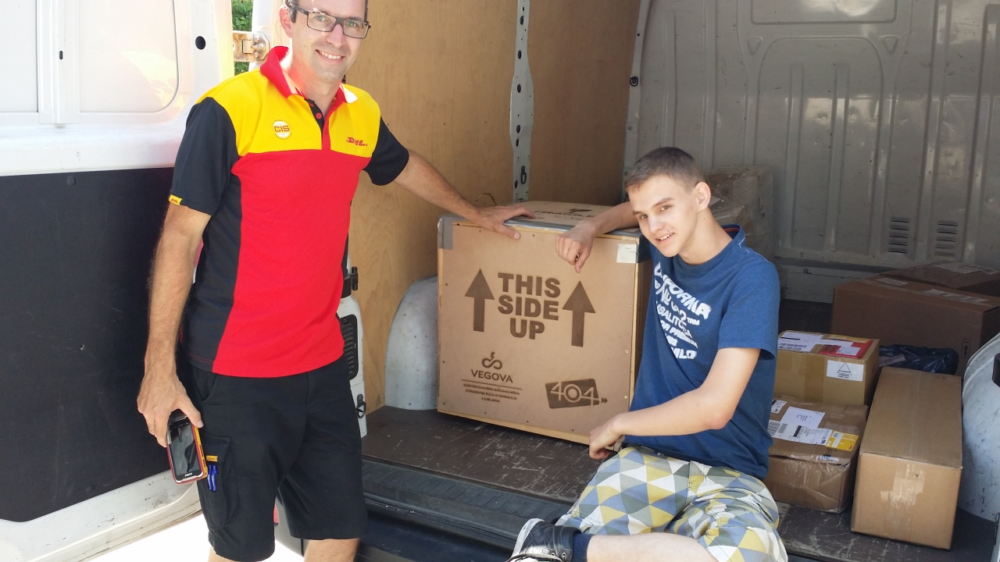
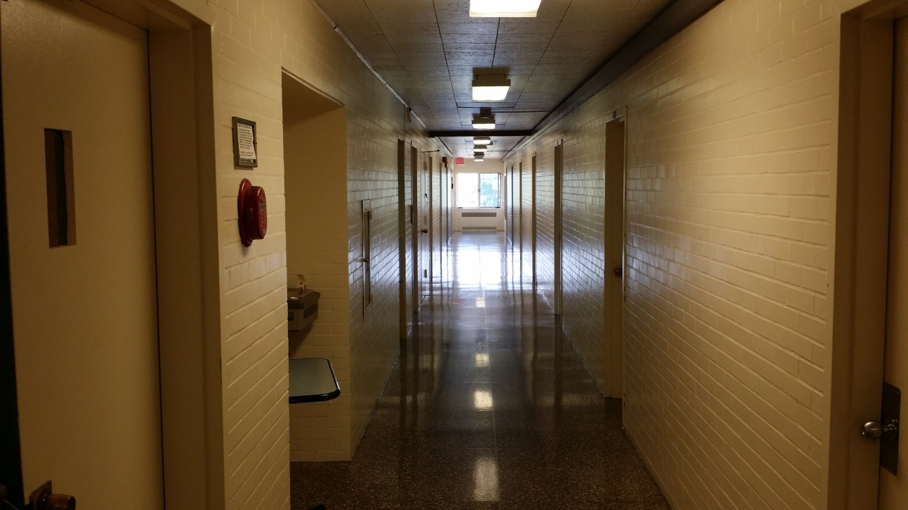

_The FIRST Global Challenge 2017 would probably have passed unnoticed by all eyes and ears, had the American administration not blocked visas for the team from Afghanistan, made up entirely of girls, and for the team from the Gambia. The news was carried by every major news outlet in the world and so drew attention to the fact that such a competition existed at all. The visas were granted only after the intervention of the American President, Donald Trump, who reportedly took up the matter personally. Slovenia also took part in the competition, represented by a team consisting of David Kraševec, Luka Maček and Mark Breznik, students of Vegova Ljubljana, and one of their mentors, Aleš Volčini, who teaches technical subjects there and who wrote this short diary._

<!-- truncate -->
We landed at Dulles Airport just after a storm, during which the temperature had dropped all the way to 14 ℃. We were already running late because of random security checks in Amsterdam, yet we had to wait a further 45 minutes or so before the aeroplane was allowed to approach the terminal. True, it was still a little windy and still raining a little, and they were also wary of the static electricity that might have built up on the aeroplane during the storm, but we were nonetheless growing rather weary of our journey across the pond. After the checks and customs formalities, we went to collect our luggage and then sought out the FIRST Global representatives at the exit. There followed complications with the luggage, which went on ahead separately in its own vehicle, and a wait for transport to Thurston Hall, the meeting point for all 163 teams.

The air was stifling; it soon warmed up again to 35 ℃ and was almost completely saturated with moisture.

At last a bus came for us. A proper yellow school bus. We squeezed in. Once again there was not enough legroom, as these buses are meant for primary school children. The drive to the centre took almost an hour. David remarked that he had never imagined he would ride in such a bus. Makes two of us.

There was considerable confusion at the centre, and we still had to find our robot, which had arrived by DHL four days earlier. At registration we were told that we would be sent to another location, Trinity Washington University. We were somewhat disappointed, as this meant being rather far from the sights we had hoped to see in the evenings, and on top of that there were no shops nearby. But it soon became clear that this was the lesser problem. Our robot, you see, was nowhere to be found. After much enquiring and some panic, we were reassured that the robot would be waiting for us the next day at DAR Constitution Hall, where the preparations and the competition would take place. Right.

At about nine in the evening, the bus took us to Trinity, where Karl was waiting for us. When he asked who wished to go up to their rooms first, we leapt at the chance, and so he handed the keys to us first. As the mentor, I was given room 506, Mark his own room 504, and Luka and David a shared room 503. Every room had two beds. We went up in a lift that looked old and worn out, but travelled between floors very quickly.

The first surprise came immediately upon arriving on the fifth floor (or rather the fourth, as Americans count the ground floor as the first). I unlock the door and step into the room. I am hit by cold but stale, unpleasantly sourish air. The air conditioning was running, yet the air could not have been stuffier. Someone knocks at the door. I open it, and there stands Mark.

‘There’s already someone in my room.’

‘What?’

‘There are three of them in there, two on the beds and one on the floor.’

Amusing. I take a look, and indeed, the room was already occupied. Just great.

‘If you don’t mind, you can move into my room. There are two beds in there. Or we could go and see Karl first.’

So we went to see Karl first. Karl was terribly surprised, as he had apparently not given the keys to 504 to anyone. We then agreed that Mark and I would share a room and that we would sort out the rest the following day. Okay.

We returned to the room and first opened the windows. Air with a strange smell was still blowing from the air conditioning, so we thought it best to switch it off. The microflora on it did not exactly inspire confidence either. The furnishings probably dated from the eighties, worn but still serviceable. The door handle was typically American – a round knob that turns to open, with a lock in the middle – and did not exactly give one a sense of security. I felt as though I were in a game of Fallout. The black mattresses were practically new, and the newer chairs were half rocking chairs. The pillow was filled with some sort of air filling, but was not uncomfortable. The stale smell faded quickly: by the next day it had dropped to a bearable level, and by the end of our stay to a barely noticeable one. Or perhaps we simply got used to it...

The lavatories were combined with the showers, and there were no urinals to be seen anywhere. We later discovered that this was because we were in a girls’ hall of residence. We got used to that as well.

For supper, we ate what little food we had brought with us. We got ourselves showered and off to bed. Outside we could still hear some quarrel, and someone was saying that they would call the police. We wondered for a moment what sort of place we had landed in, but the noise soon died down and all was quiet once more. Finally.
