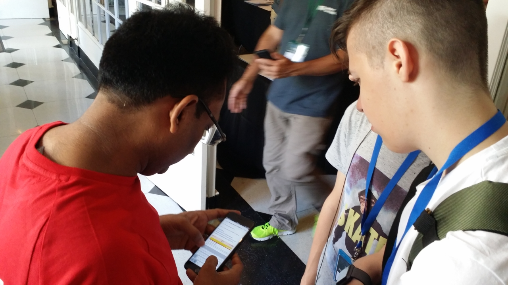
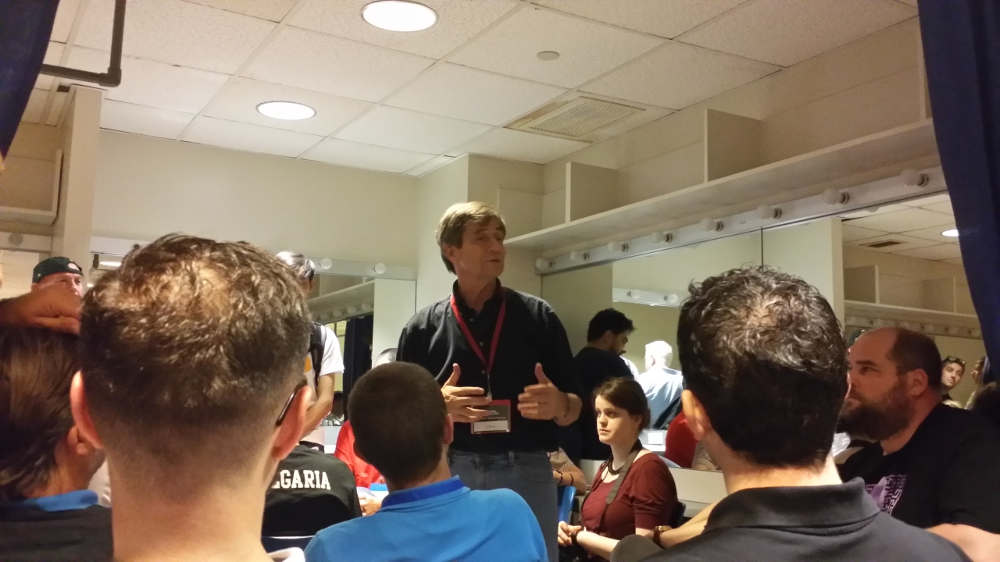
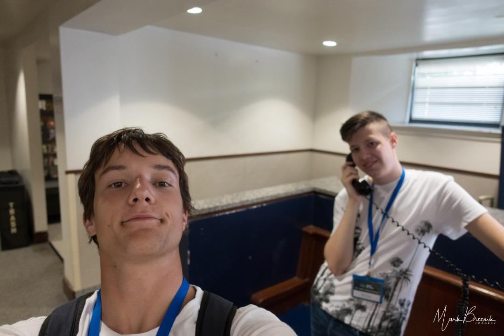

The next morning began most interestingly. Maria, who was standing in for Karl, told us that they were completely full, or rather overfull, and that mattresses were missing (probably the one from 504, on which the person on the floor had slept). She had therefore given up her own to someone and brought herself a sleeping bag, and then given that up too. Someone even had to spend the night on a sofa in the lobby downstairs.
<!-- truncate -->

They had miscalculated, forgetting that there were also girls amongst the competitors who ought to have been housed separately. They had received only names, and from names from all over the world they could not work out who belonged where. Frank, a member of the FIRST Global staff, had also spent the night in a van and was very short of sleep and in a foul mood that morning. We guessed that he was probably the very person Karl had been quarrelling with the previous evening, as he should have had a room to himself.

Naturally, the first thing to do was to ask Frank whether they had found our robot. The answer was that it was probably waiting for us at DAR Hall, or else Tom from the repair station would help us build a new one. Right.

Before the bus arrived, Mark and Luka set off to the nearby delicatessen to do some shopping, but came straight back empty-handed, as it did not open until eight o’clock, an hour later.

The bus came for us and took us to DAR Constitution Hall, the venue for the preparations and the matches.

The preparation areas were on the ground floor around the central concert hall and in the basement, and the teams were very unevenly distributed. The basement, with a much smaller floor area than the ground floor, held almost half of the teams, and there was literally not a single free square metre, except by the nearby repair station. The lighting was of candle strength, and every two teams shared one table with a single chair.

The crush was indescribable, with people searching for their robots, which had been brought there separately from the teams. Most teams found theirs quickly; only a few unfortunates, ourselves amongst them, did not. Ukraine had not managed to get theirs to the USA, because the airline had failed to transfer it in time during a change of flights, and it arrived only the following day; two teams had lost theirs on the way; and ours, which we had sent to Thurston Hall by DHL, was nowhere to be seen either. The team from Bahrain arrived a day late, but their robot was soon found. They were rather less pleased when they discovered that they had been given accommodation in the same place as us, but that there was no room left there and they would have to find private lodgings.

After an hour of searching, we enlisted the help of a few more volunteers and staff, but to no avail. We were greatly helped by Mr Gagan, a member of the Indian team, who for some reason was very well informed about whom to turn to. Frank and the others also tried to help, but to little effect. Someone from the repair station recalled having seen the box, but Mark rightly suspected that they had merely seen it in the video we had posted on YouTube. After lunch – a sandwich and crisps – by about one o’clock we were beginning to despair of ever seeing the robot again.

In the morning, from eight until eleven, there had also been a meeting of the mentors with the director, Joe Sestak, at which Joe, a former congressman and naval officer, explained how they had achieved such worldwide participation, shared a few anecdotes about how the military can only stop a conflict but cannot resolve it, and told us what they intended to do with the competition in future. Someone mentioned how the story of the Afghan girls had caused a great stir amongst the public and had unwittingly given the event a great deal of publicity, particularly after the American President had reportedly taken up the matter of the visas personally. Joe said that the staff who issue visas are duty-bound to assume that an applicant wishes to stay in the USA for ever, and the applicant must prove otherwise. All of the registered teams had obtained entry permits or visas, including the teams from Afghanistan, Burundi and the Gambia.

After the meeting, at eleven o’clock, I also caught Liz, who promised to help us look for our robot.

By two o’clock there was still no news, so we decided to take matters into our own hands. Mark and David set off for Thurston Hall to check the situation on the spot, whilst Luka and I waited at DAR Hall. Three quarters of an hour later, a text message arrived from Mark saying that they had not found the robot, but that they had news. Cliffhanger.

Luka and I speculated: they had not found the robot, but they had news. What news? They probably knew at least that it had arrived. Perhaps even what had become of it. Or whether someone had seen it... Mark had probably deliberately not said what the news was, so it was probably good. He had left us in suspense on purpose. Cheeky.

Mark and David returned. When they had asked about the parcel at Thurston Hall, they were very nearly sent away. There was a group of security guards there. One of the guards almost turned them away, but another guard, who had an inkling of what had happened, rang someone from the administration of George Washington University (to which Thurston Hall belongs) from a nearby telephone box. The kind lady at the other end told Mark that all deliveries were sent to the university’s post centre, two blocks away, which was currently closed. It would open on Monday morning. Great.

Clearly, the day was lost for us. We informed Frank that we would make our own way back to Trinity, since there was nothing we could do today, and that we would rather go and look around a little. We went to Thurston Hall to thank the guard in person, but he was no longer there. Too bad.

An hour later an e-mail arrives: during their conversation, the lady from the administration had put Mark on hold three times and in the meantime contacted the organisers, and now the director, Joe, had sent word that the robot would be delivered to DAR in the evening. Thank you, Jake and Joe. Yay.

Mark proved most resourceful and quickly discovered that Lyft was not at all expensive in Washington, so we decided to try using it to get back to our hall of residence at Trinity University. Our first Lyft ride went off without a hitch. Chatting with the driver, we discovered that he knew of Slovenia and correctly placed it south of Austria, near Trieste. When we asked him what was worth seeing in Washington, he listed a few of the usual places, but also mentioned the Basilica of the National Shrine of the Immaculate Conception and knew that Slovenia had its own altar there. He praised the First Lady and said that the USA had never had such a beautiful First Lady. Melania had clearly put Slovenia firmly on the map, as during our stay nobody asked us where, or even what, Slovenia was. Nice.

At the hall of residence we freshened up a little and then set off on foot to the Giant shopping centre, 4 km away. We walked amongst typically American terraced houses, narrow and two storeys high, with a little patch of lawn in front of the door, and wondered just how safe it was to stroll about there. But nobody bothered us, and along the way we saw the odd unroadworthy vintage car on the lawns in front of the houses, a primary school, an ice-cream van with its characteristic barrel-organ music and more besides. Interesting.

At the shopping centre we bought some drinks (the tap water was heavily chlorinated, and even the bottled water had a suspicious taste – for some reason it had added minerals, or ‘minerals’), some sliced bread, jam and peanut butter. I was slightly irritated that we had bought nothing interesting to eat, so I bought a blueberry pie and some sliced cold meats. Luka bought instant noodles, even though we did not yet know where we would get hot water, or proper drinking water. We took a Lyft back as well. The meat went very quickly, but for the next two days nobody would so much as try the blueberry pie, and it was very good. Youth these days..

We had lost practically the whole day, but at least we looked to the morrow with optimism.
