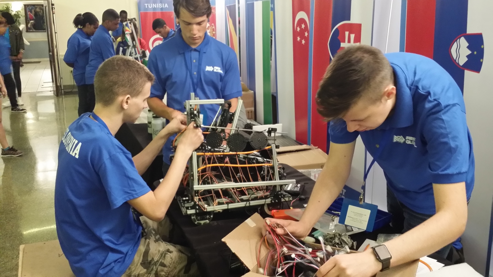
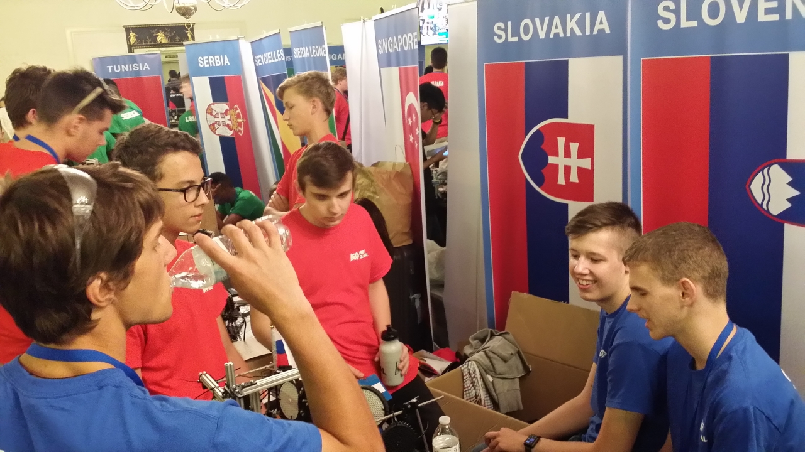
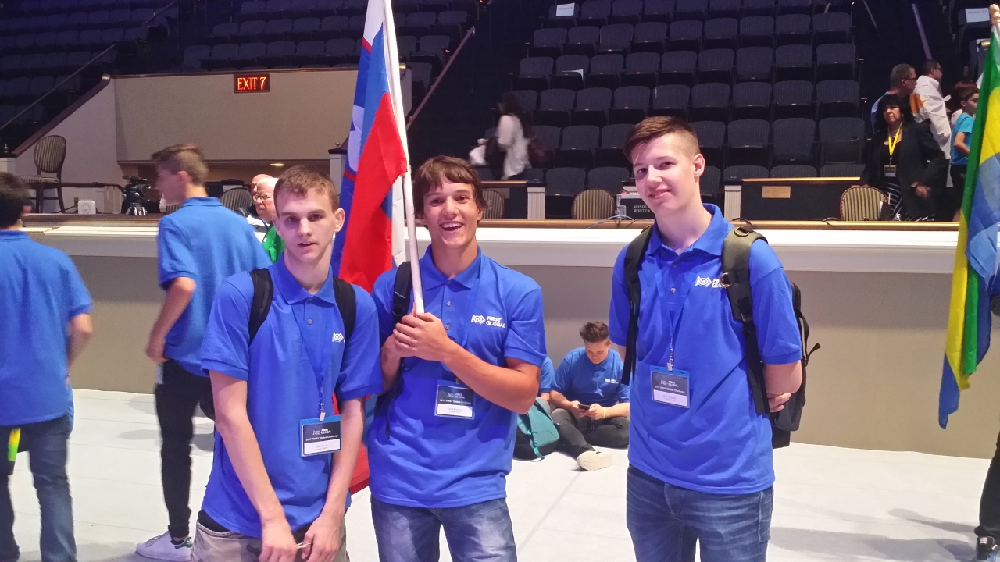

For breakfast: toast, jam and peanut butter, along with all manner of proverbially unhealthy sugary drinks. At a quarter to seven, buses took us to DAR. The robot was still not there, but we were told to wait, as it would be brought along shortly. Another surprise awaited us, however. During the night, some of the teams had been moved elsewhere, and unlike the previous day, one could now actually move without treading on anybody’s toes. They had also managed to switch on two chandeliers, and so it was possible to work normally.
<!-- truncate -->

By noon the robot had still not appeared; apparently it was at Thurston Hall. Once again we decided to go and fetch it ourselves, as otherwise another day would go to pot. Mark and Luka set off with Tom to Thurston Hall, 1 km away, to carry it back on foot. Brave.

Just when the trio had probably arrived there, someone came to tell me that the robot was waiting for us upstairs. I ran up the stairs and, sure enough, our box was waiting for us in front of the entrance to DAR. I let Mark know that the robot was now here and that they could come back, whilst David and I carried the box to the repair station to open it there. But it turned out that Tom had taken the only cordless drill with him, so David and I were left to undo 10 cm screws with screwdrivers and multi-tools. It was very slow going, and together with another volunteer we had managed to undo half the screws by the time Mark, Luka and Tom returned. With the drill, the rest went considerably faster. Yay.

We carried the box to our spot and assembled the robot, which had been taken apart just enough to be ready for safe transport. After testing, we took it for inspection, and there things became a little complicated. Between the controller and the expansion unit we had used a USB connection, as we simply could not get the RS-485 connection to work. The inspectors insisted that we switch to RS-485, and together we then established that the connection really did not work at all. The solution was to replace the control unit, and I perhaps made a mistake in not also demanding, for the sake of reliability, that the expansion unit and all the cables be replaced as well. A clean cut, as it were. As time was truly pressing, we replaced only the control unit. The program had to be loaded onto the replacement unit again (we had come prepared and had a backup copy), and we had to configure afresh which motor and which sensor was on which port. The procedure sounds simple, but not with the software available. Fortunately, Mark had armed himself exceedingly well with iGadgets, and together with Luka he gave his all, so that literally a few seconds before the last possible practice slot scheduled for our team, we had the robot in working order. Or so we thought, for every now and then there were minor technical problems with the connections. Neither the staff nor we attached much importance to this, as there were a good many wireless access points in the vicinity and it was happening to others from time to time as well. Mistake.

Over the following hours we made various further improvements, as the robot had changed its dimensions slightly in transit. In the meantime there were two dress rehearsals of the opening ceremony, in which the competitors came onto the stage with their national flags. That others, too, have trouble telling Slovenia and Slovakia apart was discovered during the rehearsal by the Slovak team, who, when the volunteer sending teams onto the stage asked ‘Slovenia?’, at first answered in the affirmative. Funny.

By the end of the day we had also noticed that the connection between the tablet and the robot was dropping out ever more often, and we prophetically concluded that this would yet prove a problem.

There followed the official opening ceremony, which was also streamed online. Amongst the speakers were the president, Joe Sestak, and the founder, Dean Kamen. That Dean Kamen, who some years ago introduced the world to the two-wheeled Segway. As the speaker meant to inspire the assembled secondary school students, they invited, in true American fashion, the man deemed most fitting: a one-time South Korean immigrant, now President of the World Bank, Jim Yong Kim. Once the ceremony was over, the names of the teams who were to wait at the venue appeared on the screen, as they would be visited by diplomatic representatives of their countries. Representatives of most countries came, but we waited in vain for the Slovenian one, even though we drew a great deal of attention to ourselves with our flag.

We returned to the hall of residence. We took stock of the situation, pleased that we had got hold of the robot at all, but worried about the dropping connection. For supper we decided to go out for a pizza and found a Domino’s Pizza nearby, but it turned out that there one could only get it to take away. Fortunately there was a Subway right next door, where they made us sandwiches that were not exactly cheap, but large and good nonetheless. Before we had even finished eating, it had grown thoroughly dark, and when we went to the Seven Eleven two doors down, there were already a few unfortunates there begging for change for a sandwich or something else. I gave one woman five dollars, entirely overlooking the fact that there were several people there in the same predicament. I felt a little uneasy, as the shops were rather isolated, but the sight of two police officers in the shop put my mind at rest. We bought a few more things for breakfast, ordered a Lyft and drove home from outside the shop. The driver was friendly and talkative; she told us that she was working overtime and would therefore miss the first episode of the new season of Game of Thrones, but that she would manage.
