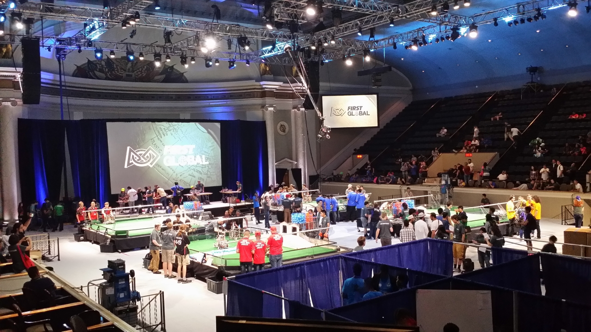

The morning rush hour lengthened our journey by almost 20 minutes. This time it did not pass without some hooting of horns and forcing of right of way, but fortunately no harm was done.

The first day of the official competition greeted us with four matches, in each of which we were in a different alliance.

<!-- truncate -->

The first match was far from what we had planned. After about 20 seconds the connection dropped, and the boys worked feverishly to restore it before the end of the match. Unsuccessfully.

We played the second match normally.

The third match was a shining example of a blessing in disguise. Soon after the start, the connection dropped, immediately after we had bumped into an opponent’s robot, inadvertently knocking out its battery and disabling it completely. Our robot, however, instead of stopping safely when the connection dropped, shot forward, wedged itself under the bridge and completely blocked the balls coming out underneath. Meanwhile, the rest of our alliance diligently cleared whatever balls were left on the field; no new balls came out, and before the end of the match we managed to restore the connection, but did not have time to hang the robot on the barrier (part of the game, worth 20 points), as it soon dropped out again. Nevertheless, we beat our opponents by a single point. Despite the mishap, the Dutch were terribly pleased, as they already had one defeat behind them. High five.

The manner in which the connection dropped surprised the technical support staff and aroused their interest, as the robot ought to have stopped unconditionally upon losing its connection. This pointed to a serious problem with the equipment. One of the technical support volunteers suggested that we relocate the control unit, claiming that the cables were dragging along the field and causing the dropouts. We found this a little odd, as we had never had these problems at home, but we decided to remount it all the same. During the remounting, someone managed to tear the wire of the power cable to the expansion unit. I could not understand how this had happened despite careful handling, and on reflection I concluded that the cable had already been cracked since the morning we had replaced the control unit, and that only the heat-shrink insulation had been holding it together in contact. We replaced all the power cables, and after that the connection dropped out no more. In the next match, however, we were still treated to an interesting sequel of technical problems.

In the fourth match it emerged that the problem now lay with the gamepad as well, which was likewise losing its connection. It was particularly strange to see the tablet showing the gamepad as connected when it was more than obvious that it was not. Luka filmed it on the telephone, just in case. After the match, we managed to reproduce the problem in front of the technical support staff, who were visibly surprised by it. They then gave us a new gamepad, corrected a few lines of our code on account of ‘known’ bugs and stabilised its operation with some service program. We stayed at the venue until almost eight in the evening, by which time practically only the security guards remained in the hall, but at least the problems had somehow disappeared. Finally.

As by eight o’clock the bus had long since departed, we made our own arrangements and first went to a Pizza Hut, where each of us ordered a pizza. To Slovenian tastes they were nothing special, but the choice of toppings was rather large. Luka, Mark and David got their pizzas, but mine was running a little late, even though the pizza maker appeared to have nothing to do after three pizzas. Someone remarked that in my place they would already have complained, but I was in no hurry. When the others had almost finished eating, I merely asked whether my order would be ready soon. The pizza maker said he would look into something, disappeared somewhere into the back (it later turned out that he had gone to check the order), came back, apologised, told me it would take 10 minutes, offered me a 2-litre bottle of a drink of my choice and threw in no fewer than six cups. I accepted the offer once he had assured me that it would not come out of his own pocket. The boys were surprised, and I was terribly clever and pleased with myself for having proved that patience, too, can get you somewhere. A few slices of pizza were left over, so we took them with us, along with two of the cups. Outside it was already pitch dark. Sleepy.

Before we collapsed into bed, we also discovered that someone had swapped the signs for the gentlemen’s and ladies’ lavatories. Very funny.
