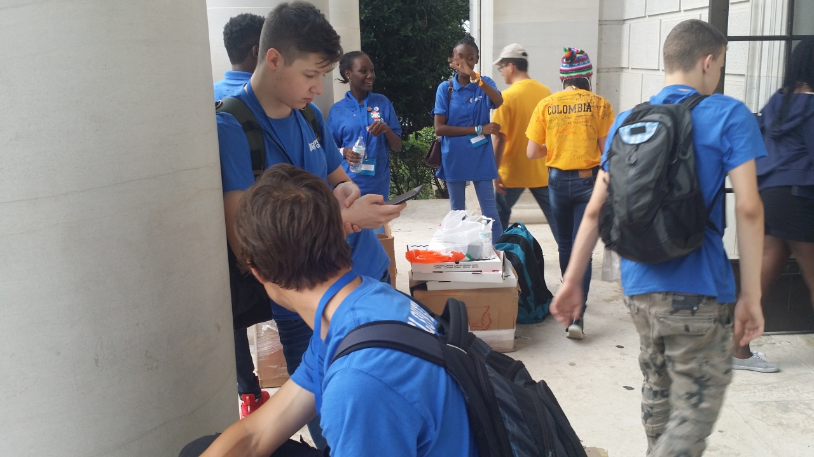

The morning rush once again lengthened our journey to the competition venue, but it was not too bad. Two more matches awaited us that day, and we made a few more minor repairs to the robot.
<!-- truncate -->

After our fifth match, which, unlike the others, we were at last able to play without technical problems, we took a little stroll around DAR Constitution Hall, had our photographs taken in front of the Washington Monument, the American Red Cross and the White House, and had a look around the immediate vicinity. Helicopters circled overhead, police were everywhere, and every now and then an aeroplane would come in through the no-fly zone to land at the nearby Ronald Reagan Airport. A storm was brewing, so we hurried back a little.

The sixth match was very exciting, and things were looking very good. A minor complication arose at the end when the robot was hanging: the hook gave way slightly and caught the edge by a hair’s breadth. Luka warned the others that nobody was to touch anything, but sure enough someone from the alliance leaned on the barrier, moved it and thereby pushed the robot off for good. Oh well.

With the sixth and final match behind us, the boys sat there as though someone had switched them off, and one could practically see the adrenaline ebbing away.

In the afternoon came the closing ceremony, at which awards were presented in several categories. The top prize in the main category went to the team representing Europe, the second prize was awarded to Poland, and as for the third, we had lost interest by then. Our team finished in 78th place. We took some consolation in the fact that Albania, Lesotho, Tanzania, Turkmenistan, Kyrgyzstan... and also France, Belgium, the Netherlands, Russia, the UK, the USA and Canada finished behind us.

We carefully packed up the robot and carried it out to the entrance. I asked the Slovaks what they would be doing the next day, and they said they had been invited to lunch at the Slovak embassy.

The bus soon arrived and took us back to the hall of residence for our penultimate night. For supper, the boys went to the nearby delicatessen, whilst I finished off the blueberry pie.
