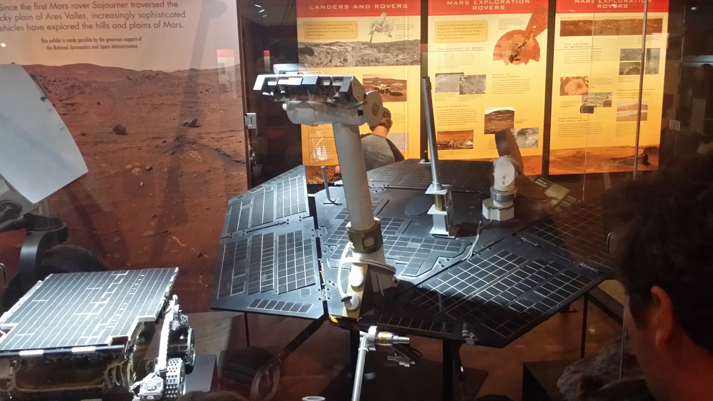
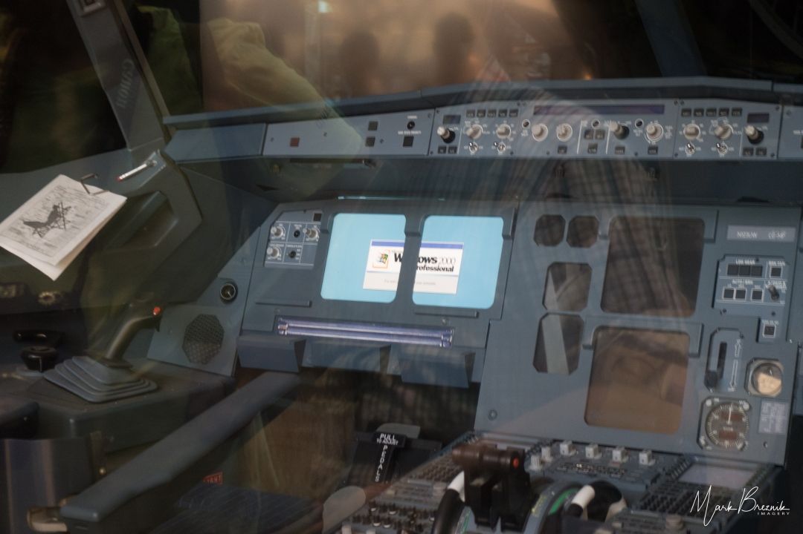
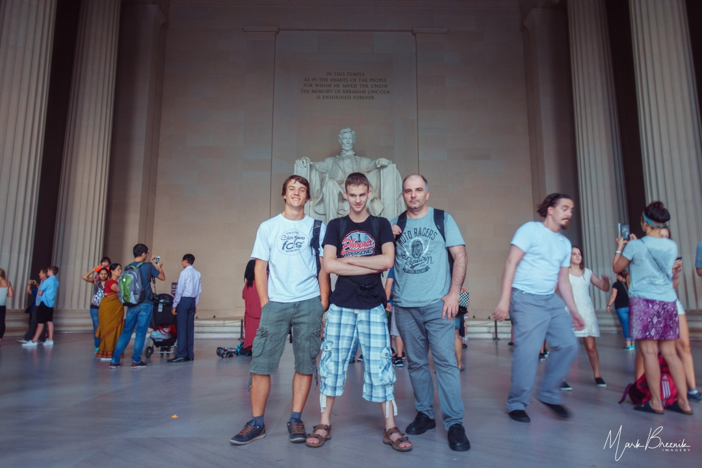

At last we had a day off, so despite time being precious, we stretched our sleep out until half past nine. At six in the morning I noticed that our floor now had only ladies’ lavatories. Very funny again.
<!-- truncate -->

Curiously, we never once saw who looked after our rooms. Every morning they were spotless and freshly cleaned, with the wastepaper basket emptied. Even the lift, which broke down once or twice, was always soon running again.

At about eight o’clock I heard voices below and looked out of the window. Two police cars were parked outside the entrance; two officers were talking to our warden and drove off soon afterwards. Partly out of boredom and partly out of curiosity, I took a stroll around our floor, examined the furnishings and found a second lift. Some teams were already leaving that day, and two rooms stood open and in disarray, as though someone had left very carelessly and in a great hurry. Messy.

When we had all finally got up, the boys went to the nearby delicatessen for breakfast whilst I waited in the room. After breakfast we set off for the Smithsonian’s National Air and Space Museum. We arrived there at about half past eleven. Admission was free, but at the entrance we were searched as though we were boarding an aeroplane at the very least. As there was no entrance fee, we could more easily afford a snack at the museum’s McDonald’s at three o’clock. We also browsed the souvenirs, but left our purchases until the end, when we would know everything on offer. What a mistakea to makea.

We had set aside two hours for the visit, but the museum’s closing at half past five in the evening came so suddenly that we did not manage to buy a single souvenir. To be fair, there had been an announcement over the loudspeakers 15 minutes earlier that something was closing, but we ignored it, as it mentioned only the gallery we were looking round at the time. In practice, however, at half past five they herded all the visitors out, cowboy-style. Even the souvenir shop was out of bounds. How rude.

We headed towards the city centre, but when we got there, apart from shops at the sight of which one’s purse simply shrank, there was nothing special to see. Apparently the lighting there is very artistic in the evening. As there was no point in waiting for evening, we ordered a Lyft and went to see the Lincoln Memorial, to find out whether it really is as it appears in Planet of the Apes.

We walked another kilometre or so, sat down on a bench by the river and pondered what else we might go and see. And we realised that we had not yet visited a single shopping centre. So, to round off the day, we looked round two more shops (Best Buy and Target) in a shopping centre 7 km away, where we bought a few trifles for home and for the journey.
