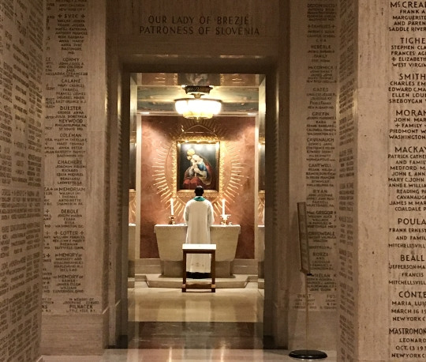

The day dawned when we had to make ready for the journey home. After breakfast we packed our luggage and had tidied our room by ten o’clock. In the meantime, word arrived from somewhere that six members of the team from Burundi, who had been staying in the same building, were missing. The police downstairs the day before and the untidy room suddenly made sense. They had apparently vanished even before the awards ceremony, and two of them had already been spotted today at the Canadian border, where they would most likely seek asylum.
<!-- truncate -->

As we still had two hours to spare, we went to see the Basilica of the National Shrine of the Immaculate Conception, which was part of the campus itself. The building is rather large, and even a cursory visit took an hour and a half. The rich decoration was marred by scaffolding, above which they are completing the central dome, due to be finished at the end of the year. The lower halls were lined with marble plaques bearing the names of donors and the purpose or person in whose memory each donation had been made. Just as we were beginning to wonder whether our first Lyft driver had confused Slovenia with Slovakia, we spotted, amongst the chapels downstairs, Mary Help of Christians from Brezje. A priest was saying Mass there just then, so we photographed her only from afar. On the way out we stopped at the souvenir shop, where David and I bought a few things for our families.

When we got back, it was a while before the bus came for us and took us to Thurston Hall, and from there another bus took us on to Dulles Airport. Using the KLM telephone app, we had checked in for our flight whilst still at the hall of residence, and so earned ourselves priority treatment at the airport. Once we had checked the robot in with the luggage and gone through the checks, there was still some time left for lunch. After it, I took a few minutes to say a few encouraging words at the end of our journey. The boys had invested an enormous amount of time in the robot; their health and their school results had suffered, and they had risked resits, yet the result was what it was. The boys needed to be told that, regardless of the result, they had done well; that I was glad the pressure had not broken their unity and that they had not fallen into conflict; that they had not let up until the very end; that they had fought like lions; that they had acquitted themselves as one should; and that I was proud of them. The reality is simply that there is only one winner, that the first loser is already second on the leaderboard, and that there is always a little politics behind the scenes. The tension visibly eased. I ought to have done that sooner.
