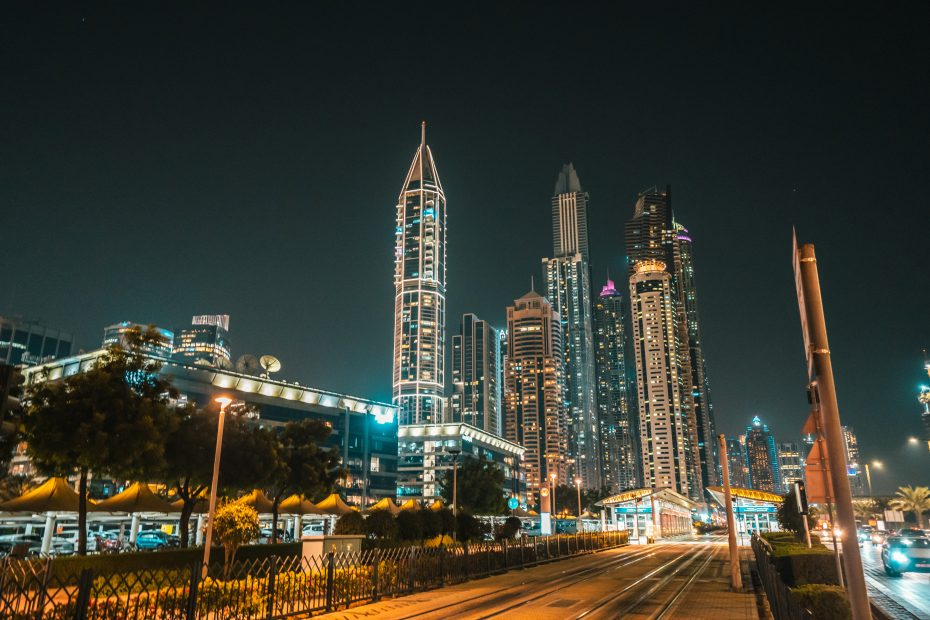
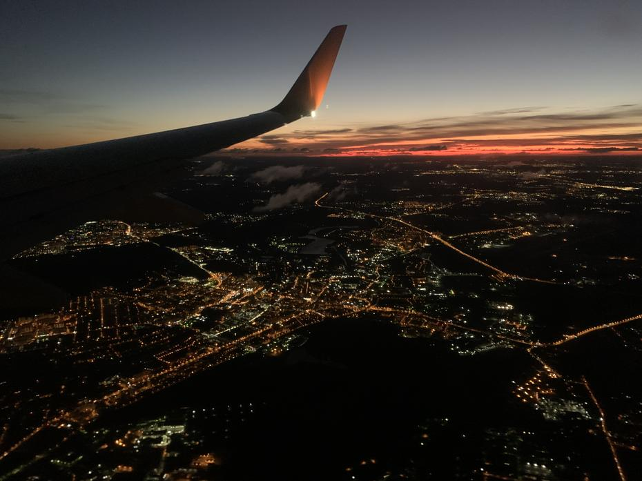
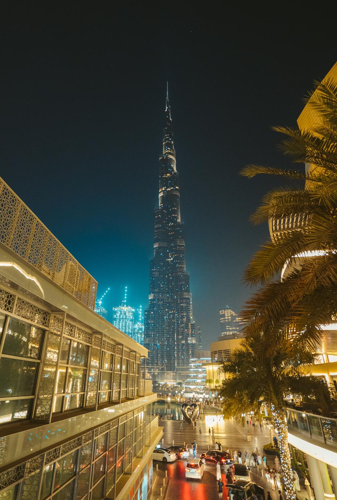
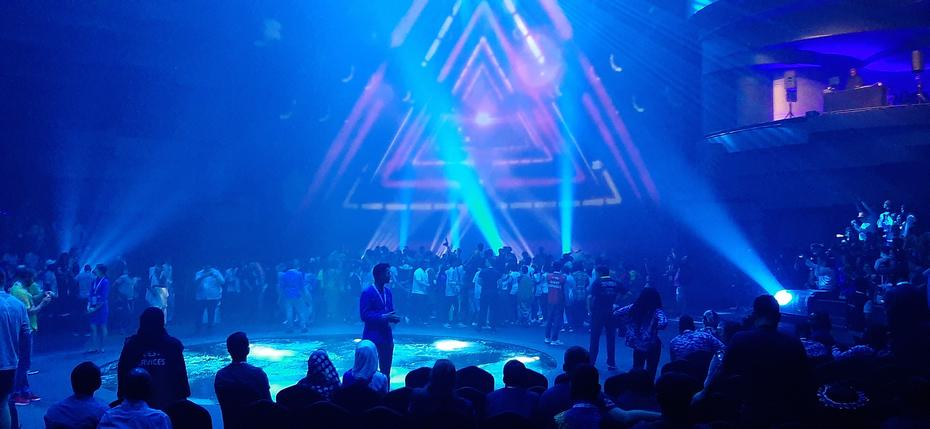

On 22 October 2019, we students of Vegova Ljubljana set off on a journey destined for the history books – or at least for the website. It took us to the city of glitter, Dubai. Despite a gruelling 11-hour flight, the Slovenian robotics team was still all smiles, full of energy and full of beans. <!-- truncate --> We were put up at the InterContinental-owned Festival City hotel, which was certainly more than just a hotel. There we met the other competitors, swapped stories over dinner and grew very close as a team. Yet Dubai is not merely a holiday destination; it is also a city of warriors – or, in our case, of students ready to show the world their knowledge and their robot’s teeth.

Every one of the competing robots was built from the same parts, as each national team had received an identical so-called ‘kit’ containing the only parts permitted for building the robot. Thus we were all on an equal footing. A team could use all of the parts, or leave some of them unused. The maximum permitted size of the robot was half a metre (in both the x and y directions). The robot was also remote-controlled, which meant that it was not allowed to operate entirely on its own (it could not carry out any task without the operator’s intervention). The rules of the game dictated that the robot must have no sharp parts, as these could damage the other competitors’ robots. The robot’s tasks were pushing, shooting and lifting balls, and a good deal more besides. Teams also had a free hand in designing part of the robot’s tasks as they saw fit. Before the competition began, the robot was checked by both a hardware inspector and a software inspector, and the two of them gave us the green light to begin the competition.

Until next time,  
lahko noč

