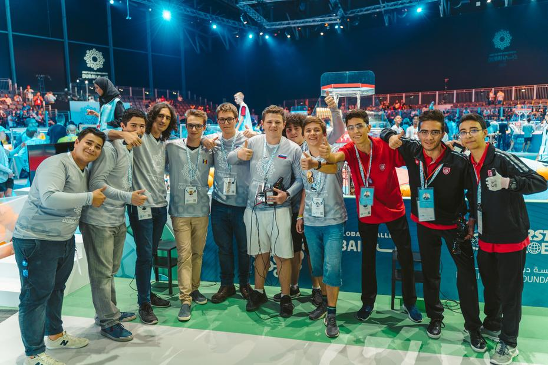
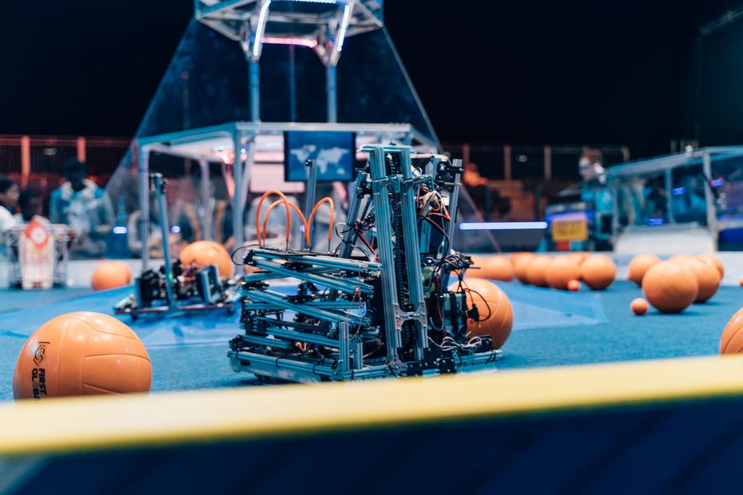
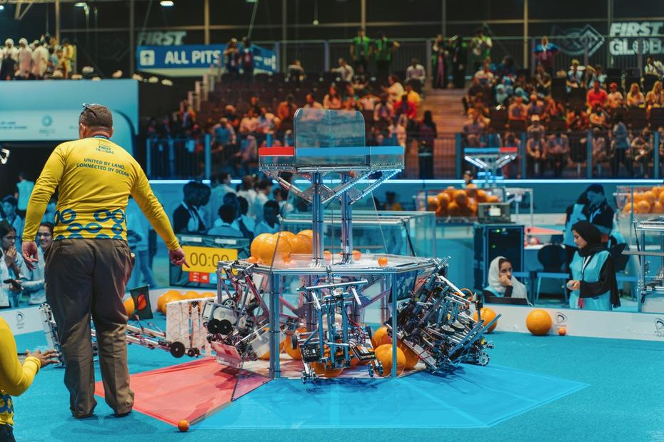
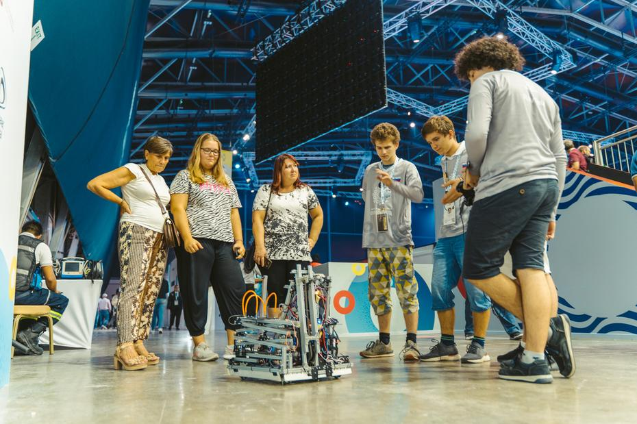
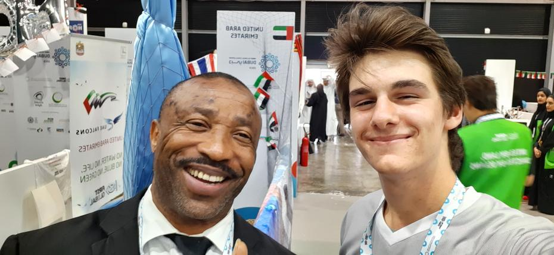

Every match took place on the same field, which was identical for our alliance and the opposing one. In the middle of the field stood a symmetrical hexagonal structure, from which a ramp rose at an angle of roughly 25 degrees. <!-- truncate --> These ramps led up to a further hexagon, which formed the first level, onto which competitors could push macro-components, i.e. large balls, or micro-components, i.e. small balls. The lower the level, the fewer points a team received for each ball. The second level of the hexagonal tower stood some 50 cm above the first. It was smaller than the first, which made the challenge harder still. Here competitors could lift or shoot balls of the desired size. Towards the end of the match, the robot could also hang from this platform, lifting itself off the ground, for which the team received bonus points. A little higher than the second level was the smallest, third level, which had a net instead of a solid floor. We dubbed the top level ‘high risk, high reward’, as the risk was high, yet it was precisely on this level that we could score the most points. We should also mention that between the two halves of the central structure there was a transparent wall, which separated the blue and red sides of the field within the hexagon. Each alliance was also assigned a corner into which it could push balls, which the so-called ‘human player’ then picked up by hand, since no human hand was allowed to touch either the robot or the balls during the match. We were not allowed to start the robots before the match began; we could start them only once the hourglass had been turned over and begun counting down two and a half minutes. Two referees were also present beside the field, who followed the play keenly and, at the end of each match, helped to prepare the field for the next contest; they were also only too happy to have their photographs taken with the competitors.

Before the qualification matches began, we also had the opportunity to play two practice matches, which suited us down to the ground, so we were all the more motivated for the more competitive contests. First match, first basket. With the help of Andorra and Tunisia, we managed to beat Kosovo, Cuba and Eritrea 82 : 64. The team was thrilled. Match number two – win number two. Alongside us on the blue alliance were the teams from the Comoros and Belarus, who helped us to a more marked points difference, no less than 135 : 81 against the red alliance. The third and last match of the first day of competition ended in defeat for the blue alliance, made up, besides ourselves, of members from neighbouring Africa, Namibia to be precise, and from distant South Korea. We kept our heads held high, as we had missed out on a win against our Asian rivals by just seven points. And so we finished the first day on a blackjack score: 2 : 1.

Until next time,  
İyi geceler

