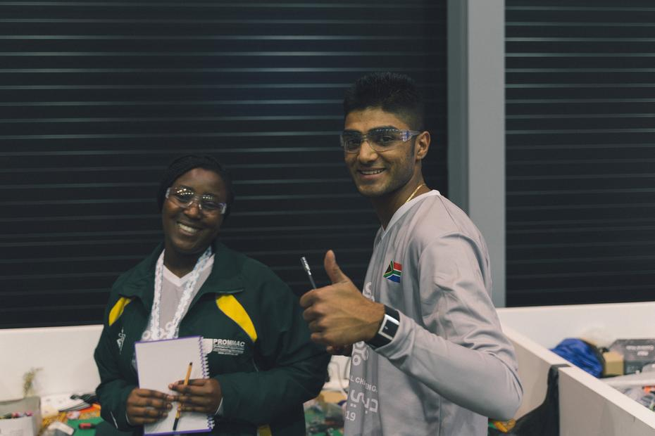
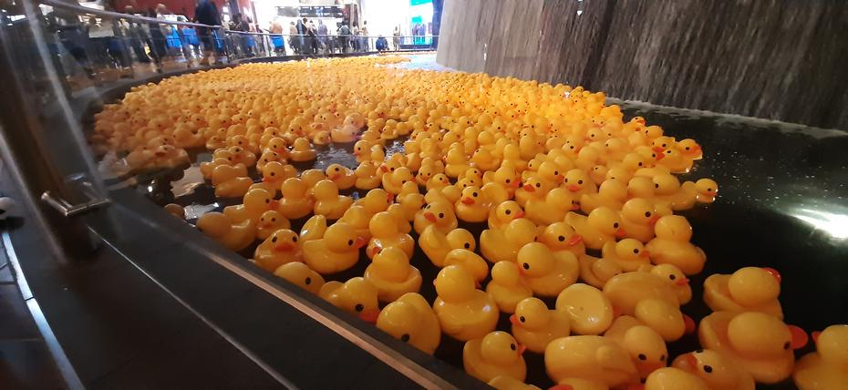

A new day, new matches! Lack of sleep did not hinder us one bit in the first contest, as, joined by the positive attitude of Guyana and Gabon, we achieved a score of 119 : 60. Our record at that point stood at 3 : 1. <!-- truncate --> After a short rest, we were already racing back to the arena with the robot in our arms, where we made friends with the Jamaicans and the Estonians. The fifth match was against Tanzania, Madagascar and the Solomon Islands. Despite all the sea around those islands, the tide still washed a win up onto our shore. 4 : 1, a fine record, but a harder time came for us too, as this time we had to march away from the table defeated. Despite the help of Bermuda and Jordan, we did not manage it, but hope dies last! 4 : 2; the team was a little downcast, but still wearing smiles. The seven Slovenian dwarfs then faced the seventh match of the qualification round, but this time seven was not our lucky number. 4 : 3. And so the second day drew to a close. Now we can only hope that tomorrow will be more successful than today.

Until next time,  
God natt

