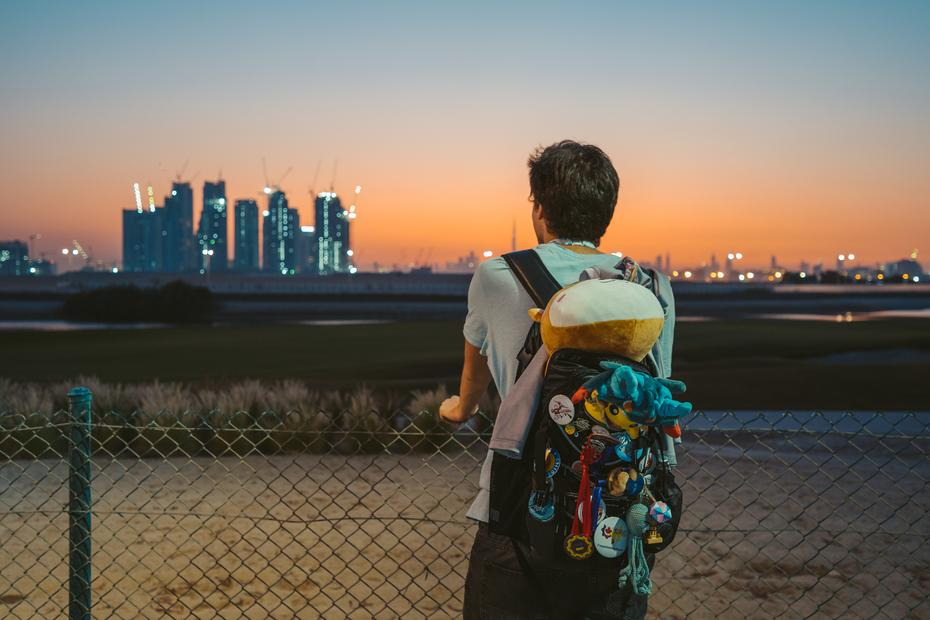
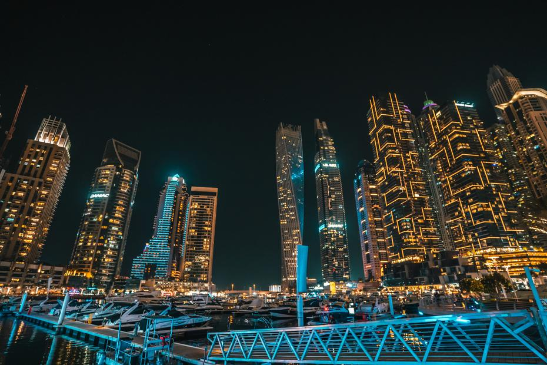
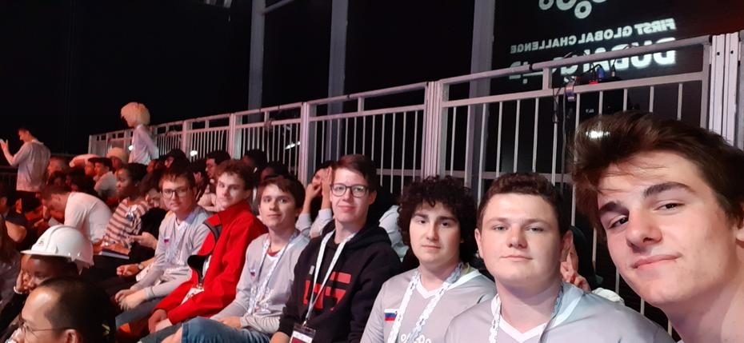
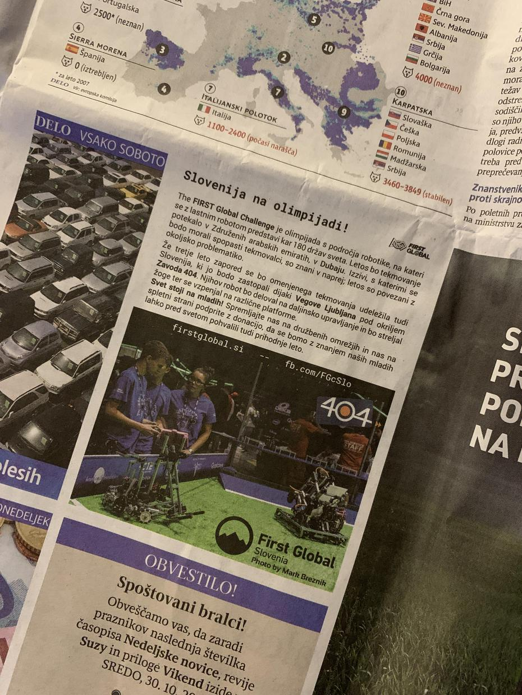

Whoopee, it is day three! Our first match of the third day dropped into our basket as a win against Peru, Brazil and Côte d’Ivoire. Djibouti and Papua New Guinea also helped us to the score of 90 : 42. <!-- truncate --> Ahead of us lay the last qualification match. Alongside us on the red alliance were Vietnam and Lithuania. Alas, our opponents were more skilful than us this time, but we still proudly shook hands with the members of the teams from Slovakia, the United Arab Emirates and Rwanda. Unfortunately, with a record of 5 : 4 we did not qualify for the final, but we did land on the edge of the top third of all competitors. We did, however, have the opportunity to watch a nail-biting final from the stands and to cheer on our friends from Venezuela.

All’s well that ends well, we told ourselves, when we were honoured with the gold medal for fundraising. A little good in something bad, and a little bad in something good! From the great city of camels, deserts and expensive cars, we returned wiser for the experience, with fond memories and newly forged friendships.

Until our next adventures,  
good night

