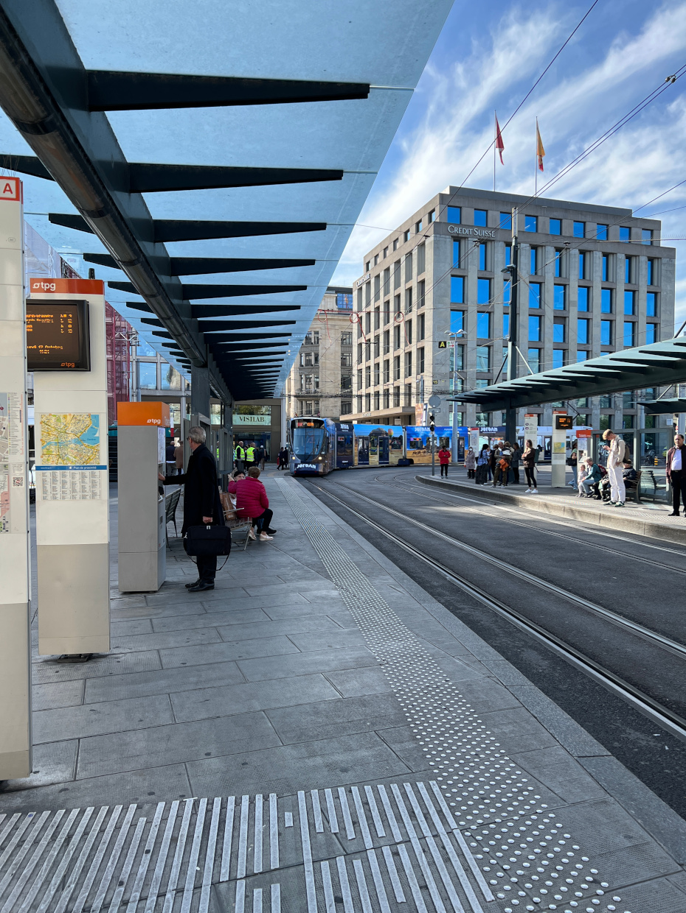
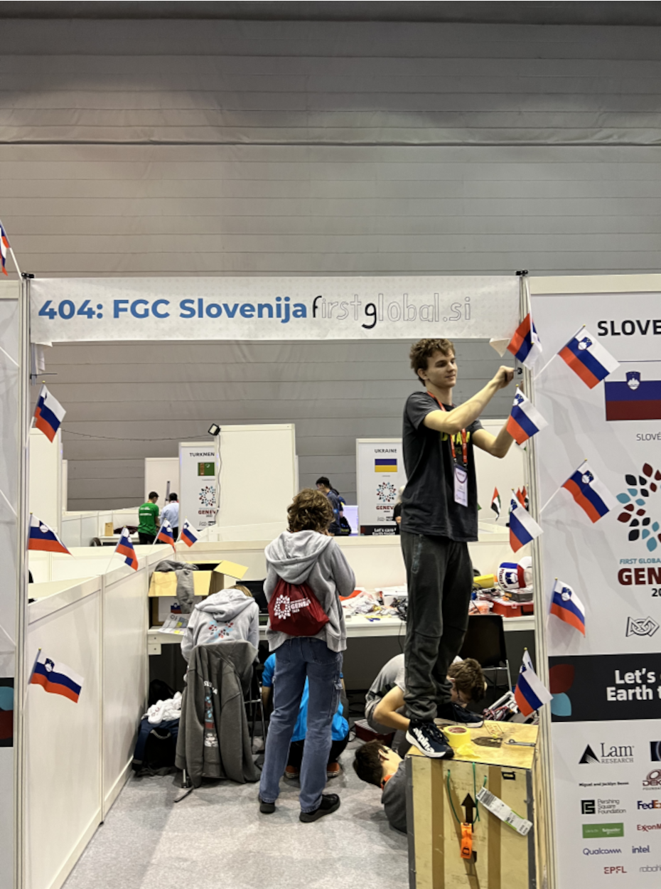
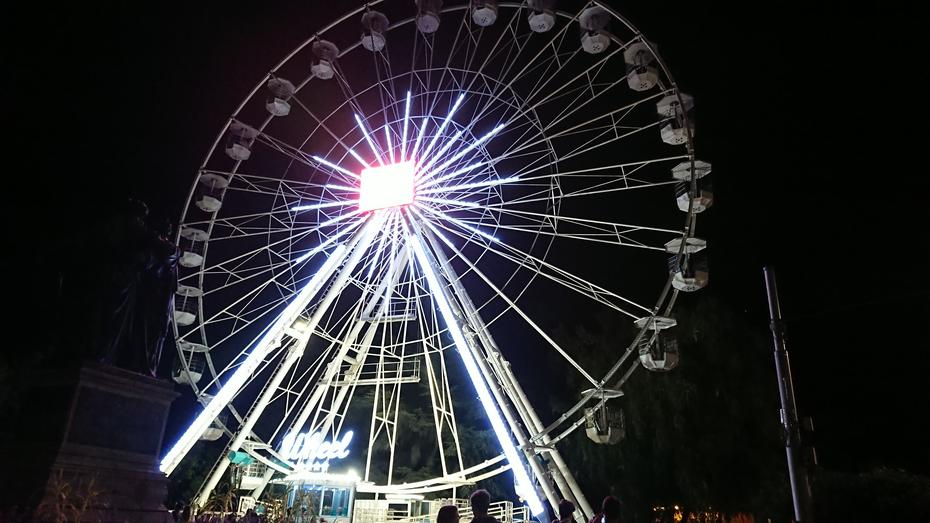
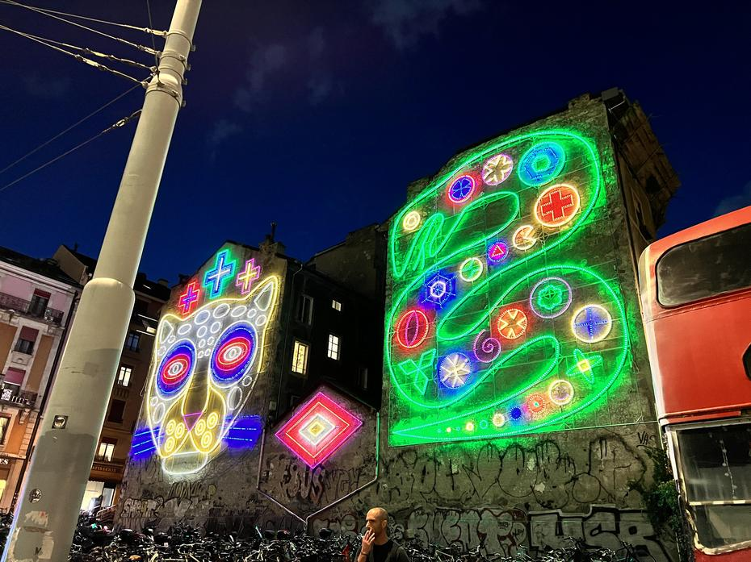
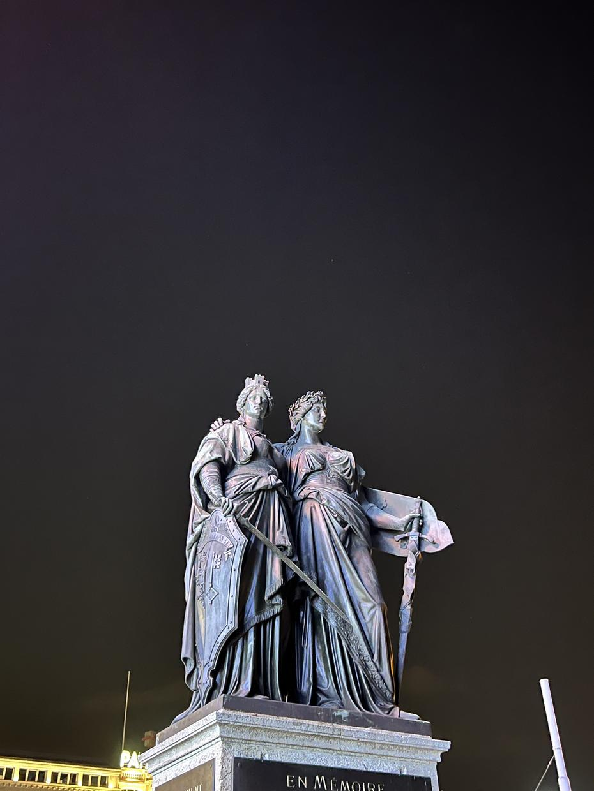

On 12 October, the quiet streets and parks of Geneva were visited by young engineering students from all over the world, our Slovenian team amongst them. The flight from Ljubljana’s Brnik airport was followed by a wait at the Paris airport, from where we soon arrived in Geneva. We had arrived the night before the arena opened, so that we could rest and finish building our robot – Baltazar. We began the day with a hearty breakfast, followed by setting up our miniature workshop, or pit. We hung up a good number of little flags, got our extension leads ready and sprang into action.
<!-- truncate -->

The opening day was enlivened by a treasure hunt not unlike bingo. Every challenge completed on the card had to be confirmed with the signature of a foreign country. Tracking down other teams that met the criteria of the challenges took us quite some time, even though Jaka was very active. Over the course of the day we met many teams – the Cayman Islands, Team Suriname, Slovakia – and also our old friends from Norway. After the preparations on the first day, we helped ourselves to lunch, which consisted of salads (goat’s cheese and walnuts win – goated), small sandwiches and apples. Dinner was on the schedule not long after lunch, which played havoc with many a stomach, but the food was as expected, so we preferred to lay in extra supplies. Although our mentor’s surname is Maček (‘tomcat’), we took the bear’s approach and stocked up, which paid off on the long walk into the city centre. Despite public transport being free, we had to resort to Shanks’s pony owing to a strike by the drivers. Fortunately, the map, together with our sense of direction, helped us reach the well-known bridge on Lake Geneva.

We crossed the swaying bridge and saw the Genev-eye, a ‘sundial’ made of flowers that actually runs on electricity, and, to round off the first part, the neighbouring water jet (the fountain). After a recalibration and some playful Cupid scenes, we made our way through the city centre, lined with luxury-brand shops, all the way to the old town. The night-time illumination made many a drinking fountain look lovely on our way to St Peter’s Cathedral, and after a rest we continued towards the Old Arsenal, where we looked at the cannons and mosaics. This was followed by a visit to a park, a viewpoint and a playground. Our last sightseeing stops were the exterior of the Athénée building and a park resembling Ljubljana’s Tivoli (albeit a two-lane version), with its monument to the Reformers. Before heading for the bus back, we took in the Place de Neuve and one of the grandest buildings in the city, opposite which stands an equestrian statue of General Dufour.

The number 3 bus took us to the Bel-Air stop, where we changed to the number 5, which quickly brought us home to the Ibis Budget hotel next to the Palexpo arena.

Until next time, lahko noč.
