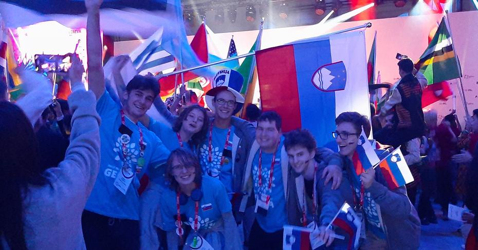
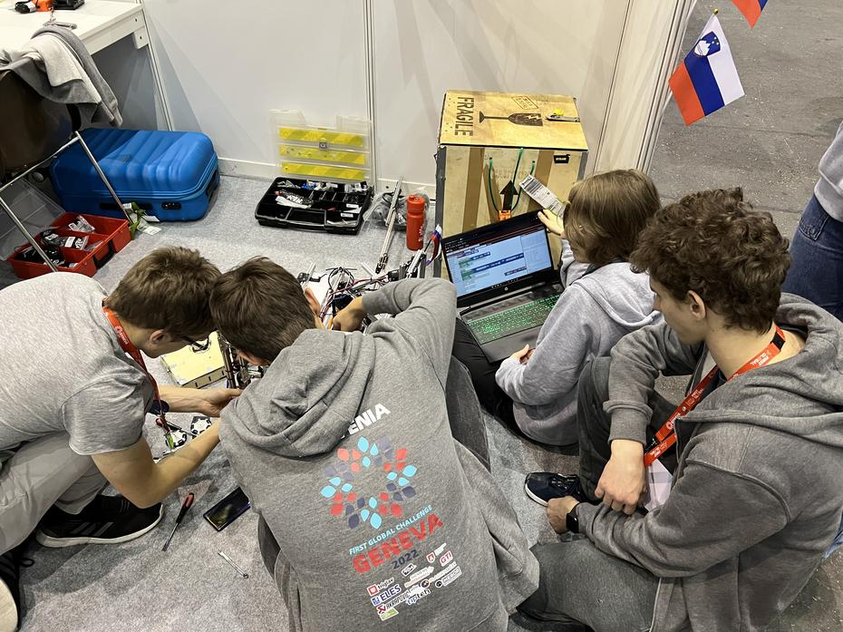
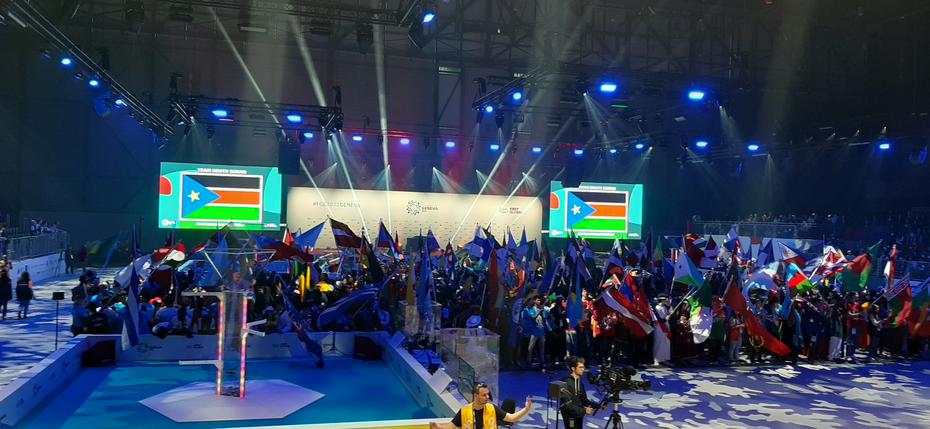
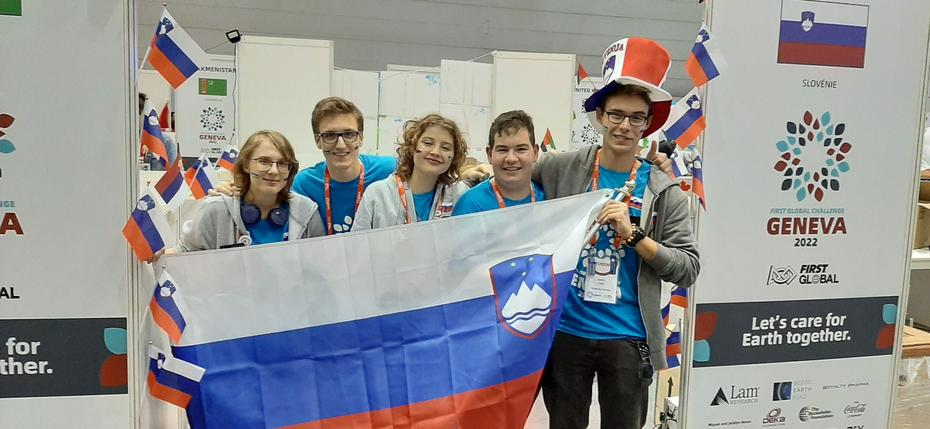

Our day of sightseeing in Geneva awakened the Swiss spirit in us and inspired us for the first matches. On 13 October we played our first practice matches and eagerly awaited the opening show.
<!-- truncate -->

Despite the superstitious date, Thursday the 13th was a pleasant day for us. We met many old friends and mentors and got to know new national teams. Although the preparations for the competition were full of positive stress, as many of the robot’s mechanisms were not on our side, we managed to rest pleasantly at every meal and to realise that we had in fact learnt something new. The results were anything but promising, as we barely scored a point owing to the unsatisfactory performance of the launching mechanism, but every time we did discover a new shortcoming in the lifting mechanism.

The day was soon over, and we went off to an early dinner (one might call it a late lunch). To the somewhat irksome musical accompaniment of Tunisia (once again), we ate our vegetables and rice and helped ourselves to pudding. We were also visited by the musician will.i.am, who gave all the participants a motivational speech. We went back to Hall 3 of the Palexpo, where we mentors had to sit in the stands and wait for our teams, who slowly paraded their flags onto the stage, each accompanied by an anecdote from the commentators. The countries lined up in several rows and waited (for quite some time) for the official opening of the FIRST Global event! We were treated to words from the founder, Dean Kamen, from representatives of companies that support the FIRST organisation and from Swiss dignitaries.

After the opening speeches, the event truly began. Onto the stage marched a gentleman who played his own arrangement of Ed Sheeran’s ‘Shape of You’ on a Swiss alphorn, milk churns and rattles. He was later joined by gentlemen waving the Swiss flag behind boys dancing breakdance. Just when we thought the festivities were coming to an end, we were treated to the customary FIRST upgrade. The lights dimmed, and onto the stage came men with illuminated drums, accompanied by boys twirling illuminated poles so as to trace the Swiss cross and the event logo as they spun. They were joined by two dancers with lights in the shape of peacock tails. After this musical overture, an (unknown) DJ took to the stage. To his music, the already weary team members were revived and began to dance, to clamber onto the stage and to enjoy themselves on the dance floor. Although some teams had already gone to their hotel rooms before it began, we marched off a little later to the hotel’s common room, where we ended the night with board games.

Until next time, ofi!
