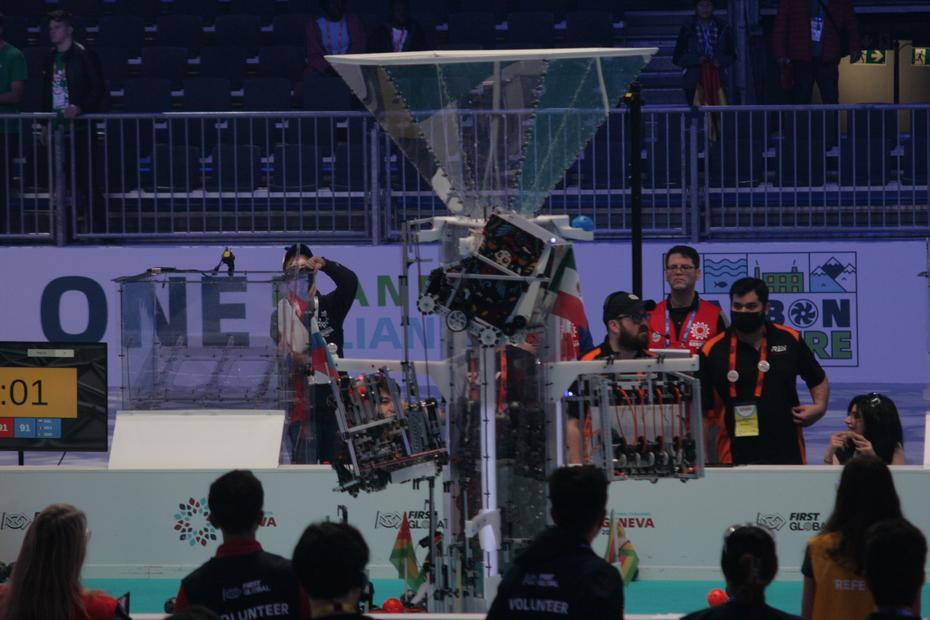
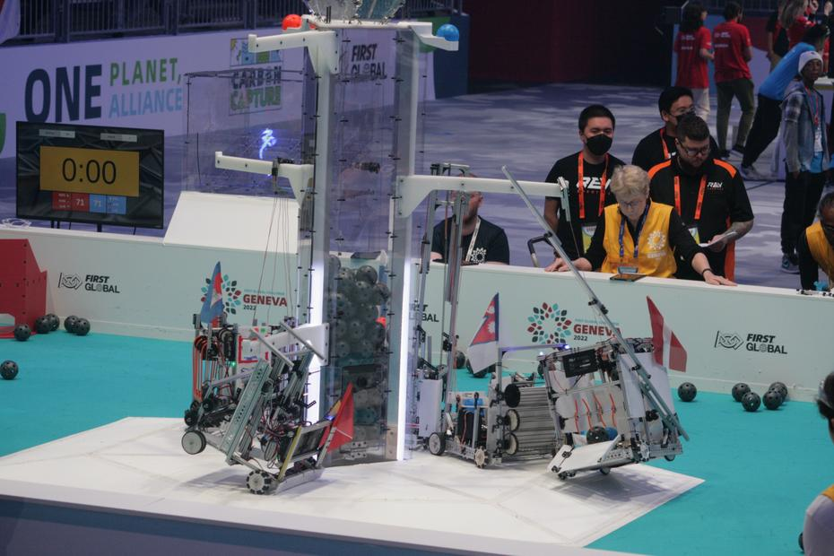
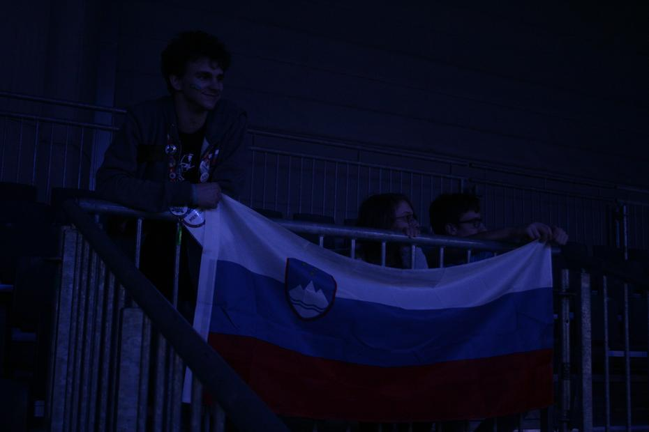
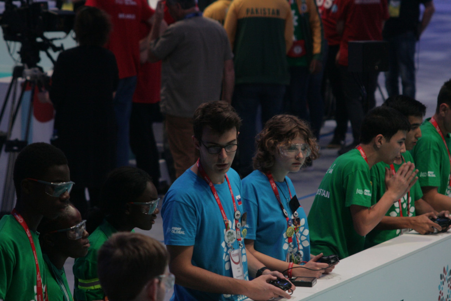
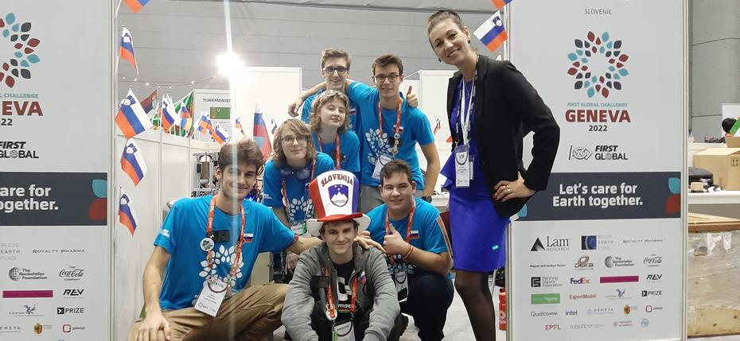

We usually associate Fridays with rest and comfort, but in the case of a world olympiad, with a considerable measure of adrenaline and positive nerves. After a championship breakfast, the sleep-deprived team set off towards the entrance of the Palexpo arena, behind which plenty of work on the robot still awaited us.
<!-- truncate -->

Whilst making repairs, we received the schedule of practice matches, three in all, which took place between nine o’clock and noon. During testing, the drive team (David, Ana, Jaka) discovered a heap of faults, which they tried to fix in every spare minute. The nerves before the first ranked matches, which count towards a team’s place on the leaderboard, grew ever worse. Fortunately, lunch, with the help of little sandwiches, salads and puddings, managed to calm us down.

The first ranked match plunged the drive team into temporary low spirits, as first defeats are the hardest to swallow. But like true Baltazars, we kept our heads held high and claimed our first win as early as the second match. Our ratio of wins to losses hovered around even, and we were rather pleased with our place on the leaderboard after the first day of competition.

Besides the competition itself, we were also fortunate on the social front. Amongst others, we met the team from Montenegro and the double of a teaching assistant from the Faculty of Computer and Information Science. We also had the pleasure of a visit from Ms Bruant Gulejová of CERN, who was interested in working with students from our secondary school. Just before the end of the day, we were visited by a crocodile who bites with jokes, Mr Michael from Florida. That evening was planned as a cultural evening, with participants coming to dinner dressed in traditional costume and performing their own dances. Sadly there was no interest of that sort, but we hope something of the kind happens next year.

Until next time, laku noć.
