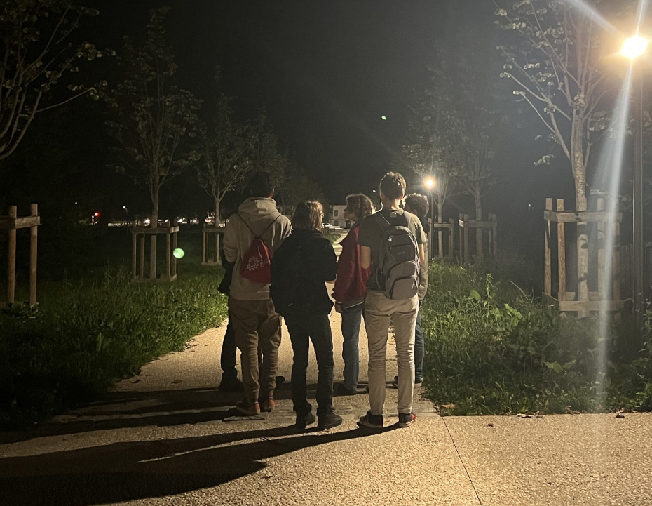
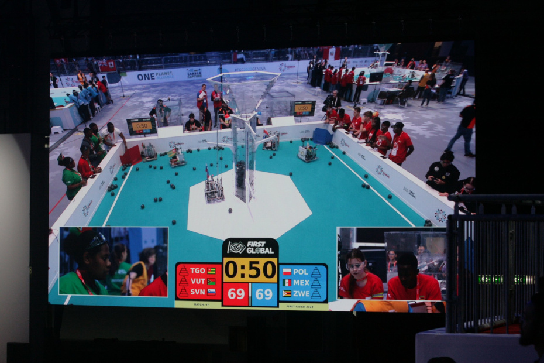
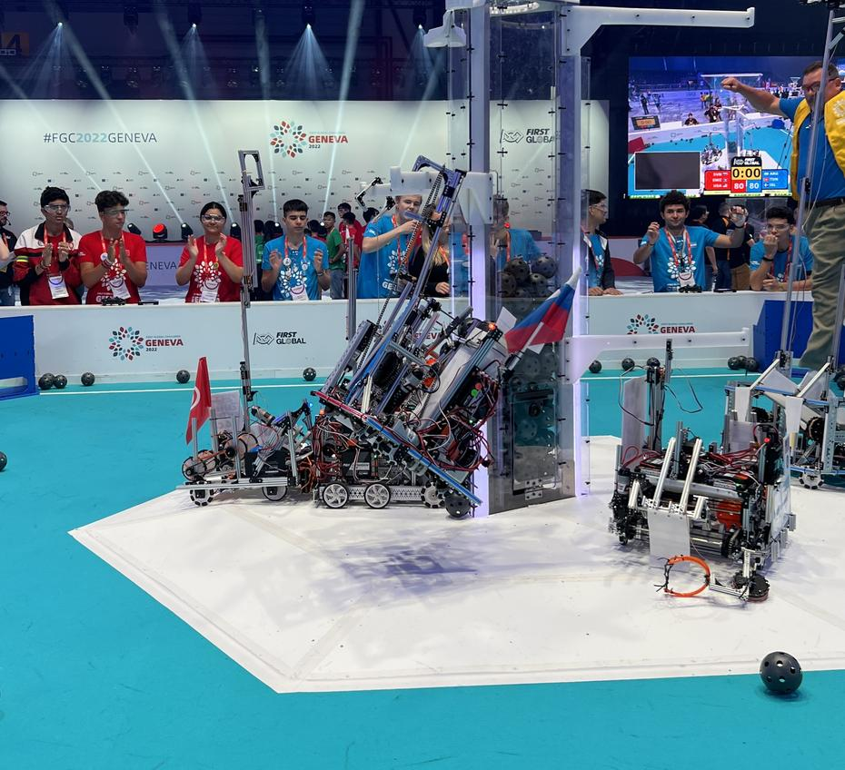

Fine adventures are accompanied by even finer days. The team’s Saturday began sleepily, like every other day, but after a hearty breakfast we hurried to the arena, as our first match awaited us at 9.15. After some quick repairs, our trio – driver, co-driver and ‘human player’ – hastened off to show Slovenia in the best possible light. We spent most of Saturday on field number 5, which meant that everyone could watch us, both in the stands and from their sofas at home.
<!-- truncate -->

The matches went by, and with them the wins piled up (and, alas, the odd defeat too), and like any machine, our team ran on sandwiches and salads (some of us also on tea and energy drinks). Despite the gruelling day we were happy, as we managed to exchange a few words with many teams, which made the time pass more quickly, and so dinner came round all the sooner. At dinner, a representative of Lam Research, loyal supporters of the FIRST Global event, drew the winning team from a collection of balls, each bearing the amount of carbon captured after a match. The first country called was not present, but at the second draw the team from Great Britain was chosen and received several Raspberry Pi computers. The presentation and prize-giving were followed by a DJ set and (yet another) dance, attended by noticeably fewer people.

We marked the end of the day with... a walk into France! The original plan was a stroll to the E.Leclerc, which turned into a visit to the château and the streets of the little border town of Ferney-Voltaire. Small, modest, charming. One could sense the change in architecture, though the tranquillity remained the same. On the way back we visited the local church before boarding the bus that took us back to Switzerland. Some of us decided to pay our beds a visit, whilst the others trotted off for an evening stroll into town.

Until next time, goedenacht.
