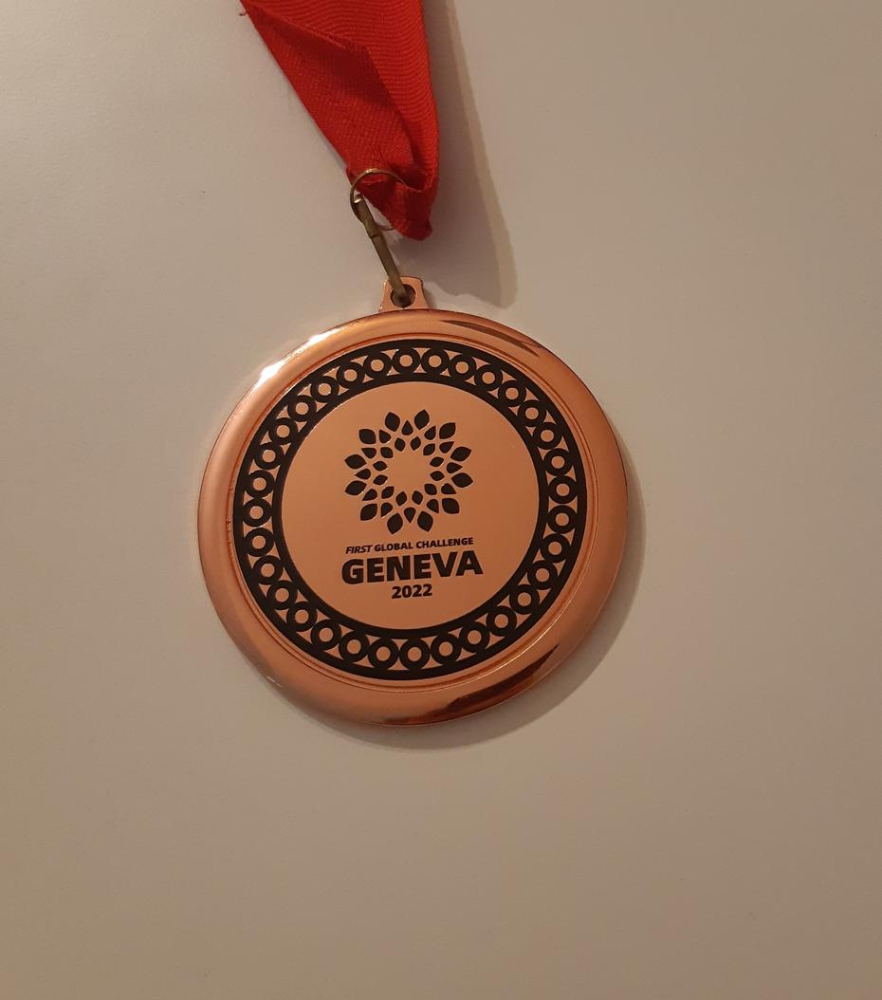
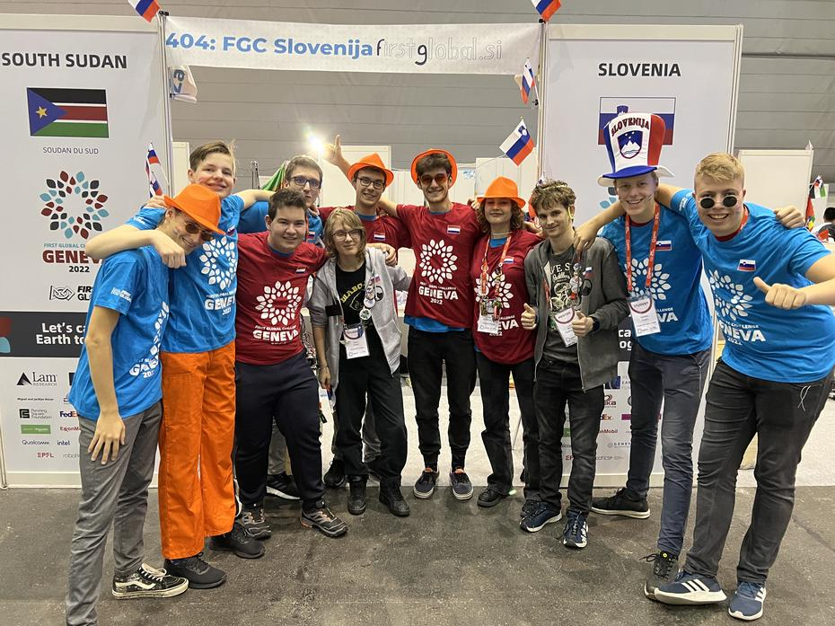
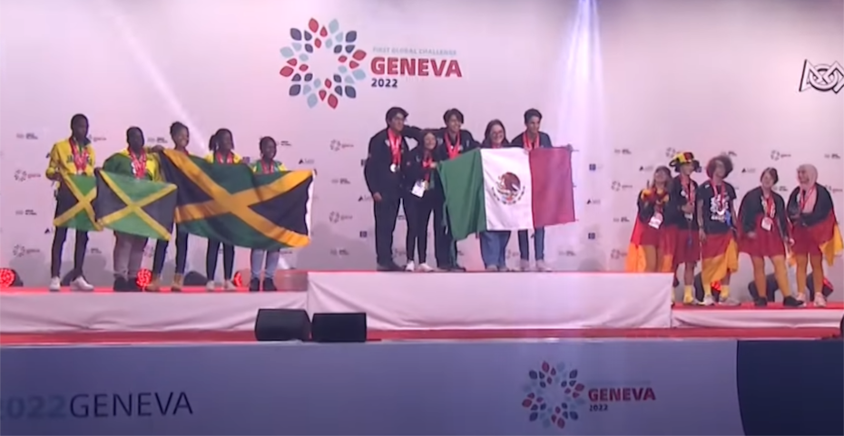
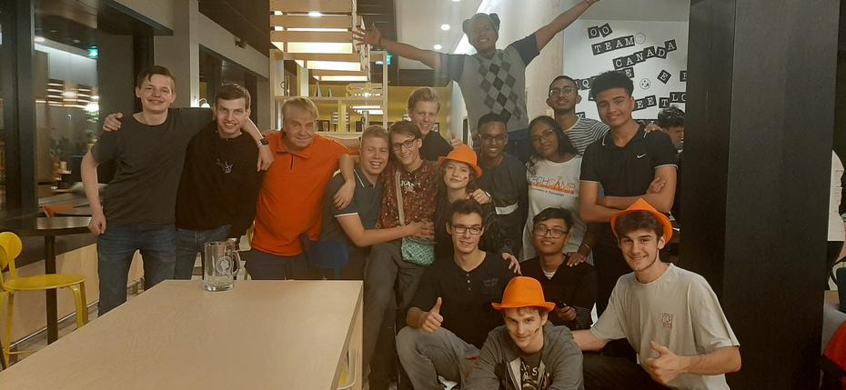

The answer to the title is very simple: a great many people’s. After the usual start to the day, we found ourselves in the arena and were soon invited to collect the ‘Helping Hands’ award, which we had earned by helping other teams (the Norwegians, New Zealand, Sierra Leone...), something we shall be able to remember whenever we look at our bronze medal. <!-- truncate --> Almost every country received an award of some kind, though some, sadly, without a medal. We are all winners – that is the message of the competition! And so we all received applause and the attention of the photographers when collecting our awards. Most countries received awards for their social media presence and for safety.

Fortunately, in true Sunday style, we had only two matches, and soon afterwards we were already cheering passionately for our friends from Montenegro and Macedonia. With every round, the contest grew more tense, the stands louder and the scores ever closer; some matches even ended in a draw. The pace of the last matches of the day and of the competition was markedly higher, and with it the number of points rose considerably (an average of 400 points per match). The winning alliance of this year’s FIRST Global Challenge was made up of Lithuania, Belize and Switzerland, of which the Baltic country finished in first place. (Pictured are the teams that won the Albert Einstein Award.)

We spent the rest of the day bidding farewell to our friends and giving away what was left of our promotional material to the volunteers and staff. We spent our last evening before departure in the company of the teams from the Netherlands, Canada, the USA and Suriname. The culturally tinged evening ended with wishing one another good night in foreign languages and receiving orange hats from the Dutch, in the colour of their kingdom (kaaskop).

Until next time, good night.
