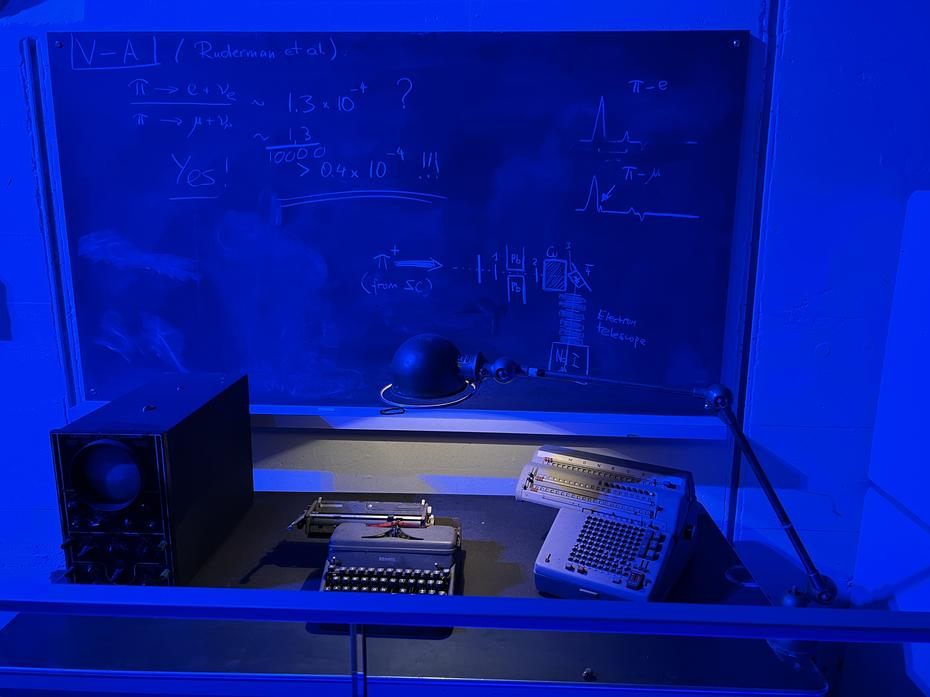
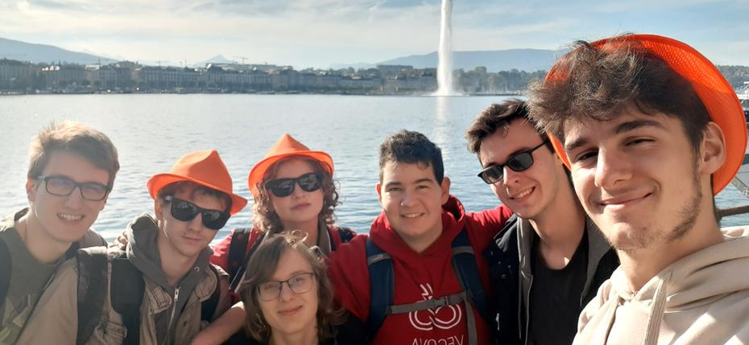
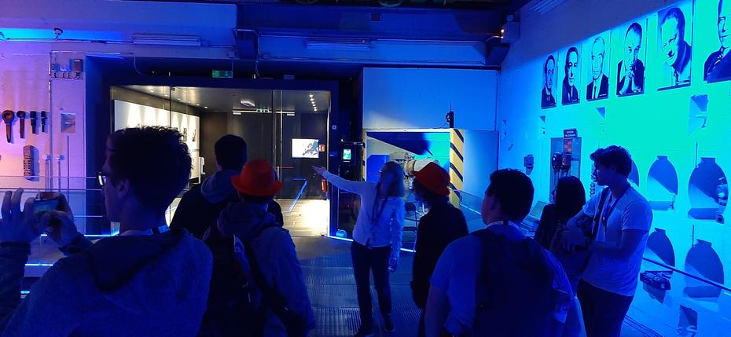
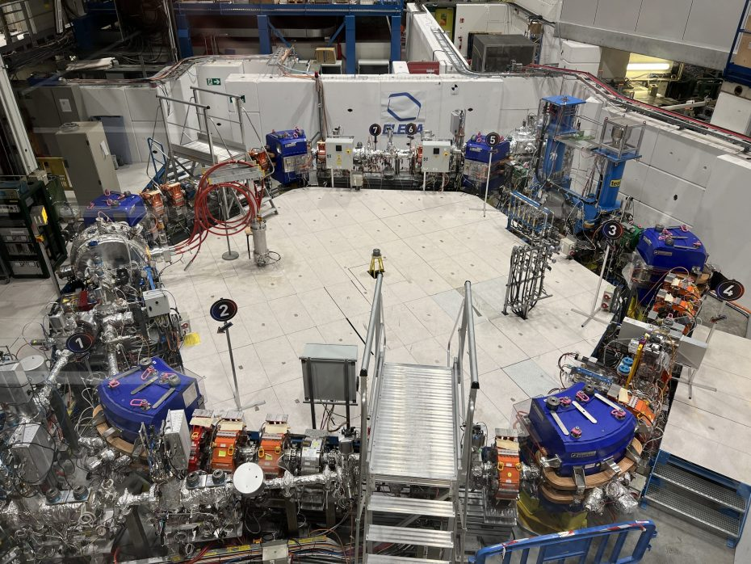
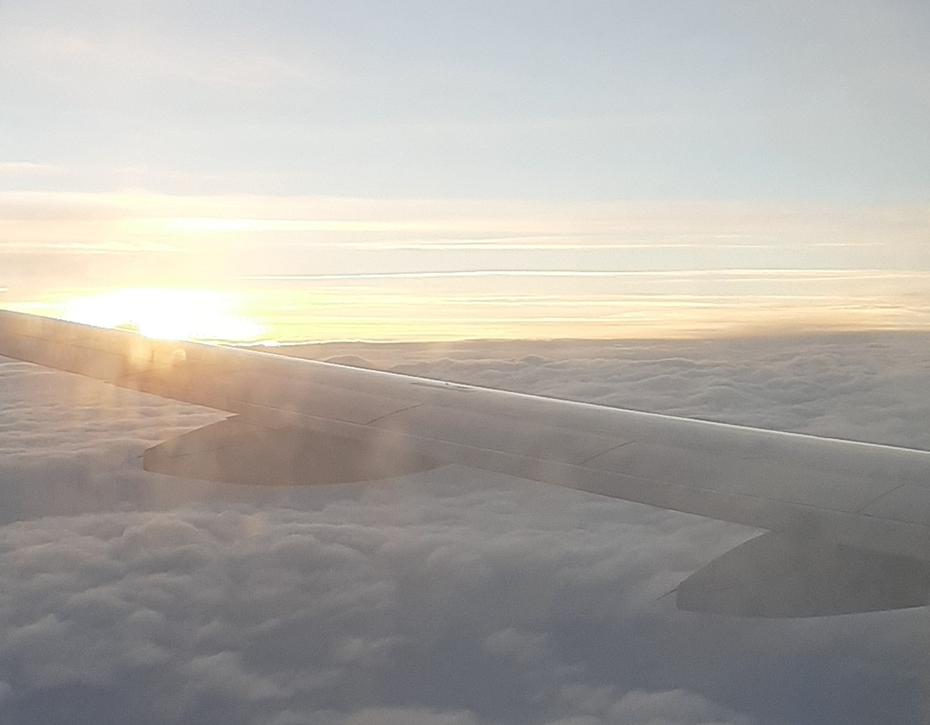

All good things must come to an end sooner or later. And so our team’s visit to Geneva draws to a close, but one must prepare for a late-afternoon flight with a quick sightseeing tour. After a champion’s breakfast, we finished tidying our rooms and got our luggage ready for the journey. When we returned our hotel key cards, the opportunity arose to bid farewell to the supporters of New Zealand and the mentors of Canada. Soon afterwards we hopped once more onto the by now familiar number 5 bus and headed into the city centre.
<!-- truncate -->

Monday shines in a different light in Geneva, as there was no weariness to be felt amongst the people we met during our first visit to the city in daylight. We saw the city’s greatest landmark – the fountain (the Jet d’Eau). Pressed for time, we managed to catch only a glimpse of the architecture before hurrying off to the tram to CERN. Line 18 brought us to just across the road from the entrance to the dream workplace of many a science enthusiast. There, whilst waiting for our personal guide, Anja, we also met the teams from Great Britain, the Cayman Islands and Romania. After a short introductory talk, she handed out passes for entry into a little town, where we first went to see a miniature museum about the history of the first accelerator and about how many scientific inventions are older than LEGO bricks and pocket calculators. Afterwards we went on to the antimatter factory, where we first had a discussion about the mistakes in the film Angels & Demons. From there we went on to the apparatus that studied the fall of antihydrogen (GBAR), the proton decelerator (ELENA) and the lift down to the accelerator itself, 30 km in diameter, which runs underground. On the way out of the little town, which has its own fire brigade, post office, health centre and so on, we also saw the stone marking the border between France and Switzerland, and their ‘animal shelter’.

After our ramble, we hunted for the quickest way home amongst the public transport lines on offer, fumbling about a little before finally, after two changes, finding line 28, which took us to the airport, and from there the number 5 to the hotel. We left our temporary lodgings once we had collected our luggage (and, of course, the robot). We waved goodbye to the Palexpo and gratefully marched off to the airport, where, without any complications whatsoever, we soon reached the departure lounge. Without delays we arrived home by the same route and, after a team hug and a selfie, said our farewells and each went our own way.

Until next time, …
