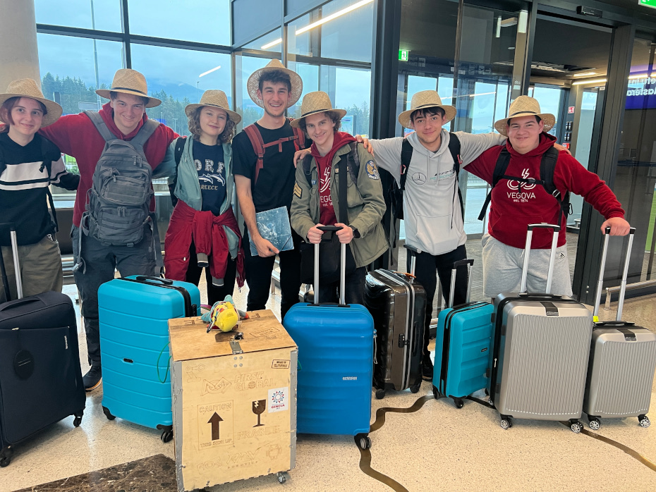
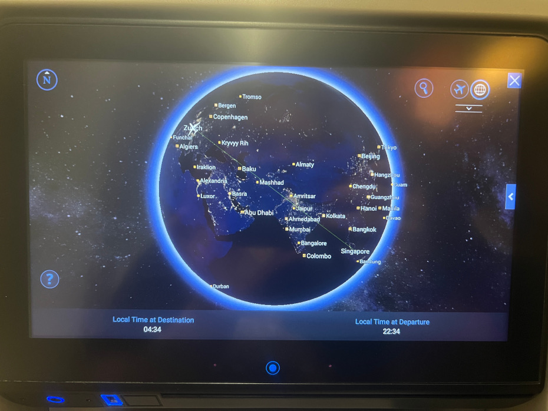
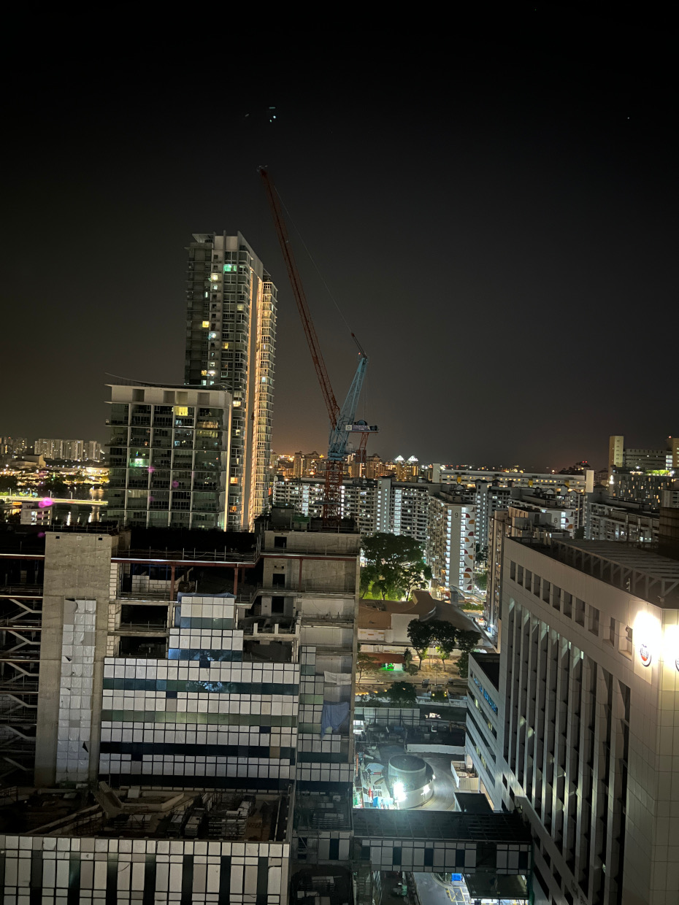
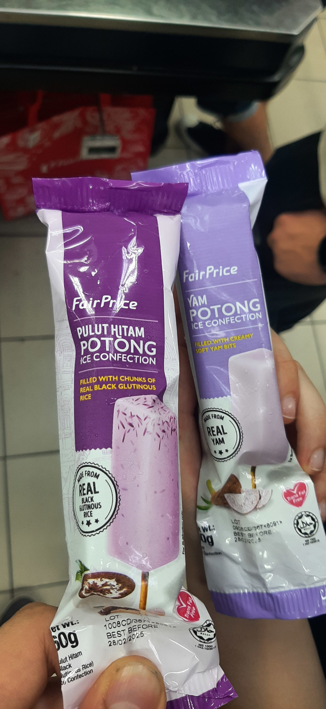

The long-awaited start of our journey had arrived, and so the FIRST Global Slovenia team took off for Zurich in the evening. There a two-hour connection awaited us, including, amongst other things, a ride on the underground train in the company of an animated Heidi and the discovery of what looked like the premises of Aperture Laboratories. We soon boarded, filing past the first-class passengers to our seats, and, playing with the touch screens, set off on a 12-hour journey covering some eleven thousand kilometres.
<!-- truncate -->

Two meals and one short nap later, we found ourselves at Changi Airport in Singapore, a city of sustainable development. After a long wait in the queue for the automated checks and gates, and a delay caused by one broken-down Windows machine, we reported to the baggage hall. Armed with a SIM card, we called on the first FIRST Global Challenge coordinator we saw. They kindly directed us to their colleagues, who in turn pointed us to a waiting coach, on the way to which we encountered for the first time the weather we would be meeting over the next few days in Singapore.

Check-in at the V Hotel Lavender went without a hitch and was full of meeting and getting to know the new faces of this year’s teams. We soon all scurried off to our rooms to rest. This restorative session was followed by a walk in search of a suitable establishment for our first meal on a new continent. A few restaurants, shops and baffling traffic rules later, we decided to eat at the nearby Kopitiam food court. After much deliberation, the members of the team settled on a varied selection, ranging from chicken rice to a spicy Indian curry (and pineapple rice). After dinner it is only proper to cool down with an exotic ice cream, which that evening came in coconut, yam and black rice flavours.

Back at the hotel, it was more than obvious that all that remained for us was for little ‘Zzzzz’ clouds to appear above our heads, full of dreams.

Until next time,
lahko noč.
