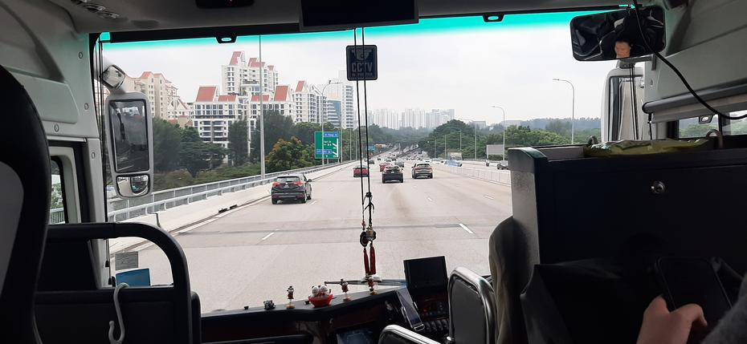
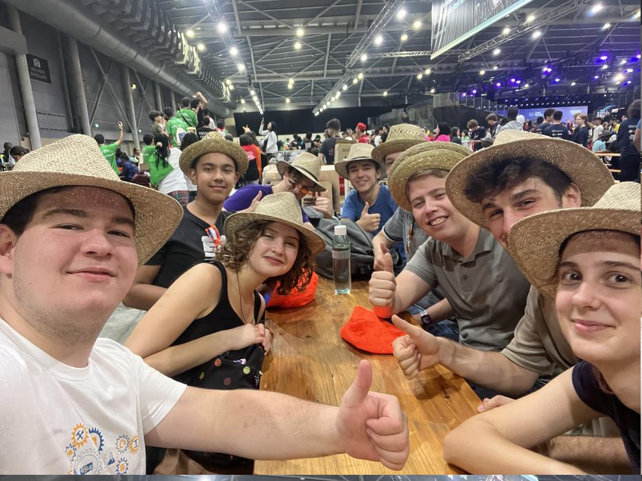
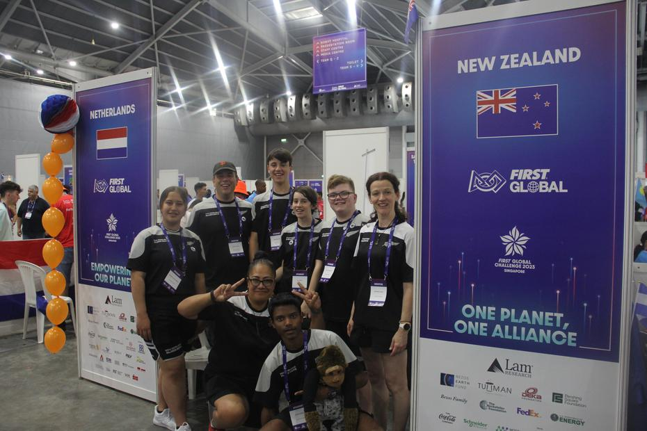
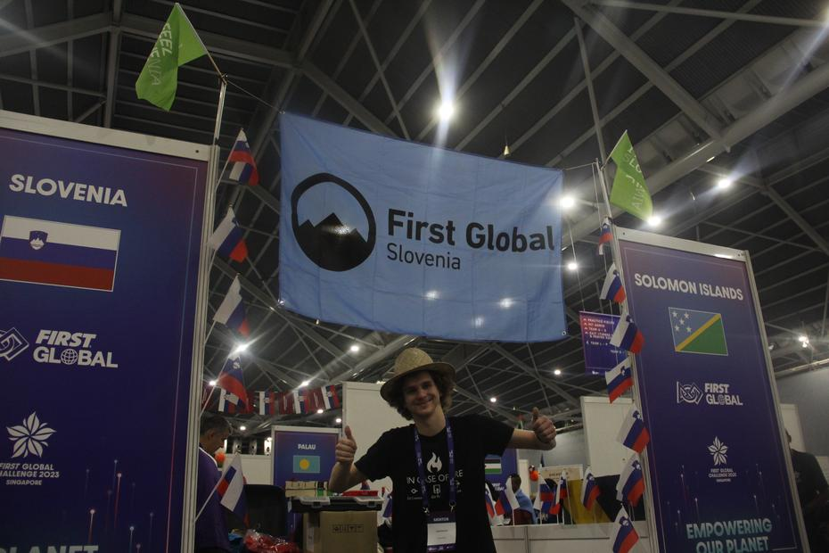
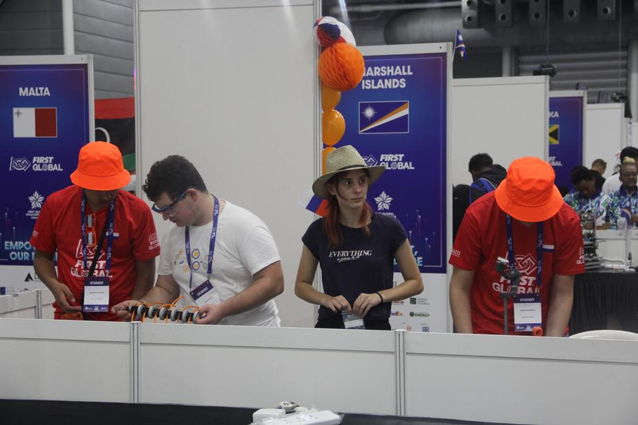
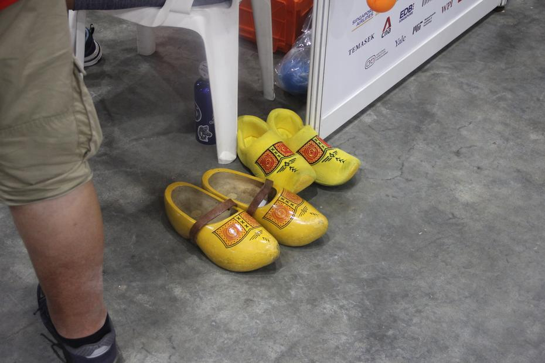
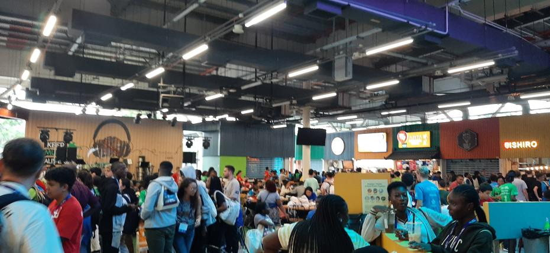

We began the second day of our Singaporean sonnet with a breakfast that included a sunrise and food such as paratha (flatbread pancakes), poha (yellow rice) and kway teow (fried noodles). After some yawning, we slowly made our way into the crowded lift and, together with the robot, to Singapore’s EXPO arena.
<!-- truncate -->

The event that interested us awaited us in Hall 3, whilst the other halls were hosting markets and even the largest baby equipment fair. We livened up the impatient wait in the foyer with discussions and visits from our friends. When the doors opened, we went into the hall, whose spaciousness delighted us. Meanwhile, one of the mentors saw to the team registration, receiving a few items for each member and mentor of the team: two T-shirts, a bag, a bottle, a keyring and, above all, a name badge for each participant. The members waited impatiently for the mentors in the company of their friends from the Netherlands, singing ‘Zdravnik’.

When the little party was over, we went off in a cluster to look for the other teams we knew. Before long we found them and discovered that this year one of them had a member and a mentor who were both from Slovenia. It was a pleasure to meet Martina and Ožbej (or simply Bej) and to accompany them on their first encounter with the FIRST Global Challenge.

Soon it was time for the official opening of the national pits. Every country was greeted with applause and encouraging cheers from the organisers.

The first task of the day was decorating the pit, and the second was finishing the robot. Although we were behind schedule with an unfinished robot (like many other countries), our friends from the Netherlands team were worse off, as their robot had not been loaded onto the aeroplane owing to a lack of permits. The news shook us, and we wished to help as much as we could. Although their plan was to send it on the morning of 6 October, they were not sure whether it would arrive in time for the first qualification match. We therefore sent two of our members, Jaka and Brina, to help. With their assistance, building the robot went markedly faster.

Then came lunchtime and a tense choice between four menus (Western, Asian, International and Vegetarian), which each of us received packed to take away, but ate right there. Over lunch and afterwards, we had the opportunity to spend time with the Dutch team (whilst both teams worked on their robots) and to learn a few new words in their language (and they in ours).

We rounded off the day by receiving dinner vouchers and, as instructed by the organisers, headed to a colourful building nearby (Timbre+). There a crowd awaited us, along with a considerable selection of eateries, where we could spend our vouchers on the basis of two vouchers for one main course, or one voucher for one side dish, pudding or special drink. The team split up, reassembled at a table agreed in advance with their beeping buzzers, and waited patiently for their food (about half an hour). A good deal of chicken, rice, hot spices and similar dishes later, we realised that we still had a few vouchers left. A group decision led to their being cashed in for six sugar cane drinks. With tasty drinks and food in our stomachs, we went to catch the bus back to the hotel.

There, weariness caught up with us, which we soon dispelled with sleep (most of us, at any rate).
Tomorrow, however, the competition officially begins.

Until next time,
Pō mārie
