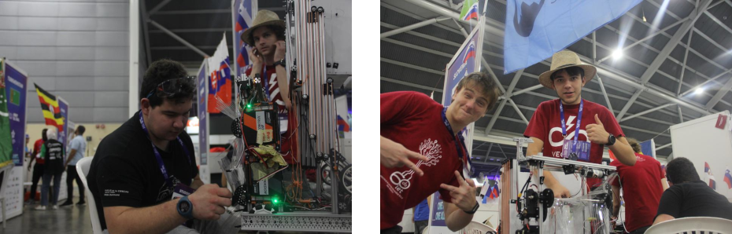
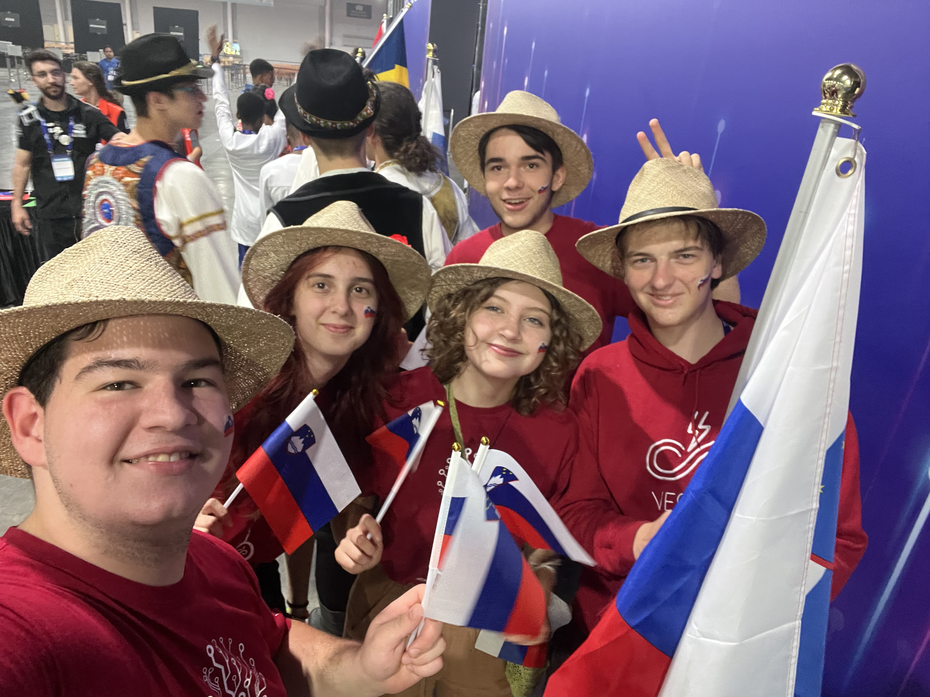
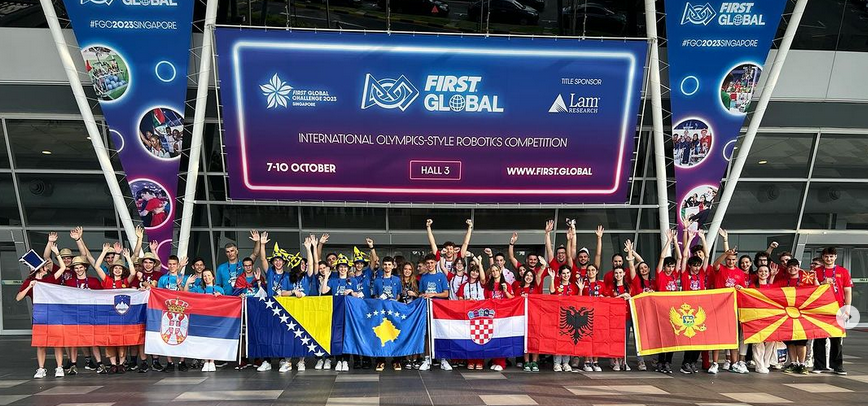
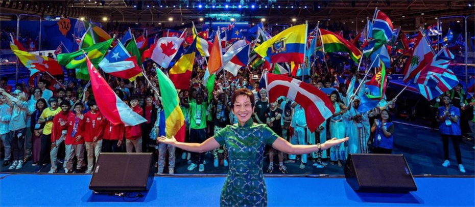
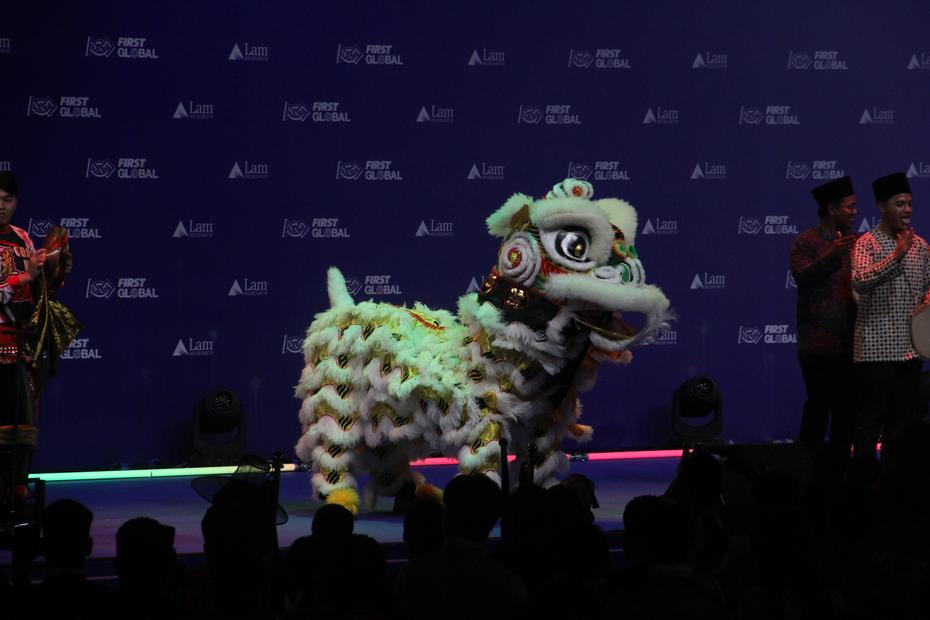
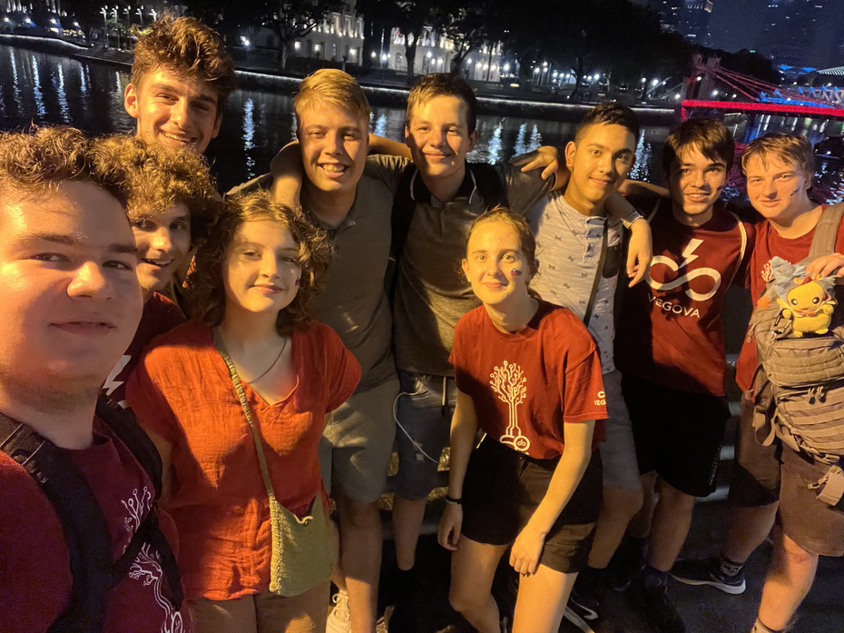
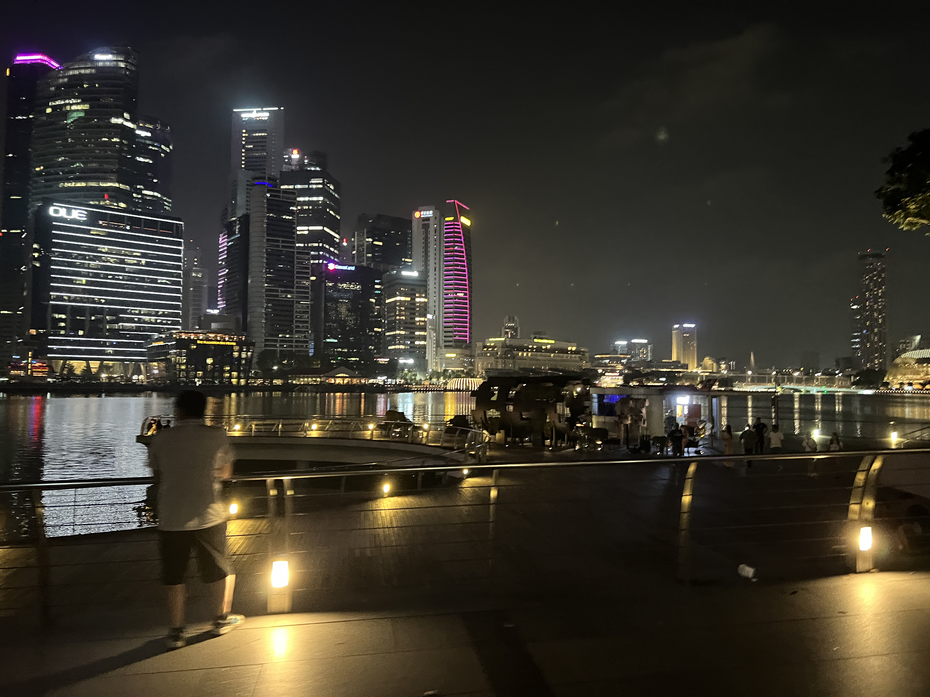
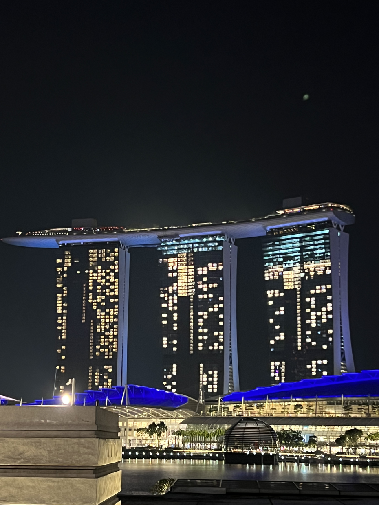
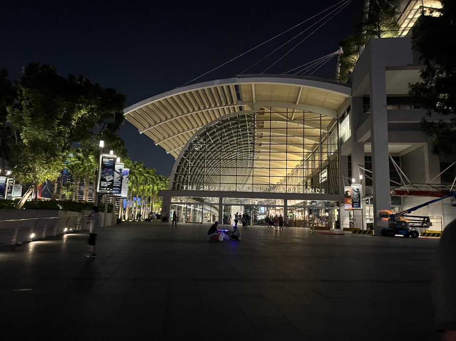

The day of the lucky number in October, 7 October 2023, began slowly and grew busier by the minute. A hearty breakfast and half an hour’s drive were followed by repairs to the robot, with a view to earning a tick from the robot inspector.

<!-- truncate -->

After lunch only minor repairs awaited us, and even without them we nonetheless managed to pass inspection! Evidently the odd unconnected cable does not trouble them unduly. We were glad to have received the tick and the green sticker early enough, as at two o’clock in the afternoon, Singapore time (six hours ahead of home), our team members had a rehearsal for the opening ceremony. Queuing and waving one’s own country’s flag in national dress is not exactly the easiest of tasks, especially when there are 191 flags.

After the rehearsal we were glad of a visit from our friends from Suriname, and especially from their mentor Yuri, with whom we had already made friends last year in Geneva. The gift of friendship did not end with our alligator-eating friends, as we also met Christian from Romania, who often gives us positive advice and is full of interesting jokes and ideas about education. That day we also visited our fellow Balkan teams, who invited us to a group photograph, which is by now something of a tradition at the FIRST Global Challenge.

‘Let the event begin!’ the organisers said to themselves. The opening ceremony included a walk across the stage between the playing fields by each of the 191 countries, waving their flags and, if they wished, wearing national costume. Each walk was accompanied by an anecdote from the commentators. With every team, the sea of flags grew choppier, until we could not even see the stage from the stands. Once all the countries had appeared, there followed an opening speech by the founder, Dean Kamen, and after him by Singapore’s Minister for Sustainability, Grace Fu, and Dr Philip Yeo (head of development innovation in Singapore). Finally, the head of Lam Research also greeted us with a speech.

The opening ceremony ended with a dragon dance, dancers in traditional dress and a hip-hop group. Thrilled and ready for the competition, we packed up our things with heavy hearts and returned to the hotel.

The day was not yet over for us, nor indeed for the Dutch team. After a short rest, we took the MRT, the underground railway, into the city centre. The train, which on the bends seemed to have neither end nor beginning, was exceptionally fast, frequent and affordable, so we soon found ourselves in the heart of the city. From the hotel (Lavender station) to the city (Raffles Place) took us a mere 8 minutes. Our route took us around the sights of Marina Bay, where we could see the illuminated part of the city, tall skyscrapers and a luxury shopping centre too. Being pressed for time (as the underground runs only until midnight), we headed back to the hotel from right inside the shopping centre, changing trains twice in the process.

Contented and worn out, we lay down and surrendered ourselves to the beginning of a pleasant rest.

Until next time,
Goedenacht
