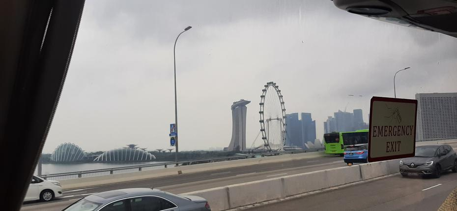

An air-conditioned and sleepy start to the day woke us once again and escorted us to the 4th floor, where, as on every morning of our adventure in the Lion City, breakfast awaited us. Food of many cultures and customs fortified us, so that, with the first ranked matches in mind, we could set off towards the coaches. Half an hour’s drive (and half-sleep) along Singapore’s motorways gave us some time to settle our plan for the day.
<!-- truncate -->

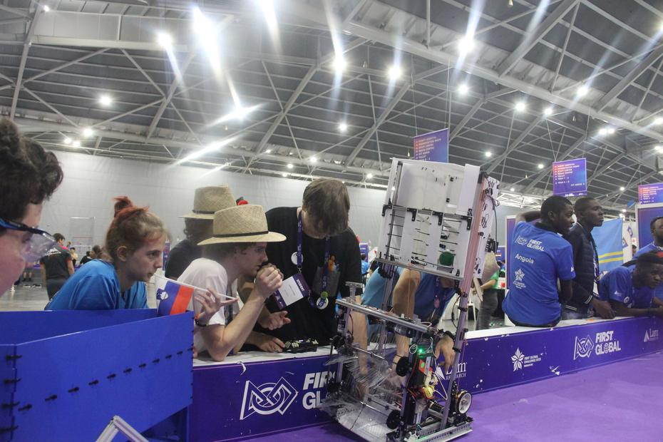

On returning to our place of work at Singapore’s EXPO centre, we set about repairing the robot straight away, as our Krtek (‘Little Mole’) was not running at its best and we had only a few hours until the first match. Finishing the box for storing the balls and refining the intake mechanism were our two chief aims, for our robot could already drive!

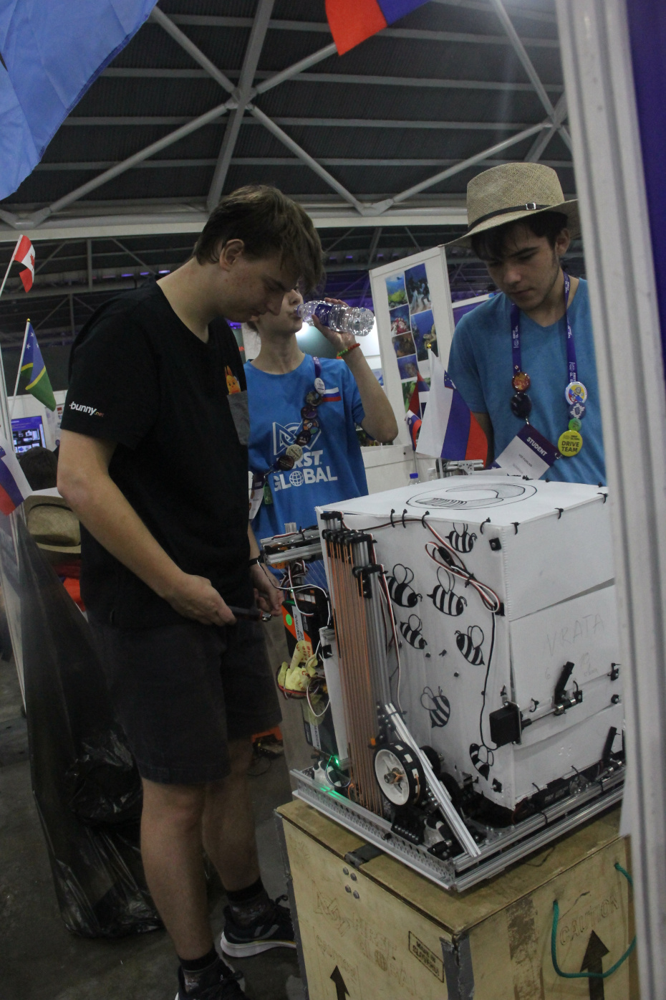

Our first match was [number 17](https://youtu.be/43vi8mebumc?t=2135), so, knowing that we were grouped with the teams of Jamaica and Somalia, we set about our strategy. Jamaica was not exactly the strongest of teams, whilst Somalia had not even arrived at the event by the time of the match. In a low-scoring match we unfortunately lost to the teams of Saint Vincent and the Grenadines, Bhutan and Nicaragua, with a result of 28:20.

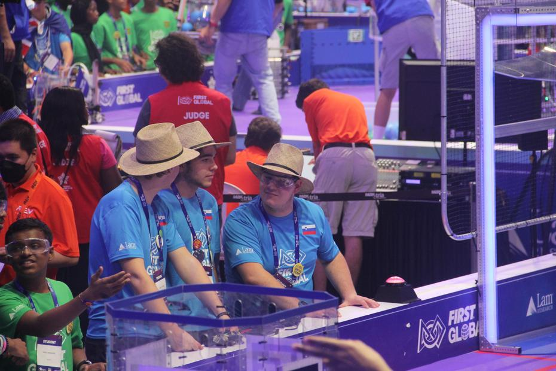

Our first real match opened our eyes to possible improvements to our robot, so we hurried back and set about repairing the damaged parts and calibrating our centre wheel, which is there for moving left and right. After lunch, [match number 45](https://youtu.be/6uGkEqgfV9o?t=5559) awaited us, this time on the central field (no. 5). We played alongside the teams of Guinea (who supplied only a human player to throw the blue balls) and Aruba, against the teams of Barbados, Nigeria and Cuba. This time we snatched victory by a hair’s breadth, winning a somewhat slower match 16:15.

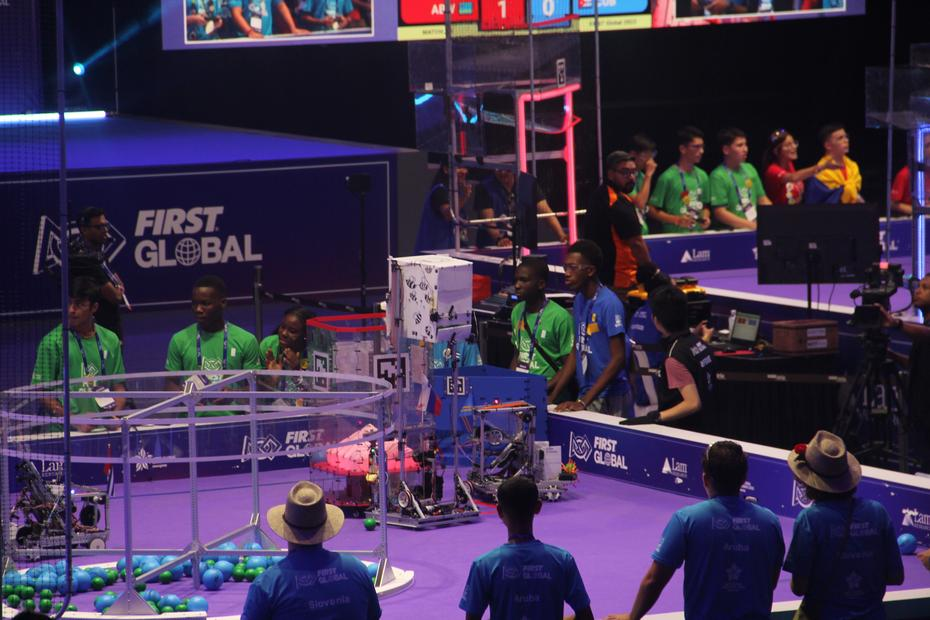
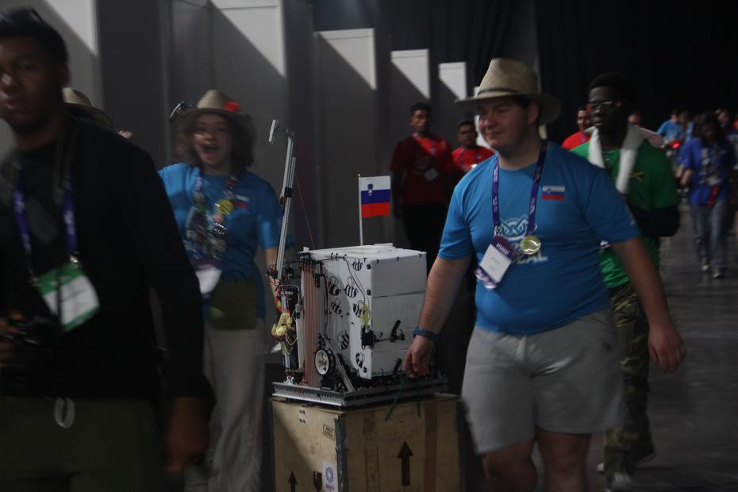

Whilst the driving part of the team (the Drive Team) fought for points, the two remaining members rejoiced with the Netherlands team, whose robot had finally arrived, and helped the Cook Islands repair theirs. We ended the exhausting day a few hours earlier than usual and all went back to the hotel to rest, as a cultural dinner at Gardens by the Bay awaited us.

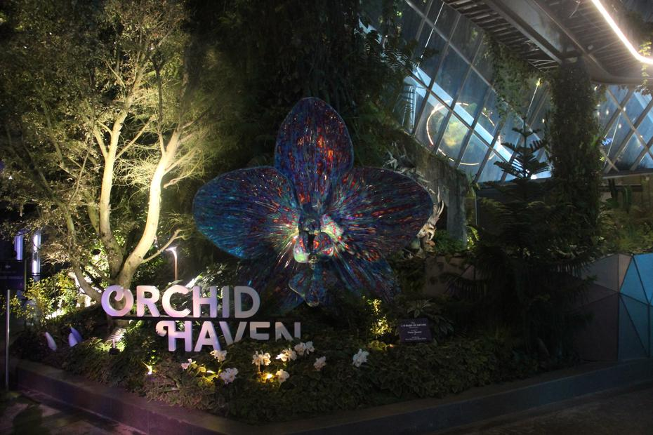

Singapore’s botanical garden, themed on the film Avatar (the one with the blue creatures), was a thrilling experience, all the more so as the teams could fortify themselves at dinner by taking several helpings of the various dishes on offer. The lights and the company over good food made for an even more relaxed atmosphere, from which we soon set off to see the exhibition.

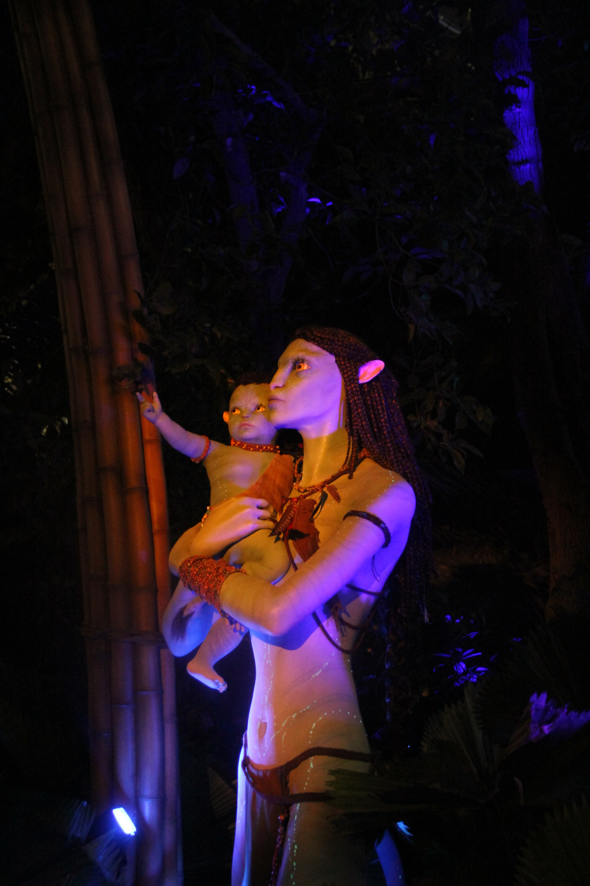

Assorted creatures, leaves, lights and a waterfall greeted us as soon as we entered the central part of the magical garden. A lift carried us right to the top, where the waterfall itself begins, after which we made our way down the floors along the marked paths, enjoying the plant life and the attractions meant for grown-ups and children alike. Dragons, games and photographs livened up our way through the Cloud Forest.

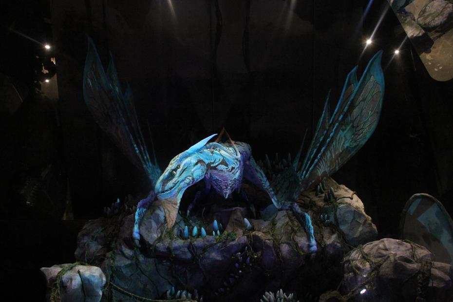
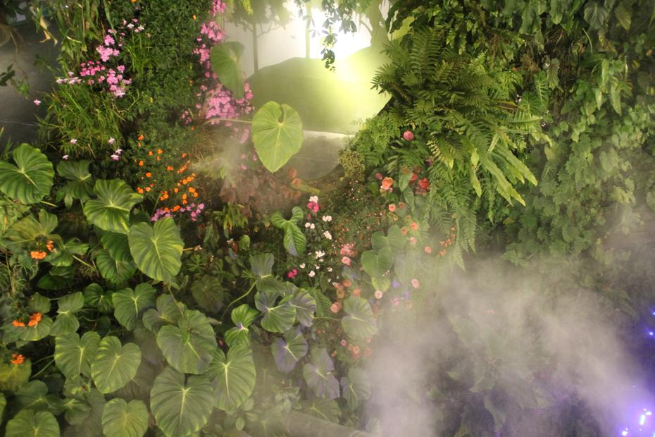

Besides the botanical theme, we also came across a play of lights and luminous decorations in the dark. Soon daylight greeted us once more (though, like the day itself, it was already slipping away), and so we made our way to the next attraction, or rather venue: the light show at the artificial trees. The lovely illumination and the somewhat monotonous, quiet soundtrack made for an interesting experience for everyone, and soon, tired but happy, we headed back to the hotel, intent on sleep (or on wandering about).

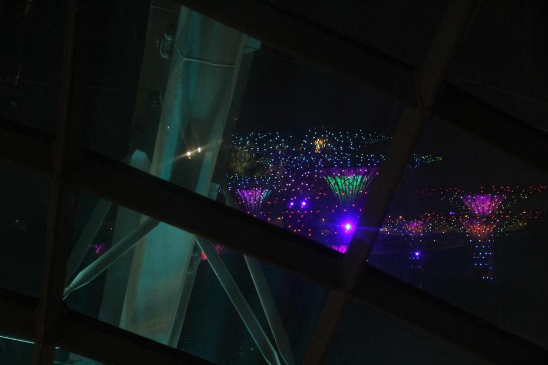

Until next time,
buenas noches
