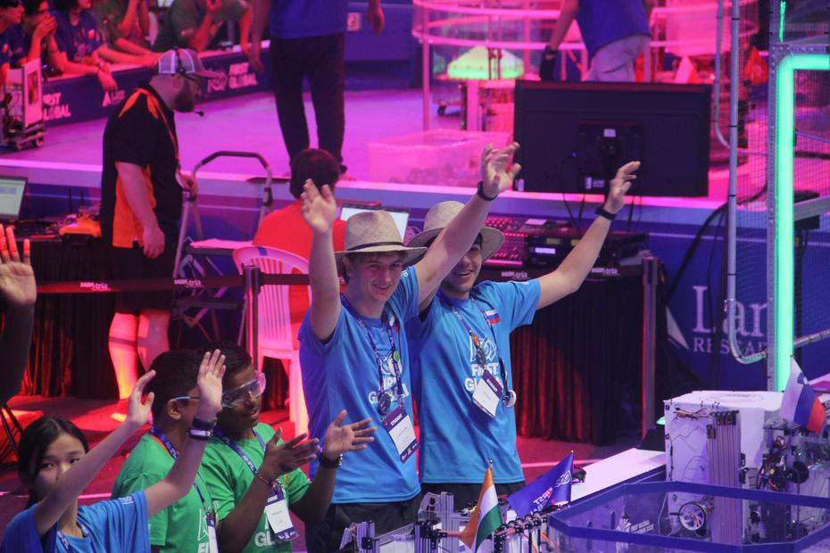

Waking up to the most gruelling day of the whole competition was something markedly different. We tried to put out of our minds the thought that no fewer than six matches awaited us that day, and to eat in peace our morning cereal, rice, noodles and whatever else had landed on our plates. Our appetites duly satisfied, we hurried to the coach and, on arriving at our hall, set about further work on our robot.
<!-- truncate -->

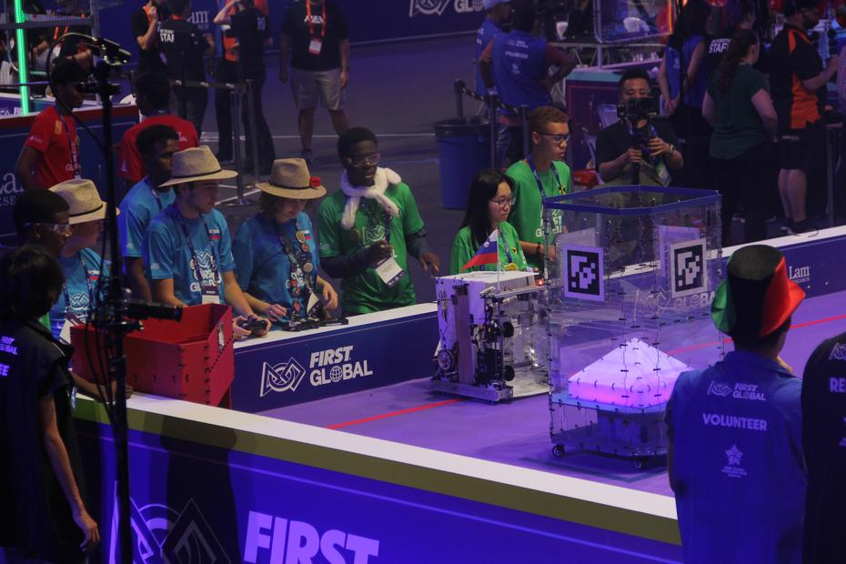

The first match of the day, which awaited us a mere two hours after our arrival, was [number 95](https://youtu.be/9Cgij9hvTjQ?t=6349), in which we played on the side of India and our neighbours in the pits – the Solomon Islands. On the other side, or rather in the opposing colour, we could see the teams of Portugal, Cameroon and Sudan. This time, with a markedly better-refined robot (and a better trio), we carried the match off with a result of 62:15.

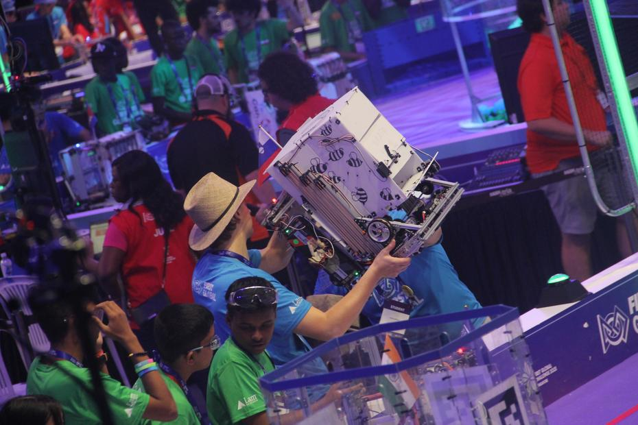

With the pace of the matches stepped up, it was soon our turn again, after a break of about 30 minutes. Before long we heard the familiar sound of the horn once more, and off we sent the robots into [match number 113](https://youtu.be/9Cgij9hvTjQ?t=9145). This time we shared our side with the teams of Ireland and Jakarta. With a little bad luck and a poorer execution of our strategy, we finished with fewer points than our opponents, but we shook hands and heard the applause all the same. The teams of Jordan, Cyprus and Kiribati beat us 73:30.

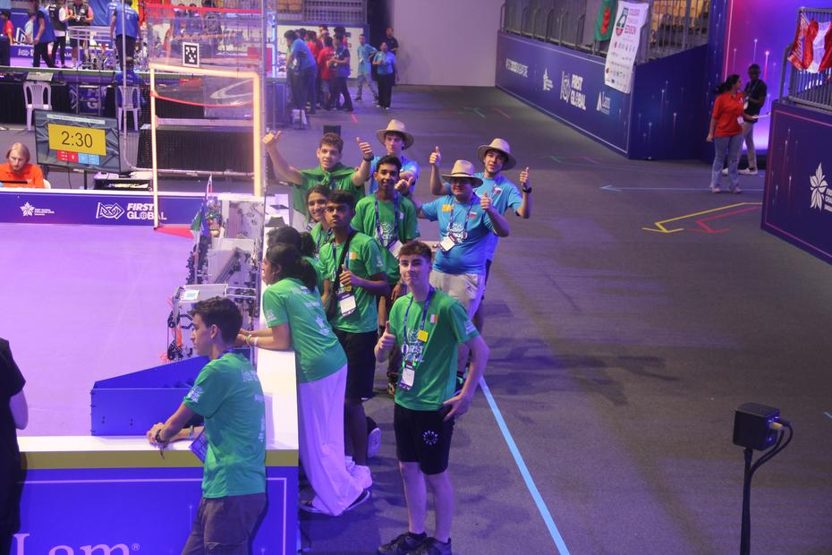

With our heads held high, we carried on honing our robot and our driving skills! Ahead of us lay [match number 133](https://youtu.be/IgS8z1B1yg0?t=12383), which was of special significance to us, as we knew that we would be playing on the same side as our friends – the New Zealand team! Joining the two of us was Israel, and so we went into ‘battle’ against three opposing teams – the representatives of Kosovo, the Maldives and Mozambique. The power of friendship prevailed, and so, to whoops from the stands, we shook hands and signed off on a 45:27 result.

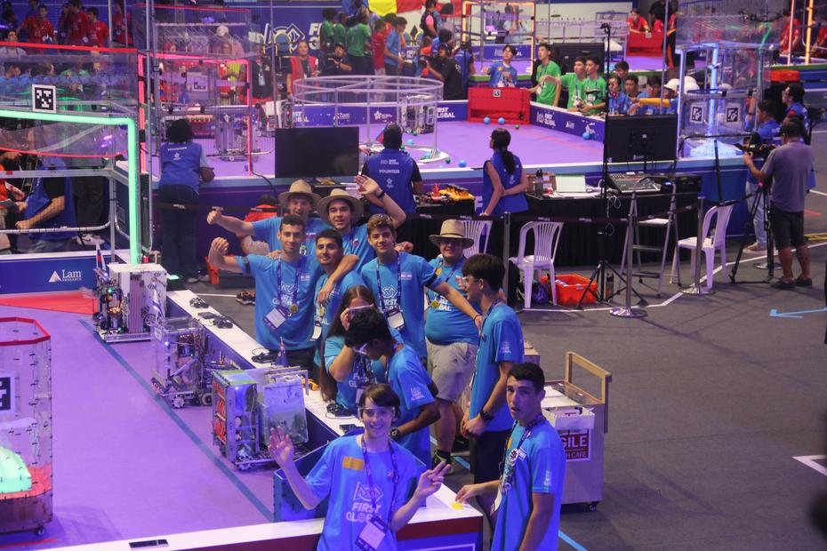
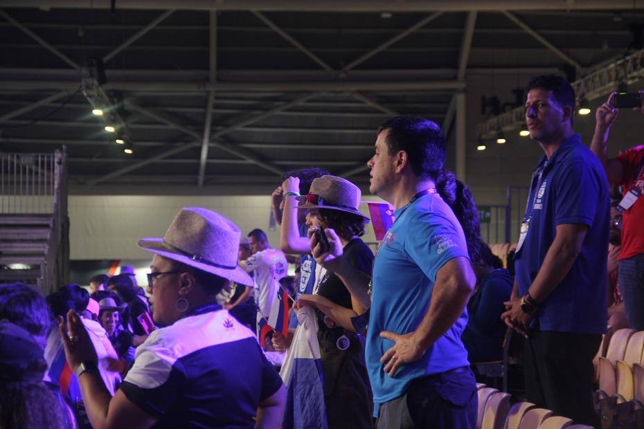
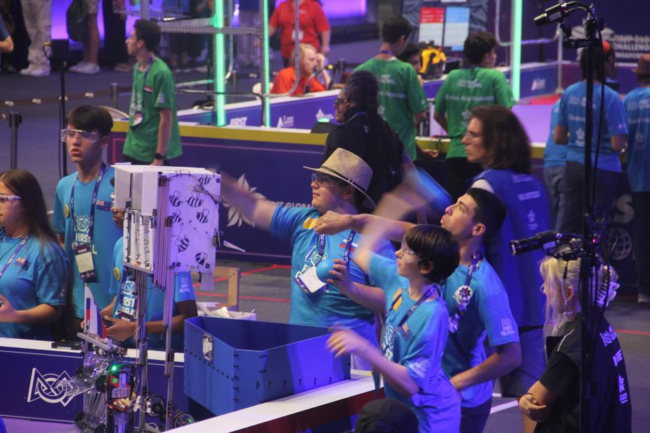

Time for lunch! Once again (as every day) we had the chance to fortify ourselves with one of the four ready-prepared menus. A robot is easier to repair on a full (or partly filled) stomach, so the members dashed off to do some servicing, as another match of importance, in the friendly sense, awaited us. Ahead of us was [match number 169](https://youtu.be/IgS8z1B1yg0?t=21009), in which we shared our side with our colleagues from the Netherlands and with the team of the Dominican Republic. An eventful match full of breakages ended in a 42:42 draw against the trio of teams representing Team U.S. Virgin Islands, Azerbaijan and Thailand. Contented, we marched off the field to the accompaniment of Dutch cries of joy.

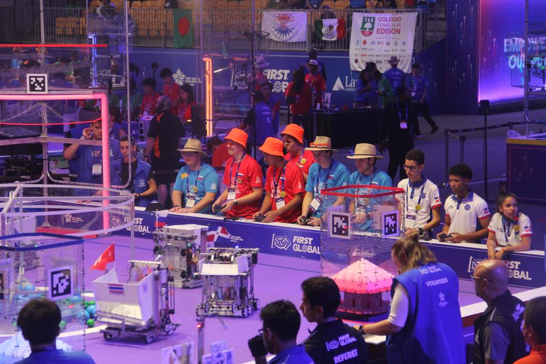
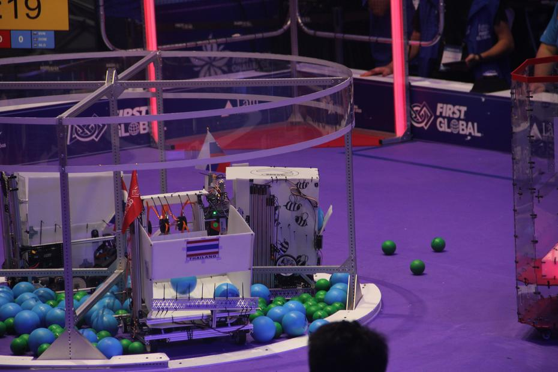
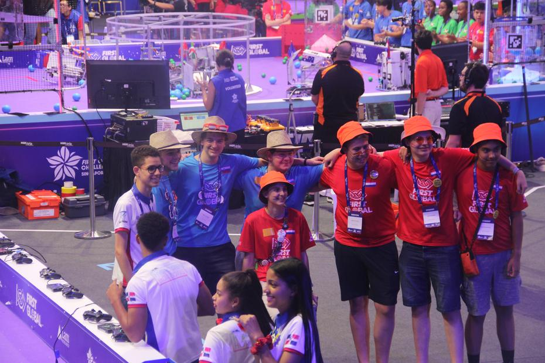

Repairs, repairs, repairs! That, together with sweets from foreign lands and swapped flags, was more or less our motto between matches. Every sweet brought us closer to our next match, [match number 211](https://youtu.be/IgS8z1B1yg0?t=26881) to be precise, which featured one of our more distant Balkan neighbours on the opposing side. This time we had the opportunity to work with the teams of Palau and the Philippines. Two minutes and thirty seconds passed quickly, and in the end we of the blue alliance came off worse, losing by a single point, 46:45, to the red side, formed by the teams of Serbia, the Gambia and the Czech Republic.

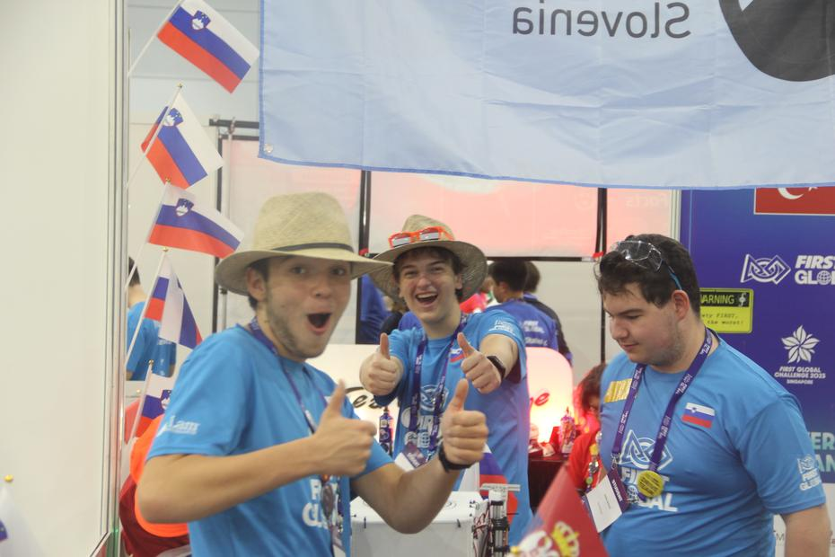
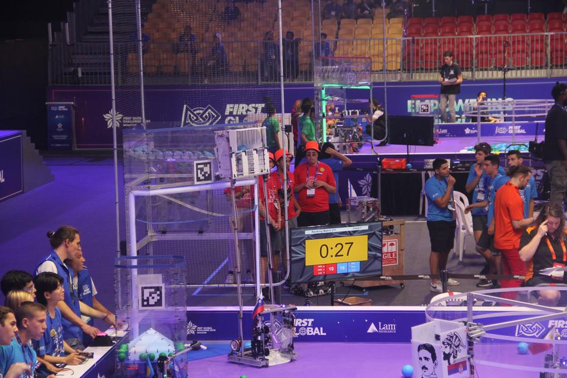
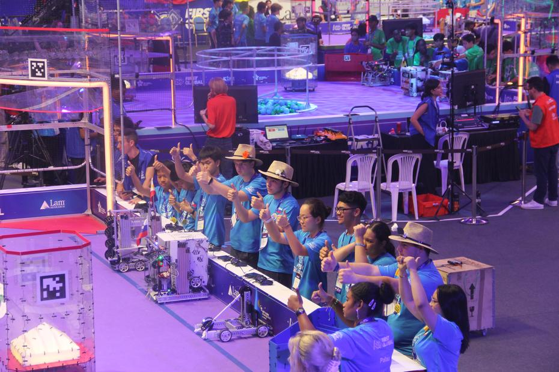

‘Just one more, and we’re done.’ Ahead of us lay the last match of a day full of repairs, work and laughter. We played [match number 230](https://youtu.be/EDLcrV-ZWCs?t=29188) together with the teams of South Sudan and Finland, earning 38 points, which brought us victory over the red alliance. The opposing half was formed by the teams of the Marshall Islands, Djibouti and Belize.

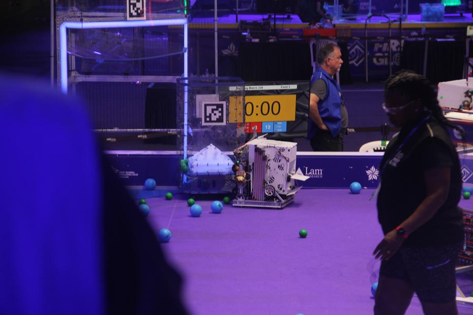
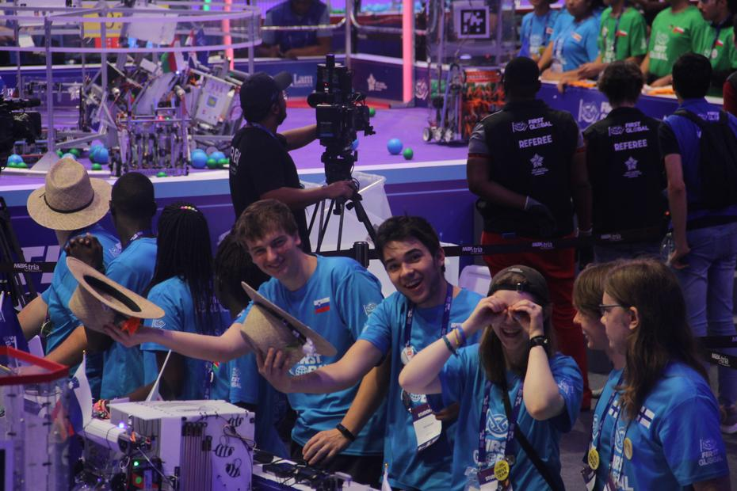

The tiring day had come to an end, at least as far as the competition was concerned. We finished with satisfactory results and a worry about the gear of the lifting mechanism slipping, but that did not stop us from setting off on an adventure to Changi Airport, where we spent the best part of two hours. The shopping centre, with its famous endless waterfall (the vortex waterfall), boasted a good many floors full of shops, restaurants and even mazes, trampoline parks and suchlike. Visiting various shops such as the Pokémon Center and the Apple Store, besides hunting for our agreed meeting point, took us quite some time. Exhausted, we returned to the hotel on the underground and gave our dreams free rein.

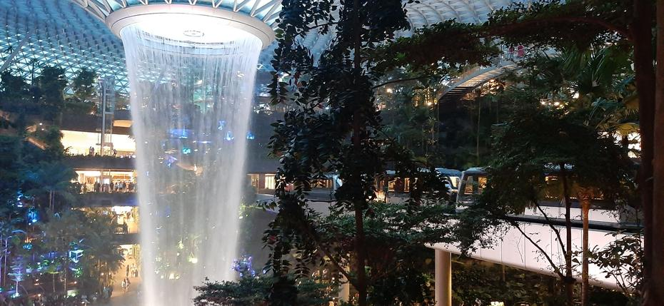
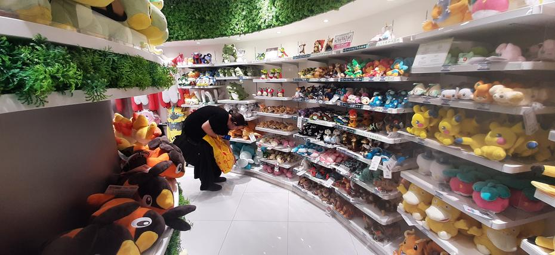

Until next time,
Goeienag
