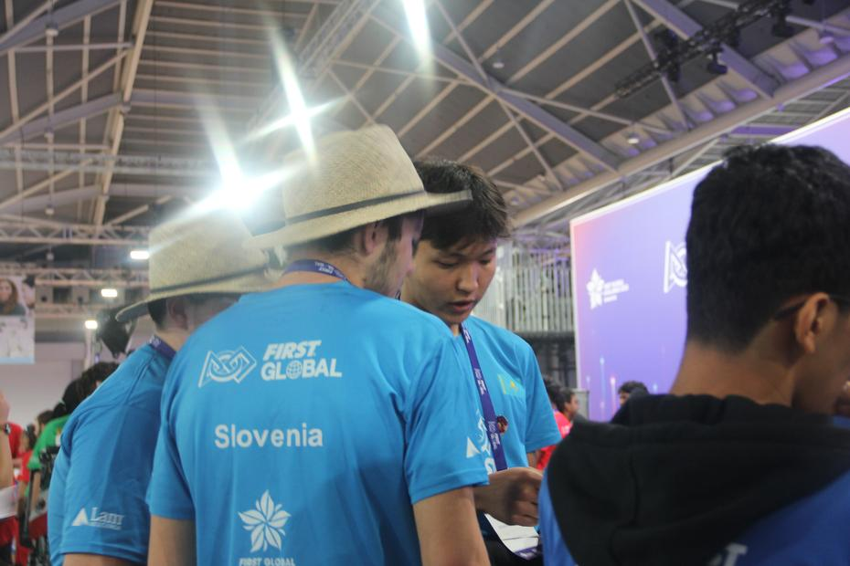
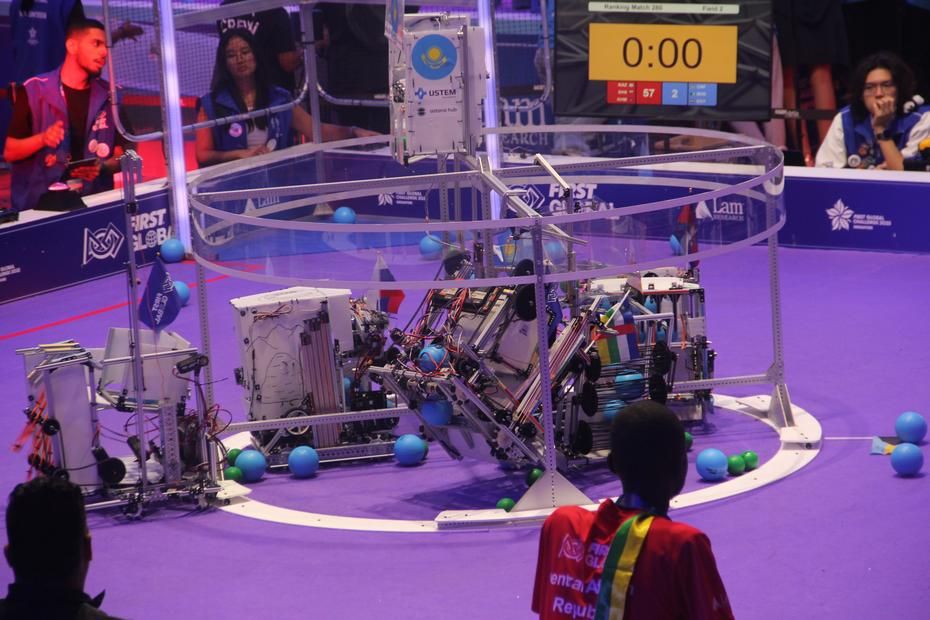
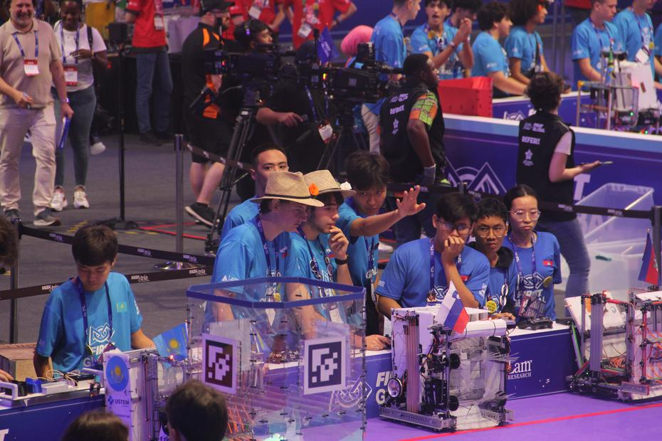
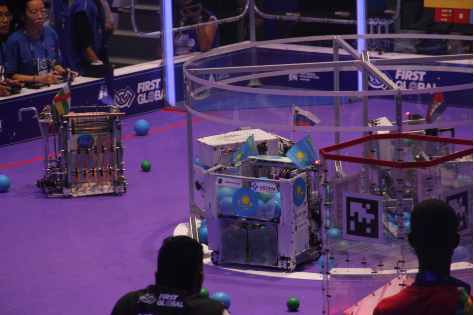
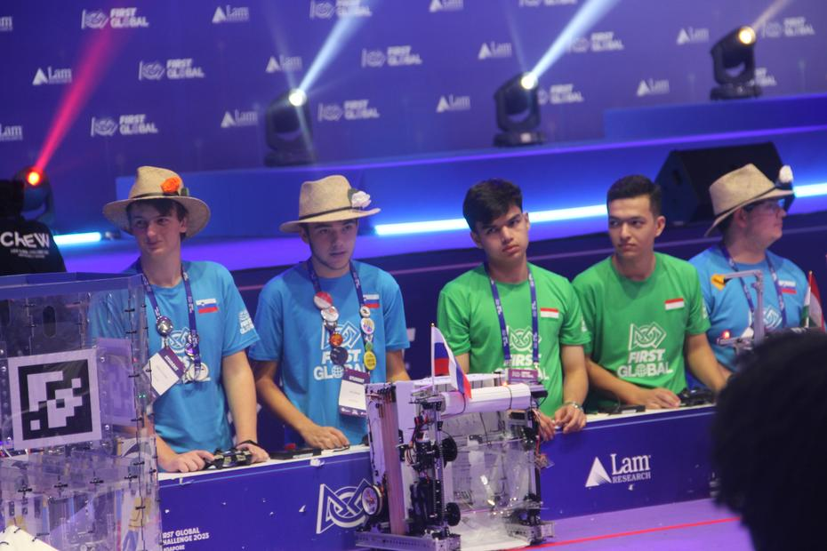
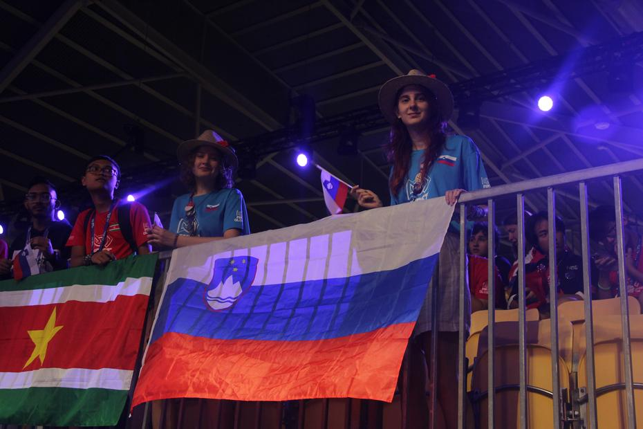
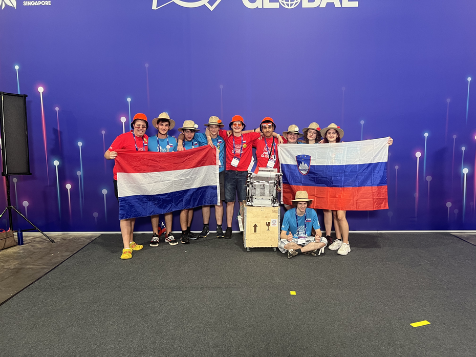
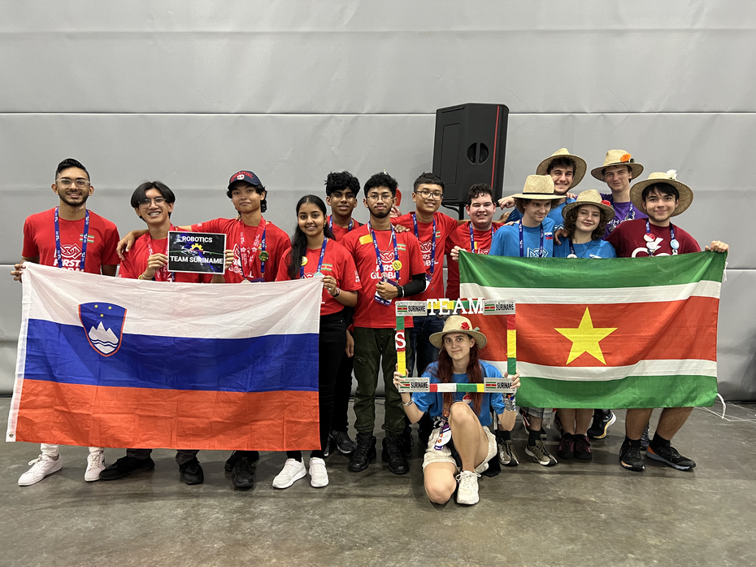
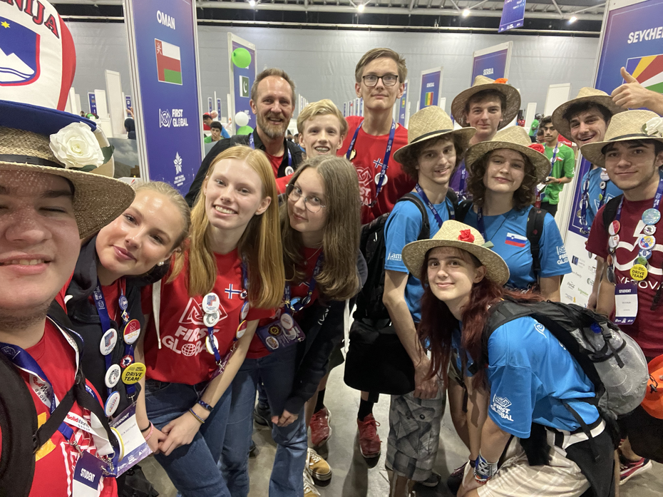
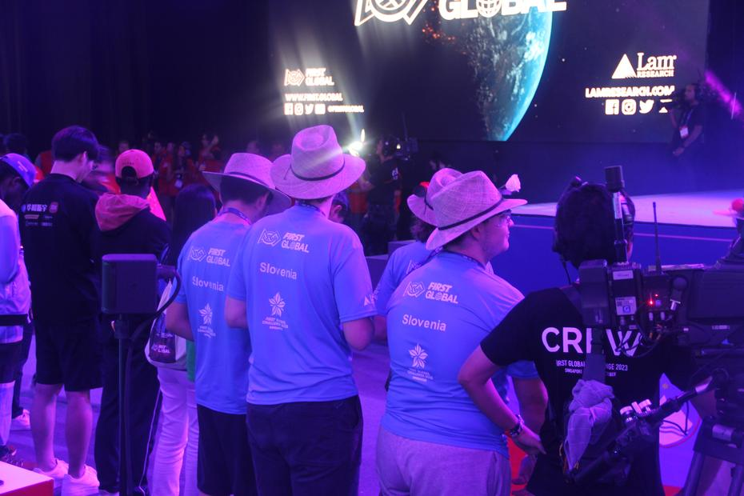

The last day of competition got off to an eventful start, as we had to rise early to oblige the team from Kazakhstan, who wished to forge the perfect strategy for our match, which was still a few hours off. A few of our team members marched into the arena later, whilst the others diligently drew diagrams and pondered the match. Testing the lifting mechanism also marked the start of our day, together with the wish of the Kazakhstan team members to help repair, or rather improve, our robot.
<!--truncate -->

Tick-tock goes the clock, and it waits for nobody. Before we knew it, we were already standing in the queue, full of hope, for [match number 280](https://youtu.be/96H0_qOIa84?t=7123). This time we had the privilege of being placed on the same side as the teams of Kazakhstan and Cambodia. Our strategy, honed to perfection, worked splendidly and brought us no fewer than 155 points! In the match against the teams of Egypt, the Central African Republic and the Bahamas, we climbed a full 81 places on the leaderboard.

In a state of happy shock, and after celebrating with the friends who had come to cheer us on, we gratefully returned to our pit. Slowly, of course, we began to prepare for our last match, which happened also to be the last match of the regular qualification rounds. In [match number 319](https://youtu.be/hQeEWxXgboc?t=12359) we were paired with the teams of Tajikistan and Colombia. At this competition we were content with little, and so, even with the smaller half of a 23:22 score, we marched cheerfully away from the playing field. The last qualification match was won by the trio formed by the teams of Albania, Eswatini and Dominica.

The top few countries were chosen, together with a few others at random, giving a final 32 teams divided into groups of four. Tense matches brought only three of the eight foursomes to the final; the winning foursome, on the basis of its average score, was made up of the teams of China, Eritrea, Team Hope and Vietnam.

The tense matches were followed by the awards ceremony. We received the bronze award for helping other teams (the Helping Hands Award). Leaving the seats from which we had watched all the tense matches over the course of the event also meant leaving Singapore’s EXPO centre behind us. We bade farewell to the other teams, swapped shirts and signatures with the Netherlands team, and then went off to dinner. Whilst saying our goodbyes and eating, we could watch the workmen who had come to dismantle the pits and the stands and to take down the FIRST Global Challenge signs.

And just like that, it is behind us. At the hotel we took a little time to rest and then went for a walk to the shop we knew best, FairPrice, for snacks, before we began gathering our strength for our last day in the Lion City.

Until next time,
Қайырлы түн
