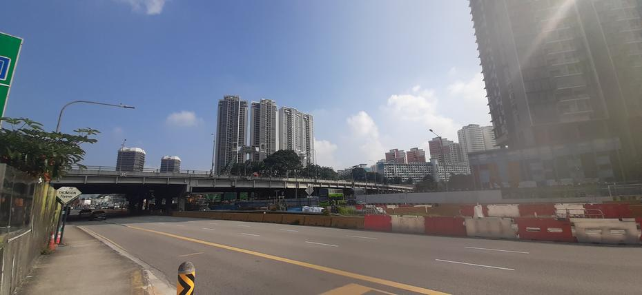

We began the final morning of our visit to Singapore somewhat later than usual, as we wanted a little more rest (and to pack our luggage again). After breakfast we checked out of the hotel and left our luggage there. The logistics were followed by the start of our last Singaporean adventures.
<!-- truncate -->

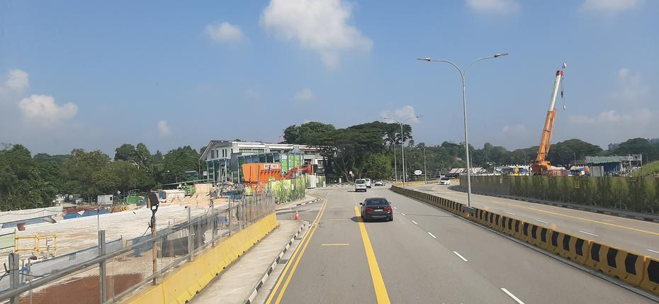

We hopped onto the number 980 bus and later changed to route 166 (a double-decker), so that we could see the city in a different way. It dropped us off at the Flame Tree Park stop, and we began our walk through their national park. The boardwalk began on the Squirrel Trail, where we had the chance to meet red dragonflies, the local flora and squirrels. At the end of that trail, signposts began to appear, and we followed the ones for the TreeTop Walk. Along our way, which runs partly parallel to a local road, we also met other walkers and even two lizards. The muggy weather and high temperatures were not exactly encouraging, but the path passed ever more quickly. Of the 3 km to our destination, we covered just under 2 km fairly swiftly. We stopped for some special visitors – monkeys! On the path we met monkeys moving calmly through the forest and climbing the trees. Our next stop was at the drinking fountains, which stand just before the steepest slope of the entire route to the TreeTop Walk. The tarmac path was not especially interesting, but we were surprised by a sudden shower that had not been forecast. Every cloud has a silver lining, and we took this one as a chance to cool down. At the top, our destination awaited us – and a change of plan. The TreeTop Walk – a walk along a bridge amongst the forest canopy – has a rule that once visitors step onto the bridge, they must carry on in the direction of the trail (there is no turning back after that point, as the signs make very plain). And so, with rain in our hair, we walked at the height of the treetops and admired the view stretching out on every side. Beyond the bridge, a path with railings and boards awaited us, along which we met a good many walkers sheltering from the rain. At the end of the marked path, we set off along a macadam track, which brought us back to the drinking fountains, but this time the visit was rather more interesting. Soon after we had begun our rest, the monkeys paid us a call. We had the chance to see a mother with her baby, as well as their thieving tactics: whilst one monkey is endearing and steals the attention, another tries to steal whatever comes within reach of its fingers. After a while, and a wealth of photographs, we set off back along the route by which we had first reached the drinking fountains. On the way back we took another (prettier) path to the Squirrel Trail and could see that, the moment the sun shone in full, the water began to evaporate from the wooden boards. After about three hours of walking, we had completed the loop and returned to our starting point, just as the map at the start had foretold. Drenched in sweat and weary, we went to catch the bus to our next stop.

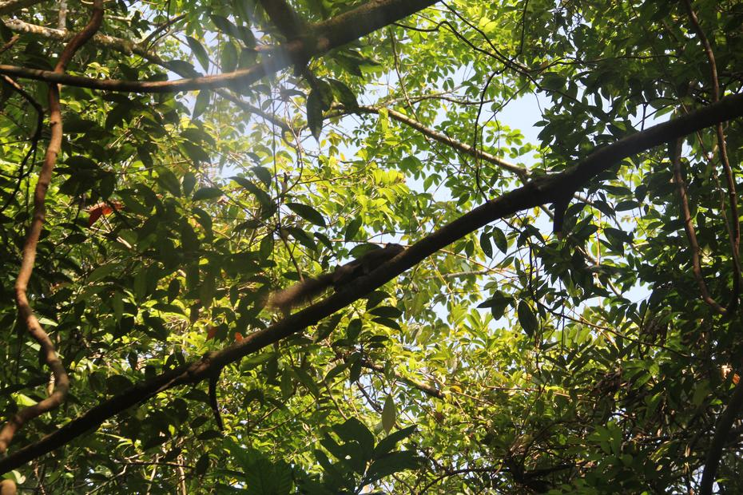
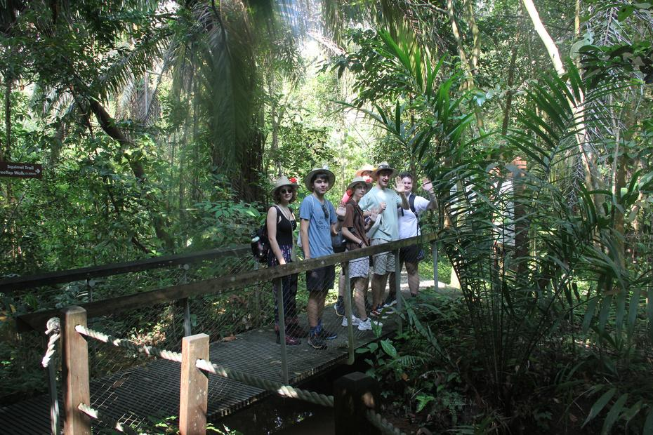
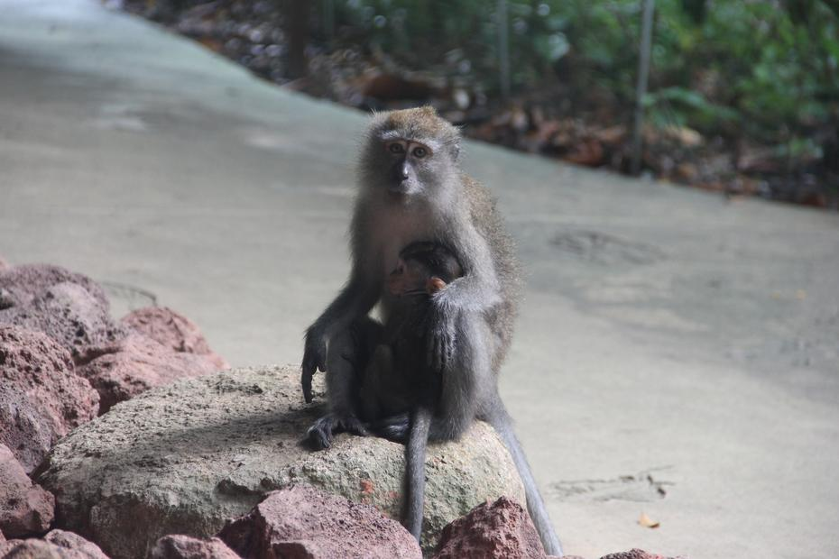
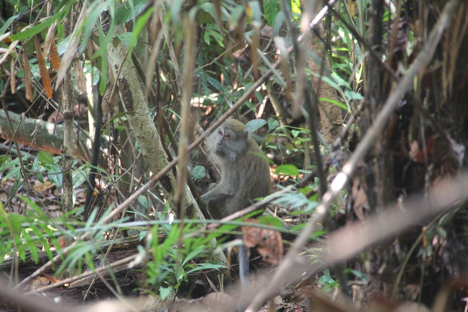
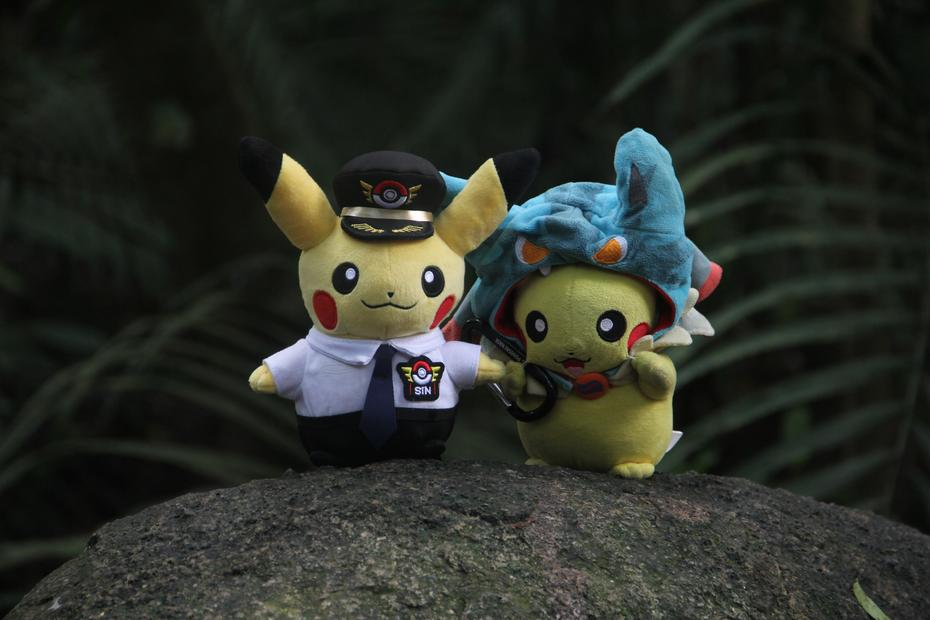
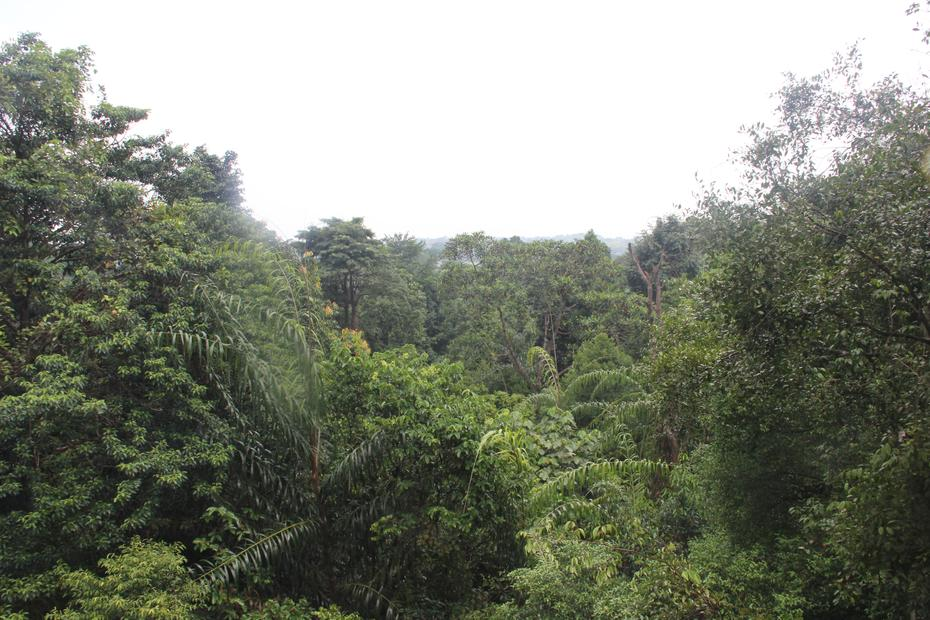

A café with prohibitively expensive audio equipment – headphones, to be precise – served as a resting point for the boys, whilst the rest of the team walked through most of the Little India quarter (so named because the market, the people and everything else are reminiscent of India), visiting two Hindu temples along the way: the Sri Veeramakaliamman Temple and the Sri Srinivasa Perumal Temple. At the far end of the quarter they visited City Square Mall and sent postcards. On the way back to the boys, the rest of the team also stopped at a souvenir shop and at a supermarket with live fish and crabs and an ever-lowering ceiling. Soon the team reassembled at Sim Lim Square, a shopping centre for computer equipment and electronics with no fewer than six floors. After a brief whirl round the shops, the team went to lunch at Hill Street Tai Hwa Pork Noodle, a street food stall with one Michelin star.

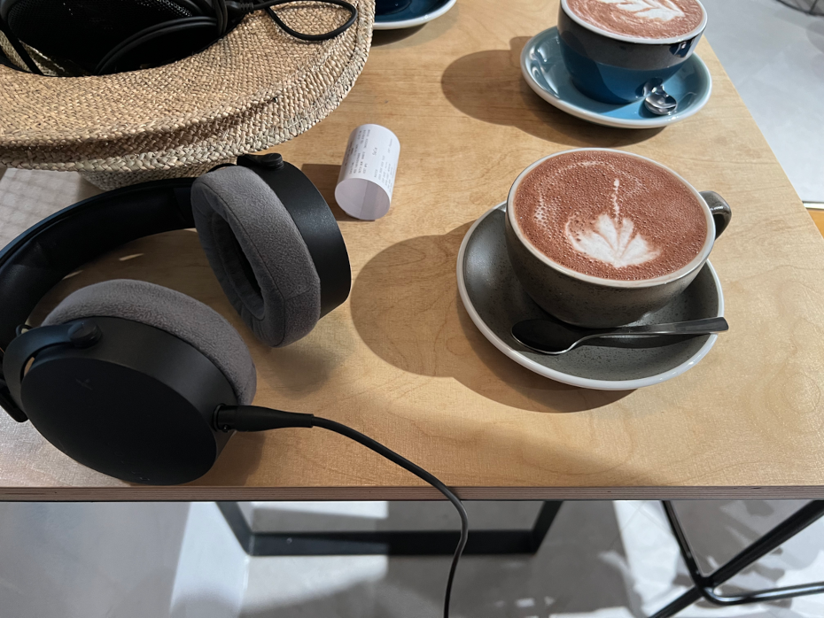
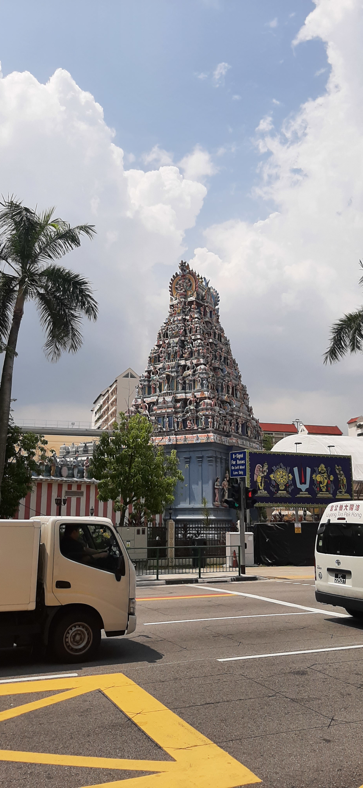

After lunch the team split into a resting half, which stayed at the hotel, and an exploring half, which set off for the city’s Chinese quarter – Chinatown. The quarter is adorned with assorted shops, a shopping centre and market stalls, and the remaining walkers were on the hunt for one item in particular: a Maneki-Neko (the figure of a cat with a moving paw). After a successful sweep and a purchase at a lower price, the still-standing half of the team quickly boarded the purple underground line, then changed to the green one, which took them back to the hotel.

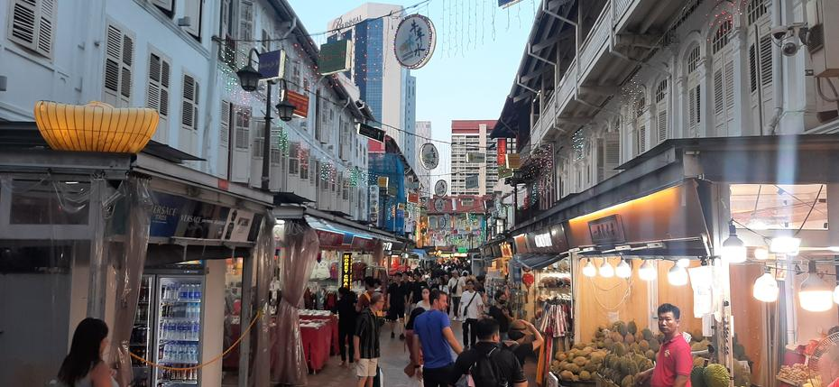
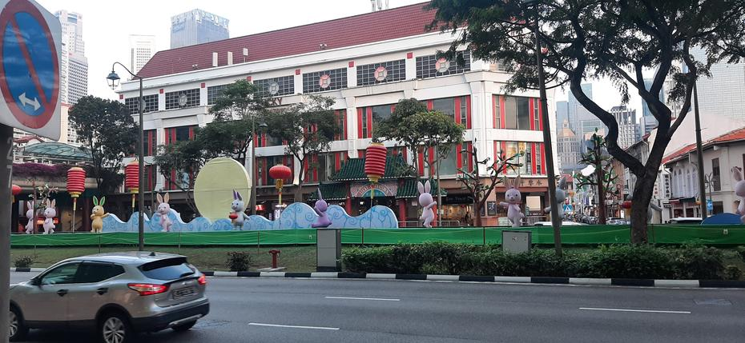
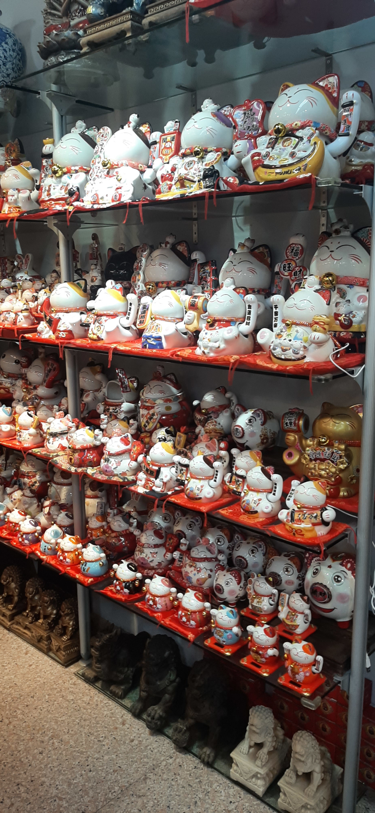

Only one step remained before leaving for the airport: rearranging our luggage and, with it, redistributing the weight. With our suitcases in order, we set off for the last bus of this journey. At the airport we hopped between terminals – by train, of course – and checked in, at the same time dropping off the robot and the suitcases, which we would not see again before Ljubljana. After that, some members decided to freshen up in the airport showers, which were just a car park away from the lounge where the other members of the team stayed. Once reassembled, our team went through the security check and dashed off to the departure lounge for our flight. Before we knew it, we were sitting on the aeroplane, with a 13-hour flight ahead of us, most of which, fortunately, we slept through, albeit in fits and starts.

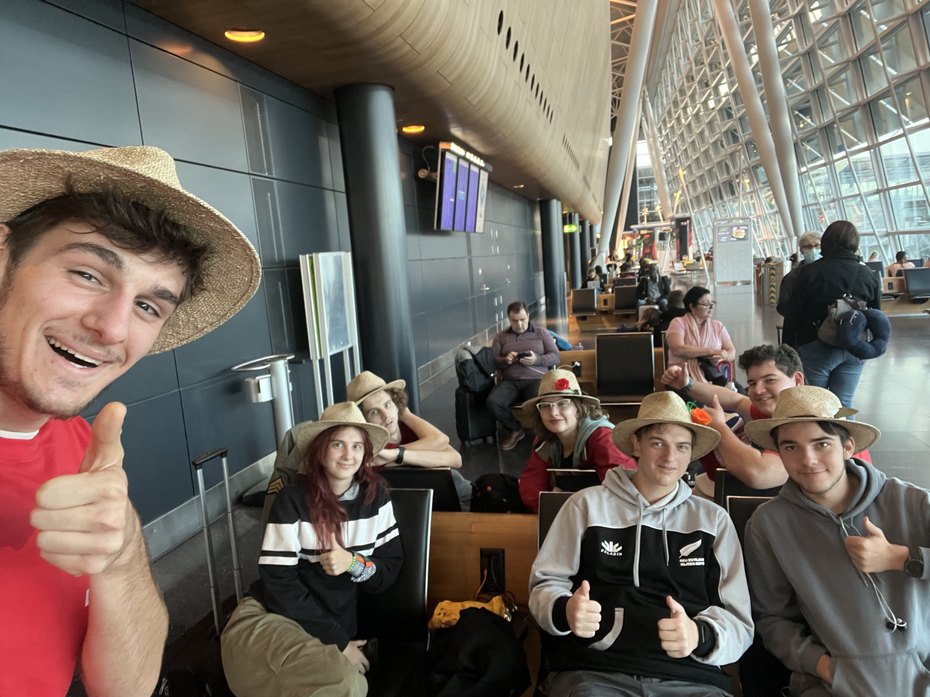

A few meals, uncomfortable sleeping positions and films later, we landed at Zurich airport. Here we once again rode the train with the accompanying voice of the cartoon heroine Heidi, so as to reach the right part of the airport. One promotional video for our supporter Zavarovalnica Triglav later, we made our way from the part of the airport with the best shops to our final gate. The Swiss temperature pleasantly surprised us, as for once we did not break into a sweat. The flight to our home capital was short; all that remained for us was the hardest part – saying goodbye.

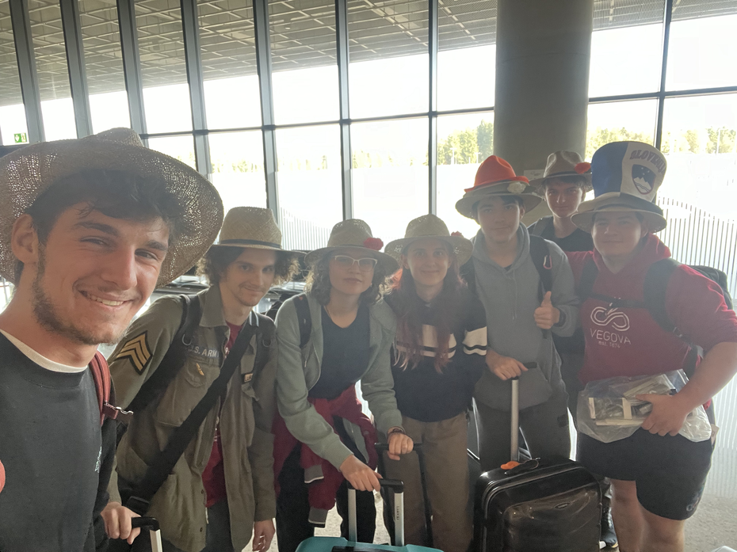

Until next time
再见
