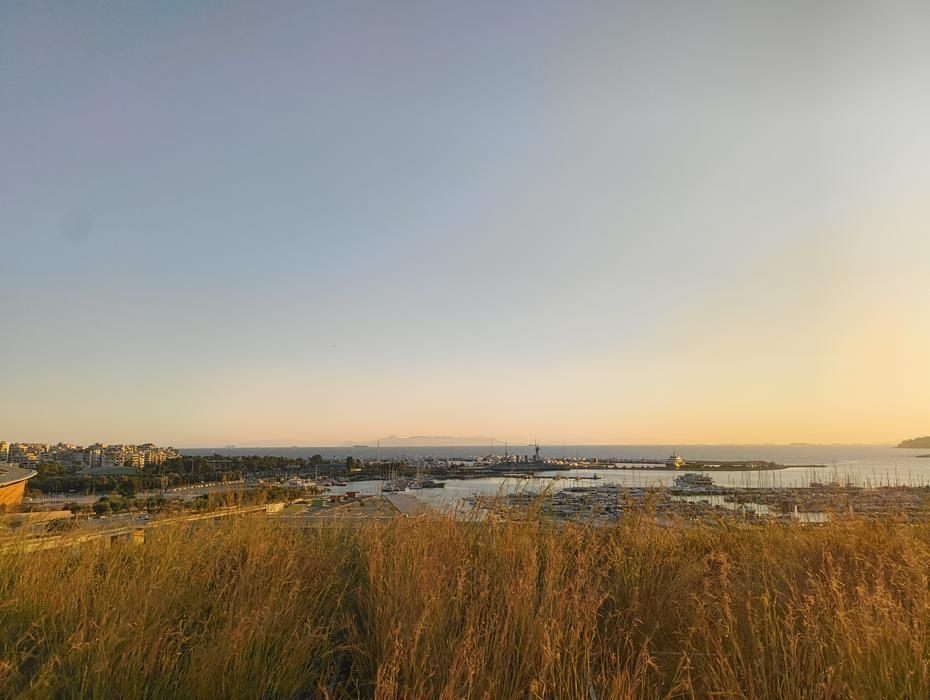

The second day of autumn had arrived, and we set off for the land of inventors, gyros and gods. We whiled away the early hours at Brnik airport weighing our luggage and sorting out our tools and batteries. Security was soon behind us, so we could wait for boarding in peace, gazing out at the rainy weather.
<!-- truncate -->

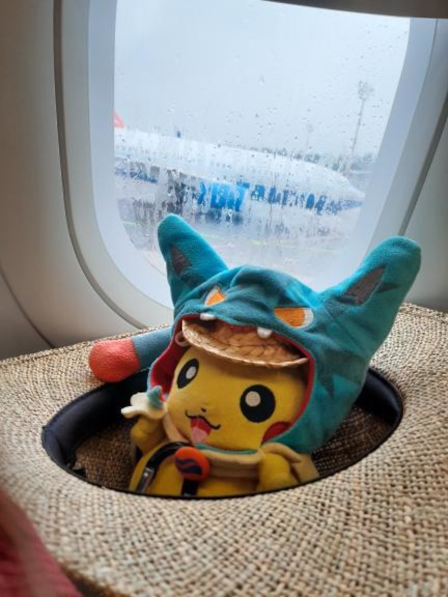

The two-hour journey passed quickly, and soon after a snack on the aeroplane we found ourselves at the airport of the harbour city of Athens. Higher temperatures, together with the staff of the FIRST Global Challenge robotics olympiad, awaited us outside the airport. An hour’s wait for our coach to leave was followed by a half-hour drive along a motorway not unlike the American ones. On the way into the city we were surrounded by dry vegetation, which, combined with the temperatures, reminded us of Dalmatia.

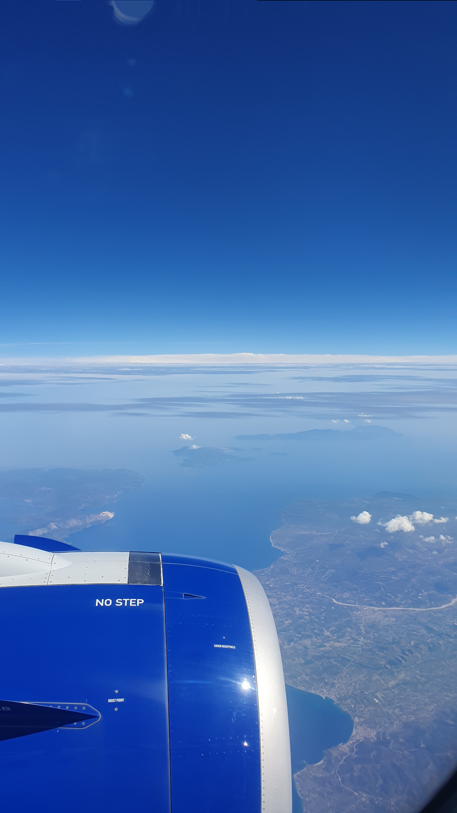

The city centre had a character all its own. In short, it is a mixture of good and bad, as the finer institutions and shops are surrounded by forgotten, outdated infrastructure or even rubbish. On the way to the hotel we saw two statues that put us in mind of Soviet times, several handsome buildings that are in fact banks, academies, libraries and the like, and also a small group of traditional Greek soldiers walking along the pavement.

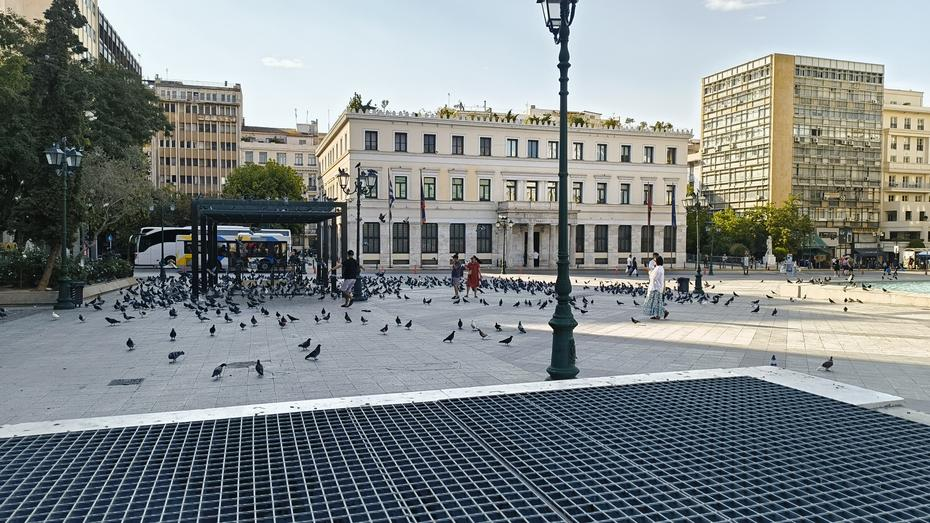

We were pleasantly surprised that the Hotel Titania, where we would spend the nights of our Greek adventure, is one of the finer buildings in the city. The rooms of the four-star hotel were, admittedly, another story, but they will do nicely for catching forty winks each night. We treated ourselves to a short rest, changed our clothes and set off into the city centre.

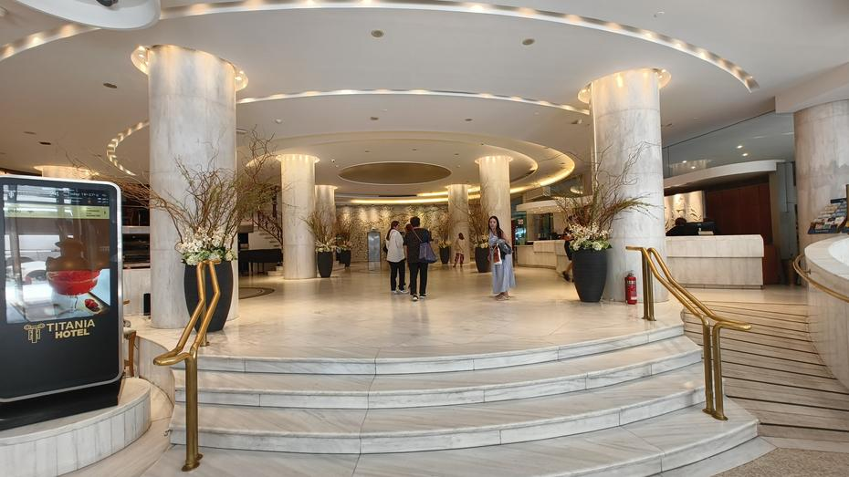

The way to our meal at the Potato King restaurant took us across the road and through a park, where we had our first glimpse of the harsh reality of the city we were visiting. The sight of people under the influence of substances, and of needles on the ground, told us that we must take care over when we spend time outside the hotel, and above all where. We covered the rest of the way along the main roads, where we merely strolled past newsagents’ kiosks and stalls selling tools, food and all manner of older goods. Along the way we also noticed some smaller halls resembling markets, from which came the smell of fish. The closer we came to the city centre, the lower the noise and the greater the number of cafés and shops on either side of the road.

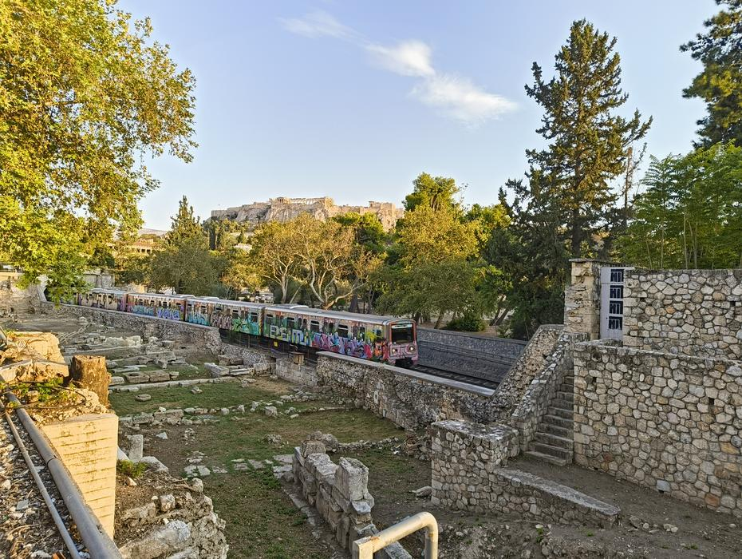
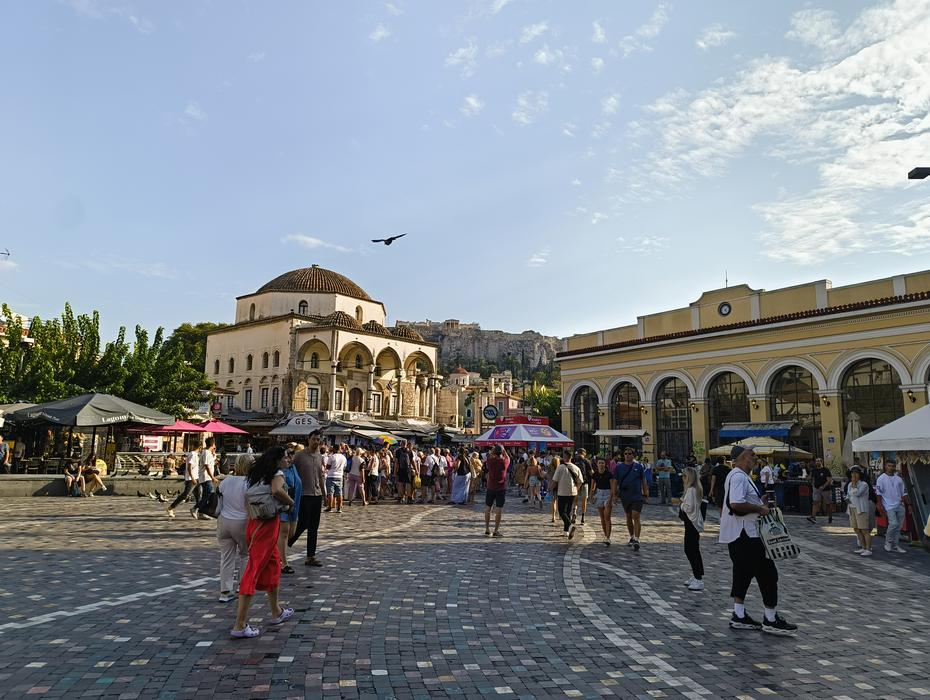

The central square was graced by a small chapel, a view of the Acropolis – or rather the Parthenon – and wooden steps. We changed our route to lunch and made our way through a market that had everything from souvenirs and printed T-shirts to vinyl records and bicycles. At the end of the market we turned our gaze to the remains of ancient times, which they have fenced off here and there about the city. Potato King fortified us satisfactorily with a good many chips, cheese balls, wraps and sauces.

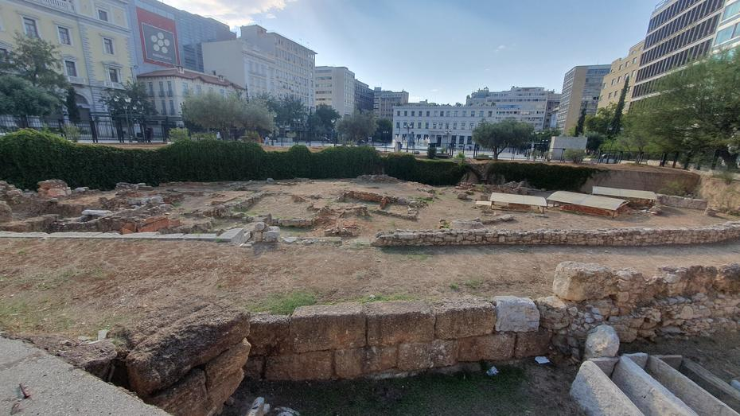
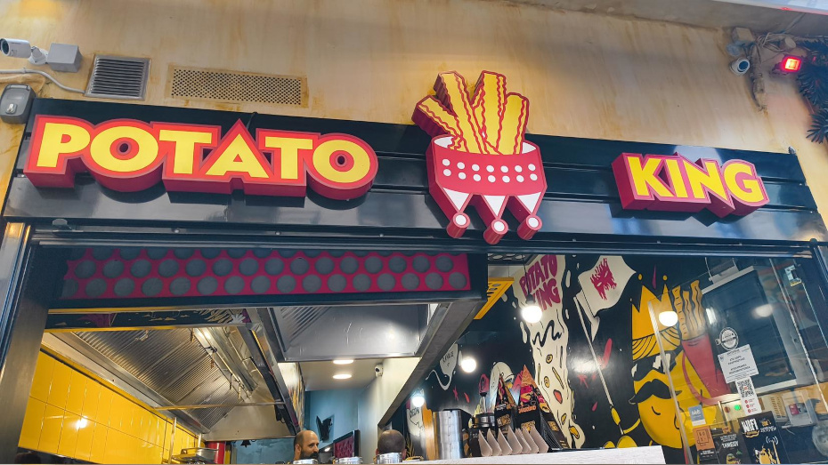

After lunch we went to see the Little Kook café, a house decorated to match the season. We were treated to Hallowe’en decorations, which had also been put up on the opposite side of the street and in the little lane leading to it.

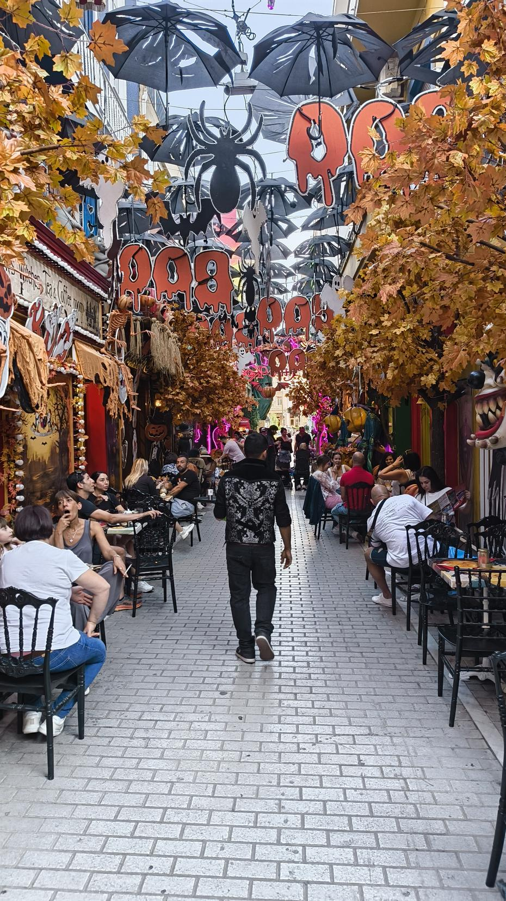
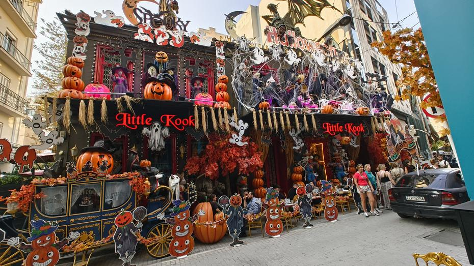

The way back to the hotel included a stop at a local shop, where we bought a small supply of juice and sweets to be consumed later whilst writing our robot’s technical documentation.

Until next time,
lahko noč
