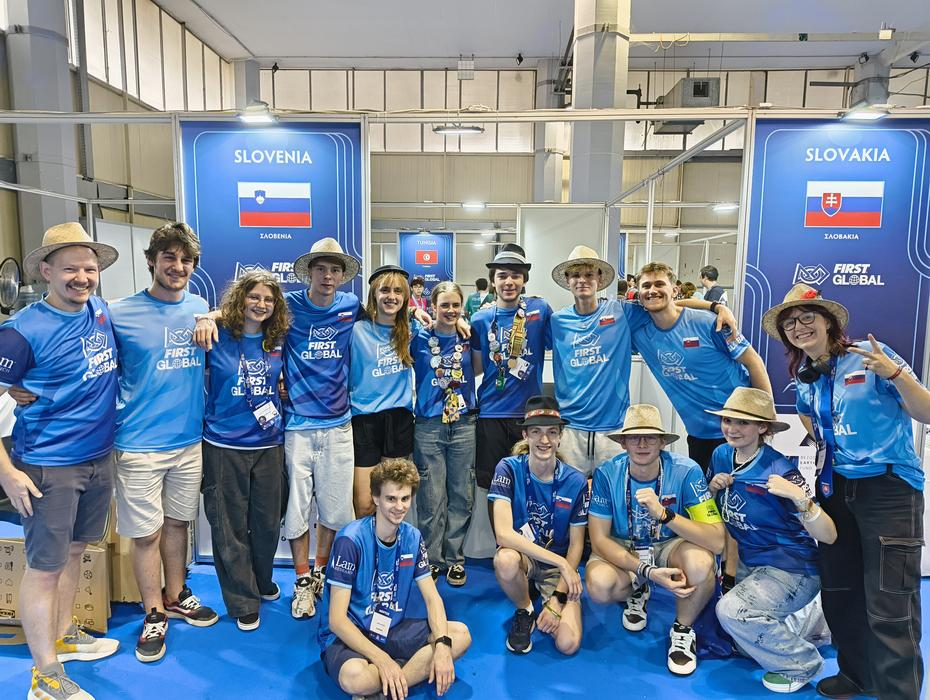
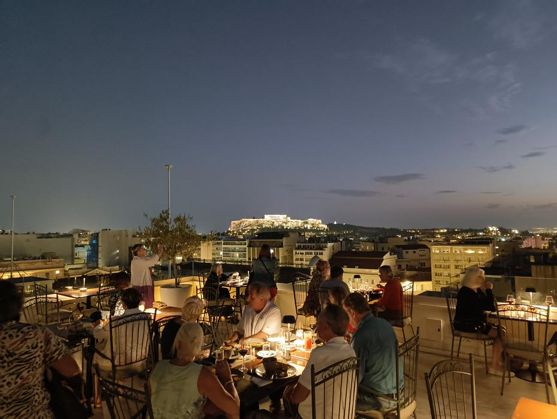
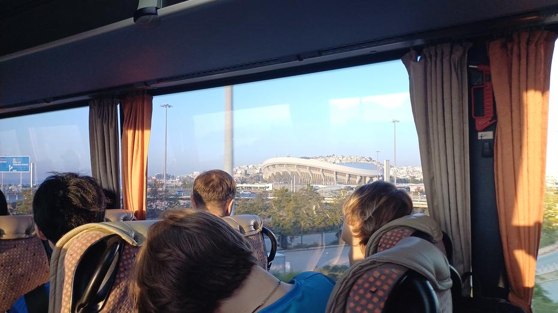
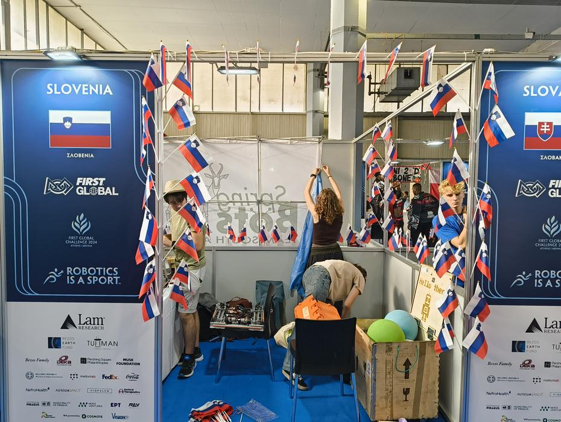
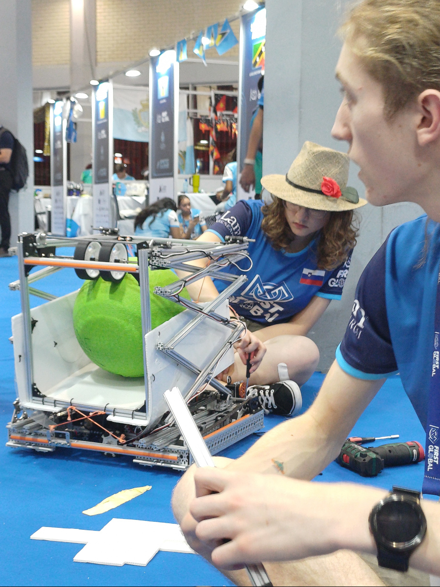
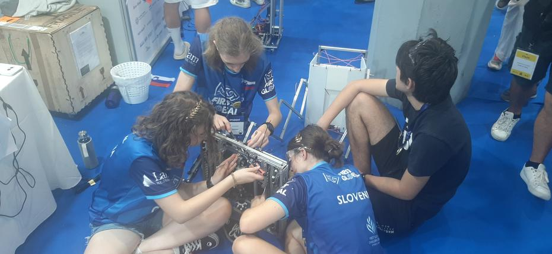
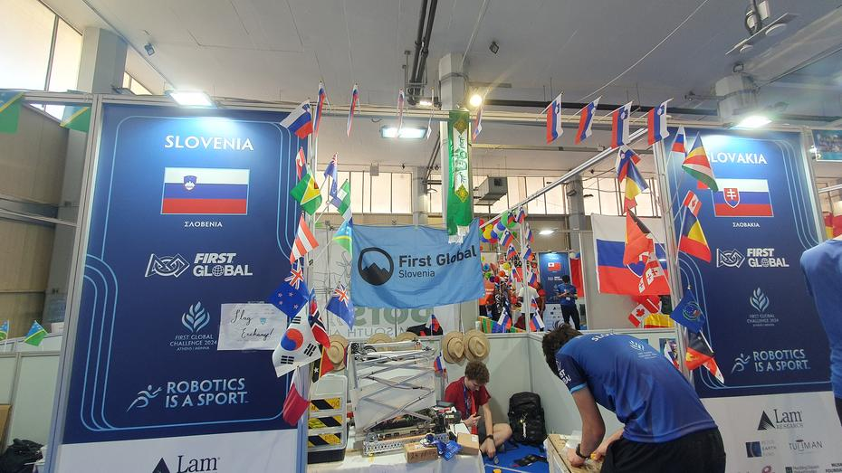
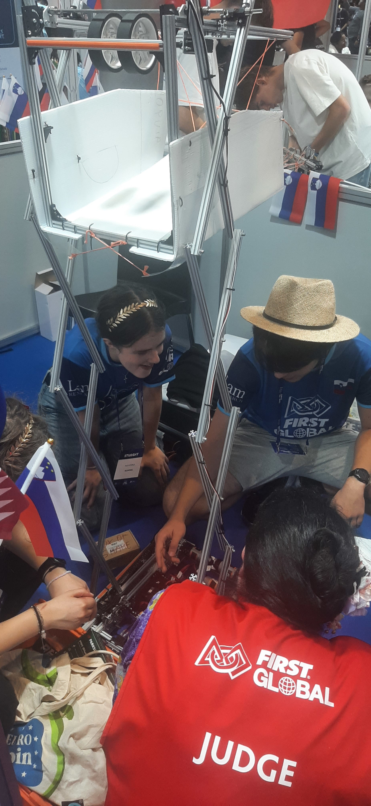
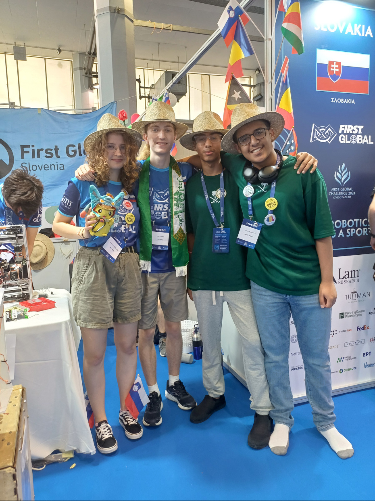
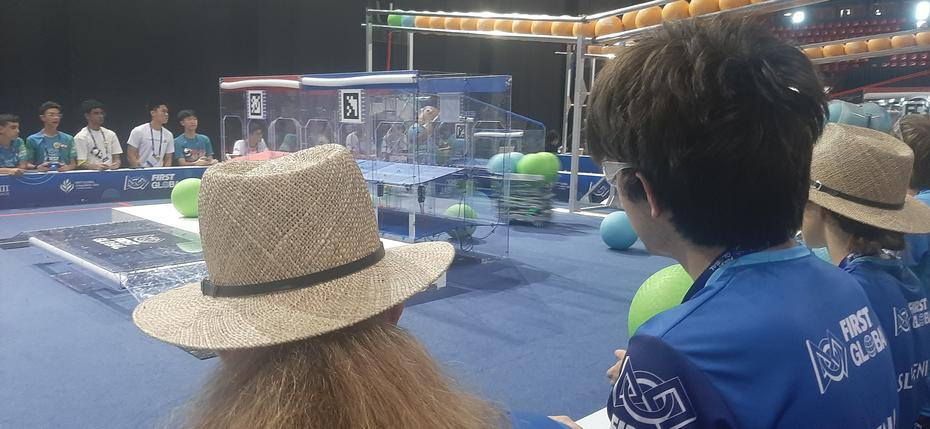

We began our Wednesday with a hearty breakfast at sunrise on the roof of the Hotel Titania, which we had to reach by way of the emergency stairs, as the lifts were all taken. On the 11th floor a crush of people awaited us, along with a view of the Acropolis. The shortage of cutlery was made up for by the tasty food, which we had to clear from our plates quickly so as not to miss the coach, as had happened to some countries, whilst some others had not even arrived in Athens yet.
<!-- truncate -->

The coaches full of Olympians took the motorway to the Peace and Friendship Stadium. The Olympic arena stands right by the sea and has a curved roof in the shape of a crisp. With every coach, the rising temperatures were joined by the voices of team members waiting impatiently for the entrance doors to open. In the meantime we had the chance to greet old friends, namely the teams of Slovakia and Norway. The chatter and the befriending of new members passed quickly, and it was time for each country to find its place in the Olympic alphabet, unpack its tools and begin work on its robot.

Our settling in to the corner bearing the sign ‘Slovenija’ was enlivened by old friends from South Africa, Slovakia and the Solomon Islands. After that we unpacked the robot and began a small post-transport service, which was interrupted by a great misfortune – the chain slipped off one of the sprockets of our lifting mechanism, owing to the unfortunate position of a nut and bolt, and then jammed between the sprocket and the aluminium profile. On top of that, the chain had not been assembled correctly. We soon took the chain apart, mended it, threaded it back on and joined both ends together. The robot’s chassis was ready; all that remained was to test the lifting mechanism, which resembles a pair of scissors.

With the help of elastic bands, the lifting mechanism was capable of raising two balls. Concern arose amongst the team members over the whole mechanism tilting as it rose or descended. Since its path was the same going up as coming down, we decided to leave the mechanism as it was. There followed a few test lifts and some adjustment of the ramp that lets the balls roll of their own accord towards the exit of the box. In doing so, we had to adjust the incline, as an under-inflated ball could escape from the box if the robot stopped suddenly.

During the repairs, our mentor Luka brought a box of team shirts, bags, bottles and other small gifts that every country receives. We could at last exchange our sweaty clothes for sports shirts, and soon afterwards we discovered that the cause of the heat in every country’s workspace was a wrongly installed air-conditioning unit, with its outdoor unit at our end. After that we decided to start a worldwide flag exchange, in which every country can have a Slovenian flag if it leaves its own with us.

Soon after these moments of gift-giving, we went to lunch, which involved quite a few menus and a large hall that is otherwise a gymnasium with basketball courts. After lunch with our friends from Norway, we went back to our pit full of energy, where, soon after our return, we had the opportunity to get the robot inspection done. The lady examined our robot thoroughly and, after a demonstration of its workings, said that we had done a wonderful job. She forgot to give us the sticker for passing inspection and the LED-light indicator that shows which side (alliance) one is playing for, so we received those later.

After the inspection the students split up, some marching off to the practice fields and the others going to get to know the other teams, or rather countries. In the meantime the two mentors minded our pit and chatted with the mentors of other teams.

Once all the students had gathered at the workspace again, we heard over the loudspeakers about the drivers’ meeting, which we had also spotted on the schedule published in advance. Over the course of the meeting, a good hour long, the drivers and the so-called human players learnt more about the rules for running the matches themselves. Straight after the meeting ended, an opportunity for a practice match arose, and one call later the robot was already on its way.

After quite some time the students returned, just in time for dinner, as luck would have it. This time, too, we went in two shifts on a walk of a few minutes around the entire arena to reach the dining hall, where a new menu and another hearty meal awaited us. After dinner we tidied up our pit and went to catch the coach home. Before turning in, we made our final corrections to our documentation and arranged with the staff at the hotel reception for it to be printed.

Until next time,
dobru noc
