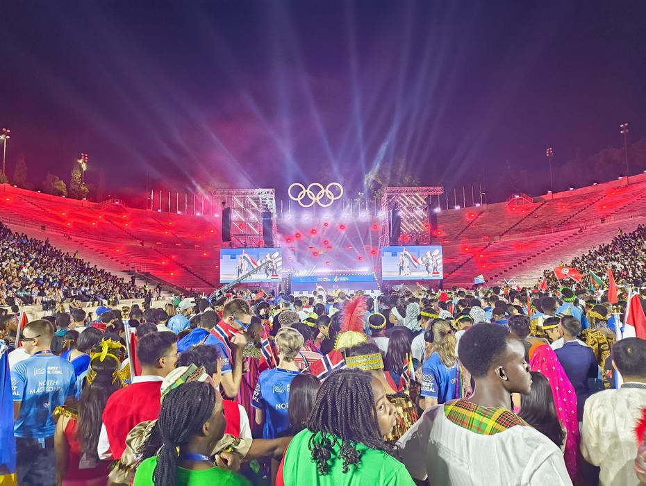
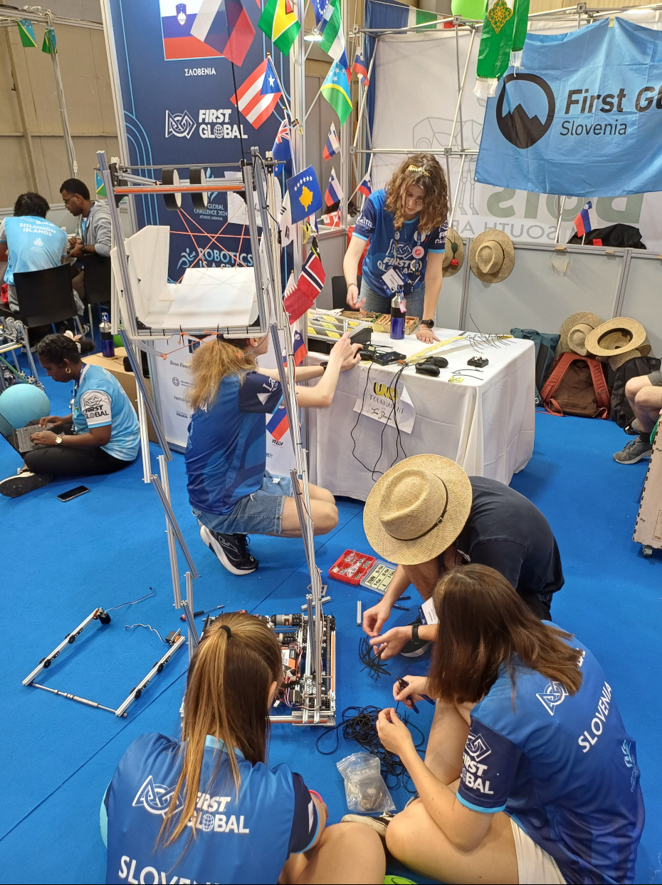
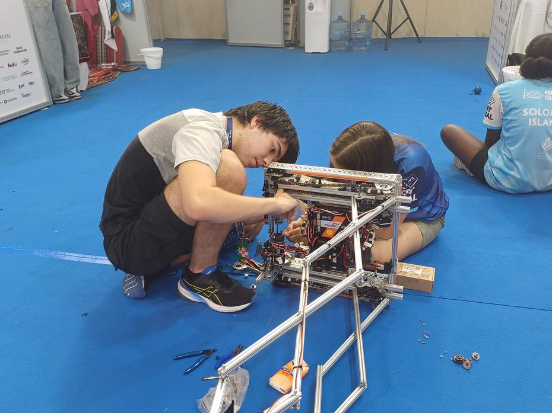
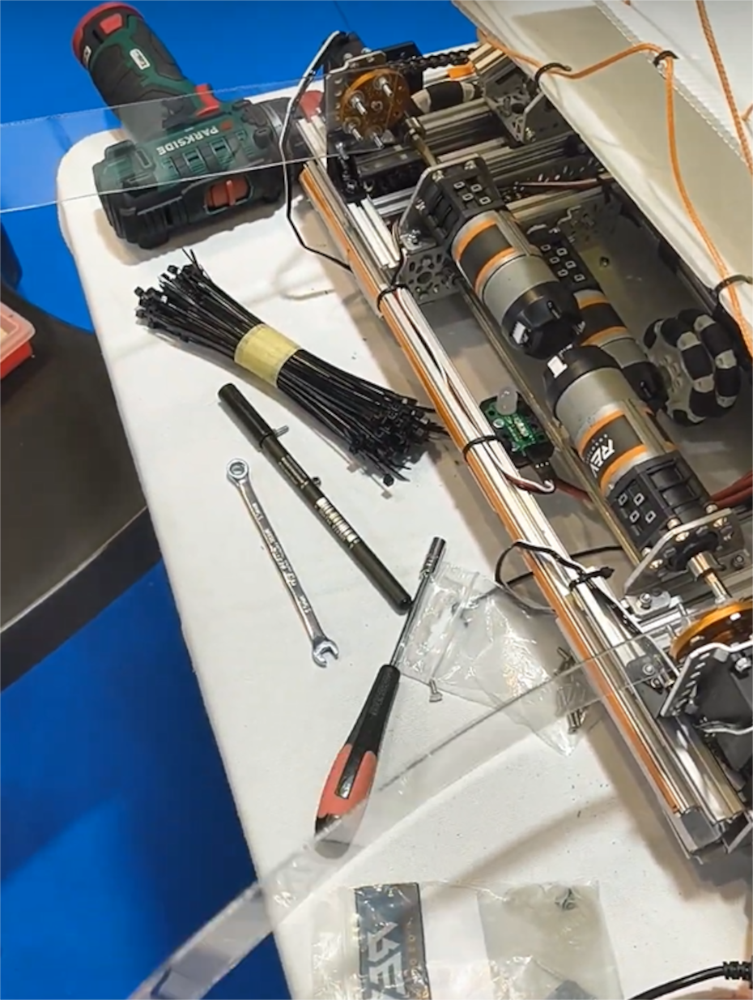
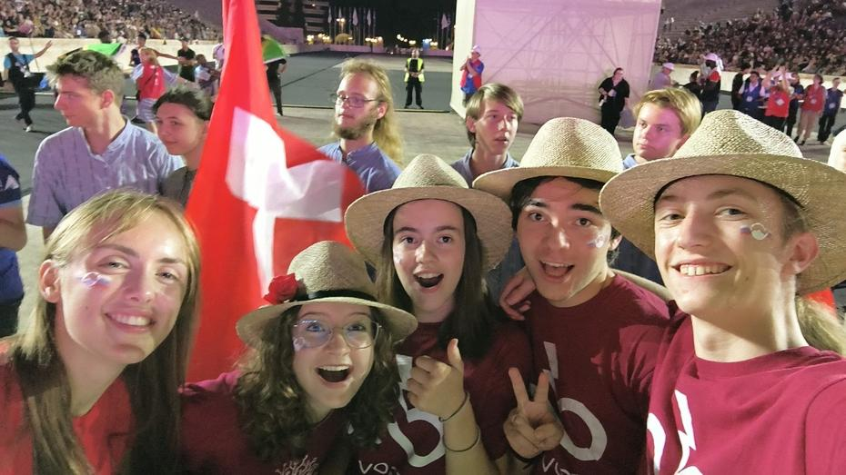
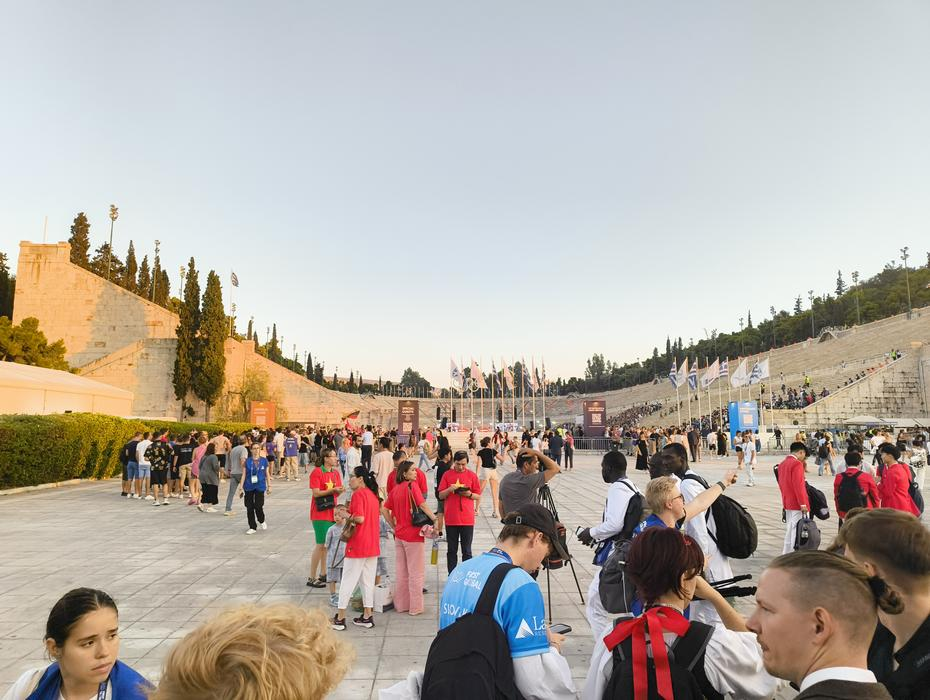
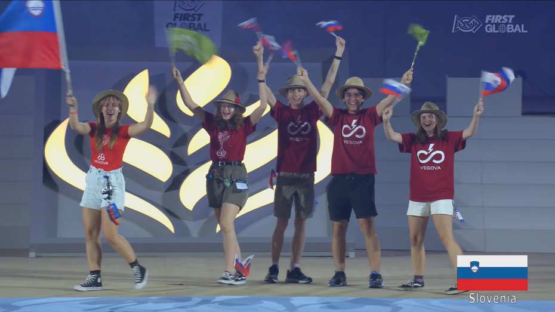
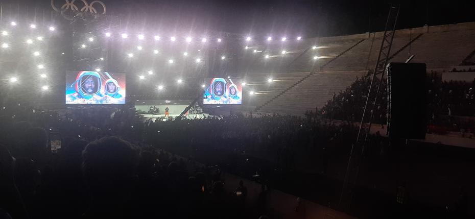

The robotics olympiad has begun! 26 September had arrived, the first of four days for our Olympic robotics team. Another hearty breakfast and the journey to the Peace and Friendship Stadium were followed by settling into our pit once more and handing in our robot’s technical documentation.
<!-- truncate -->

Aware that a long day lay ahead of us, we decided to save our energy and practise driving the robot. Our booking of a practice field came round soon after we arrived, and so the two drivers and the two human players could practise. At the end of an intensive driving session, after some fifteen minutes, we discovered that the robot was noticeably weaker owing to a broken component – otherwise reckoned one of the sturdiest – on the lifting mechanism of our box. Replacing it was relatively simple, as the two High Strength Hubs were located directly behind the drive motor and on the assembly with the driven shaft.

During practice we realised that more points could be gained if we could bring the orange ball, which represents food obtained from water and energy, to the human player. The original idea involved pushing the ball along, which, however, is rather unpredictable. We therefore decided to build a fence for the ball, with which we could reliably push, or rather drag, the ball to the human players. The first prototypes consisted of structural elements of clear plastic (polycarbonate), cardboard and sticky tape, the whole thing driven by two servo motors. The additional component was a challenge of its own, as it had to be able to tow the rubber ball steadily and also fold away compactly enough for the robot not to exceed the size limit of 50x50x50 cm. The first attempts proved qualified successes, as the robot could tow the ball behind it, but only very slowly. Turning the robot in a circle also posed a great problem, as, just as when towing too fast, the ball could escape owing to the plastic component bending.

The working part of our day soon came to an end, with lunch in between and a very early dinner, followed by time to change into the traditional dress in which the teams were to represent their countries at the opening ceremony. For the last three years, our team’s non-national costume has been the shirt of our secondary school – Vegova Ljubljana – so changing shirts was no great drain on our time. With that, we finished work for Thursday and left the rest of the fitting of the robot’s new mechanism for the following day. Before leaving for the opening ceremony, we tidied our workspace and played a round of the card game Uno Flip, which caught the attention of some passers-by; they could not join in, however, as we were called to begin our way to the coach just as the game ended.

We set off in a line together with our neighbours from Slovakia and the Solomon Islands. On the way to the Olympic stadium (the Panathenaic Stadium), we were treated to karaoke led by members of the Slovak team. When we arrived in front of the stadium, a long queue of our fellow competitors and other visitors to the free event awaited us.

We two mentors were soon separated from the students and joined the herd hurrying to the tiered seats as close as possible to the stage, where a DJ was playing music as we arrived. Before long the two hosts greeted us, and we could watch pre-prepared videos about the purpose of the FIRST Global Challenge olympiad. This was followed by an opening performance from a dance group, and after that by the parade of flags, in which 193 teams (each from its own country) could step onto the stage in national costume and wave their flags.

The festive sea of flags was followed by a speech from the founder of FIRST, Mr Dean Kamen. After a lengthy speech on the importance of the programme in which we take part, as it brings unity and the knowledge needed to achieve a better tomorrow, there followed a performance by the Black Eyed Peas.

The good tunes ended all too soon, and with them the opening ceremony. We made our way to the coach back to the hotel, where well-earned sleep awaited one of us, and a walk to the nearby McDonald’s the rest.

Until next time,
gudnaet
