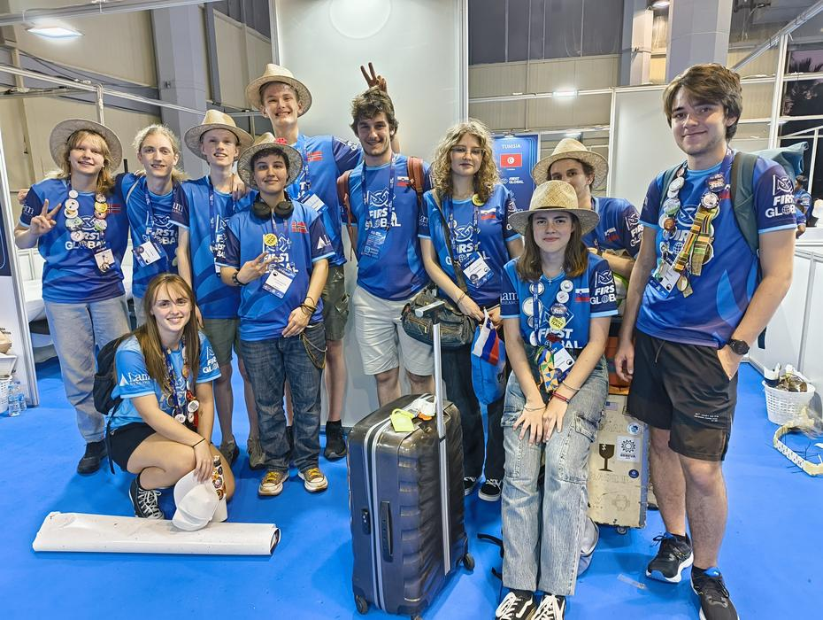
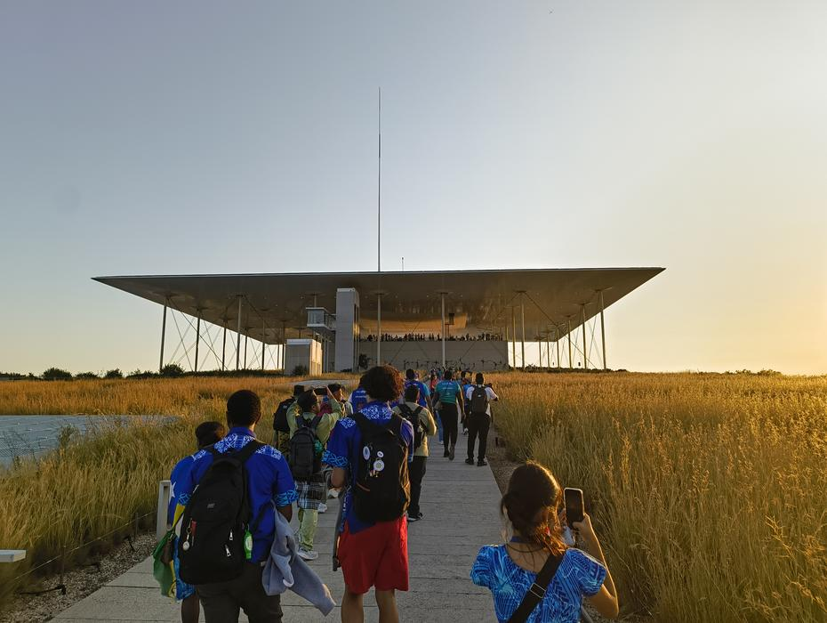
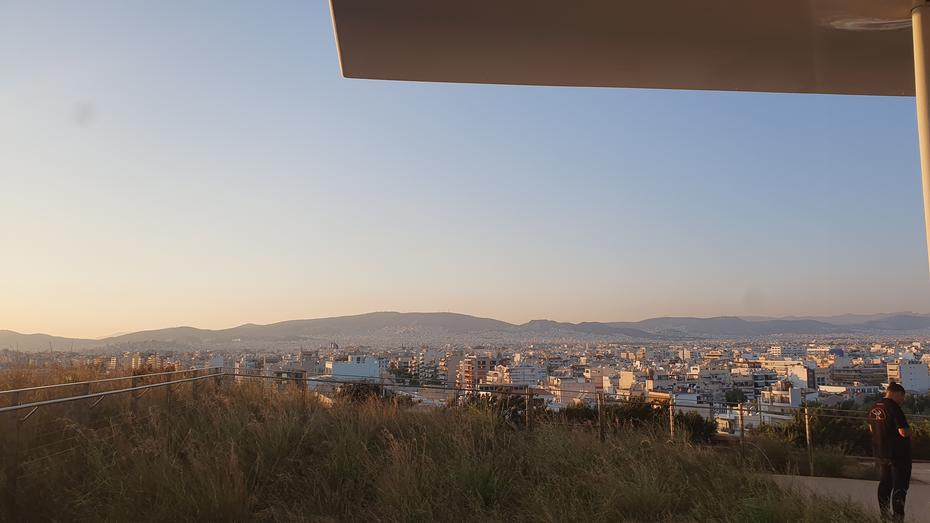
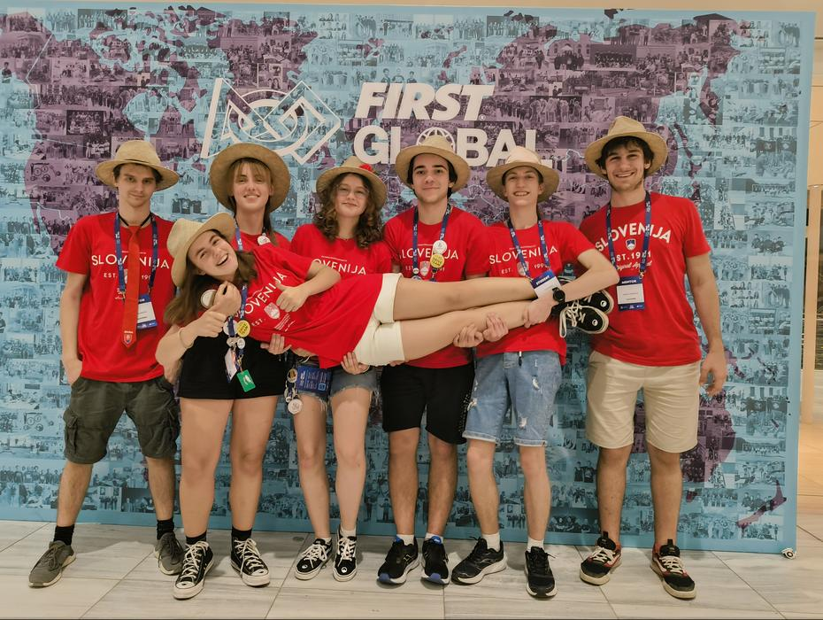

After a long night and a short sleep, we opened our eyes to the first day of competition. The same morning ritual and the journey to the Peace and Friendship Stadium were followed by the promised session of repairs to the robot, or more precisely to the ball-catching mechanism. After a short test session we changed our approach, opting for one similar to the solution of our colleagues from Norway. We built the ‘cage’ from aluminium profiles and shafts fitted with collars, which reduced friction and so let the ball glide along, turning freely on the shafts.
<!-- truncate -->

As time passes ever more quickly the closer one comes to the ranked matches, we did not manage to fit the new mechanism, which would have needed additional programming of its components in order to work properly. For that reason, we dashed off to our first serious match, number 22, which we played alongside Morocco and Tunisia. Unfortunately we were beaten 24–32 by the blue alliance, made up of Iraq, Italy and Laos.

<iframe title="YouTube video player" src="https://www.youtube.com/embed/V06dYpW1Yrw?start=4489" style={{ width: "100%", aspectRatio: '16/9' }} frameborder="0" allowfullscreen="allowfullscreen"></iframe>

Minor repairs and the opening practice gave us extra motivation, which came to the fore in our second match, number 51, which we played in the company of the teams from Montenegro and the Cayman Islands. This time we finished with a stronger score of no fewer than 55 points, which the opposing alliance nevertheless managed to equal. In the match against Niger, Belarus and the Cook Islands, there was no winner.

<iframe title="YouTube video player" src="https://www.youtube.com/embed/Pu7E_WJHU_g?start=12575" style={{ width: "100%", aspectRatio: '16/9' }} frameborder="0" allowfullscreen="allowfullscreen"></iframe>

Soon it was time for lunch, which, together with the match we had all but won, gave us extra energy. Once again the whistle announced the start of a match, this time number 82. We joined forces with Cyprus and Ecuador and won 48–42 against Angola, Algeria and Botswana.

<iframe title="YouTube video player" src="https://www.youtube.com/embed/V06dYpW1Yrw?start=17316" style={{ width: "100%", aspectRatio: '16/9' }} frameborder="0" allowfullscreen="allowfullscreen"></iframe>

The last match before our scheduled multicultural dinner was number 102. This time, on the red side, we worked with Japan and Uruguay. All was running smoothly until something in the robot made an unpleasant noise, followed by a very crooked trajectory of the lifting mechanism. On top of this mishap, we had to replay the match from the start because the field elements malfunctioned (when the condition was met – a blue and a green ball in the basket – the orange ball was not released). One last attempt to use the lifting mechanism resulted in a change of strategy, to the extent that we merely ferried hand-loaded balls to the collection area on the floor. Alas, this time we countries of the red alliance ended up in the red on the scoreboard too, as the match finished 57–77. With that, we ended the first day of ranked matches with 1 win, 1 draw and 2 defeats.

<iframe title="YouTube video player" src="https://www.youtube.com/embed/Pu7E_WJHU_g?start=20014" style={{ width: "100%", aspectRatio: '16/9' }} frameborder="0" allowfullscreen="allowfullscreen"></iframe>

The time had come to change into somewhat different clothes. This time we chose T-shirts bearing the word ‘Slovenija’ and, when called, set off by coach for the Stavros Niarchos cultural centre. On the coach to the Athenian answer to Ljubljana’s Špica or Tivoli, we were kept company by members of the Slovak team from the hilly north of their country. A stroll past the building and the still water of the cultural centre gave nothing away as yet, but round the corner the glass part of the building revealed itself, its interior, floor by floor, reminiscent of the renovated Cukrarna, Ljubljana’s old sugar refinery. The place is evidently much frequented by people out walking, who linger in the café or gather on the nearby lawn. We followed the volunteers carrying ‘FIRST Global Challenge’ signs, and so our way led up a ramp, then through a small park with low trees and a lawn, and up yet another ramp to the top of the cultural centre. There, all 193 teams were greeted by music, a panoramic view and a variety of food (the ice-cream bar opened later).

And so we ended the day with music and food and a view of the sunset. Unfortunately our departure was delayed, although the day was meant to close with the drummers’ performance and dance. So we left for home some two hours late; some of us went off to a well-earned rest, whilst others brandished playing cards before bed.

Until next time,
god natt
