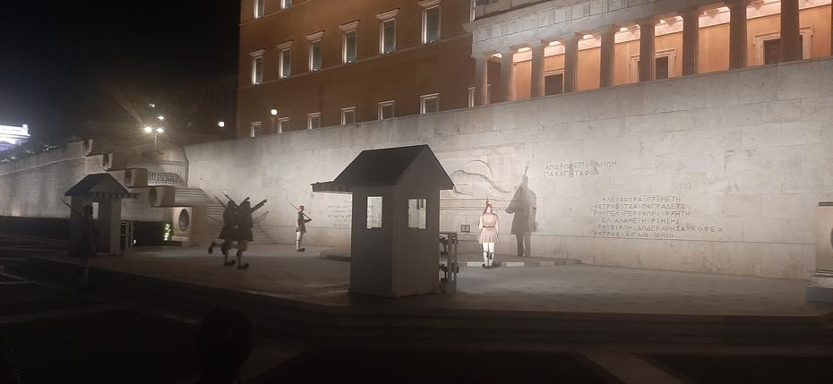
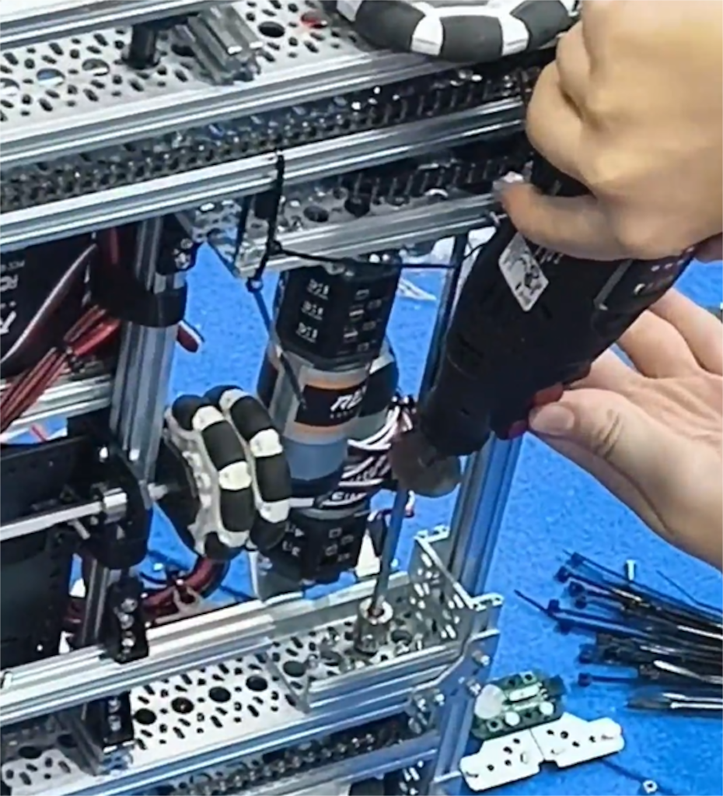
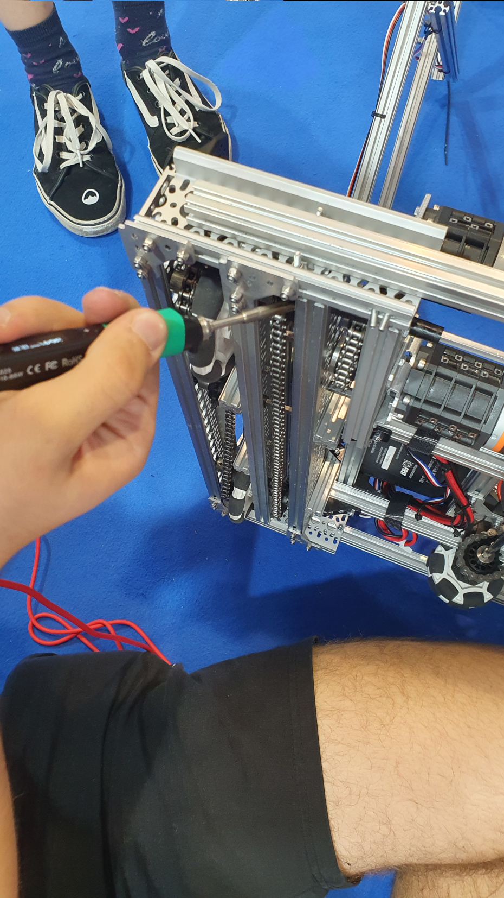
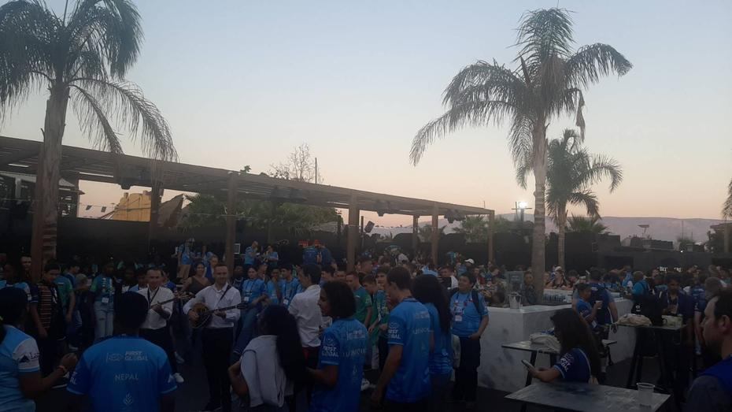
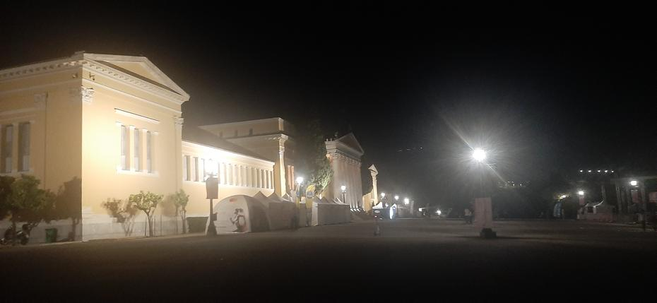
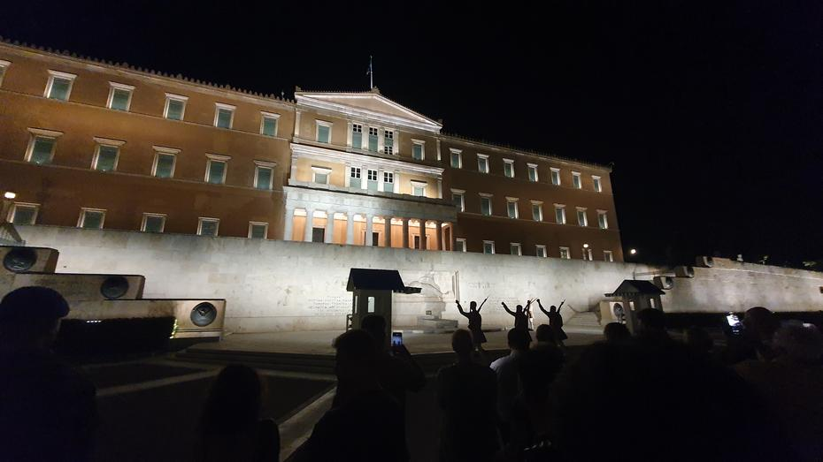
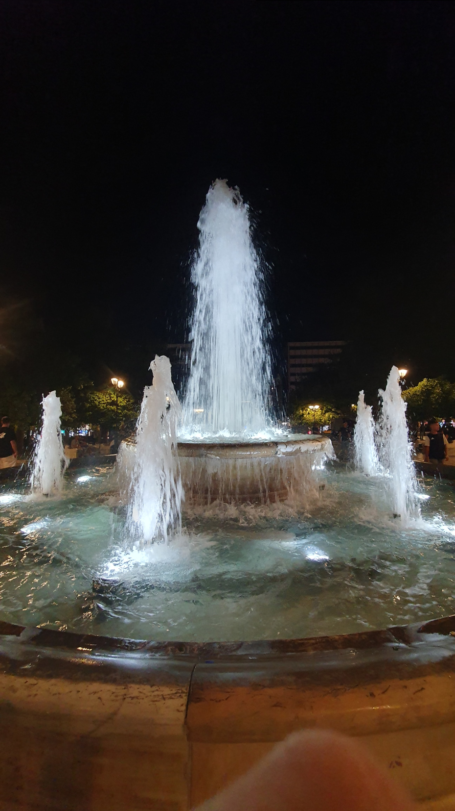

Saturday had arrived, our penultimate day in the Greek capital. The morning ritual was followed by a generous helping of work, as the robot had to be put in order before the first match of the day, which was not very long after the hour of our arrival. Unfortunately the work with the screwdrivers dragged on to such an extent that we played one match without a robot, with only our human player representing the team. So it was that we ended match number 123, in the company of Argentina and Cape Verde, against the line-up of Saint Vincent and the Grenadines, the Maldives and Sudan, with a defeat (16–58).
<!-- truncate -->

<iframe title="YouTube video player" src="https://www.youtube.com/embed/8MyPCVkS7EQ?start=2029" style={{ width: "100%", aspectRatio: '16/9' }} frameborder="0" allowfullscreen="allowfullscreen"></iframe>

The work on the robot was not yet finished, but soon after the first official match we were scheduled to appear in the additional Skills Challenge competition, where we were supposed to show off one of the robot’s unique capabilities – something which, with a robot that did not work, we naturally did not go through with in the end. We cancelled our appearance and carried on with the servicing. After a while the robot was in a markedly more working state, with a mechanism that managed to rise. A problem arose with lifting two balls, so we were obliged to lift only one in the matches. Bending remained a problem when lifting to 120 cm, but the second match of the day came round too soon. With a whistle, match number 153 set the blue alliance, made up of Slovenia, Vietnam and the Philippines, and the red alliance, made up of Chad, Saint Lucia and Guam, off on their match. This time, once again, the red alliance carried off the win, 53–31.

<iframe title="YouTube video player" src="https://www.youtube.com/embed/8MyPCVkS7EQ?start=7403" style={{ width: "100%", aspectRatio: '16/9' }} frameborder="0" allowfullscreen="allowfullscreen"></iframe>

We later realised that the parts critical to us (the High Strength Hex Hubs) were fitted in such a way that each one failed in turn after the one before it, until the cycle came full circle. Naturally, each breakage meant the part had to be replaced. Testing brought with it more broken components of the same kind, so the robot usually ran well for a little more than one match before it needed servicing. The complex system we designed and built is impressive, to be sure, but it has too little power, or rather too many critical points.

We carried on with the day and played in match number 209 in the company of Moldova and Turkmenistan. On the other side of the field we could see the representatives of North Macedonia, Nigeria and the Virgin Islands (the American territory). This match was of considerable importance to us, as Moldova is one of the best countries in the competition, and it was one of our rare opportunities to play alongside one of the best robots. This time the upper hand was ours, and we came back to the pit smiling and motivated after a match that ended 113–57.

<iframe title="YouTube video player" src="https://www.youtube.com/embed/V9FKjsyXfr0?start=18604" style={{ width: "100%", aspectRatio: '16/9' }} frameborder="0" allowfullscreen="allowfullscreen"></iframe>

Then came lunch, to which we could go somewhat less drenched in sweat, as since the morning we had been cooled by fans making up for the wrongly installed air conditioning. Soon it was time for match number 238. This time we played as a pair only, alongside Afghanistan, which sadly could not bring the rest of its team owing to problems at the border. The third member of the red alliance should have been the team from the Marshall Islands, which, however, did not appear. On the opposite side we could see the robots of the British Virgin Islands, Pakistan and Libya. Victory went to the blue alliance, 43 to 22.

<iframe title="YouTube video player" src="https://www.youtube.com/embed/53eYbymnZd4?start=22979" style={{ width: "100%", aspectRatio: '16/9' }} frameborder="0" allowfullscreen="allowfullscreen"></iframe>

The breaks between matches allowed for regular servicing and also for sampling sweets from nearly every country in the world. Sugar proved a solid raw material for points, but evidently there was not enough of it for us to finish match number 263 on the winning half. This time, on the blue side, we worked with the Federated States of Micronesia and Singapore, on whom our members pinned the nickname ‘Sigmapore’, to which they agreed, beaming from ear to ear. The red side was graced by the representatives of Costa Rica, China and Barbados. This time our side managed to earn no fewer than 85 points, but we fell 8 short. And so the match ended 93–85 to our opponents.

<iframe title="YouTube video player" src="https://www.youtube.com/embed/V9FKjsyXfr0?start=26367" style={{ width: "100%", aspectRatio: '16/9' }} frameborder="0" allowfullscreen="allowfullscreen"></iframe>

During the day we had the chance to look at what the American colleges WPI and MIT have to offer, and also at what Greek education, telecommunications and energy companies do. Besides this, we could also see an example of a wooden robot lady who can move with the help of legumes and pours a mixture of water and wine when a cup is placed in her palm. With these we could while away the time when we were not repairing our over-complicated mechanism.

Serious problems proved fatal in match number 285, which was also the last of the penultimate day of competition. As before every match, we forged a strategy in advance, only this time we were conferring with Luxembourg and Antigua and Barbuda. Although our robots are meant to cooperate, this rarely shows between the blue and the red alliance, the latter made up this time of the teams from Swaziland, Lebanon and Ukraine. Sadly we ended the last match of the day with a defeat, 50–32 in figures.

<iframe title="YouTube video player" src="https://www.youtube.com/embed/8MyPCVkS7EQ?start=29180" style={{ width: "100%", aspectRatio: '16/9' }} frameborder="0" allowfullscreen="allowfullscreen"></iframe>

After the strenuous competitive part of the day, some relaxation is only proper, and the organisers provided it at a bar next to the Peace and Friendship Stadium. There, activities awaited us such as painting watercolour tattoos, a maze, and the decimals of the number pi, after which the party was also named. Our first stop was by the entrance, where we could make a brooch of our own design. This was followed by exchanging a voucher for a soft drink of our choice. Having found a free table without seats (a standing table), we decided to start a game of Exploding Kittens on our feet. During our game, music began to play on the most open part of the dance floor, to which visitors could learn traditional Greek dances. Our few games of exploding kittens stretched out until the coaches left. Whilst waiting by the road outside the bar, we managed to pop down to the sea and dip our toes in. Our wait for the coach to the Hotel Titania was tiring, as we had to wait for the right one out of a long line of coaches, which took about an hour and a half.

On returning to the hotel, we quickly changed and went for a walk about the city. Our first visit was to the national bank, in front of which two soldiers always guard the statue of the unknown fallen soldier. On the hour, the guard changes, which is one of the sights of Athens. As we had arrived a good ten minutes before the changing began, we walked through the underpass, which, amongst other things, is also a station for the underground, but which also has an exhibition open to passers-by. We could see the remains of vessels and of walls, or rather graves. Then we popped over to a nearby park, within which a palace lies hidden, and in front of which, at the time of our visit, stood some small tents that reminded us of the DM women’s run back home.

Just in time, we joined the herd of visitors who had likewise come to watch the changing of the guard. During the changing, two less traditional, or rather less interesting, soldiers stand by a little sentry box nearby: one who will remain there for the duration of the watch, and another who will escort the two soldiers who have just completed their duty. The changing lasts a few minutes and requires visitors to stand at a suitable distance, as otherwise they are told to step back. During the changing, the two new soldiers approach, slowly raising one arm and one leg, with an audible scraping of their shoes, which have a large round pompom on the toe. The soldiers are dressed in traditional garb and wear a cap and carry a weapon at all times. After the changing, the two new soldiers each stand at their post, and the stationed (‘less traditional’) soldier comes to straighten their clothes and caps. The two traditional soldiers who have finished their watch are escorted away by one of the two less traditional soldiers, who must first clear a way through the crowd so that they can pass.

After that we decided to look at a park that resembled Park Zvezda back home, with a fountain in the middle. Some members of the team stopped with a mentor for dinner at KFC, whilst the others went back to the hotel to rest, looking for cross-body bags on the way.

Until next time,
تصبح على خير
