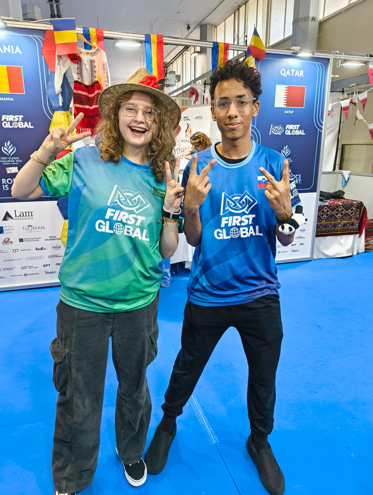
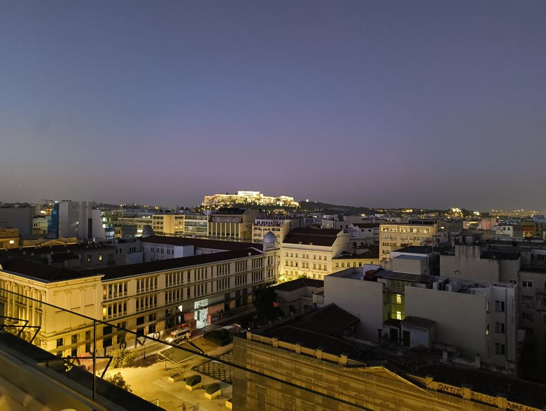
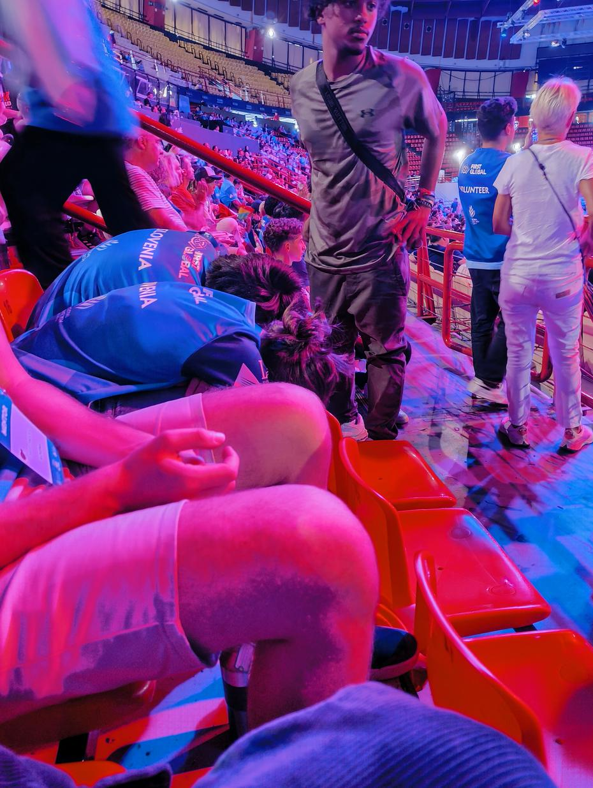
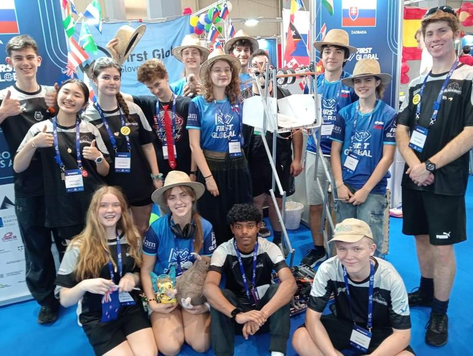
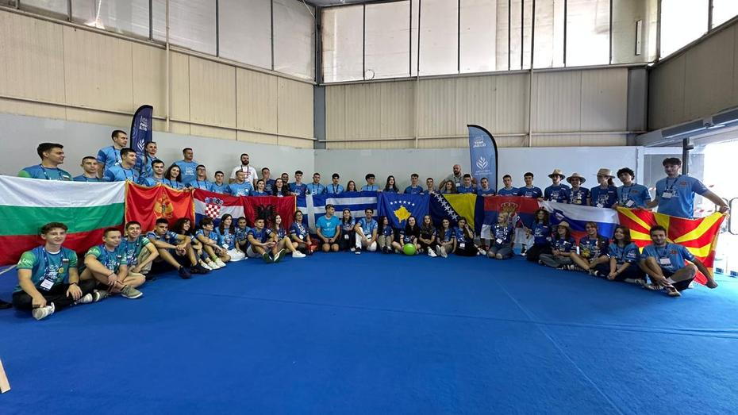
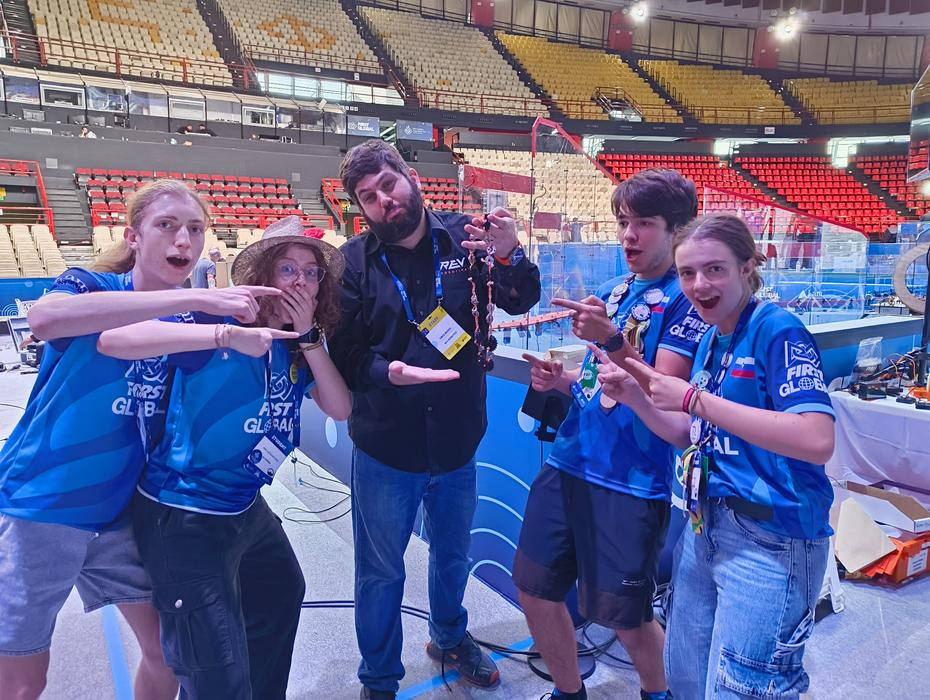
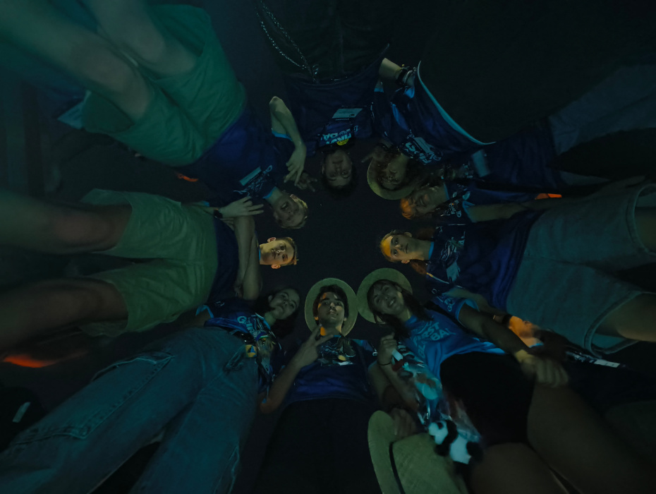

The penultimate day of September had arrived, and with it the last day of the FIRST Global Challenge competition for 2024. The morning ritual was followed by yet more servicing of the robot, as we wished to finish the competition in winning style. Two matches lay ahead of us, which meant that we had the chance to toil away until about half past twelve and then have the rest of the day at the stadium free.
<!-- truncate -->

The repairs were nearly complete, but before they were finished came match number 307, which we played alongside Kiribati and San Marino. The opposite (red) half of the field was graced by the representatives of Serbia, the Bahamas and Syria. Victory slipped from our grasp by a hair’s breadth, and so we conceded defeat, 59–55.

<iframe title="YouTube video player" src="https://www.youtube.com/embed/MRKgTGhcV0M?start=4103" style={{ width: "100%", aspectRatio: '16/9' }} frameborder="0" allowfullscreen="allowfullscreen"></iframe>

‘We have more than an hour until the next match!’ we told ourselves, and carried on with the sorely needed repairs. Soon the robot could stand on its own two feet again, but we changed our strategy so as not to go for the highest baskets, as we did not wish to risk anything else breaking. And so the siren soon sounded for the start of match number 335. The blue alliance comprised Slovenia, Spain – whose robot had the same mechanism as ours – and Latvia. On the other side we could see the colours of Puerto Rico, Switzerland and Kosovo. We won the last match of the olympiad by a resounding 139–119. This last victory made up for all our past defeats and put smiles on our students’ faces.

<iframe title="YouTube video player" src="https://www.youtube.com/embed/TOi5-RFpaGY?start=7669" style={{ width: "100%", aspectRatio: '16/9' }} frameborder="0" allowfullscreen="allowfullscreen"></iframe>

The end of the regular programme was followed by lunch and then the announcement of the top 24 teams and 8 random ones, all of which would be mixed together into alliances of four to battle for a place in the finals. The game would still be played three against three, but each of the four countries in an alliance would have to appear on the field at least once. For the play-offs and finals, however, the rules of the game were somewhat different and thus more demanding – 3 extra blue balls were added at precisely specified positions, which can make extra points possible. We were not called amongst the best 32, so we could treat ourselves to a rest.

For our team, the rest of the day consisted of signing our fellow competitors’ shirts, watching matches and cheering on the Norwegians, who had been selected for the elimination rounds. Our friends from the north soon met with bad luck, however, as one of the robots in their alliance ran into trouble, and so they lost their matches and with them the chance of appearing in the finals. Whilst the students cheered and watched the matches, the two mentors stood guard over the pit and signed more shirts and booklets.

When the team returned to its workspace, we had the chance to swap shirts with our neighbours from Slovakia, as each of us had received 3 shirts. We also cheerfully handed out T-shirts bearing the words ‘Ljubljana je najlepše mesto’ (‘Ljubljana is the most beautiful city’), giving our friends an extra keepsake. We also managed to have our photographs taken with our friends from New Zealand and Norway, and with all the countries of the Balkans too.

We helped ourselves to a few sweets from every corner of the world, and soon afterwards it was time for dinner and for packing up the pit. Before we left, however, our students set themselves the goal of meeting one of the leading people at REV and passing on the message that the most durable part in our kit is not durable enough. Along with the letter came a necklace made of all the broken components.

The end of the event was followed by a long wait for the coaches, as our hotel is evidently rather unpopular. For us this was especially tiring, as we did not sit down on the coach until about nine o’clock in the evening, having been told that the coach to the airport would collect us at midnight. So at the hotel we quickly packed our things and set off on a last walk to the little shop that is always open. There we picked up croissants, drinks and snacks, then hurried back down the hill to the hotel, into the shower and off to the airport. On the way to the airport we also picked up one of the members of the Montenegrin team, who is currently at school in Slovenia and was therefore travelling with us.

At the airport we got the logistics done fairly quickly; more tedious was weighing all the suitcases and distributing the weight. Once we had found out at which gate we were to report, most of the team began a short sleep before it was time to board the aeroplane. We soon arrived in Belgrade, where we passed the time strolling about, watching the sunrise and playing cards. Before we knew it, we had landed in Ljubljana, and whilst waiting for our luggage we recorded a thank-you video for Zavarovalnica Triglav, the insurance company that once again helped us with our insurance this year. We Hatters waved one another goodbye and went home for a well-earned rest and a long sleep.

Until next time,
pō mārie
