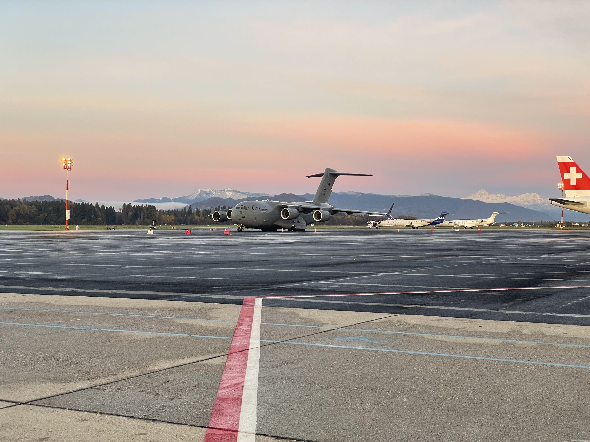
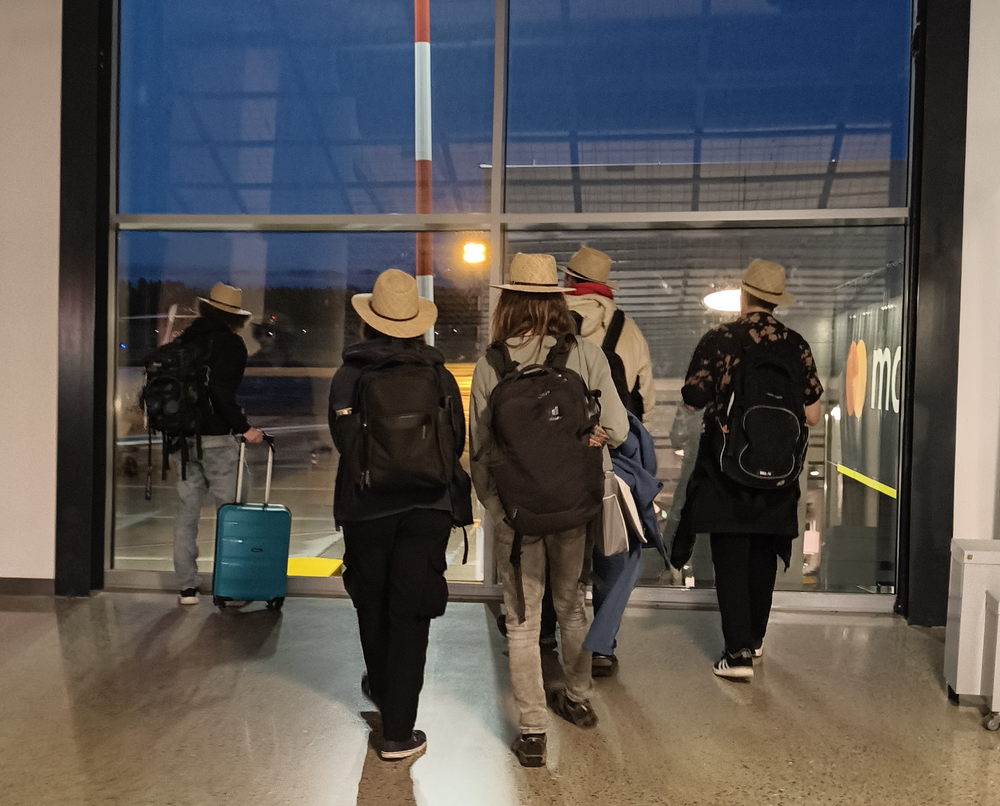
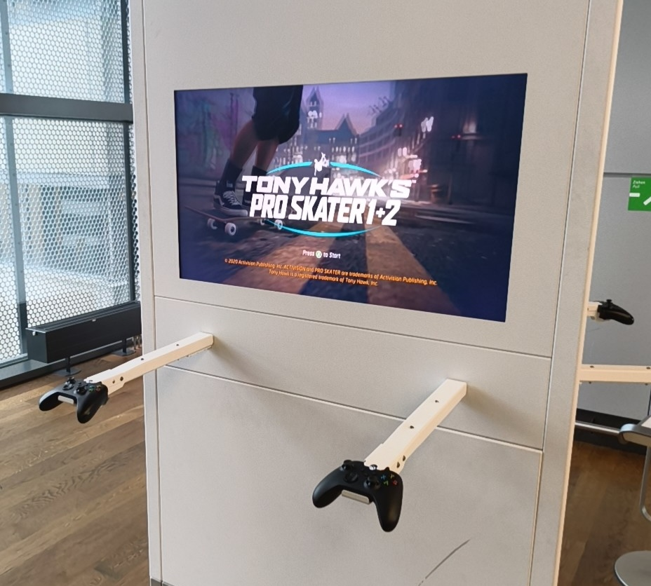
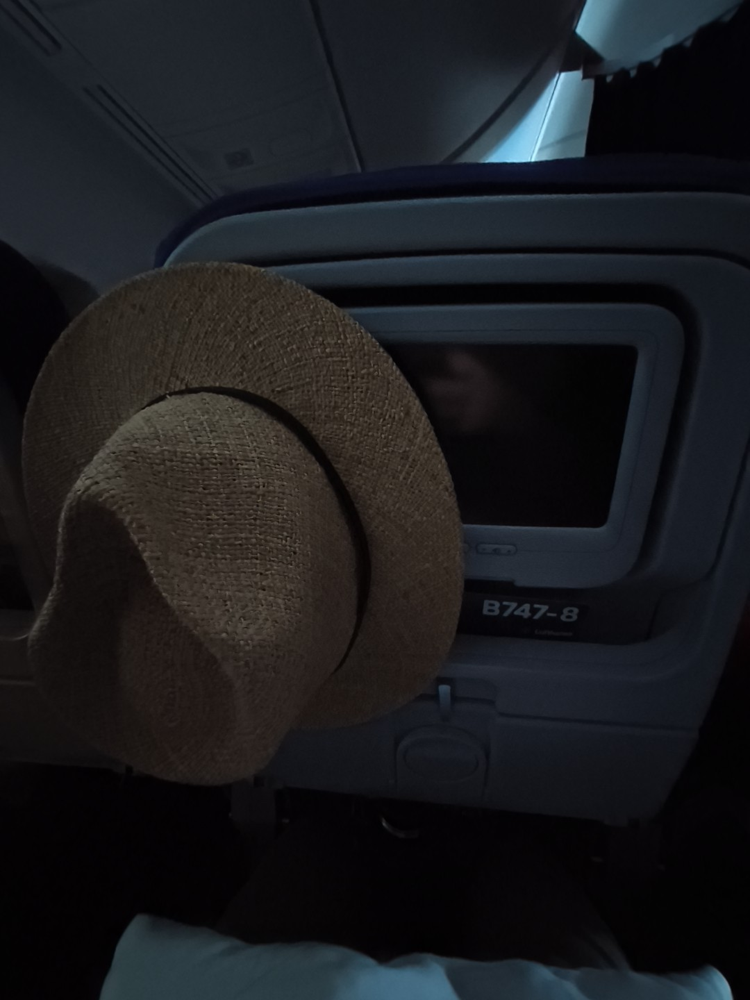
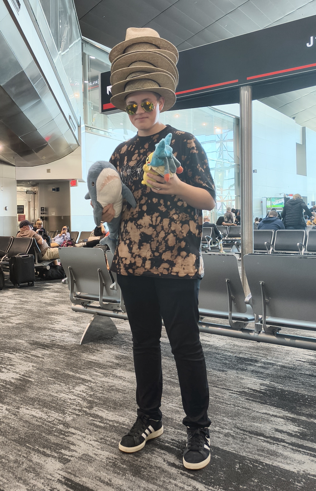
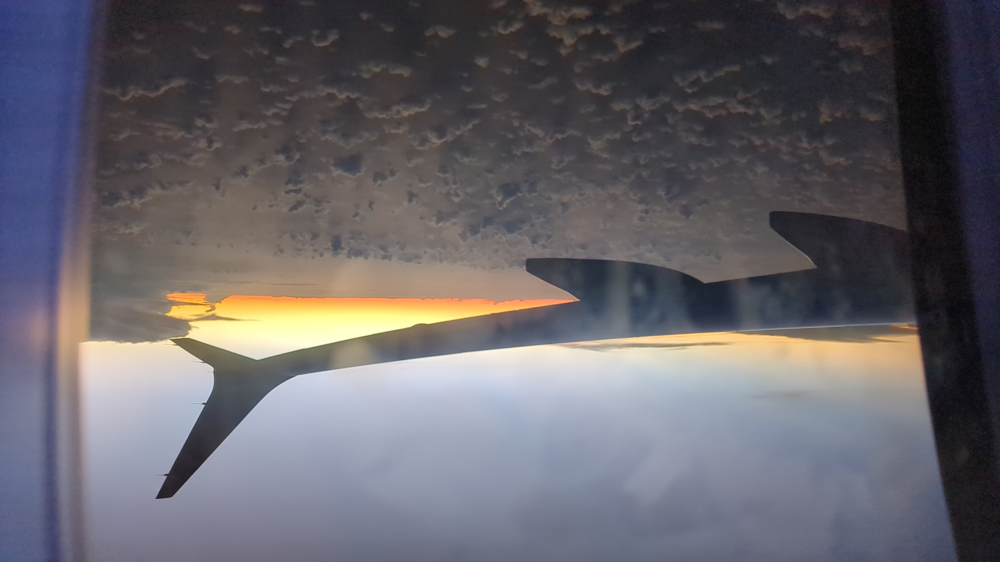
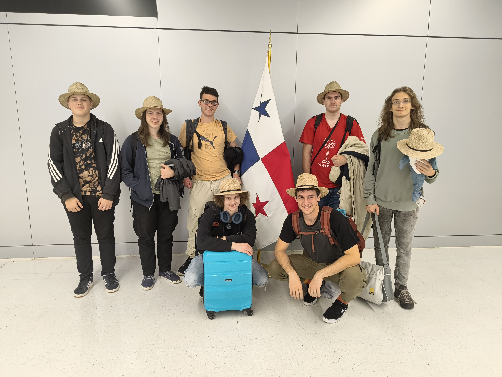
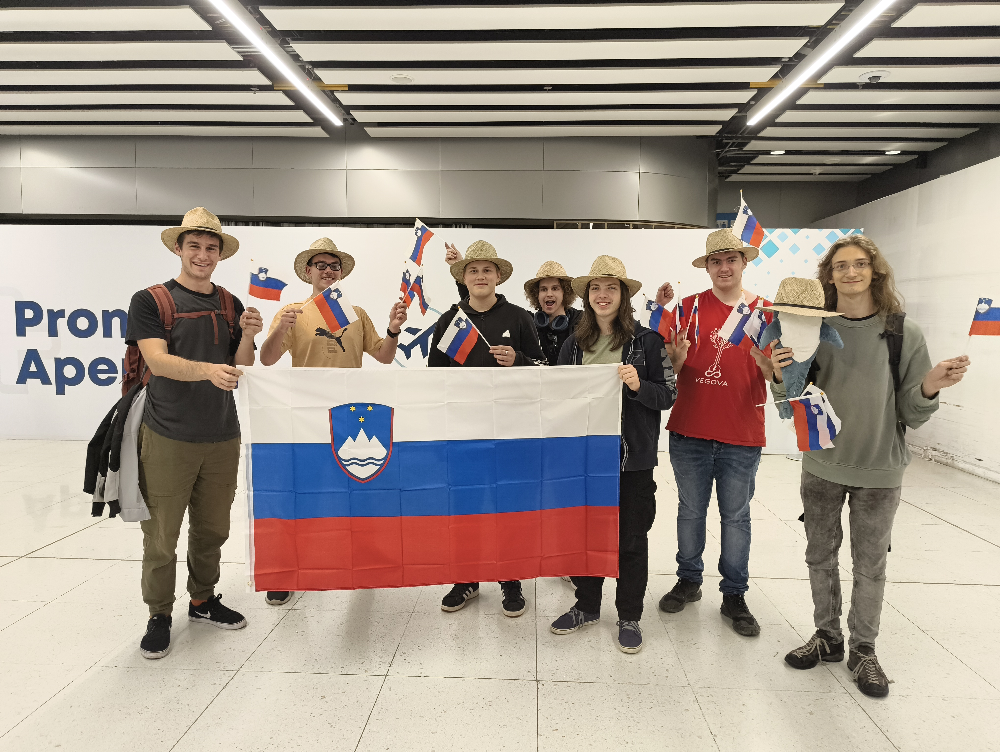
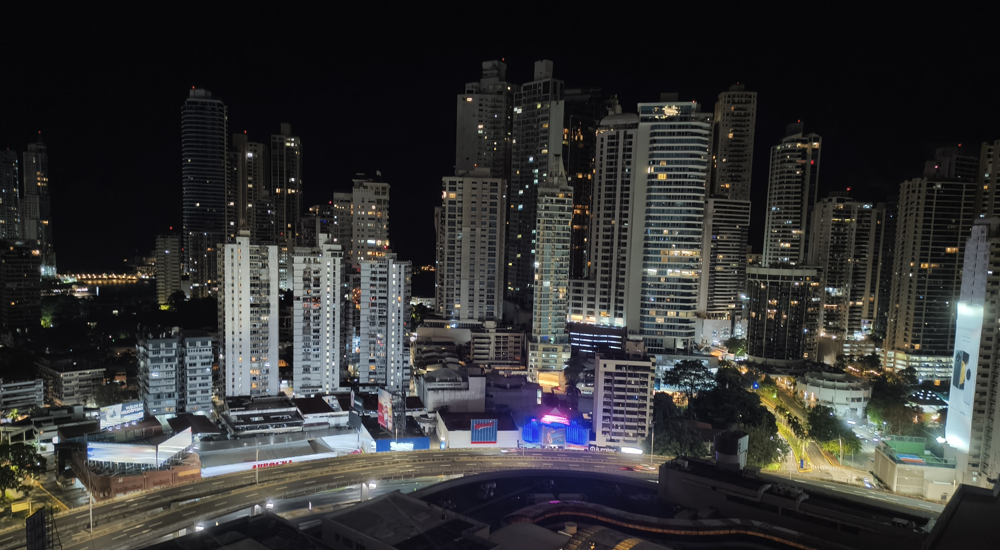

This year’s team began its journey on 27 October 2025 at five o’clock in the morning at Brnik. Repacking and weighing the luggage was followed by the logistics of checking in the robot as a piece of luggage. Once we had our boarding cards in hand, we went through security and headed for the gate of our flight, where we could allow ourselves a few minutes to rest and look at the aeroplanes.
<!-- truncate -->

The flight to Frankfurt took about two hours, and after landing we quickly dealt with the travel logistics and parked ourselves in front of the next gate. We spent the rest of the time finding and enjoying a snack, or playing skateboarding games on the airport’s consoles.

Our departure from Frankfurt was not difficult, though we were split between the upper and lower decks of the aeroplane. We settled in comfortably, set our hats in our laps or hung them on a hook, and passed the time sleeping, attending to work duties or watching films. The 10-hour flight passed without trouble, though it lasted only 4 hours (if one looked only at the times of departure and arrival).

Landing in Florida treated us to a view of densely built-up suburbs, swimming pools and American ‘highways’. As we did not have American passports, we were directed into a long queue, at the end of which a short interrogation awaited us, along with the taking of our fingerprints (4 on each hand and the thumb of each hand). Shortly before our turn came, we spotted a notice on a screen saying that we were not allowed to bring in food, so we had to eat our chocolate bars and sandwiches in a hurry (as it turned out, there was no trouble after all, but at least not all of us were hungry afterwards). Next came check-in, where we lost some time owing to language barriers, and still more time slipped away because, with our last member, they misunderstood the situation and thought a visa was needed for entry (despite our ESTAs being in order). Consequently we dashed to security, where, as luck would have it, they searched several of our rucksacks, so that we reached boarding at the very last second. We had a few minutes to rest, but not enough for the hungry members to find somewhere selling food. The team members did, however, manage to record a piece for the Social Media Challenge, in which they had to document their journey to Panama.

At the last second we learnt that boarding cards were not enough and that we had to go through the check-in procedure with our passports and ESTAs. At last we got onto the aeroplane, took up our positions and surrendered ourselves to the sunset and tropical juices (guava and pineapple, amongst others).

When we arrived in Panama, we met a lady with a ‘FIRST Global’ sign, who walked us across to the other side of the airport (literally) on foot to go through the immigration inspection, where they likewise took our fingerprints and a photograph. Then we had our photograph taken by the Panamanian flag, collected our luggage and made for the exit, where we were shown onto a coach with a Turkish interior (carpets and wallpaper).

The journey took us and the teams of South Korea and Ecuador past buses with flashing lights on their roofs, along motorways and past blocks of flats to the pleasantly illuminated city. In the lobby of the Hotel Megapolis we met several more teams waiting for their rooms. Evidently the logistics of the rooms had become rather complicated, as every team spent some 30 minutes at reception before receiving rooms, which were becoming available as they went along. After an hour and a half of waiting, our turn came, and we two mentors slowly filled in the details and waited for rooms to become available, whilst the other teams complained. The procedure was long, admittedly, but the real problem was weariness and the late hour.

Having successfully moved into our rooms, we finished the technical documentation and took a walk to a nearby shop. On the walk, the two of us discovered that the city really is safe (as the gentleman at passport control in Miami had hinted). Every 200 metres, you see, we met a security guard or a police officer, whereas on the whole walk we did not meet 10 people altogether in a good half-hour. The day ended with a gentleman in the Marbella shop, who spoke neither Spanish nor English, managing to rewire the card machine so that we could buy instant noodles without entering the shop. ‘Muchos gracias’ rounded off the experience (and awakened a desire for the drink ‘pipa fria’) and set us on our way back to the flat, where, with the help of a kettle, we boiled water and ate our noodles at half past one in the morning, Panama time. As for how we function on just under four hours’ sleep, you may read about that in the next post.

Until next time,

buenas noches
