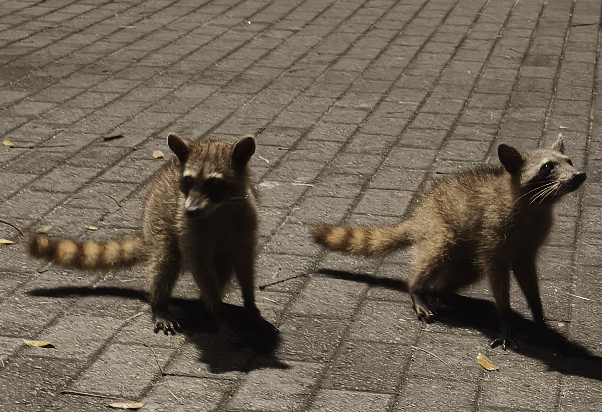

A few hours’ sleep and a sunny morning were enough for us to recover from the long flight. At twenty past six, local time, we met on the second floor and went to breakfast. Fresh fruit, ćevapi and other more typical hotel fare managed to fortify us, together with exotic juices (passion fruit, jugo and so on). The clock ticked quickly that morning, as we had to be on the coach by seven o’clock. We gathered our things, drank in the sunrise and, after a long wait for the lift, brought the robot down from the 24th floor (of 62) to the lobby.
<!-- truncate -->
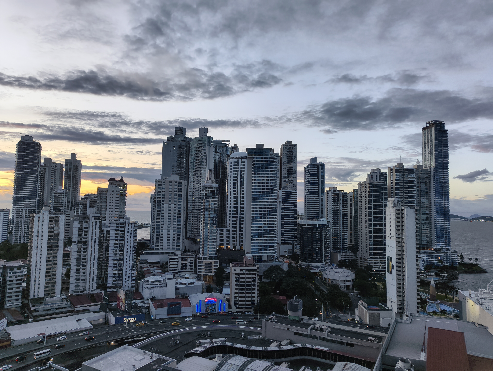

The journey to this year’s venue passed quickly, as we could enjoy the view of the sea and the tall buildings, whilst languages from other continents flew into each ear. The Panama Convention Center welcomed us with tropical vegetation and a train in front of the entrance. On our arrival, the large white glass foyer was sheltering many teenagers from the muggy air of the host country, and they managed to break the monotony with socialising, music and dancing. As in many a year, the fun was led by students from Venezuela and Tunisia, so boredom was at the very bottom of the register. Our team parked itself to one side and gave the students free rein to get to know their peers. Soon the organisers directed us to the right of the entrance, towards the door of the hall in which we would be spending the next few days together. The queue grew ever longer, but in a herd, straw hats are easy to count.

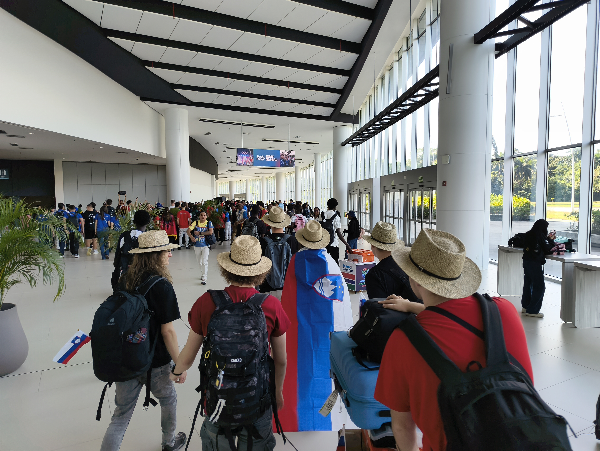

We quickly managed to locate our pit and immediately set about the traditional decorating. Half the team hung up little flags, whilst the other half unpacked the robot and set about servicing and testing it.

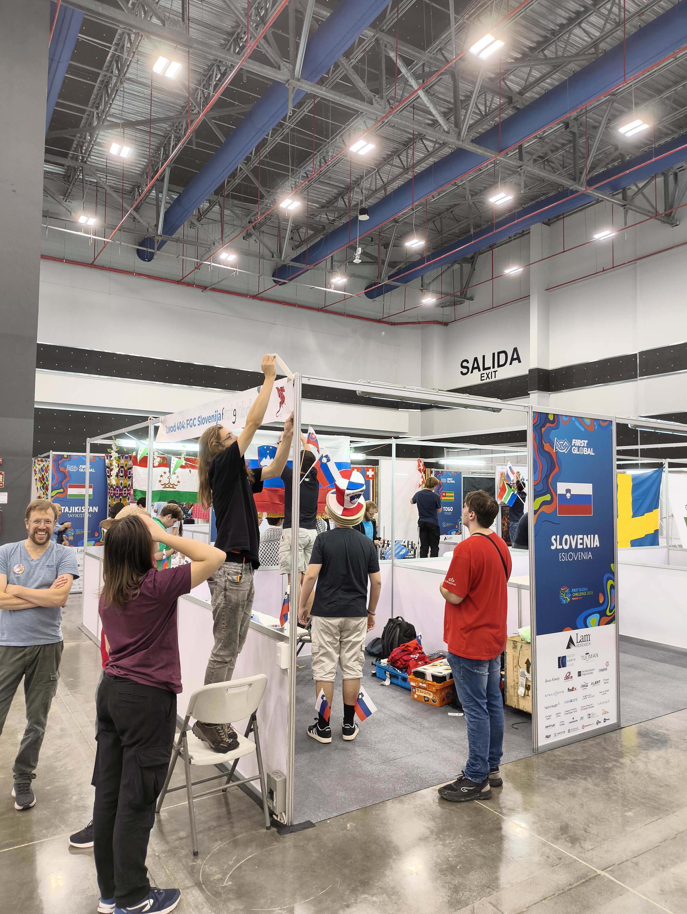

The rest of our time at the event was taken up with testing the robot on the field, getting to know new friends, tasting new sweets, catching up with old colleagues and spending time together as a team over lunch and dinner.

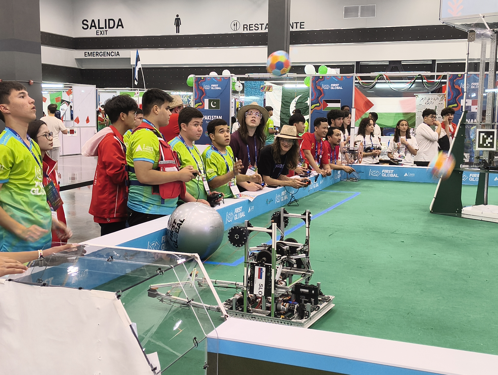

On arriving at the hotel, we took a few minutes to rest and then met in the hotel lobby, from where we set out. We stopped across the road at an outlet shopping centre, where we found a great deal of everything in the Wow shop. Our shopping ended at the till with a camping chair, an inflatable chair, sugary drinks and a 10 kW loudspeaker on the conveyor belt. So as not to walk about the city with our purchases, we called briefly at our hotel rooms, where we tried out the chair and carefully read the loudspeaker’s instructions for use, which were questionable but acceptable.

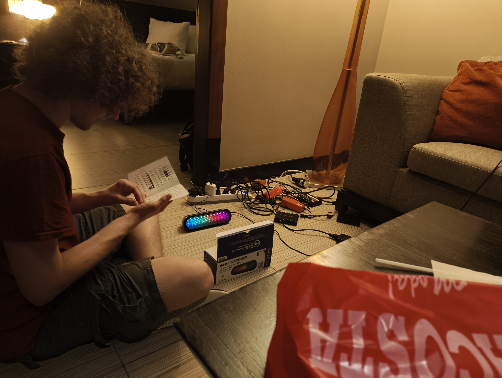

Soon we set off again with the aim of reaching the sea and visiting the raccoons. Our route took us along the main road that runs parallel to the shore. As we walked, we saw quite a few lowered taxis and cars with blue or yellow headlamps. This time the pedestrian crossings were kind to us, and their buttons worked as they should. Crossings over the main road are very rare, and their purpose is to let pedestrians reach the island in the middle of the main road. The island holds a car park and a red bridge, by which one can cross another pair of lanes of the main road to reach the shore.

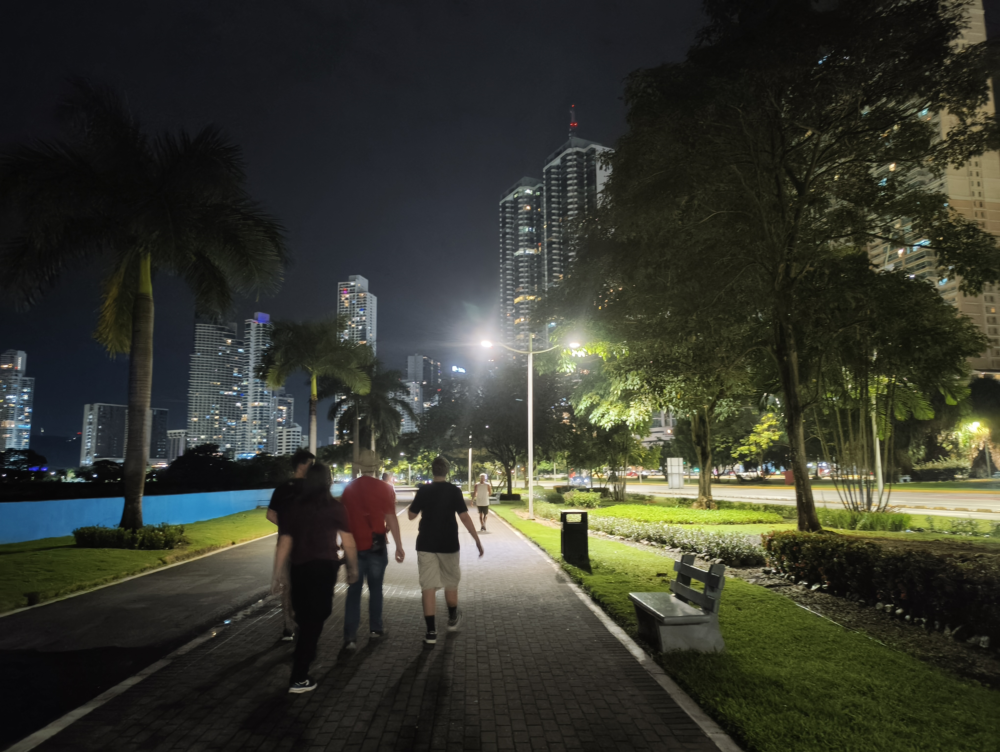
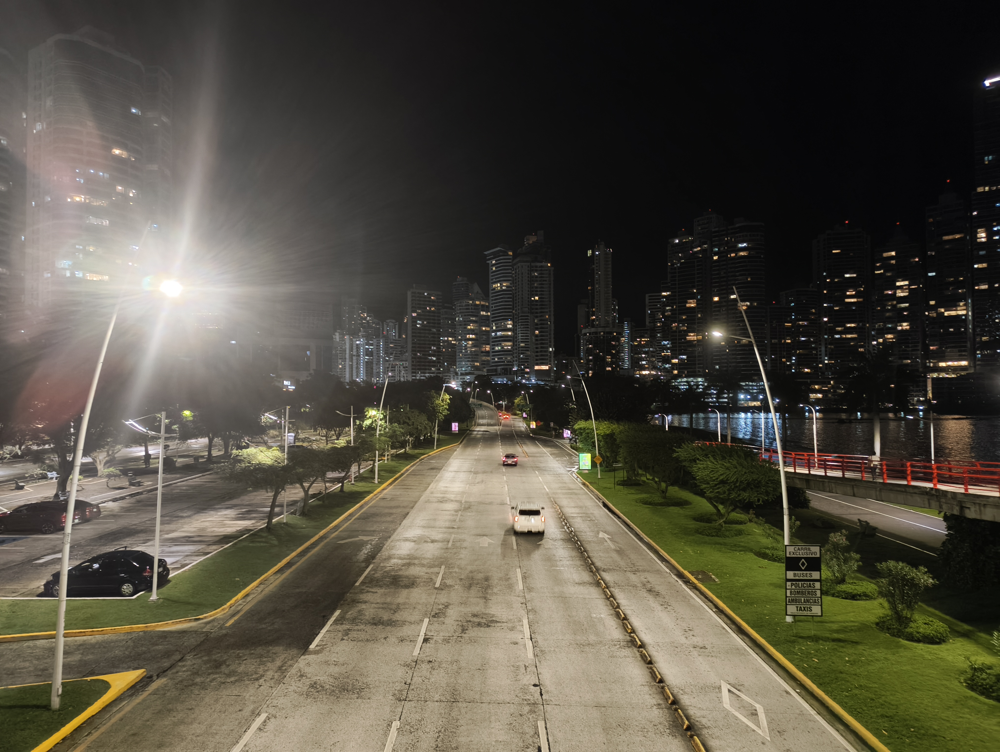

Walking along the shore, we met many runners and narrow benches on the broad path. Alongside our route ran a path for roller skaters and cyclists as well. On the way to the raccoons we passed a few playgrounds, a UV light meter and a few drinking fountains. The water in Panama has not, so far, been the tastiest. Soon our attention was caught by cats sleeping on the sea wall. Behind them we saw glinting eyes with little hands close by. Behind the cats were three raccoons on the rocks by the beach. We soon gave up on photographing them, as they were hidden in the dark of the night. A little later, however, we came across a new foursome of raccoons. They cheerfully approached us in the hope that we would offer them supper. When they realised that nothing would come of it, they made for a nearby litter bin to try their luck. It was then that we realised how nimble they are at climbing, into bins and up trees alike. In the process one of the raccoons found itself on the other side of a fence (we know not how) and could not work out how to get out of the children’s playground. For a while it struggled with the fence, but it could not climb over it. We soon went to help and guided it out, whereupon it showed the finest grasp of an orthonormal 3D basis. Having escorted them home (to the wall by the beach), we set off home ourselves, and on the way our attention was caught by an unknown species of bird resembling a swallow. As very amateur biologists, we analysed it and soon gave up on our research.

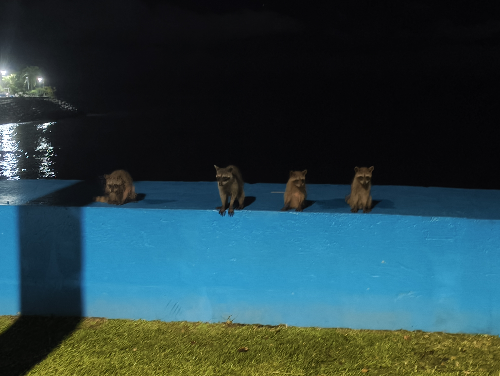

Our way home took us back along the other side of the road, from where we later rejoined a route the two mentors knew, back to the Hotel Megapolis.

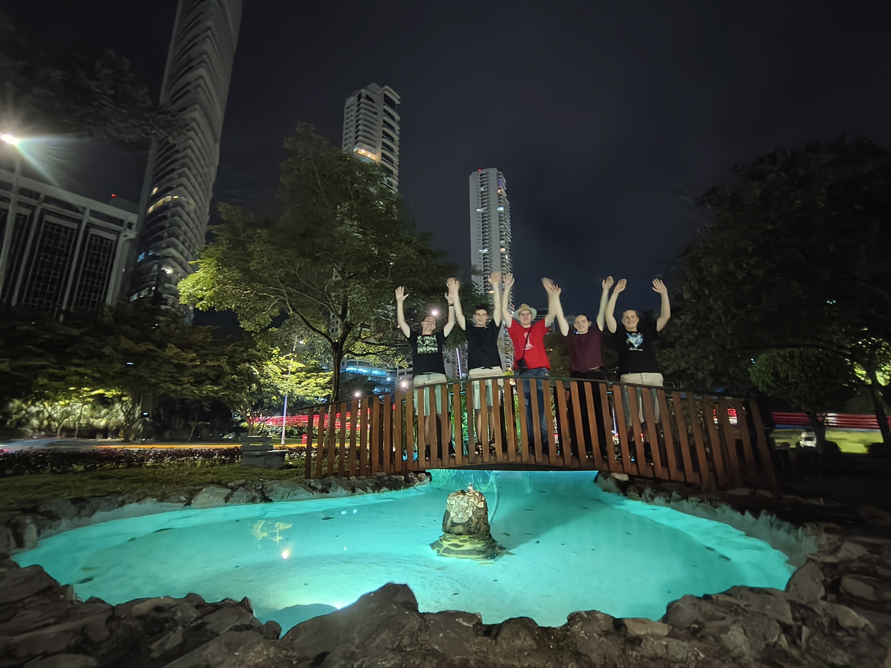
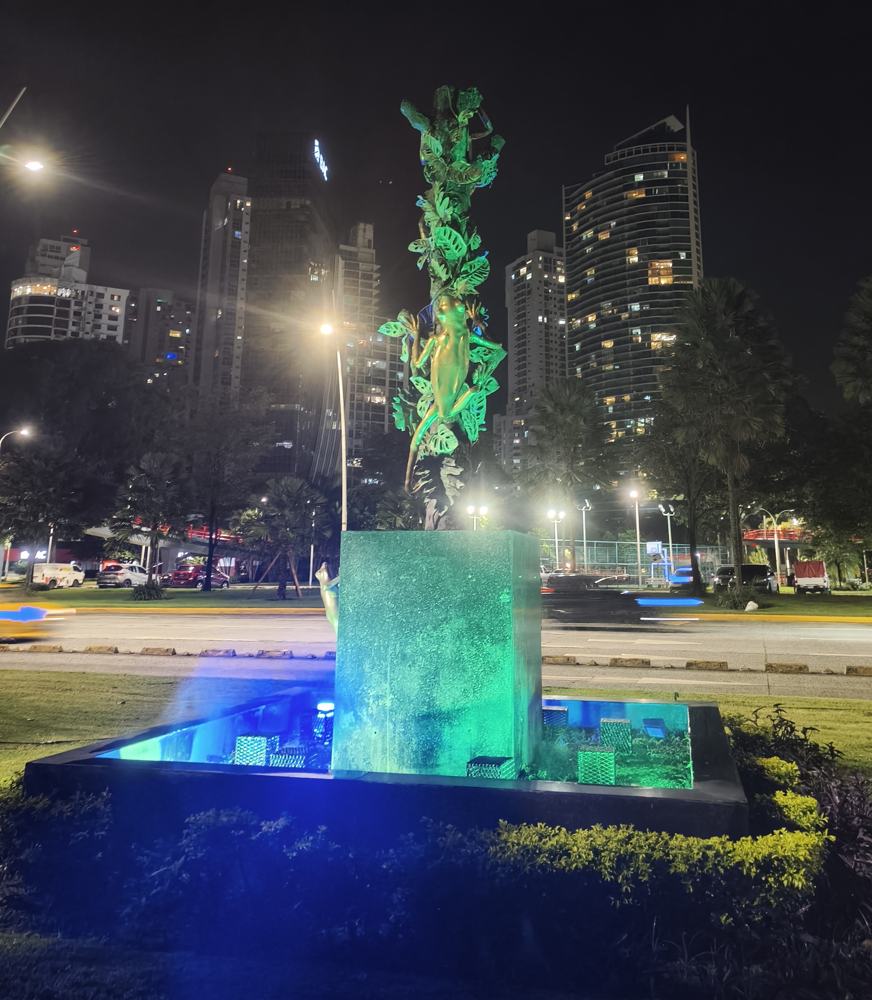

Back at the hotel, we devoted a few minutes to planning the next day and then all retired to our quarters. Tomorrow some more work on the robot and the opening ceremony await us, so energy will be most welcome.

Until next time,

Gudnaet bae mi go fo slip
