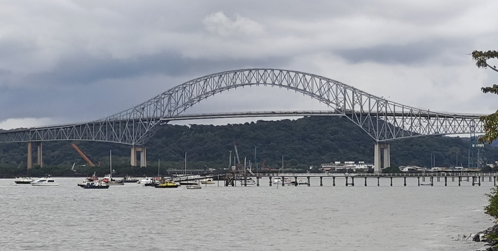

We began the third day of our American adventure in the same way, except that today we had to make sure that the suitcase with our national costumes boarded the coach with us after breakfast. We set off through the sunny morning, once again over the bridge and through traffic full of precautionary hooting to warn of merging.
<!-- truncate -->
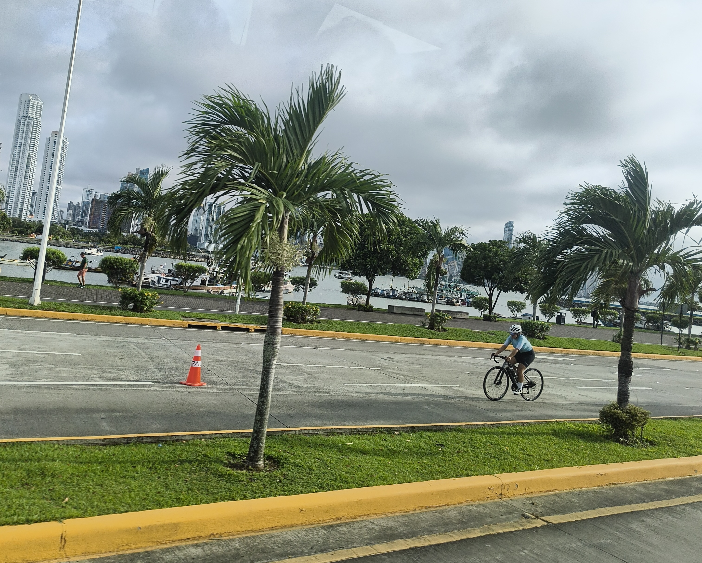
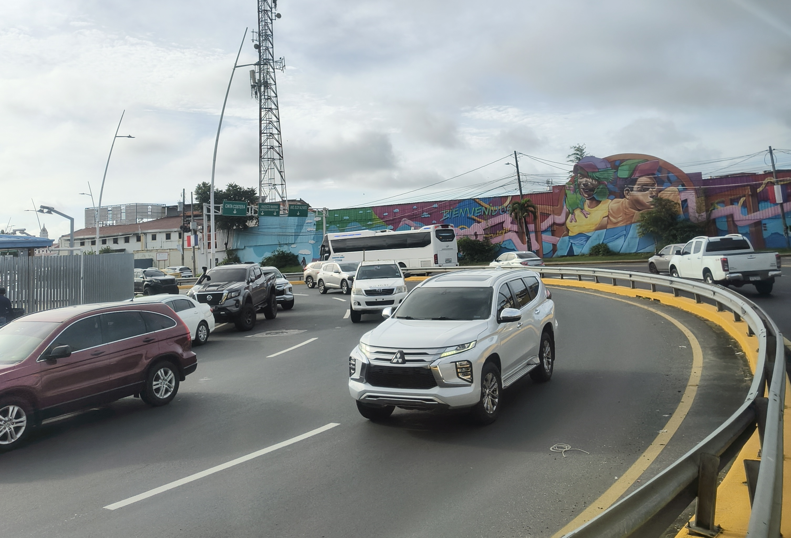

The first item of the day was the final arrangement of things in the pit, which meant trying out the fishing chair and inflating the ‘sofa’, which later proved a real hit, delighting every visitor.

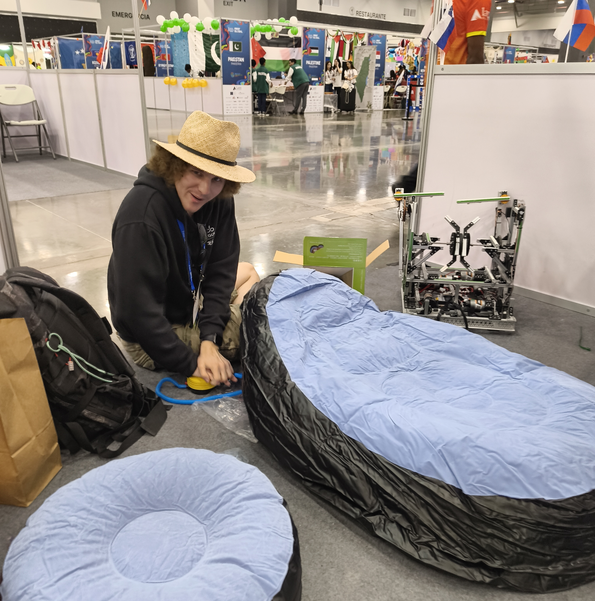

On the programme for the day was testing the robot in friendly matches (practice matches), for which the members had to sign up in advance. Whilst waiting for the warm-up matches, the boys tested the robot right there in the aisle between the pits. When the boys did not have their hands full, they went round looking at robots, trying sweets or attending to various social duties (signing booklets, flags and the like).

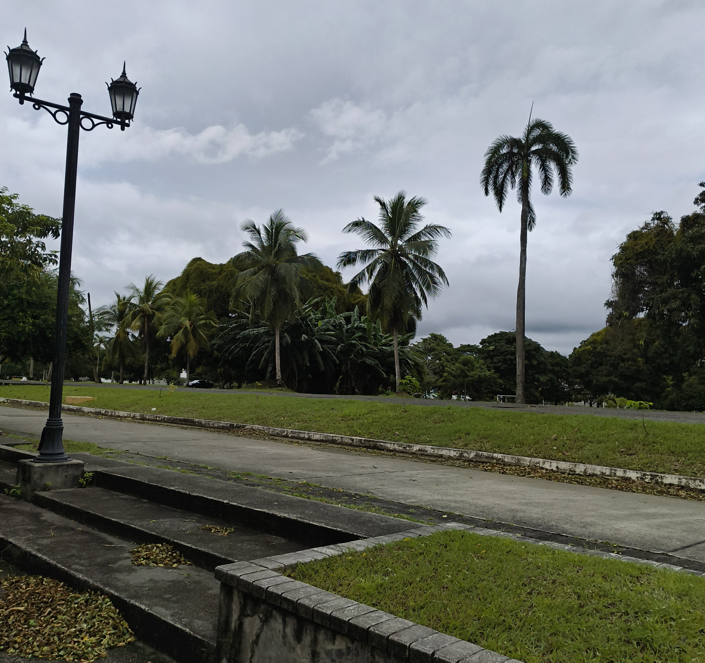

Hard work deserves proper rest too, so the crew also went off to see the surrounding area. Across the road was a path that led us to a monument relating to South Korea and Panama. A little beyond this monument lies the water that flows through the Panama Canal. Just then a large cargo ship crossed our field of view, heading towards the famous bridge.

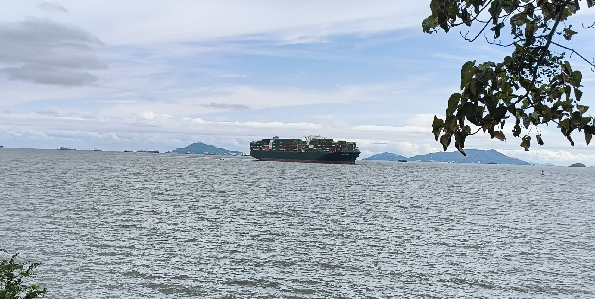
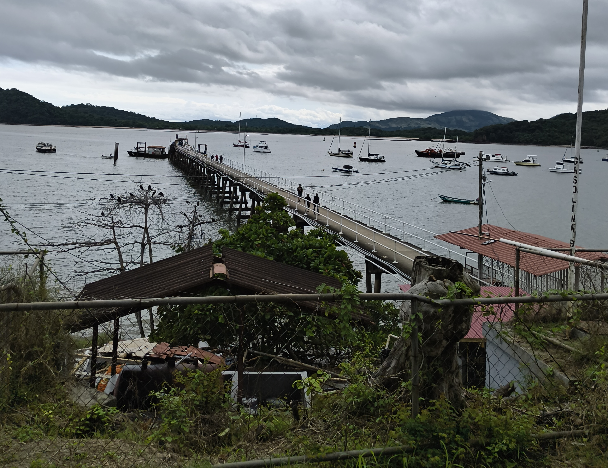

Closer to the bridge we also found a small jetty, on which workers were loading cargo in smaller lots onto smaller boats. The surroundings had been adorned the whole way by varied vegetation, from palms to cacti, from colourful birds and flowers to the untidy wiring of missing street lamps.

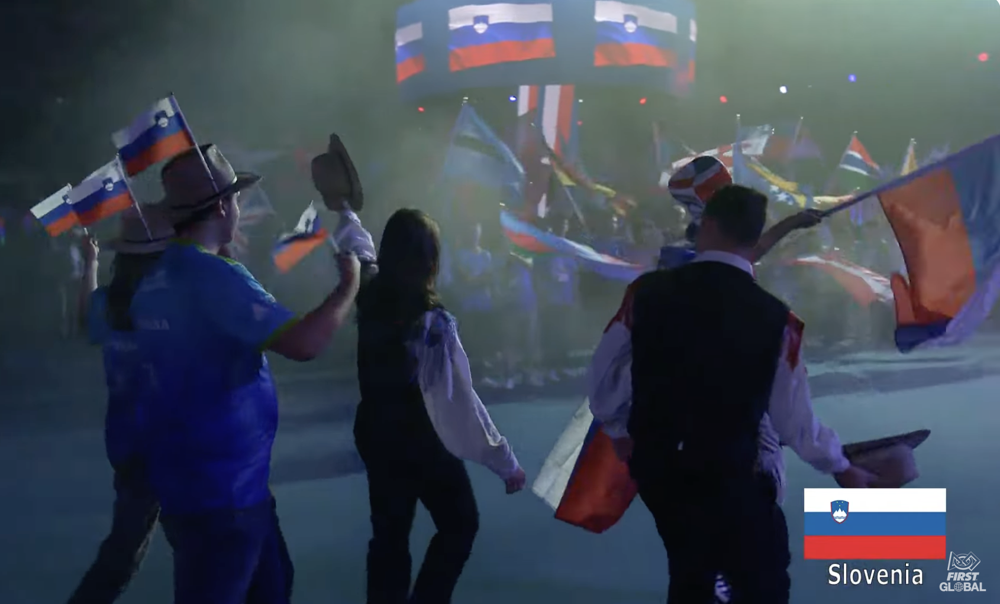

Soon the moment came when the boys had to put down their tools, park the robot and go to dinner, where they met long queues and food that kept running out. After a somewhat less plentiful dinner, they put on their costumes and hats and went off to the dress rehearsal. Its end was followed by a short rest and time to freshen up, and shortly afterwards the line of flags was already forming.

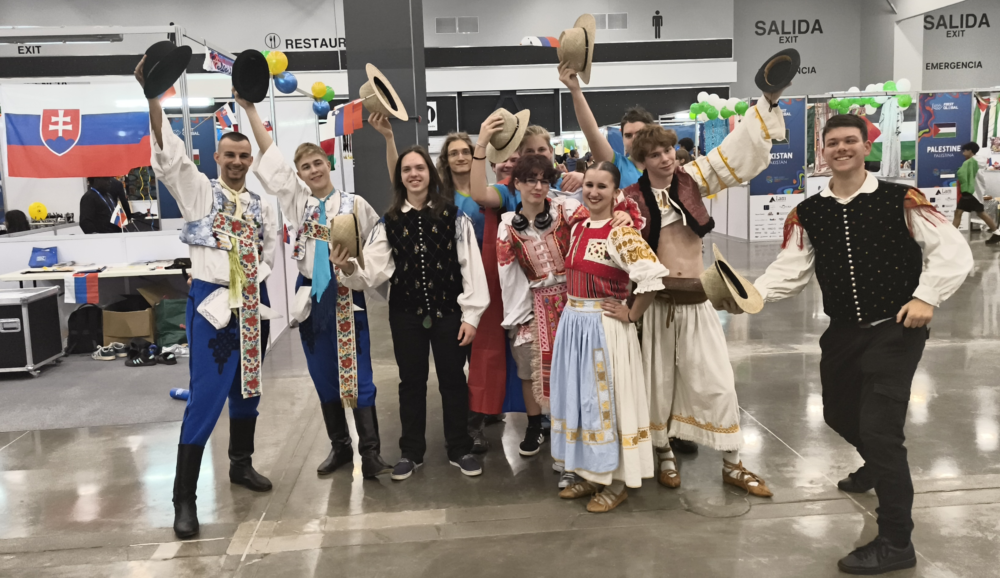

The two mentors took their places at the end of a cluster of people already diligently warming the tin stands. It was there that we two mentors met our colleague Gregory, a student back at the competition in Dubai (2019), and impressed our old friend with our memory, as we remembered that year’s entire line-up. What gave the game away was hearing that Gregory was from Venezuela.

The marching and the waving of flags in the hands of future innovators were accompanied by applause from the audience and now and then by a few trumpets, depending on how many visitors had come from the country in question. The sea of flags heralded the start of the speeches by the founder of FIRST, the First Lady of Panama and several other important guests. The premiere of a new piece of music for the FGC competition was followed by a true Panamanian carnival, in which a choir and an orchestra provided the musical accompaniment for the dancers. They were dressed in traditional costumes of varying splendour.

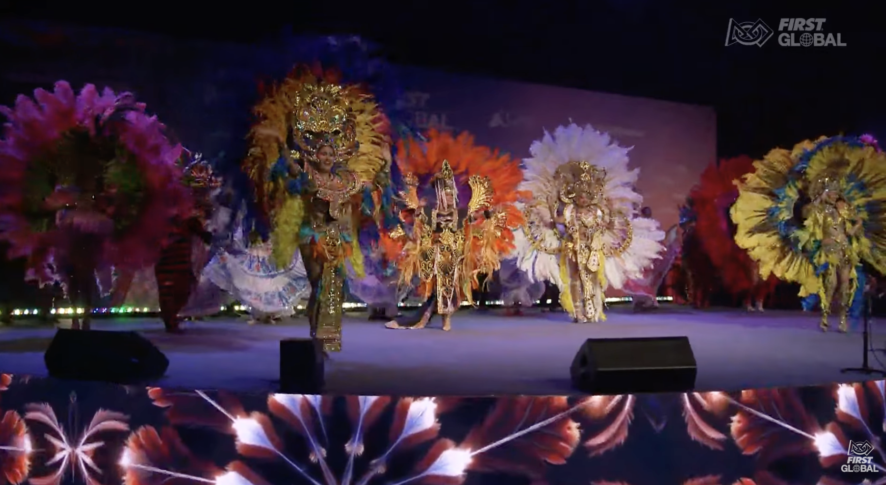

Tired but happy, we took our seats on the coach home. Some of us had a quiet journey home, whilst the seats of others shook to the rhythm of the bass from Latin songs. At the hotel we put down our things and headed to McDonald’s and afterwards to our friend at the 24/7 shop, on the way to which we encountered an American speciality – a Cybertruck.

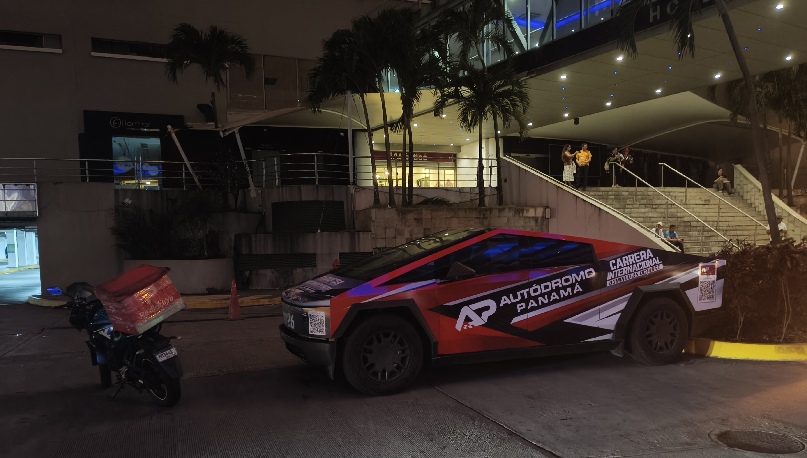

In the shop we bought various drinks, teas, snacks, soft-toy toucans and magnets. As part of the cultural experience we also tried a plantain (a broad banana that smells of cucumber), which we prepared according to a traditional recipe.

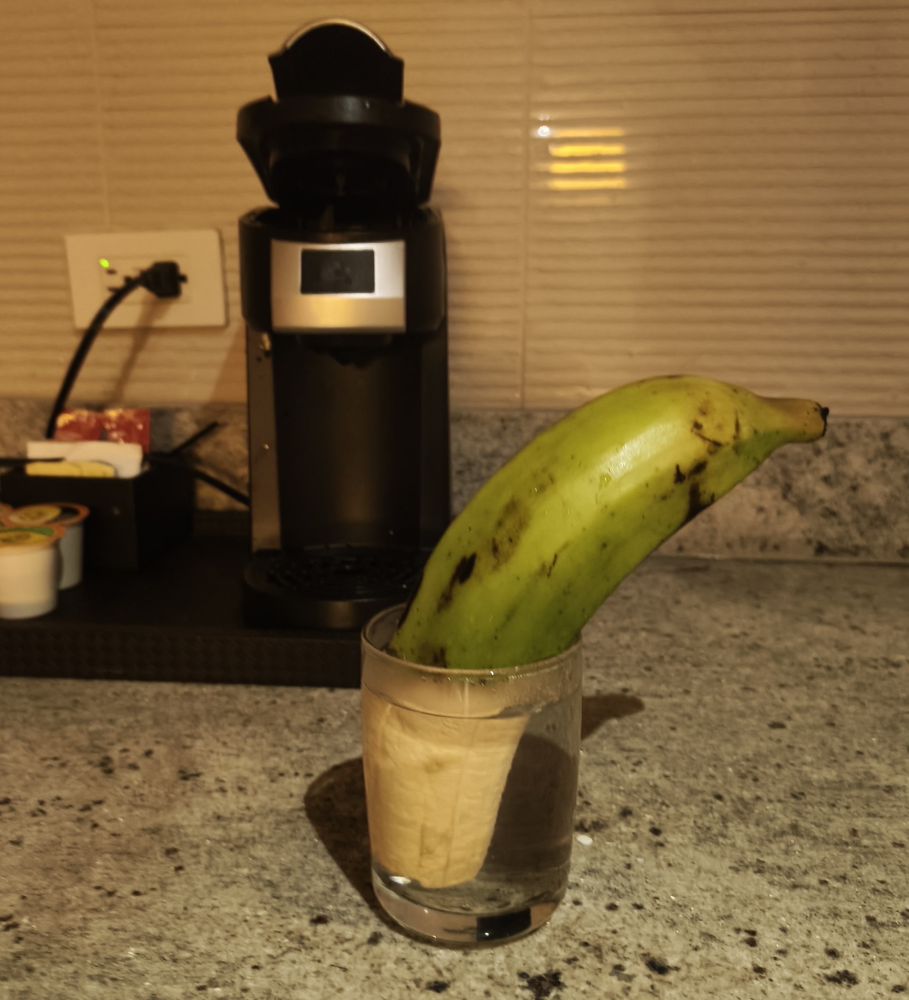

Until next time,

god natt
