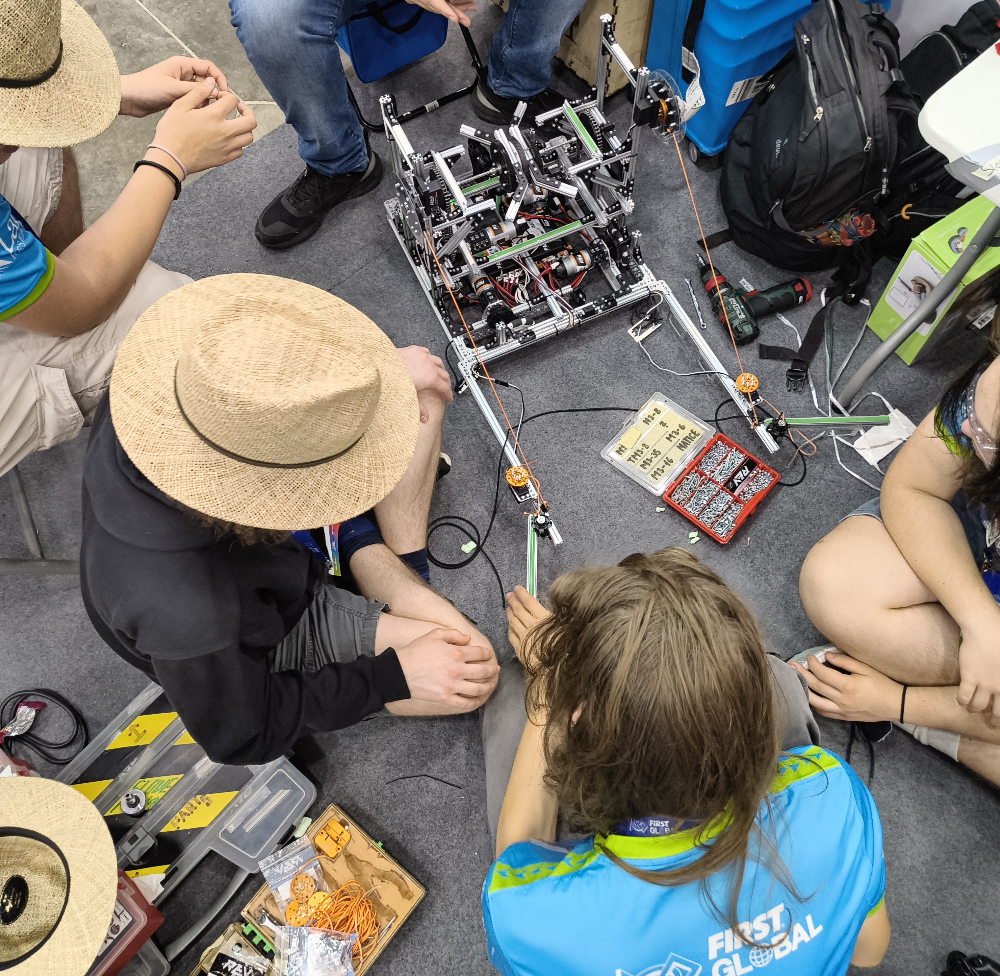

A hearty breakfast to start the new day was swiftly followed by boarding the coach. The sun shone on the road, the slits in the bridge and the hill with the Panamanian flag, where sloths and parrots hide. Should one wish to see butterflies and frogs as well, however, one would have to drive some 45 minutes out of the city (or so the wide world of the internet tells us).
<!-- truncate -->
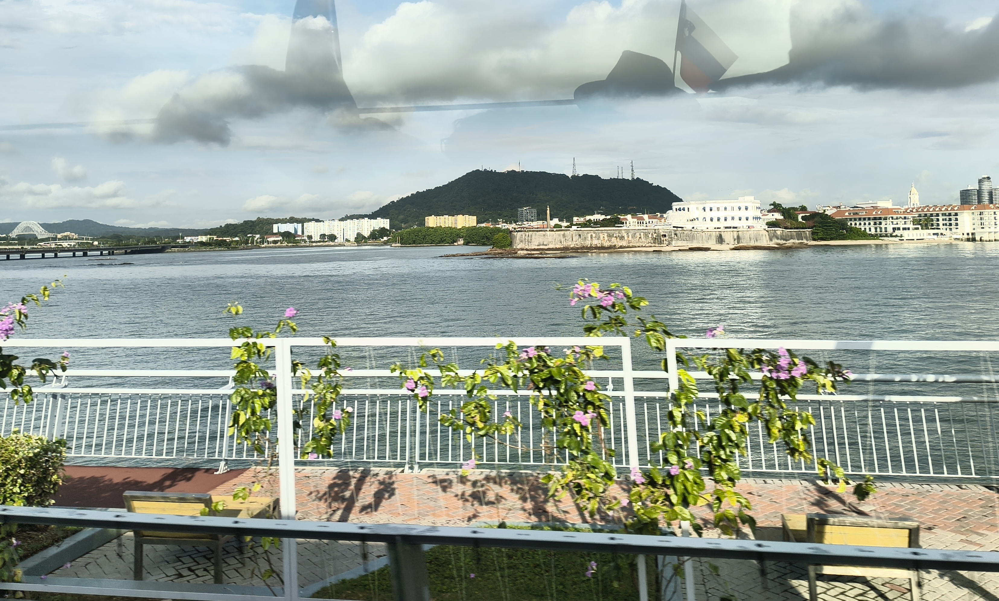
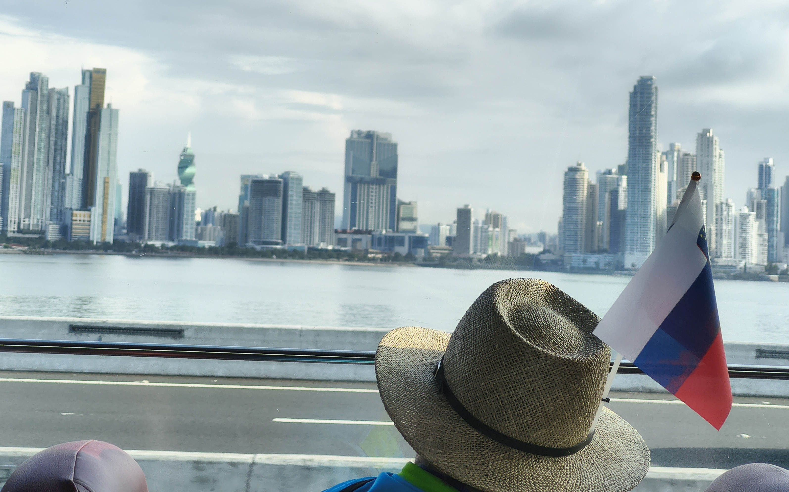

In the entrance hall many competitors were waiting, ready to enter the pits. We turned the queue to our advantage and popped over to a viewpoint by the water to gaze our fill at the shipping. We carried on along the footpath to while away some time, until the excessive heat of the Panamanian weather began to drive us back.

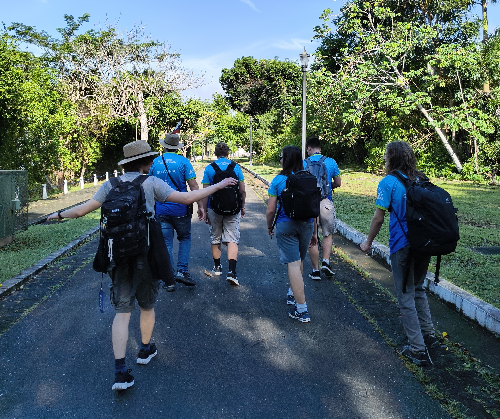
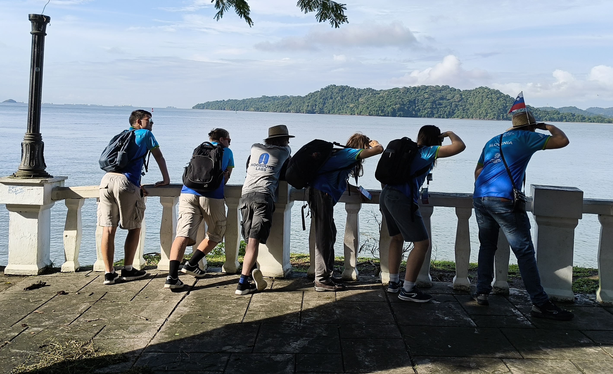

On the way back to the competition area, our eye was caught by an unusual combination of colours, followed by a tail. We had found an iguana basking in the sun. We greeted it politely, photographed it and tested its knowledge of engineering jokes. At the joke it nodded kindly, but when it had had enough of our jokes, it set off in the direction of the z-axis (vertically), up a tree.

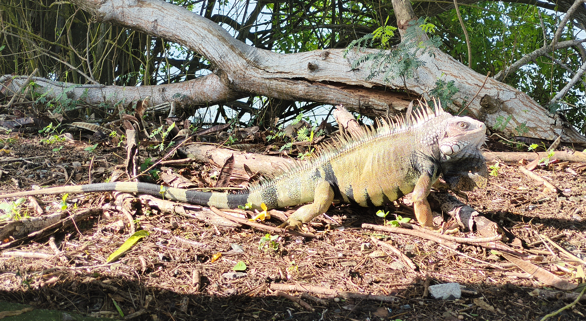
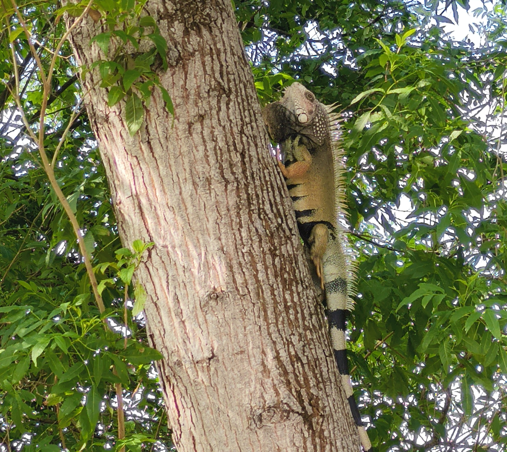

Having parked ourselves on the sofa and the fishing chair, we made the last repairs to the robot and so prepared ourselves for the first ranked matches. The boys still had some time before the qualification matches began, so, having got hold of the match schedule, they decided to lend a hand to their first teammates – the Federated States of Micronesia. Their mechanism for using the accelerator (a component of the playing field) was not working at its best, you see, so the boys stepped in with parts and a design to help them build it. During the process another country came to help as well, which left our boys free to take a stroll around the alphabet of colourful flags.

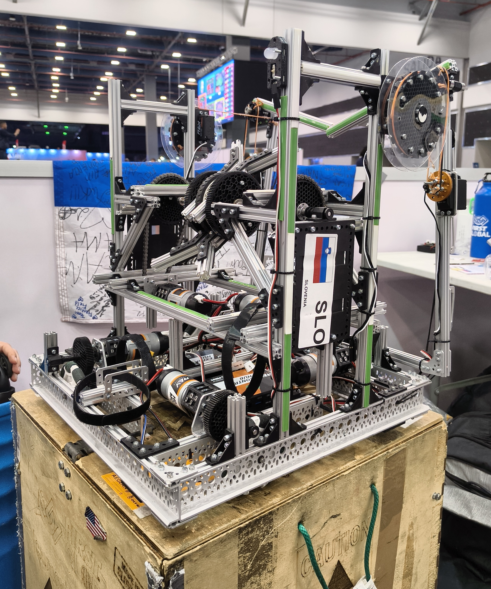

Owing to the uniqueness and efficiency of their chassis, the boys entered the so-called Skills Challenge, in which the entered teams (each separately) show off their robot’s capabilities in a somewhat different way (collecting and transporting balls against the clock, and shooting or throwing them). During the challenge certain imperfections in the robot came to light, but the boys were not sure what exactly might be causing the robot to behave in this way.

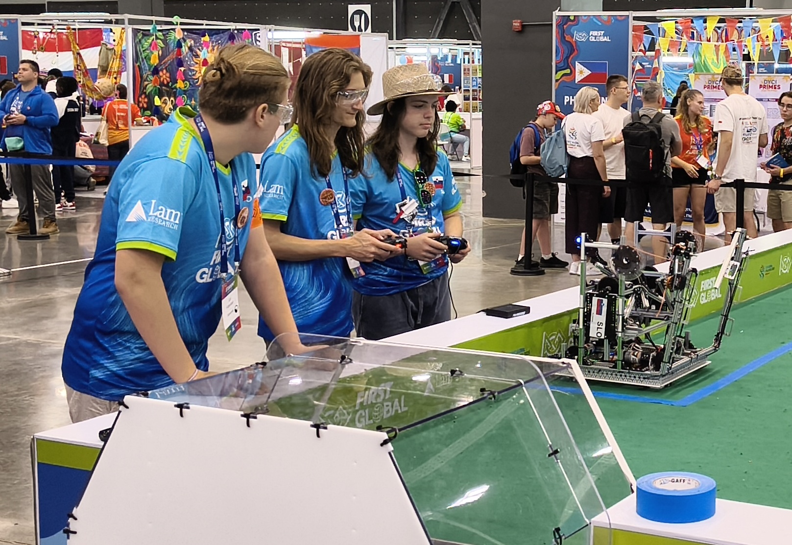
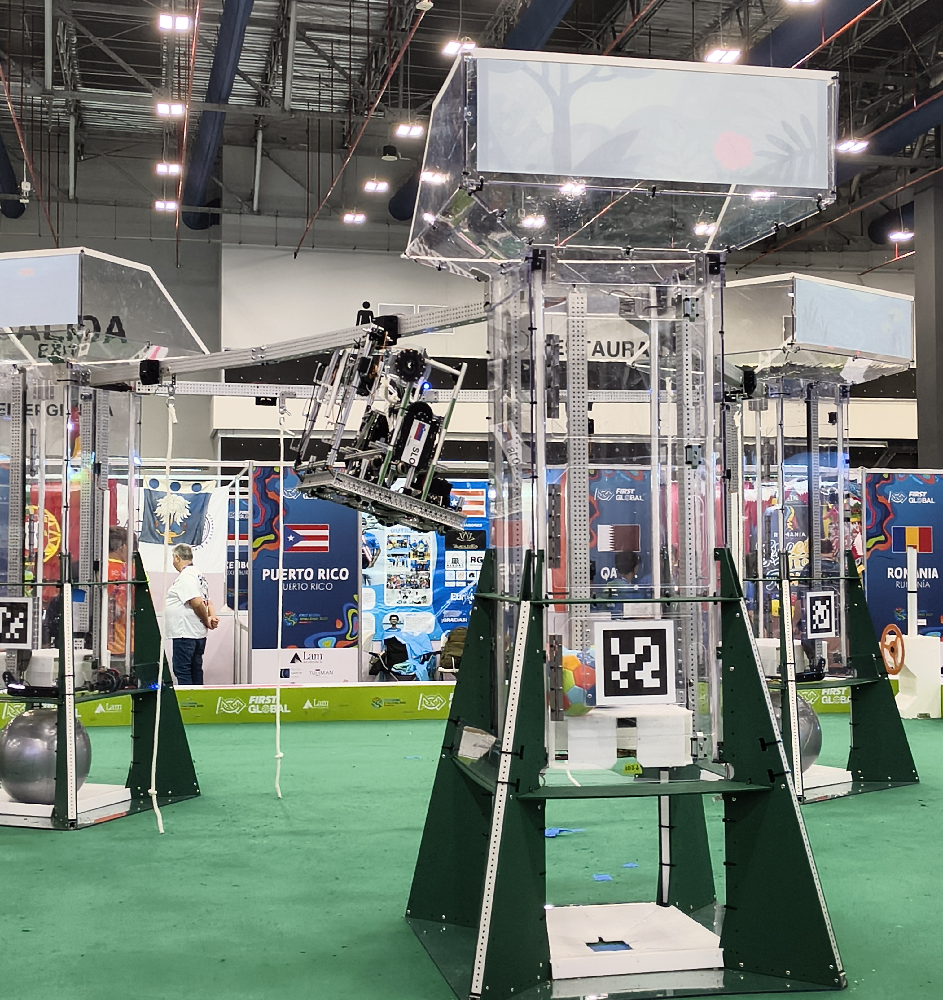

The first matches soon began, and with them some harsh discoveries. Match number 30, in which we had the Federated States of Micronesia and Taiwan at our side, was poor in terms of points, but it gave us a view of the robot’s real condition. We won this match by a whisker, 21:18, against the blue alliance, formed by Japan, Ukraine and Serbia. During the match we confirmed the problem – the servo motors for the arm mechanism were not durable enough. So far we had destroyed, on average, one servo motor per practice or qualification match. We were aware that we did not have enough time to replace the whole mechanism, so for the time being we serviced it as we went and manoeuvred with care.

<iframe width="560" height="315" src="https://www.youtube.com/embed/bipuBmCye9g?start=3782" title="YouTube video player" frameborder="0" allow="accelerometer; autoplay; clipboard-write; encrypted-media; gyroscope; picture-in-picture; web-share" referrerpolicy="strict-origin-when-cross-origin" allowfullscreen></iframe>

We livened up the second match of the day on the first field (of five) in the arena. This time we were paired with Denmark and Ghana in the blue alliance. The unreliability of the arms could be felt in the points, as we finished this match with a score of 25:22. The winners’ applause for match number 49 went to our half of the field, after which we shook hands with our colleagues from Bosnia and Herzegovina, Mauritania and Guatemala and made our way out of the arena.

<iframe width="560" height="315" src="https://www.youtube.com/embed/Hy2VGJjoMoo?start=8180" title="YouTube video player" frameborder="0" allow="accelerometer; autoplay; clipboard-write; encrypted-media; gyroscope; picture-in-picture; web-share" referrerpolicy="strict-origin-when-cross-origin" allowfullscreen></iframe>

During the third match of the first day we discovered a new flaw in our robot. Whilst playing with our colleagues from Estonia and Pakistan, we noticed that the robot was moving more slowly than it should, which bothered both drivers, as our robot is primarily intended to play a supporting role. This time fortune kept its teeth hidden, though not entirely. Match number 76 ended 28:28, so the applause was shared out evenly between us and the red alliance, made up this time of our peers from Malawi, Kiribati and China.

<iframe width="560" height="315" src="https://www.youtube.com/embed/t4IdgPIlFyg?start=11994" title="YouTube video player" frameborder="0" allow="accelerometer; autoplay; clipboard-write; encrypted-media; gyroscope; picture-in-picture; web-share" referrerpolicy="strict-origin-when-cross-origin" allowfullscreen></iframe>

The last match of the first day of the olympiad’s competitive part was assigned number 96. Our path led us to an appearance on the main field (number 5). This time we represented the blue alliance together with Belarus and the Gambia. Stress, weariness and much else besides could be blamed for the outcome of the match, but it is also only fair to shake the hand of a better opponent. This time the winning score of 26:22 fell to Panama, the Maldives and Armenia.

<iframe width="560" height="315" src="https://www.youtube.com/embed/bipuBmCye9g?start=13333" title="YouTube video player" frameborder="0" allow="accelerometer; autoplay; clipboard-write; encrypted-media; gyroscope; picture-in-picture; web-share" referrerpolicy="strict-origin-when-cross-origin" allowfullscreen></iframe>

Whilst waiting for dinner, we took time to reflect and realised that this match could have had a different outcome had our colleagues from Belarus not pinched our hanging rope, which cost us a few points. We also confirmed that the battery was draining too quickly in normal operation, which could point to resistance in one of the motors or wheels. We quickly located and replaced the troublesome part and repaired the assembly it belonged to. Besides this, we set about making a prototype of a new arm mechanism. Time overtook us, and so we went off to dinner in our culture’s attire (in our case, straw hats).

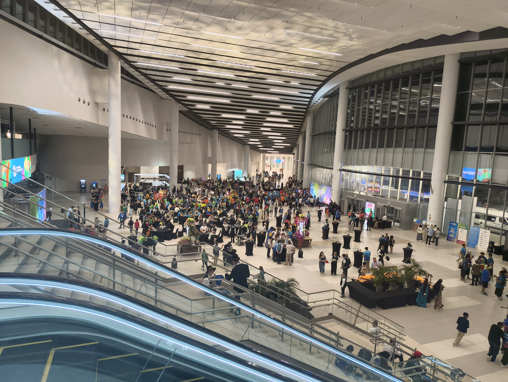

The students were in the company of their peers, whilst the two mentors talked with Michael, who works as an engineer at Boeing. We endured a long queue, but this time the helpings were more generous for it. In the meantime we had a visit (and an address) from the founder, Mr Dean Kamen, who in the course of the speech introduced a new guest – the famous chef Paul Irvyne. We were told in confidence that next year at the event we would have the chance to taste cooking from other, more famous hands. The evening continued with conga lines, team photographs and the printing of pictures.

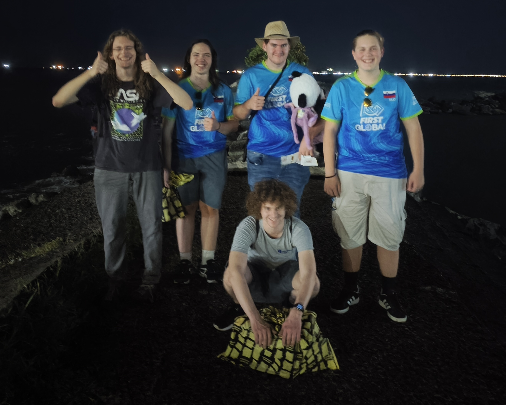

On returning home we arranged a visit to a new shop in the immediate vicinity of the Hotel Megapolis. We dashed to the other side of the main road, sacrificing a few minutes on a detour to get across, as pedestrian crossings on the main road are rare. The Arrecha shop was advertised as a chemist’s, but inside (judging by its wares) it resembled a Pepco. We wandered about for quite some time and stepped out with LEGO bricks, snacks, soft toys and whatnot. Curiosity and a surplus of energy led us on a lap of new territory. We walked along a new road and witnessed a somewhat more realistic picture of the city, one that includes rather more rubbish. Soon we found ourselves in a park with a playground, and next to both we also found the Pacific.

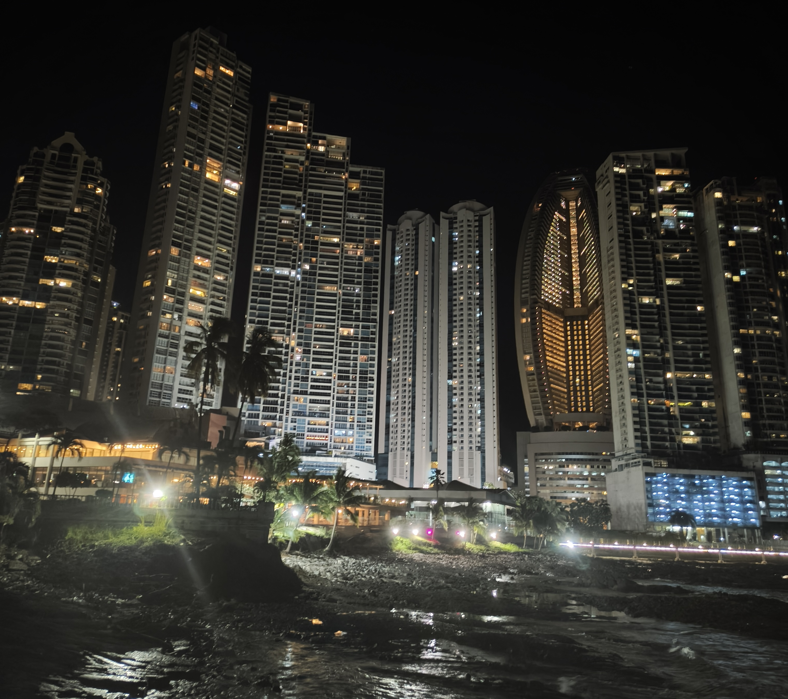

Curiosity led us to a nearby pier, and on the way a surprise awaited us. Round the corner, in the dark, two police officers with a motorcycle were waiting for us. They asked us in Spanish where we were going; we guessed the context, and one of the mentors said ‘foto’ and pointed at the pier. They wished to see our papers, which was no problem until it turned out that one member had no papers to hand and one mentor did not look the same as in the photograph (which we resolved by lifting a lock of hair). They asked how long we would be there (‘tempo?’), to which we replied by holding up five fingers. We hurried to the pier, which was whole at first, then collapsed in the middle, then whole again. We had neither the time nor the desire to clamber over the collapsed pier, so instead we devoted a minute or so to taking photographs. On the way back to the hotel we were kindly reminded that in this part of the world hooting is a friendly warning and very probably a breach of the traffic regulations. Soon we found ourselves back in our hotel beds, waiting with closed eyes for a new day.

Until next time,

mačka omáčka
