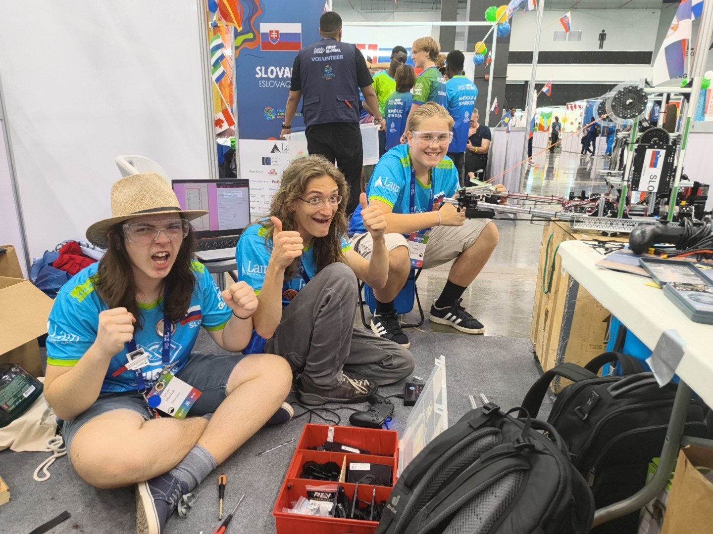
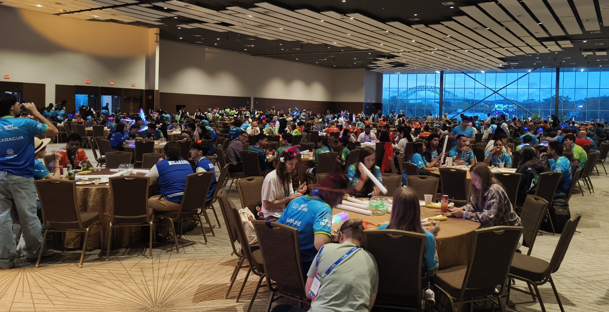
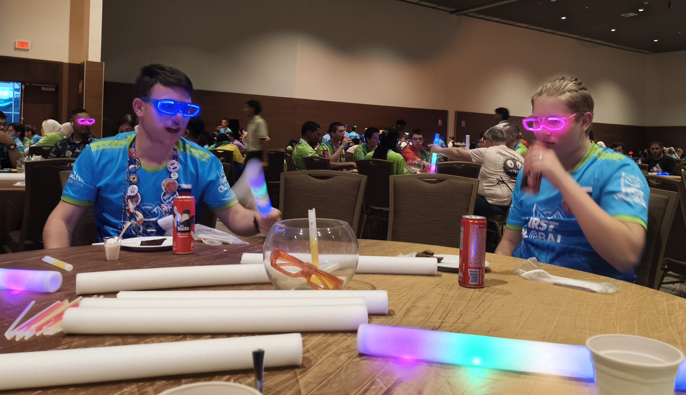

A new day, new chances of success. After the morning ritual we dashed to the pit, where we finished the prototype of a new arm mechanism and also put it into service during the first qualification matches of the second day of the official competition.
<!-- truncate -->

The difference is that this time, instead of servo motors, we used Core Hex motors with gearing, as these motors are more robust. Soon the first opportunity arose to test them outside the pit and the practice fields. We played the first match of the day together with the Virgin Islands and India. The improvement to the arms quickly proved its worth, as we managed to collect more points than ever before and bring a 44:42 win back to the pit. Our colleagues on the opposite side of the field represented Israel, Guyana and Malta.

<iframe width="560" height="315" src="https://www.youtube.com/embed/19KenSMx4QI?start=4601" title="YouTube video player" frameborder="0" allow="accelerometer; autoplay; clipboard-write; encrypted-media; gyroscope; picture-in-picture; web-share" referrerpolicy="strict-origin-when-cross-origin" allowfullscreen></iframe>

Match number 181 came round quickly, and we dashed off with the robot on its box to the queue for official matches. This time we graced the red alliance in the company of Bermuda and Kosovo. This time there was no better alliance, only equals: both our alliance and that of Eritrea, Luxembourg and Turkey took home 57 points.

<iframe width="560" height="315" src="https://www.youtube.com/embed/IMzAHjn2oqA?start=10396" title="YouTube video player" frameborder="0" allow="accelerometer; autoplay; clipboard-write; encrypted-media; gyroscope; picture-in-picture; web-share" referrerpolicy="strict-origin-when-cross-origin" allowfullscreen></iframe>

The day granted us no long breaks – at most enough for a snack from another country, or a stroll and a chat. Soon the sound of the horn rang out on field 3, announcing the start of match 206. This time we were on the blue side together with Bulgaria and Korea. For the best possible result, we cooperated with our ‘opponents’, this time Syria, Saudi Arabia and Switzerland. Another win for us, 48:45. Slovenia’s record currently stands at 4 wins, 2 draws and 1 defeat.

<iframe width="560" height="315" src="https://www.youtube.com/embed/19KenSMx4QI?start=17720" title="YouTube video player" frameborder="0" allow="accelerometer; autoplay; clipboard-write; encrypted-media; gyroscope; picture-in-picture; web-share" referrerpolicy="strict-origin-when-cross-origin" allowfullscreen></iframe>

We are drawing near the headline match on the schedule, but we are not quite there yet. Match number 232 still stands in between, in which we stood alongside São Tomé and Príncipe and Eswatini. We managed to raise our average a little further with a winning result of 58:56 against the United Arab Emirates, the Cook Islands and Benin.

<iframe width="560" height="315" src="https://www.youtube.com/embed/DzvYXbAkqIc?start=21441" title="YouTube video player" frameborder="0" allow="accelerometer; autoplay; clipboard-write; encrypted-media; gyroscope; picture-in-picture; web-share" referrerpolicy="strict-origin-when-cross-origin" allowfullscreen></iframe>

The hour had come for the headline match on the headline field. This time, on field 5, we were paired with a couple of ‘giants’. Supporting us were the representatives of Kazakhstan and the United States of America, so we had our strategy ready and felt good before the match. On the opposite side we could look our colleagues from Venezuela, Papua New Guinea and Brunei Darussalam in the eye. This time, amongst the ‘giants’, we were the bigger ones, and we took home a pleasant boost to our average with a result of 114:98.

<iframe width="560" height="315" src="https://www.youtube.com/embed/yYWFSdB9Fd8?start=24906" title="YouTube video player" frameborder="0" allow="accelerometer; autoplay; clipboard-write; encrypted-media; gyroscope; picture-in-picture; web-share" referrerpolicy="strict-origin-when-cross-origin" allowfullscreen></iframe>

The strenuous day was followed by dinner in a somewhat roomier hall than before. During lunch we had noticed them moving tables and setting up a stage, so we deduced that there would be a party that day, a conclusion only reinforced by the array of party accessories on the tables. We could help ourselves to bracelets, glasses or sticks, all with lights for the dark.

Towards the end of dinner a DJ began to play music, the bass growing more noticeable by the minute. Soon the lights went out, and the students hurried to the dance floor below the stage. The flashing of glow sticks and glasses, the loud music and the jumping of young roboticists shook the floor throughout the hall.

After the guest DJ’s opening set, Mr Dean Kamen paid us a visit, cheerfully announced that two countries held up by the weather had arrived, and proposed moving them into the final pool of 32 countries so that they could play. Naturally, the whole dance floor agreed. Then came the announcement of a special guest, who truly got the evening going. Out in front of us stepped will.i.am and performed live, making for an unforgettable evening. On the way home we scrambled to secure ourselves a Soyo transport coach, which likes to keep the party going all the way to the hotel. Latin American songs and deep bass make the journey shorter.

Until next time,

bari gisher
