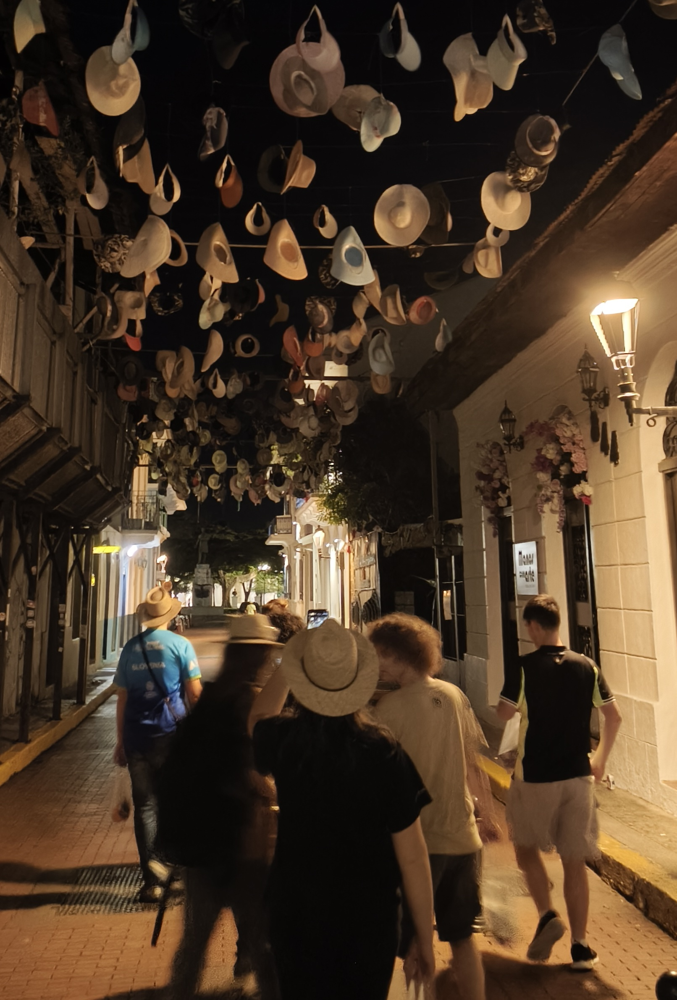

<!-- truncate -->
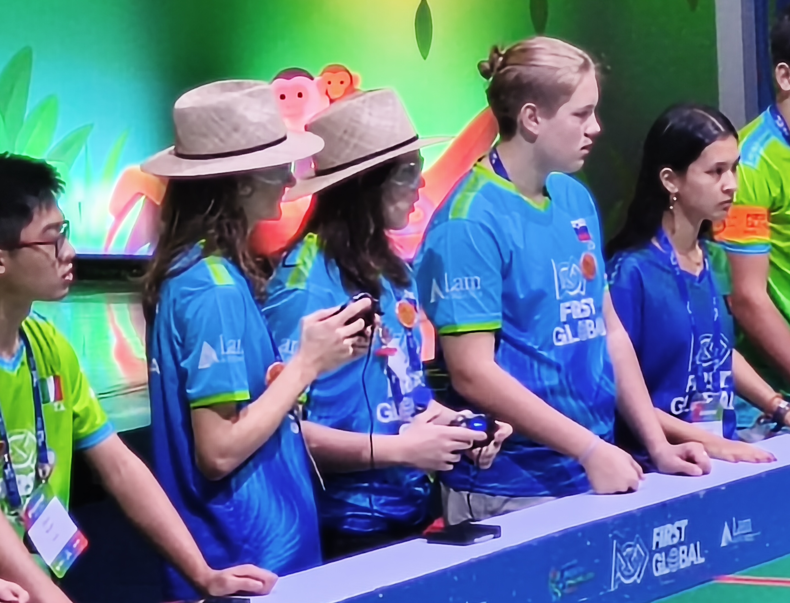

Three matches await us today, so we started early with the first match of the day, which the organisers list as number 299. This time we graced the red side together with the teams from the United Republic of Tanzania and the Czech Republic. The upgrades to the robot and a good strategy paid off, and we managed to conjure up a 74:68 result in our favour. This time, after two and a half minutes, we shook hands with the representatives of San Marino, the Netherlands and Latvia.

<iframe width="560" height="315" src="https://www.youtube.com/embed/W_ZVyhQoIOg?start=1795" title="YouTube video player" frameborder="0" allow="accelerometer; autoplay; clipboard-write; encrypted-media; gyroscope; picture-in-picture; web-share" referrerpolicy="strict-origin-when-cross-origin" allowfullscreen></iframe>

A short pause, and we were already rushing back into the queue. This time we were paired with our neighbours and could get closer to the Italians, and the trio was completed by the representatives of Afghanistan. The match on field 4 was tense, but sadly match no. 317 ended in victory for our colleagues from Djibouti, Cyprus and the Congo (36:40).

<iframe width="560" height="315" src="https://www.youtube.com/embed/W_ZVyhQoIOg?start=4331" title="YouTube video player" frameborder="0" allow="accelerometer; autoplay; clipboard-write; encrypted-media; gyroscope; picture-in-picture; web-share" referrerpolicy="strict-origin-when-cross-origin" allowfullscreen></iframe>

To round off the programme, we took part in qualification match number 337 on field 1. This time we had the honour of shaping the strategy and the match together with Nicaragua and Kyrgyzstan. We ended our attempt at the FIRST Global Challenge with a victory against (or rather with, since we wish to win as a community) Mozambique (who fielded only a human player – there were no drivers and no robot), Paraguay and Aruba. The final figures on the screen read 48:40. With that, Slovenia’s record stood at 8 wins, 2 draws and 2 defeats.

<iframe width="560" height="315" src="https://www.youtube.com/embed/FbAeVwfciMQ?start=7566" title="YouTube video player" frameborder="0" allow="accelerometer; autoplay; clipboard-write; encrypted-media; gyroscope; picture-in-picture; web-share" referrerpolicy="strict-origin-when-cross-origin" allowfullscreen></iframe>

The end of the event was drawing near, so we had to start packing up the pit. Before setting about it, we made sure to have our photograph taken in our sponsors’ T-shirts.

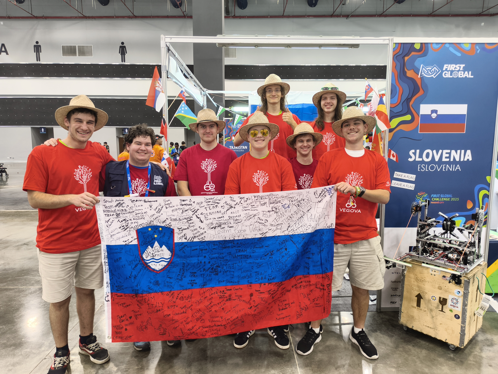

Whilst we were packing up, visitors from other countries called by, asked us to sign their booklets and shirts, and asked whether we had any souvenirs left. The conversations drifted into presentations about Slovenia and vice versa, so now we know more about South Africa, Algeria, Ukraine and a few others. When we needed a rest, we went off to swap shirt for shirt with friendly countries.

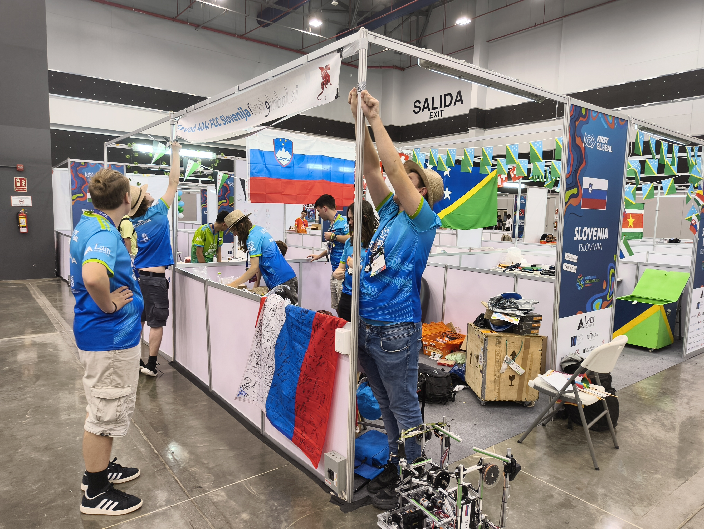

At dinner we ate our fill, and after many burgers there were many boxes left over, so our students set off on a mission to build a tower. When it collapsed, they decided to reinforce the structure into a triangular prism. Before long, the building of the tower block encouraged other countries to contribute their boxes. Soon our colleagues from Moldova jumped in and helped with the tower enthusiastically. After three iterations, we found together the ideal structure, which resembled Dubai’s Burj Khalifa. One shoulder-stand later, we stood at the height of many boxes and received applause from the hall, as well as the watchful looks and smiles of the waiting staff. The tower then collapsed, of course, but no matter.

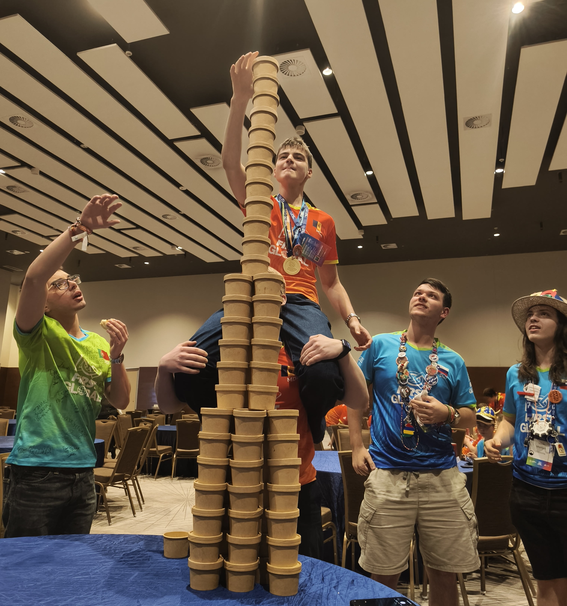

With the robot packed and the pit cleared, we made our way to the coach and back to the hotel. We devoted just under an hour to packing our luggage and securing the robot.

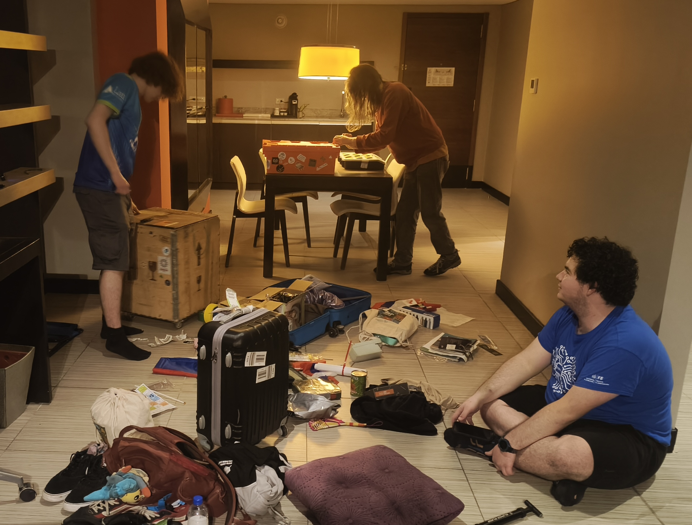

For a rest from packing, we ordered 2 Ubers and set off for the old town, Casco Viejo. The darkness of night was adorned by pleasant yellow lights, which accompanied us from our very first stop, the Plaza Herrera park. There we could look at monuments and buildings and catch one of the souvenir shops still open.

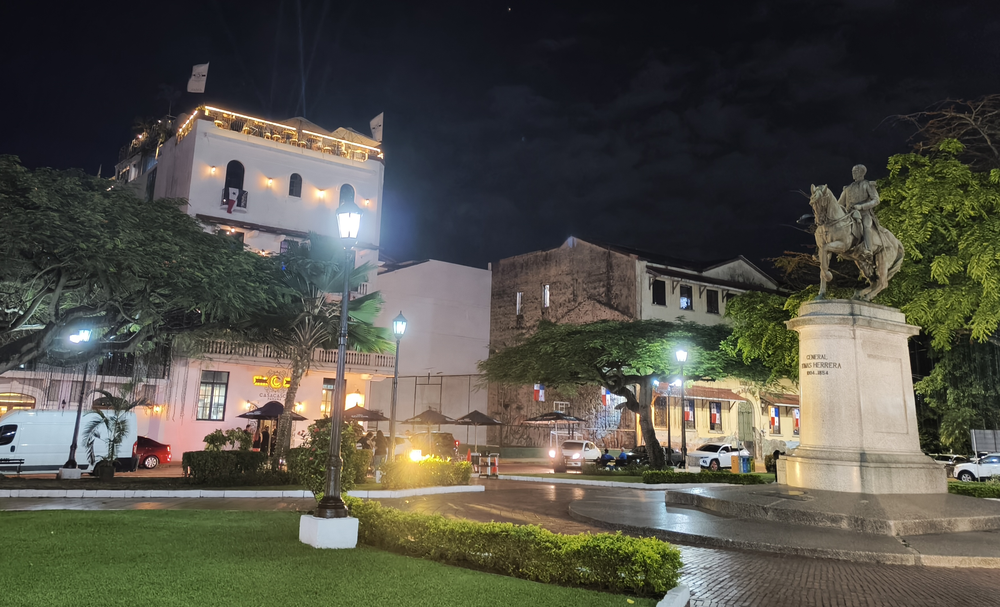

Carrier bags in hand, we continued to the end of the peninsula, where besides the sea we found monuments, a tower and a small stretch of wall.

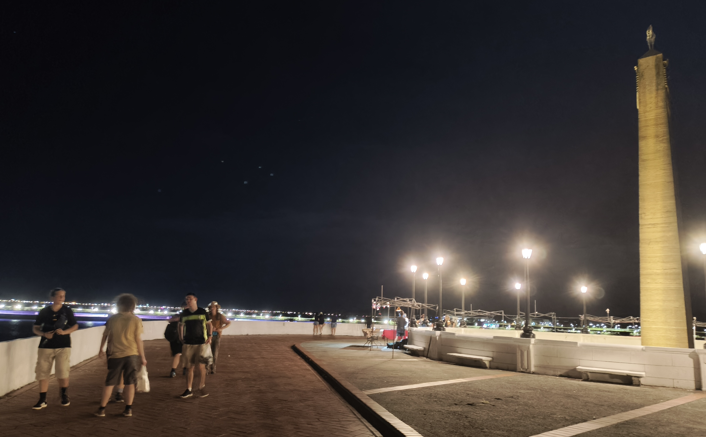

A tunnel of lights escorted us back into town, after which we turned left into the street of hats, where we also found a hat shop.

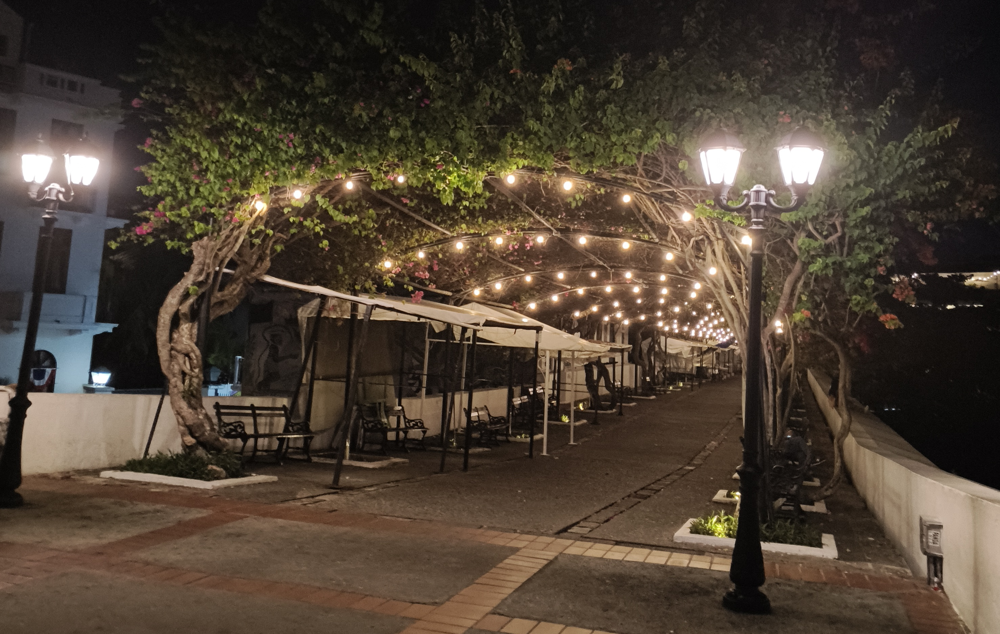

Our way along narrow pavements and past armed police officers guarding the squares led us to the art museum, a church and the national theatre.

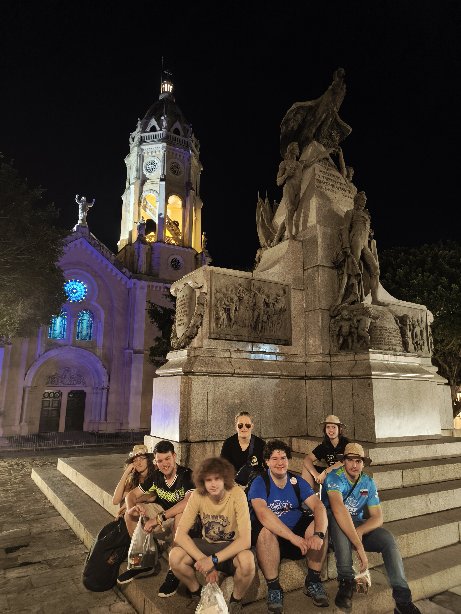

On the way back we also visited the church and the buildings on Independence Square (Plaza de la Independencia).

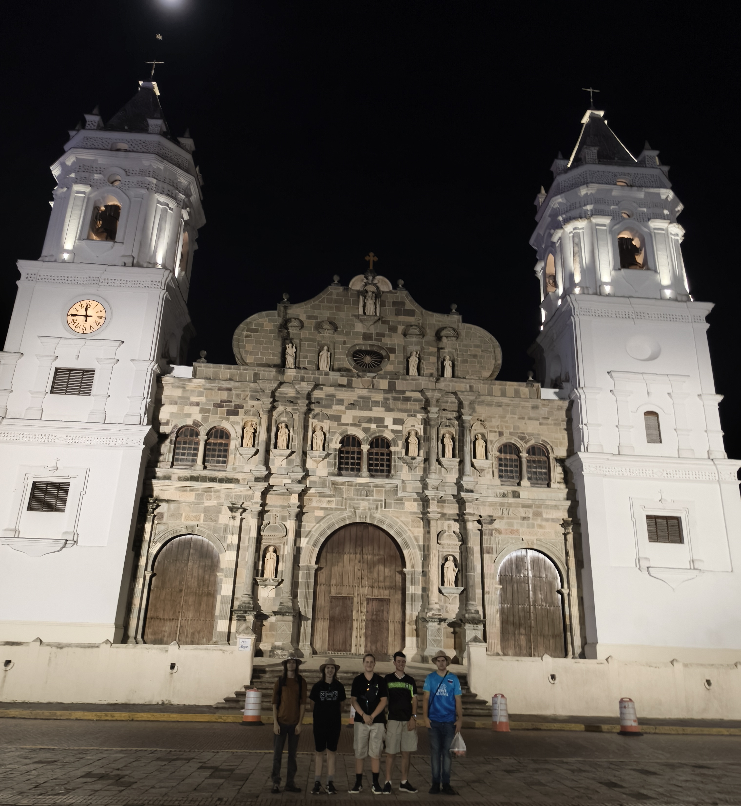

After that, with wet hair, we got into an Uber, which we had to order to the street next to the square (on account of the police), and went home.

Until next time,

dobroyi nochi
