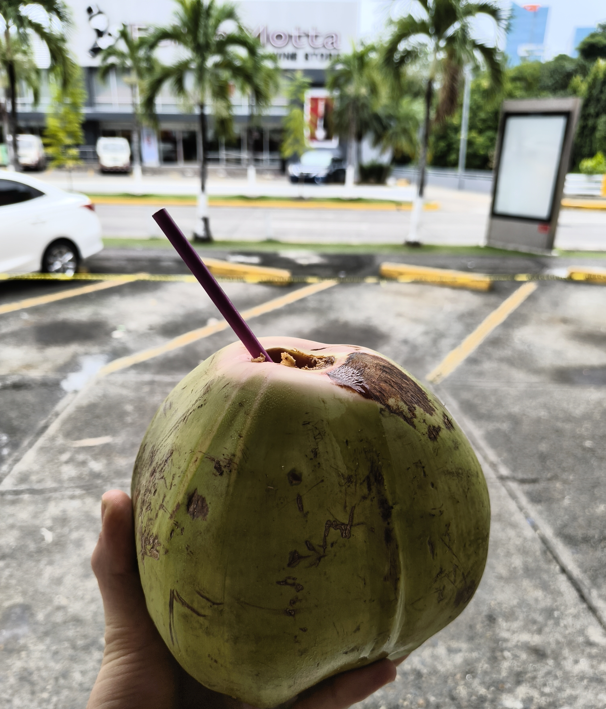
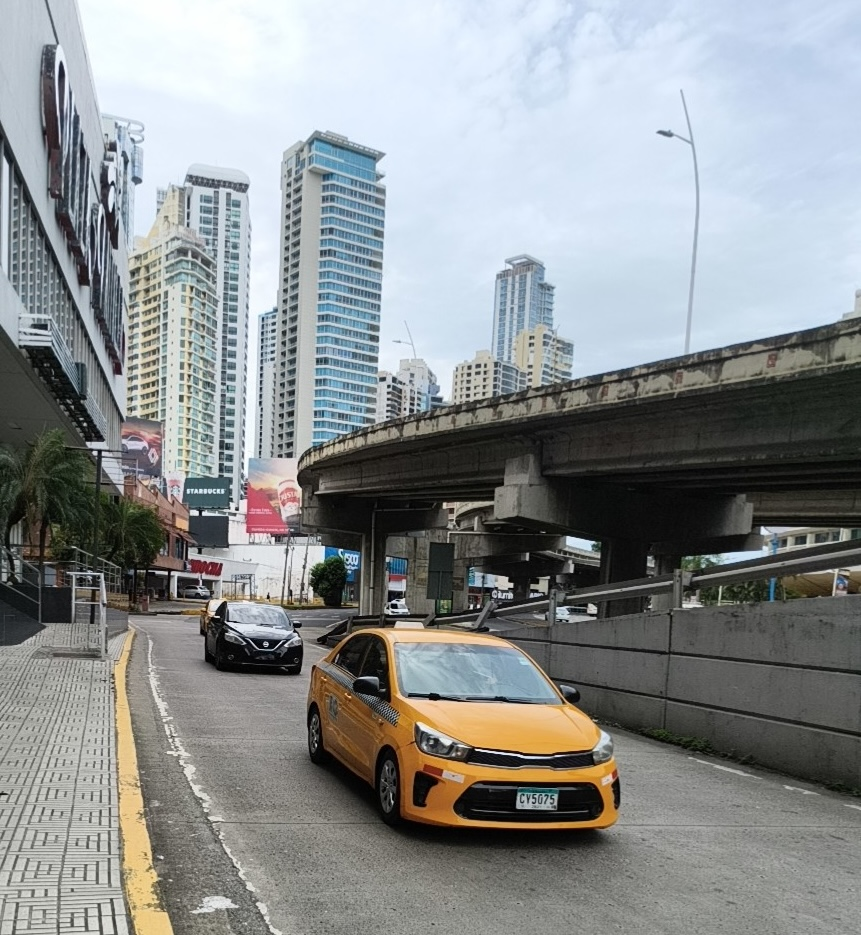
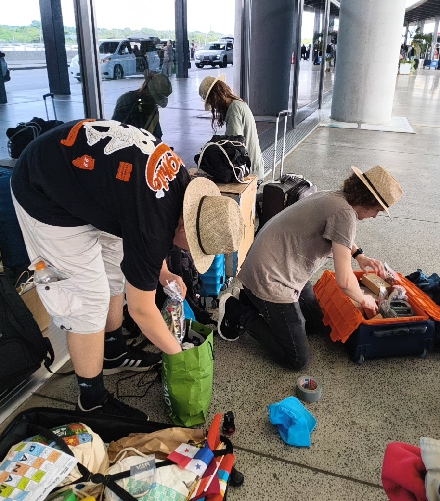
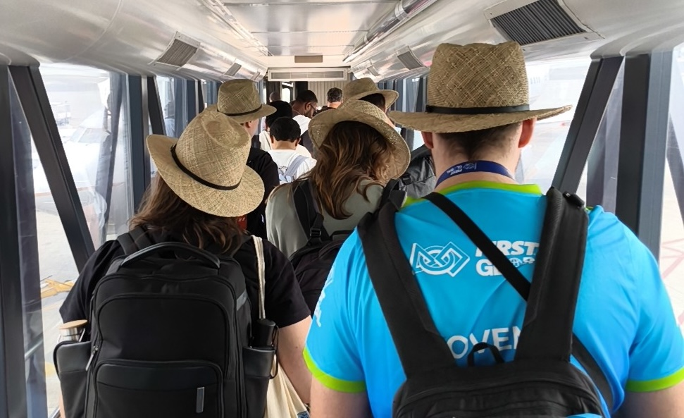
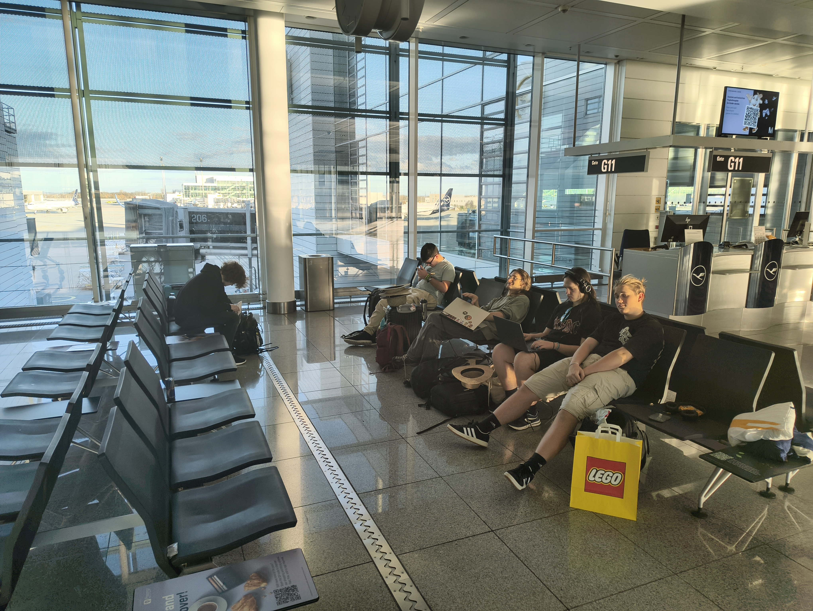

Some of us began the morning of the last day earlier than others. Anyone who wished had the chance to go to the all-night shop one last time that week; otherwise there remained the option of a lie-in and a later breakfast. In the shop we found snacks and drinks, and a coconut, which the owner opened for us with a knife, offering us a straw.
<!-- truncate -->

The shops in Panama were operating normally even though it was Sunday, though each had its own opening hours. So we three musketeers set off for the Arrecha shop, which we already knew, did our shopping in a hurry and went back to the hotel. We collected our things and gathered in the hotel lobby. The coach soon arrived for team ‘Slovenia’. We handed our things to the driver to load into the coach’s hold. At the airport we immediately stepped aside and redistributed our things amongst the suitcases, also stowing in them the contents of the bags that some had forgotten to pack.

With our suitcases ready and weighed, we joined a long queue. Halfway along it, a gentleman came up to us and offered to take us to the other side of the hall, where the queue was empty. We seized the opportunity and followed. On the way we were told that we had to wrap the robot’s box in plastic film. The team went on ahead, and a mentor approached the man with the wrapping machine. Whilst loading the box, the mentor noticed that the machine issued receipts and asked the price. The chap pointed to a sign reading ‘17$’, which the mentor politely declined. We then checked whether we could wrap the box ourselves, and they said that we could. So we applied silver duct tape along the edges, round the corners and over the heads of the screws. We checked in between, and each time the answer was ‘a little more’. Then, by a slightly roundabout route, we got past the staff on the grounds that ‘your colleague said it was OK’. At the check-in desk, the mentor was handed a slip to sign and tick, confirming that the luggage was being checked in unwrapped. And so that complication was resolved. Now for security and the aeroplane. We waited for a while at the original gate and wandered round the shops. Meanwhile the gate was changed, so we slowly moved to the other end of the corridor, but there a long queue and another security check awaited us (aha, so that is why we had been told we could not take drinks from the shops onto the aeroplane).

A delay of almost an hour was followed by the journey to Miami airport. Because of the delay, we arrived late into a queue with 100–200 other people without American citizenship. After briefly making our case for entry and having our photographs taken, we went to collect our luggage and dashed to our gate. When we got there, however, we were told that boarding for this flight had closed. Fortunately we were all wearing straw hats, and they grasped that they were refusing boarding to seven people. They urgently called their superiors, and at some point one lady gave her colleague a 👍. Quickly, as if on a conveyor belt, we all checked in and dashed to security. A complication with the robot’s batteries was quickly resolved, and we hurried on, reached the gate and even waited in the queue for boarding. We settled calmly onto the aeroplane to Munich, where, after landing, we spent about 8 hours.

Until next time,

oíche mhaith
