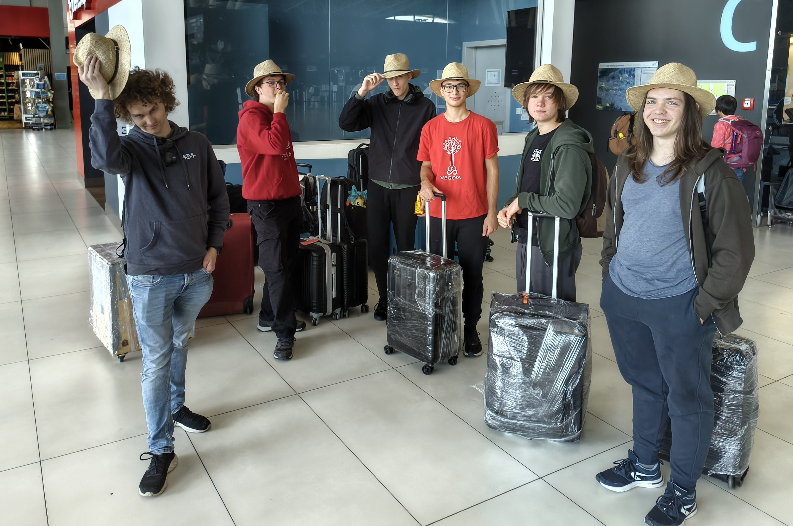

The clock struck morning on Sunday 4 October 2026. We gathered at the Zavod 404 workshop, loaded the robot and our luggage into a van and a car, and set off for Zagreb Airport. A good hour’s drive later, we were already wrapping the robot box and our suitcases in cling film. We then took the box two floors down for the oversized baggage check.

<!-- truncate -->

Bag drop went smoothly, whilst at the security check we received the questions we had expected about the robot’s batteries and the tape (‘Šta će ti ovo?’ – ‘What do you need this for?’). We then hurried to our gate, stood about for a couple of minutes and, quite without meaning to, ended up at the front of the queue. We boarded the aeroplane to Warsaw, and our journey to the FIRST Global Challenge, the Olympics of robotics, had truly begun. On the way, we snacked on spinach and apple turnovers. During the flight, we had the opportunity to observe young air steward Tim, who kept blocking the aisle. In the end, he decided that one is only young once and wished to find out what the armrests tasted like, which his mum actively prevented (‘Tim, you can lick Mummy, but not the aeroplane’).

Before long, we landed on Polish soil, where people are fond of bringing up beavers. We had about 50 minutes for our connection, so we lengthened our stride and made the next boarding. In the queue, we also bumped into our friends from Norway, who had a new team line-up. On board, we had the privilege of listening to Chopin, watching films or lying awake thanks to a crying baby. We could prepare our taste buds for Korean food, as both dinner and breakfast were meat with noodles, side dishes (kimchi, octopus) and fruit. We shall write again once we land in South Korea, which is 10 hours and 30 minutes from now.

Until next time,

lahko noč
