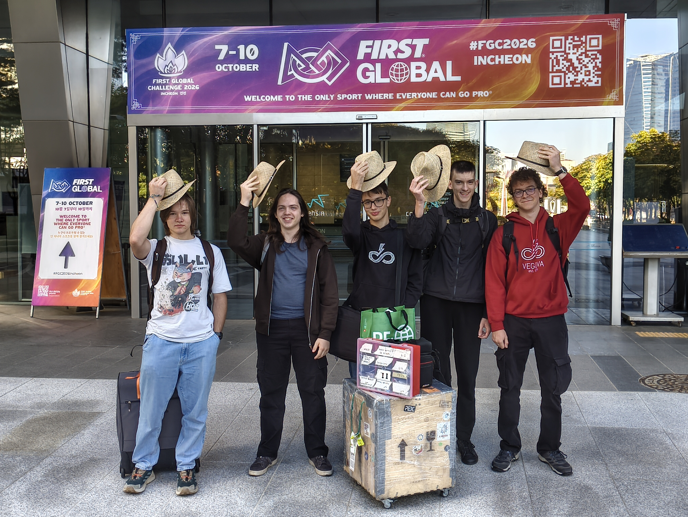

We began a calm, foggy morning in Incheon’s Songdo district with an alarm clock, breakfast and a muster in the lobby. Today’s goal was to get the robot ready and test it, since it had to be taken apart to meet the luggage requirements. Once that is done, we still need the judges’ tick confirming that the robot is fit to compete. Into action!
<!-- truncate -->
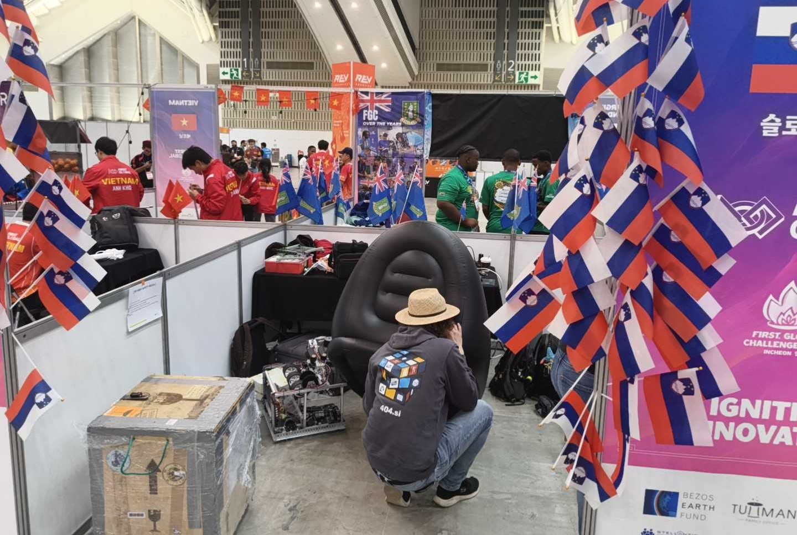

After reassembling the robot, we found that the software we had put together was not working yet, as the ball launcher did not shoot high enough on the field and took too long to spin up. So we spent a while implementing motor speed control based on RPM.

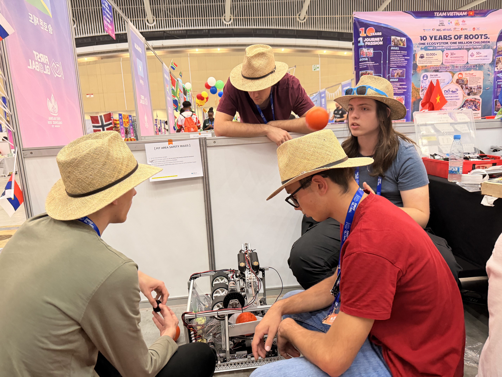
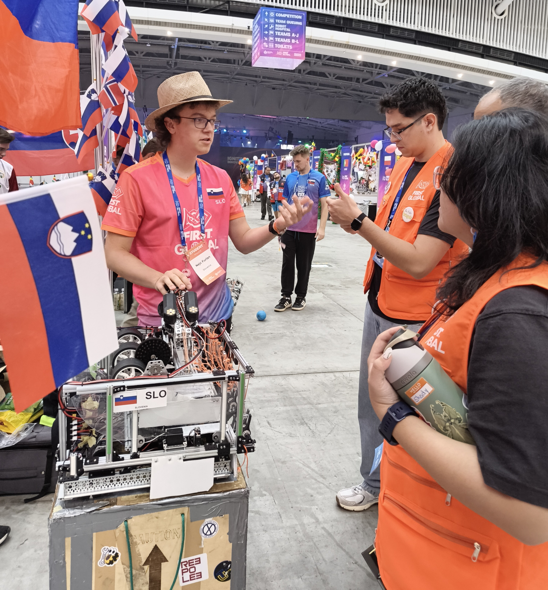

Meanwhile, volunteers kept popping by to check whether we were ready for robot inspection, which we had to politely decline. In between, we treated ourselves to a break with a catered lunch on the first floor, outside the arena.

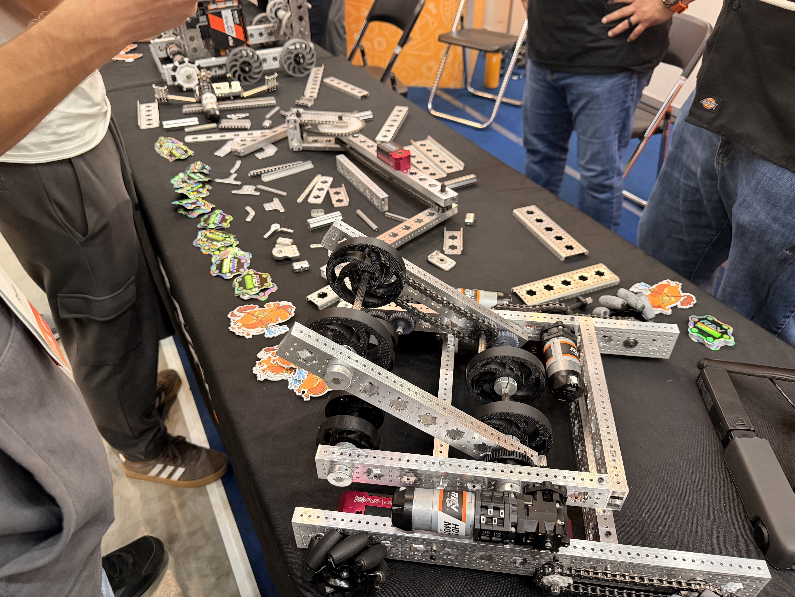

Afterwards, we went to have a look at the new parts that will be used next season, and we already cannot wait for the new geared motors, new extrusions, bearings and other goodies. Those who were not working on the robot visited other countries’ pits and got to know teams such as North Macedonia, Guam, American Samoa and others.

To make the most of the afternoon, we went over the software with our only programmer, whilst the others fine-tuned the secondary mechanisms for extending and picking up balls.

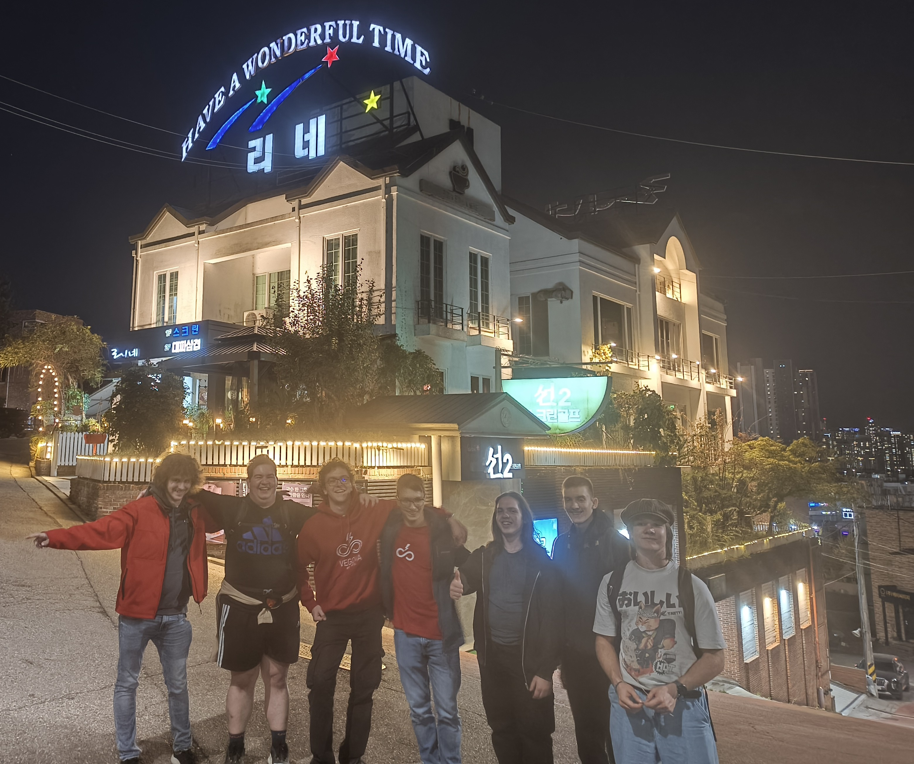

Over dinner, we drew up a plan for an evening stroll. So, after a sufficient amount of chicken and salmon, we dropped our things off at the hotel, changed and hopped on a bus. A walk up the hill took us past a statue of legs on a roof and a ‘Have a wonderful time’ sign and, as the view of the city opened up, brought us to Heungnyunsa temple. In silence, we walked past little dragon statues and up the steps to a golden tower, from where we could see the city in the distance. Next to it we found an elephant statue, and at the top of the hill, places for prayer, some of them even set into the rock face or a small cave.

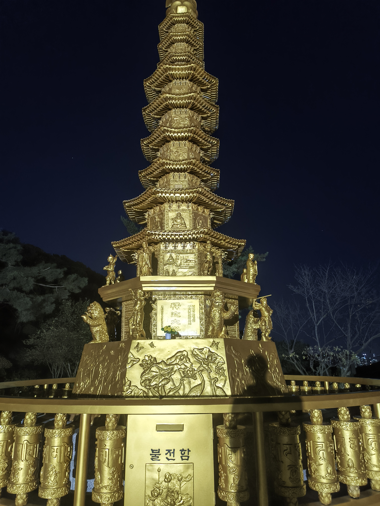
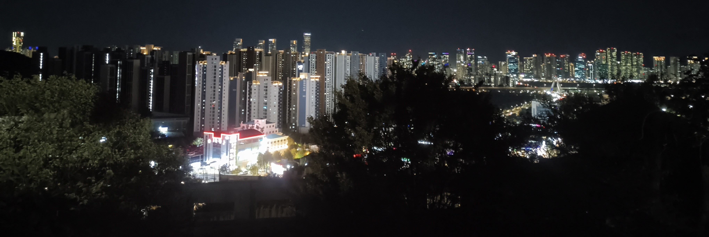
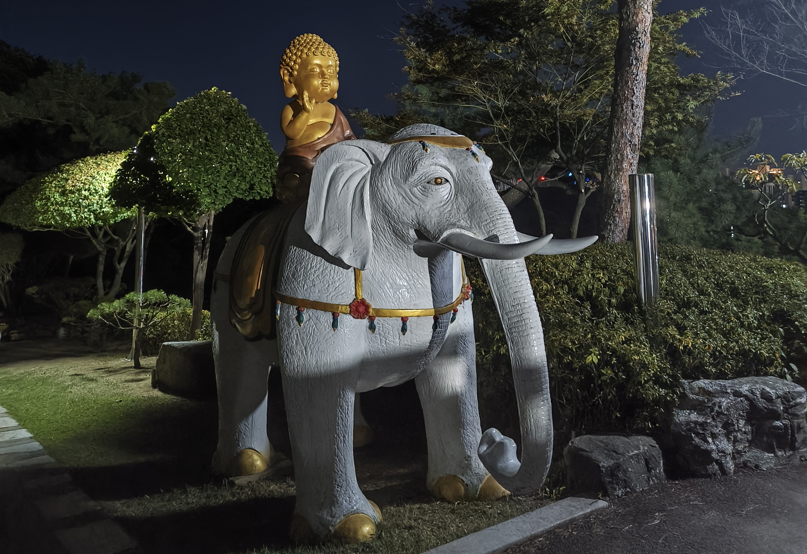
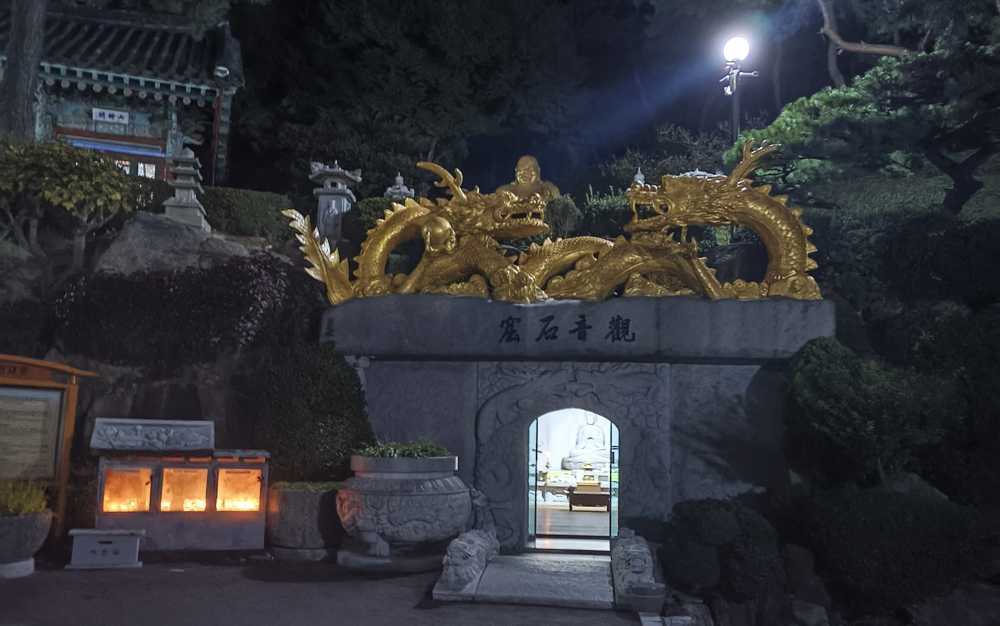
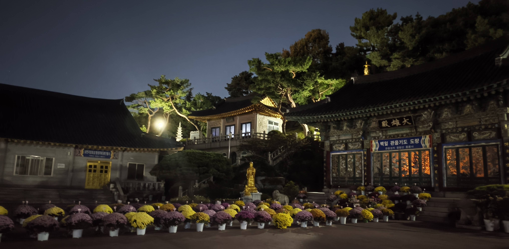

Then we zoomed out on Google Maps and discovered some sort of museum nearby, so we marched off in that direction and came upon an open-air museum about the American landing at Incheon. We got to see tanks, fighter jets, watchtowers with searchlights, a tower dedicated to the soldiers and, in the wooded part of the exhibition, a few more aeroplanes and ships. Before taking our leave, we also discovered postcards and an aquarium projection on the wall next to the entrance.

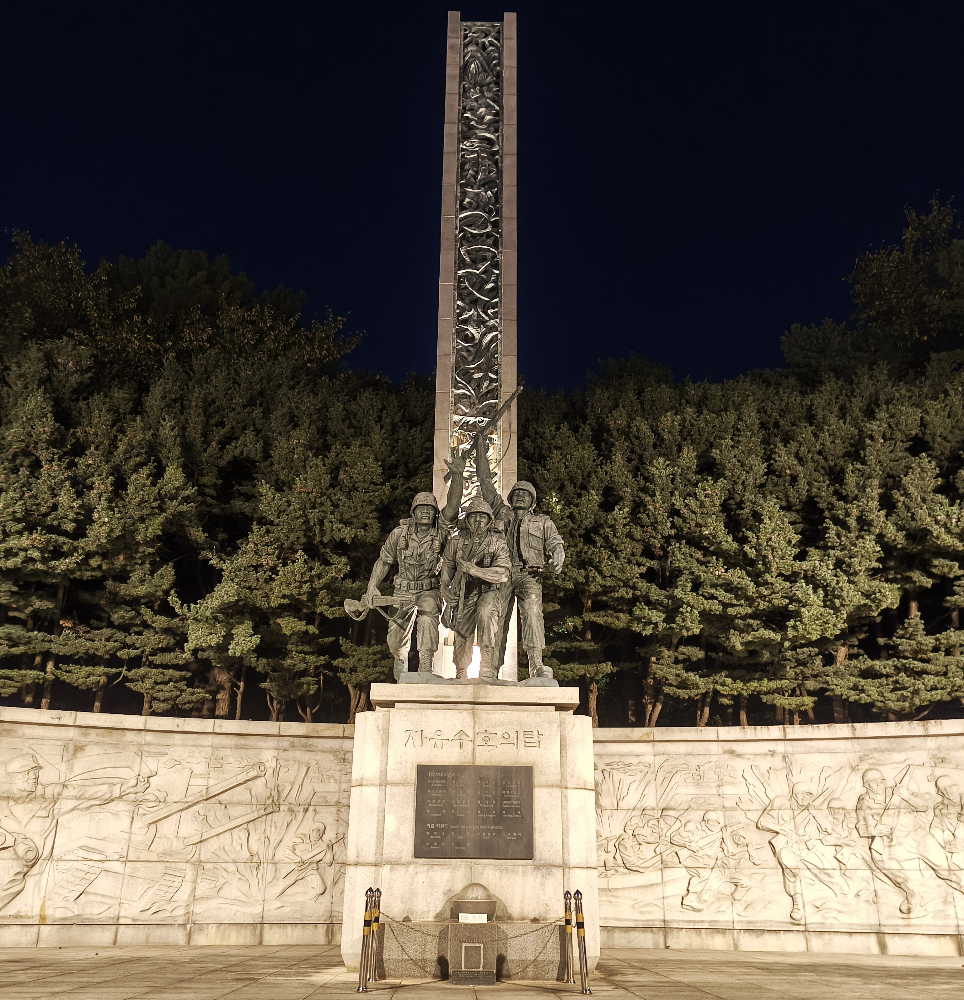
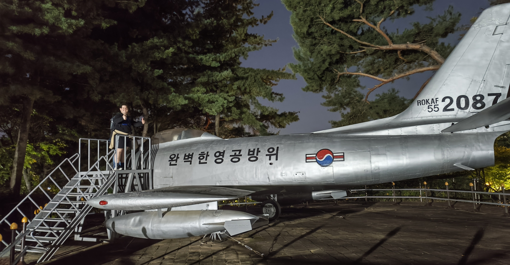
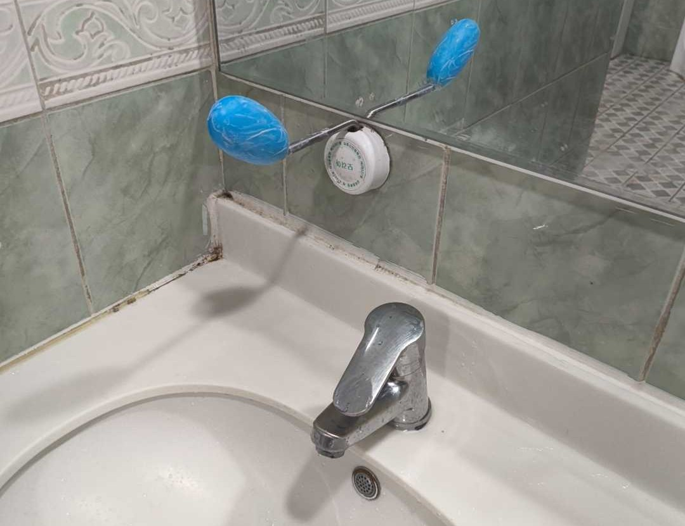
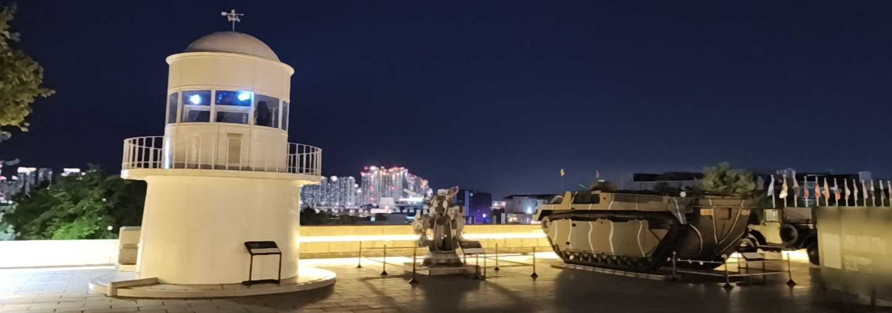

We ended the evening stroll by marching to a bus stop closer to the sea, passing a karaoke bar and a shop on the way, where we stopped to try some new juices. The bus took us safely home, and all that was left after that was sleep.

Until next time,

laku noć
