Nov datum na koledarju nas je pognal na noge, med krožnike zajtkovalnega prostora in ven iz hotela do prostorov z roboti. Popravila in dopolnitve robota so kmalu nastopile, predvsem na področju mehanizma za izstrelitev in mehanizma za izteg, ki je namenjen povečanju kapacitete zbiralnika za žogice.
<!-- truncate -->
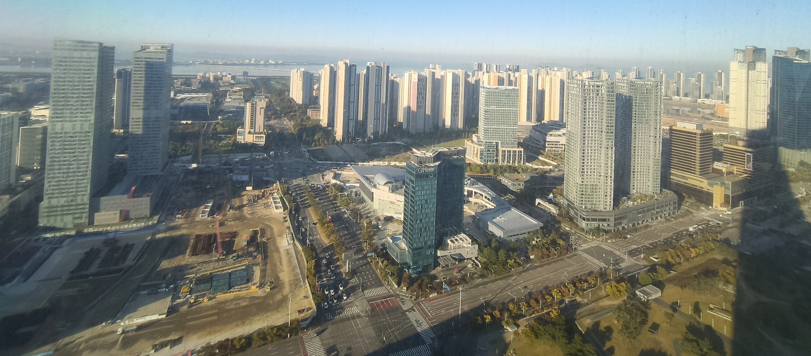
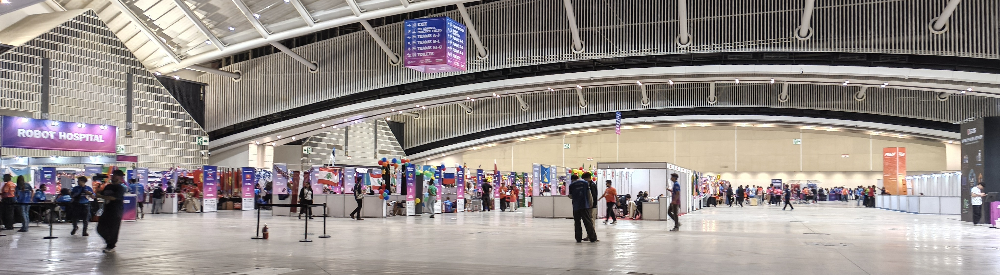

Kdor ni imel dela na vsezgodaj je počvekal z ekipo Južne Afrike in Solomonskih otokov, kasneje pa poskrbel za medkulturno mreženje ob Cockti. Izkazalo se je, da so tujci navdušeni nad rastlinskimi izvlečki, da je razlika med ostalimi kola pijačami izrazita. Slovaška reprezentanca je ime pijače asociirala s svojim izrazom za jecljanje (koktaš). Med druženjem nas je obiskala še ameriška slovenska Kelly, ki je del FIRST volunteerjev dlje časa. Slovenske korenine so očitno pognane, saj se je z veseljem vrnila po Cockto in kasneje še po Šumi bonbone.

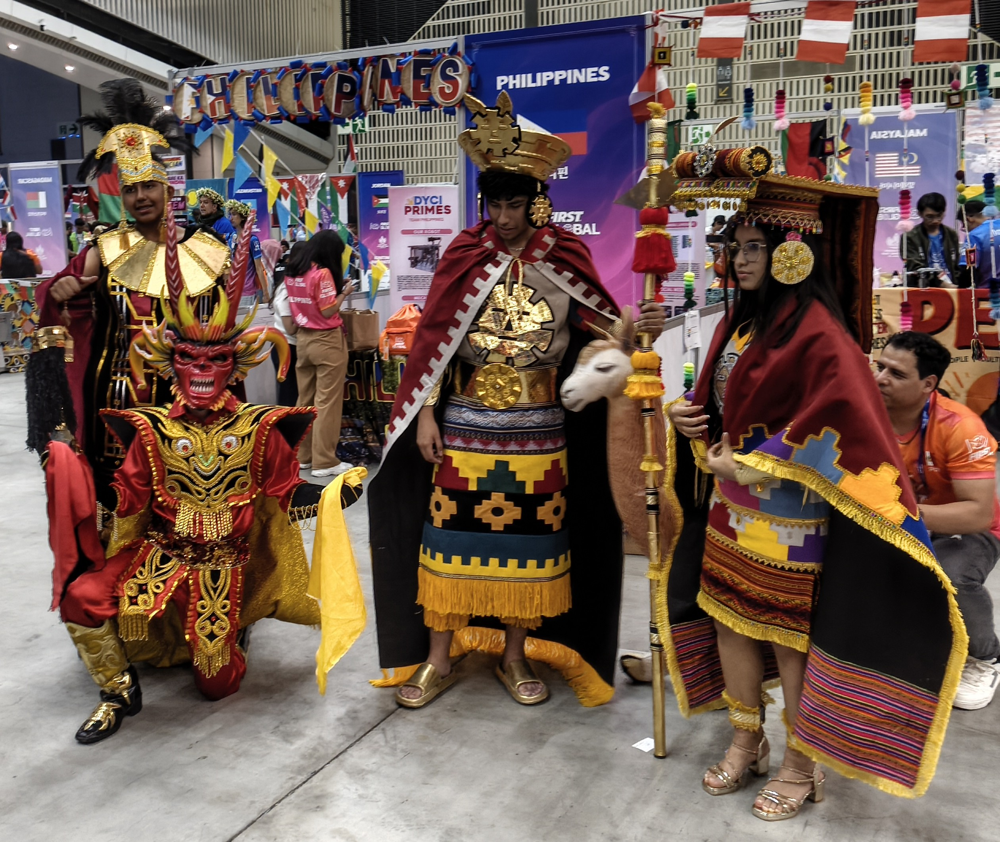
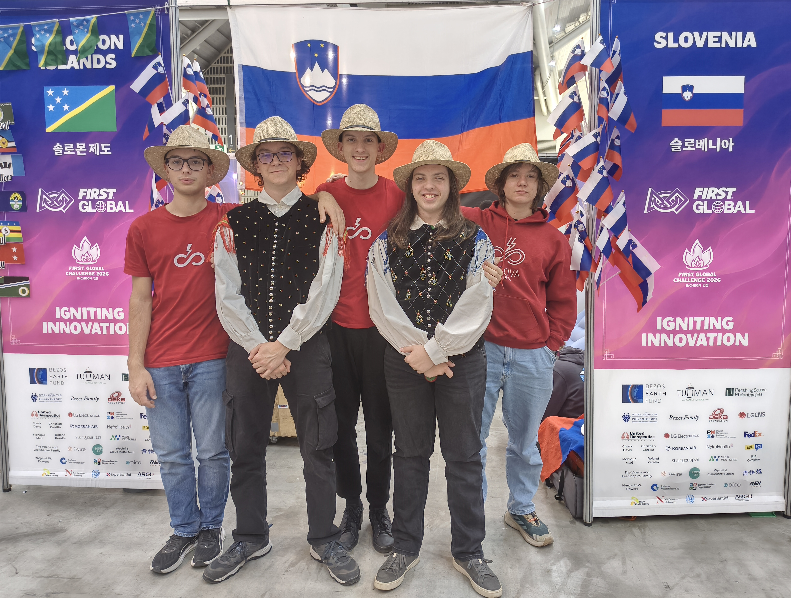
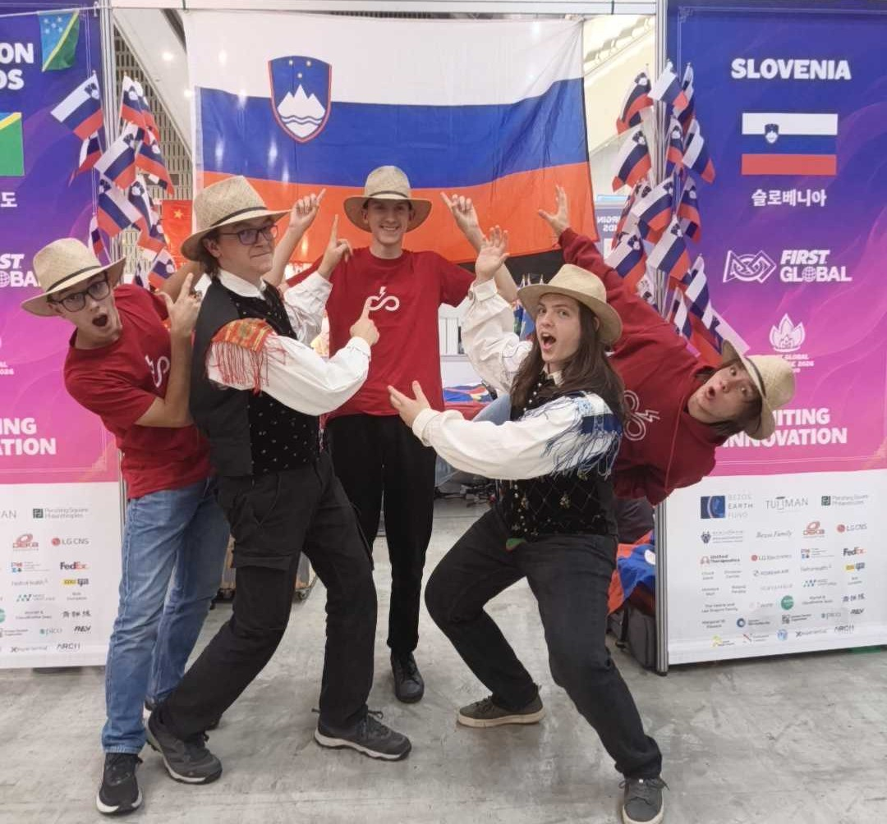

Na kosilo smo šli skupaj s prijatelji iz Južne Afrike, s katerimi smo delili recepte in slike naših vsakdanjih jedi (od balkanskih dobrot do afriških sladic). Po kosilu so dijaki priskočili na pomoč kolegom iz Norveške, ki so imeli pred seboj še veliko dela na robotu. Medtem so žogice v štandu slovenske ekipe letele dovolj visoko v zrak, da je robot dobil zeleno kljukico pri voznikih robota. Mentorja sta žogice glede od daleč, saj sta preverila novosti pri podjetju XRP, ki so letos razvili 3D natisnjene robotske roke.

Kmalu je ura v Južni Koreji odbila toliko, da so se fantje slovenske ekipe preoblekli v majice Vegove Ljubljana in v narodne noše, kar je v kombnaciji s po meri narejenimi klobuki iz morske trave predstavljajo našo tradicionalno obleko. Med čakanjem na vabilo v čakalno vrsto z zastavami nas je obiskala gospa Miriam Možgan, ambasadorka Slovenije v Južni Koreji. Na hitro smo se spoznali in predstavili robota ter letošnji izziv, nato so dijaki šli v vrsto po abecednem vrstnem redu držav, mentorja sta pa šla z gospo ambasadorko na tribune gledat otvoritveno prireditev. Vihtenju zastav 185 držav je so sledili K-pop nastop, nagovor župana mesta Incheon s razpoznavanjem govora v živo (in naknadnim prevajanjem) in seveda še nagovor gospoda Deana Kamena.

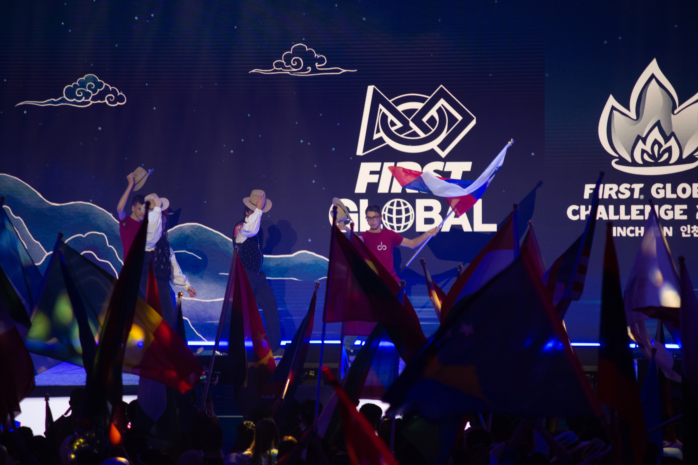
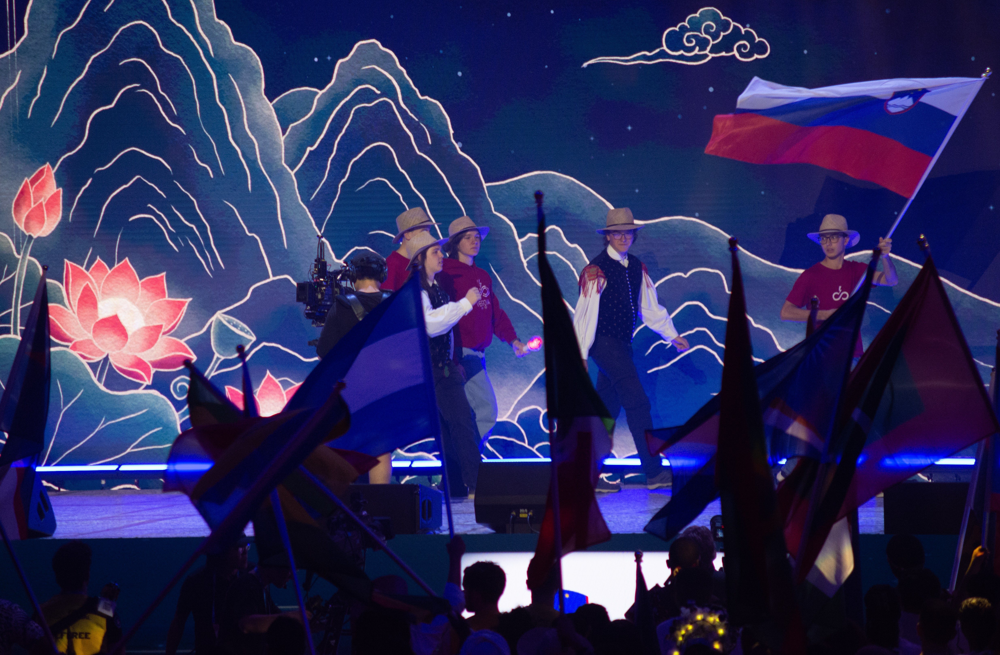
<iframe width="560" height="315" src="https://www.youtube.com/embed/CUUvTeXDERo?si=Pc7jBNjh_Of83WNS&amp;start=3056" title="YouTube video player" frameborder="0" allow="accelerometer; autoplay; clipboard-write; encrypted-media; gyroscope; picture-in-picture; web-share" referrerpolicy="strict-origin-when-cross-origin" allowfullscreen></iframe>

Otvoritveno prireditev smo zaključili s svetlobnim plesnim spektaklom, kjer je bila prava umetnost menjavanje barv oblačil plesalcev, spreminjanje ozadja na ekranu in sinhroniziranost koreografije.

<iframe width="560" height="315" src="https://www.youtube.com/embed/CUUvTeXDERo?si=nUb8gjhfsRJ1ESFv&amp;start=6674" title="YouTube video player" frameborder="0" allow="accelerometer; autoplay; clipboard-write; encrypted-media; gyroscope; picture-in-picture; web-share" referrerpolicy="strict-origin-when-cross-origin" allowfullscreen></iframe>

Na poti ven smo prejeli korejski čips in smo dali pot pod noge, da najdemo večerjo. S hrano za nami smo se napotili trgovino, ki obratuje do enajste ure zvečer, kjer smo poleg Lotte trgovine našli tudi Toys R Us, papige in axolotle, kovinske palčke za jest, matcha sladoled in avtomat s škatlami presenečenja. 

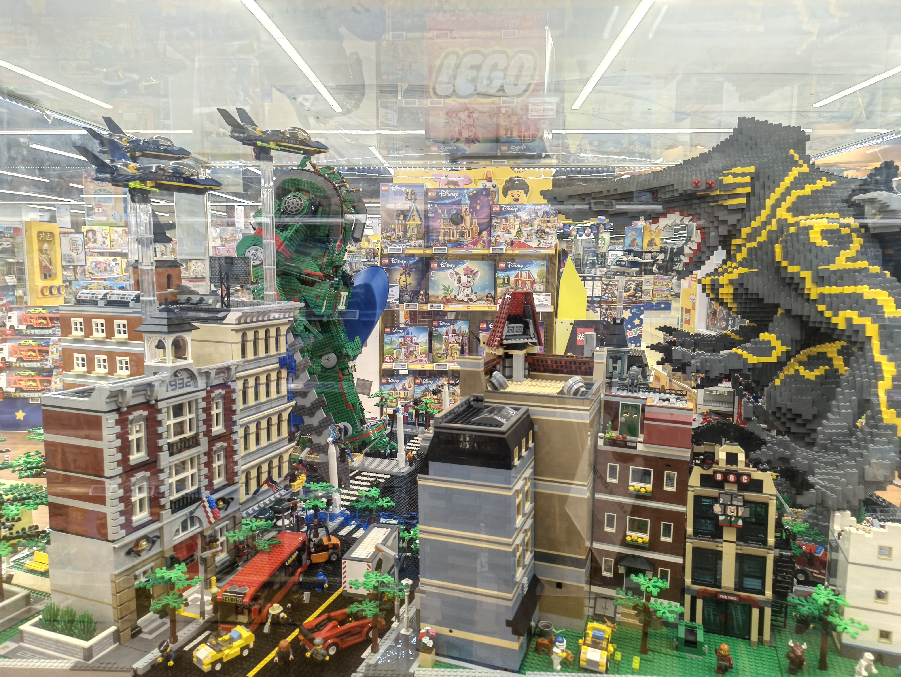

Ko nas je gospa iz prodajalne prijazno prisilno odslovila (“bye bye”), smo se napotili v Central park, kjer smo našli SONGDO napis skupaj z maskotami Incehona, templji, inštrumenti, solarnimi mački, srnami in različnimi kipi, vse ob osrednji mirujoči vodi.

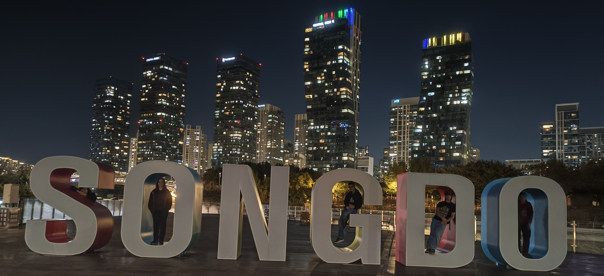
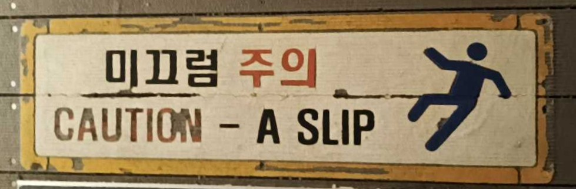
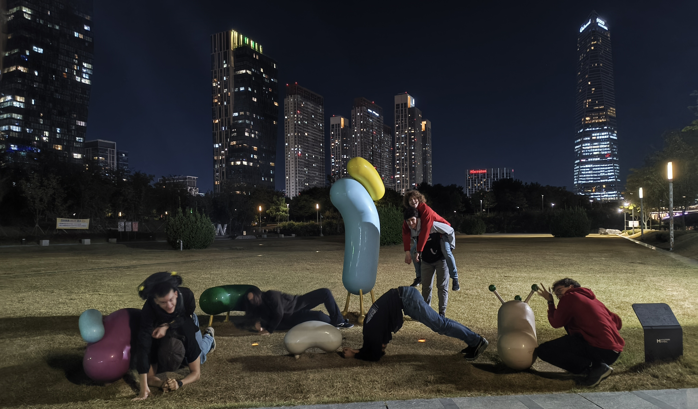
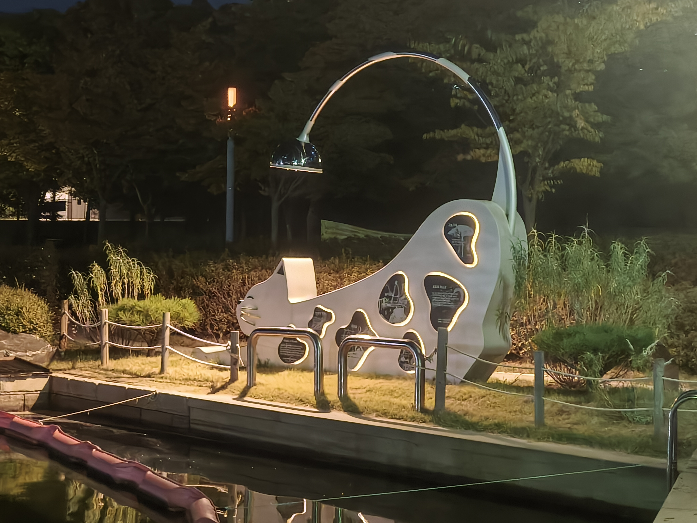
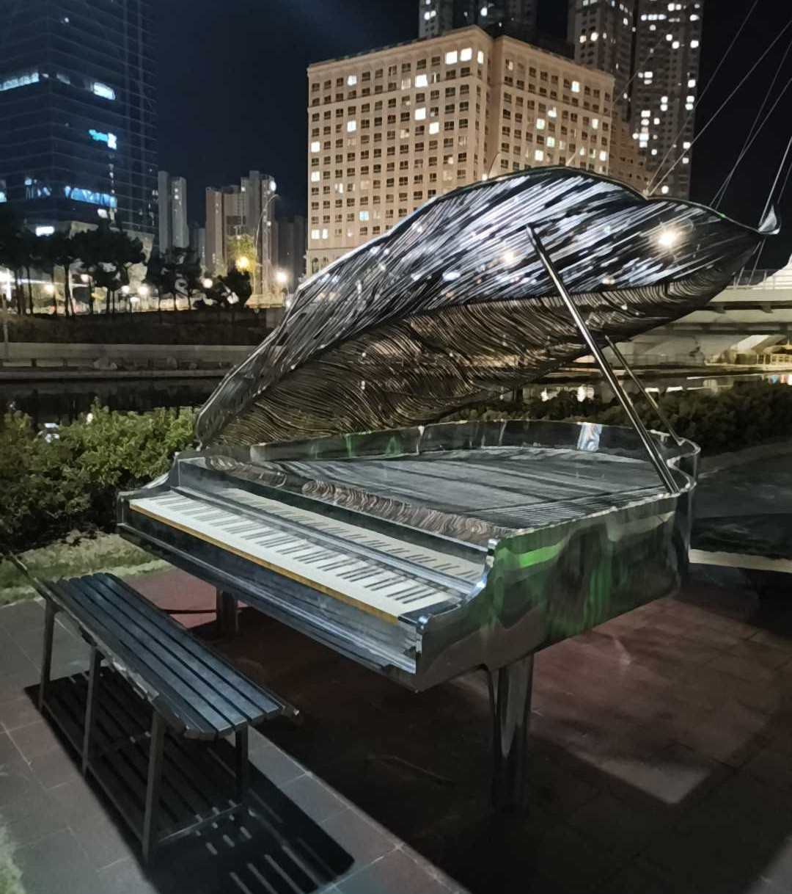

Po dolgem sprehodu nas je v hotelu pričakala mehka postelja in pogret pokrov straniščne školjke.

Do naslednjič,

noapte bună