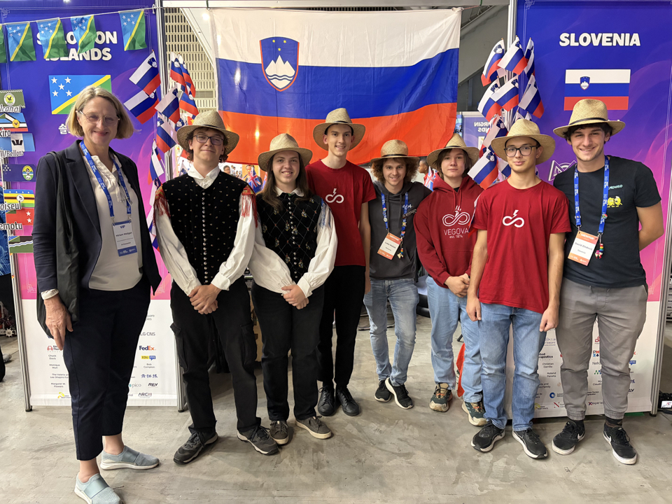

A new date on the calendar got us on our feet, through the plates of the breakfast room and out of the hotel to the robot venue. Repairs and upgrades to the robot soon followed, chiefly on the launcher and on the extension mechanism, which is meant to increase the capacity of the ball storage.
<!-- truncate -->

Those who had nothing to do at so early an hour chatted with the teams from South Africa and the Solomon Islands, and later saw to some intercultural networking over Cockta, a Slovenian fizzy drink. It turns out that foreigners are thrilled with its herbal extracts and find it strikingly different from other colas. The Slovak team linked the drink’s name to their word for stuttering (koktaš). Whilst we were mingling, we were also visited by Kelly, a Slovenian-American who has been a FIRST volunteer for a long time. Those Slovenian roots have clearly taken hold, as Kelly happily came back for more Cockta and later for Šumi sweets too.

We went to lunch with our friends from South Africa, swapping recipes and photographs of our everyday dishes (from Balkan delicacies to African desserts). After lunch, the students lent a hand to our friends from Norway, who still had a great deal of work ahead of them on their robot. Meanwhile, in the Slovenian pit, the balls were flying high enough for the robot to earn a green tick from its drivers. The mentors watched the balls from afar, as they were busy looking into what is new at XRP, who have developed 3D-printed robot arms this year.

Soon the clock in South Korea struck the hour for the boys of the Slovenian team to change into Vegova Ljubljana T-shirts and national costume, which, combined with custom-made seagrass hats, make up our traditional attire. Whilst we were waiting to be called into the queue for the parade of flags, we were visited by Ms Miriam Možgan, the Slovenian Ambassador to South Korea. We quickly made each other’s acquaintance and presented the robot and this year’s challenge. Then the students queued up in alphabetical order of countries, whilst the mentors accompanied the Ambassador to the stands to watch the opening ceremony. The waving of the flags of 185 nations was followed by a K-pop performance, a speech by the Mayor of Incheon with live speech recognition (and translation afterwards) and, of course, an address by Mr Dean Kamen.

<iframe width="560" height="315" src="https://www.youtube.com/embed/CUUvTeXDERo?start=3056" title="YouTube video player" frameborder="0" allow="accelerometer; autoplay; clipboard-write; encrypted-media; gyroscope; picture-in-picture; web-share" referrerpolicy="strict-origin-when-cross-origin" allowfullscreen></iframe>

The opening ceremony ended with a light-and-dance spectacle, in which the true artistry lay in the dancers’ costumes changing colour, the shifting backdrop on the screen and the synchronised choreography.

<iframe width="560" height="315" src="https://www.youtube.com/embed/CUUvTeXDERo?start=6674" title="YouTube video player" frameborder="0" allow="accelerometer; autoplay; clipboard-write; encrypted-media; gyroscope; picture-in-picture; web-share" referrerpolicy="strict-origin-when-cross-origin" allowfullscreen></iframe>

On the way out, we were handed Korean crisps, and we set off in search of dinner. With dinner behind us, we headed to a shopping centre that stays open until eleven o’clock at night, where besides a Lotte shop we also found a Toys R Us, parrots and axolotls, metal chopsticks, matcha ice cream and a vending machine full of mystery boxes.

When the lady from the shop kindly but firmly sent us on our way (‘bye bye’), we headed to Central Park, where we found the SONGDO sign along with Incheon’s mascots, temples, instruments, solar-powered cats, deer and various statues, all set around the calm water at the heart of the park.

After a long walk, a soft bed and a heated lavatory seat awaited us at the hotel.

Until next time,

noapte bună
