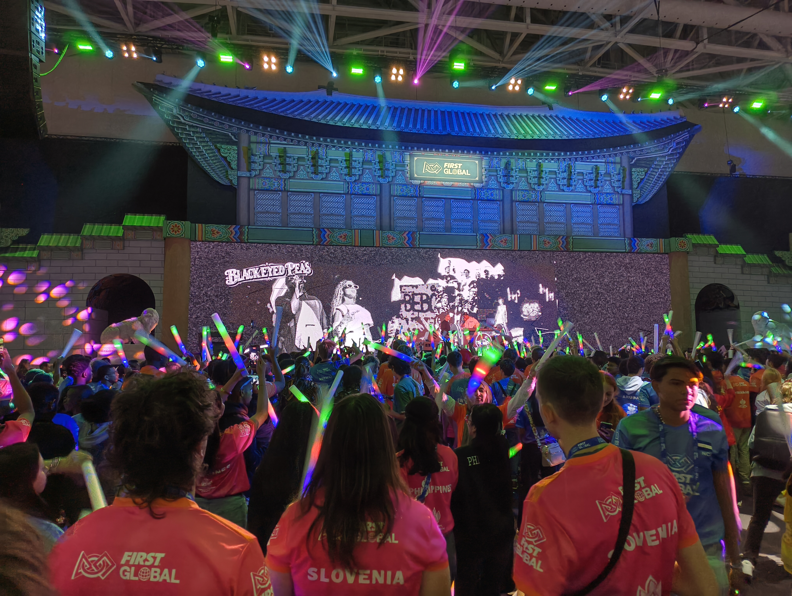
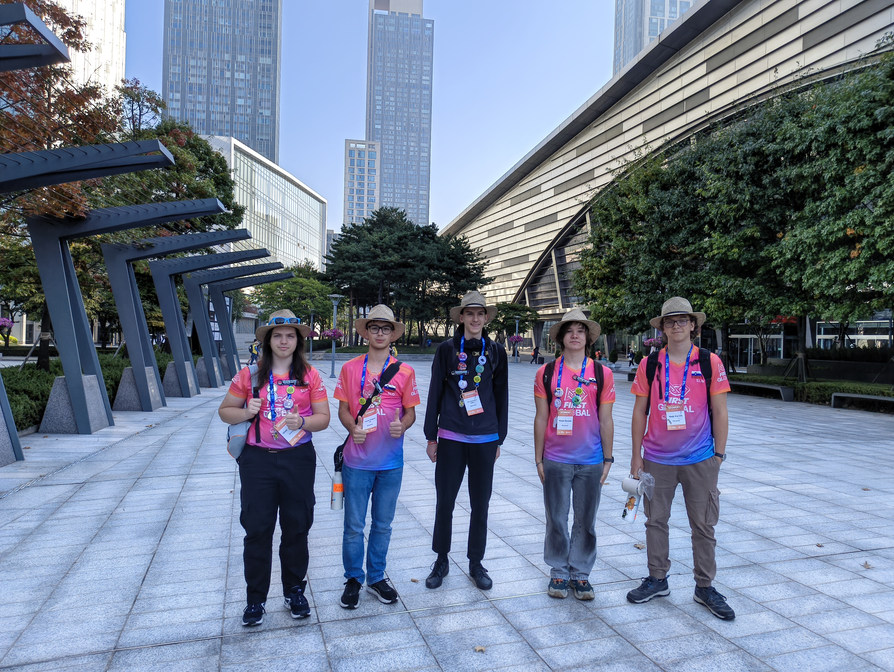
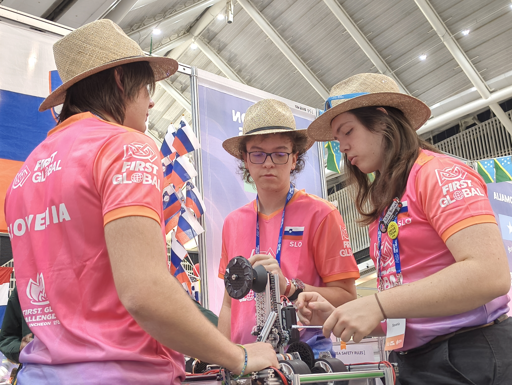
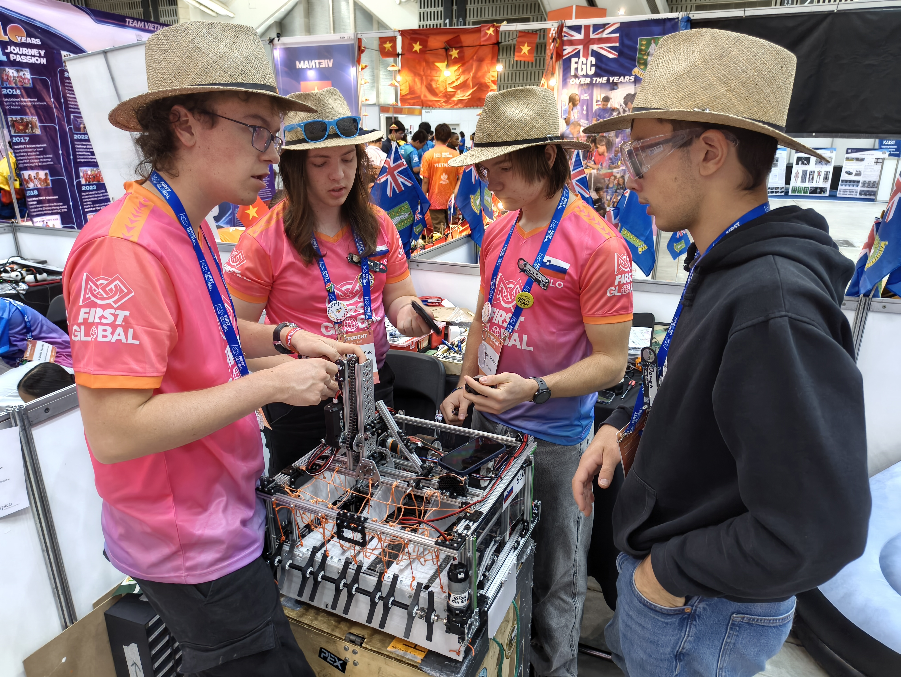
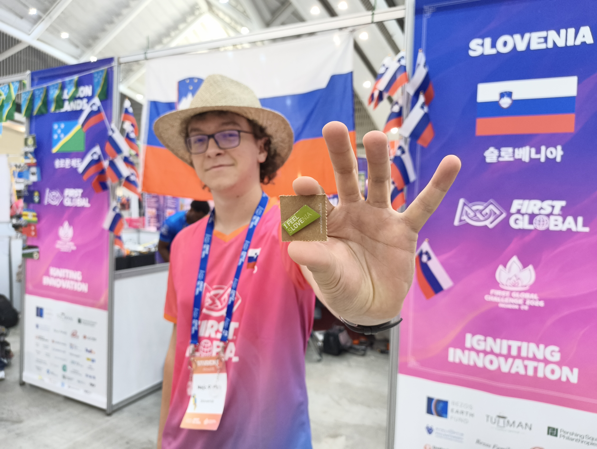

Nov datum, nove dobrote na jedilniku pri zajtrku. Čevlje smo hitro ogreli z zgodnjimi stopinjami od hotela do arene, kjer se bodo v nekaj dneh izkazali roboti in z njimi mladimi, na katerih svet sloni.
<!-- truncate -->

Med zadnjimi popravki na robotu smo prejeli list papirja s sporedom tekem in s tem smo lahko videli tudi sotekmovalce v barvi naše alianse in nasprotni. Na slednje so se nekatere države že pripravljale vnaprej, saj so člane ekipe poslali na obisk delovnih postaj vseh ostalih držav, kjer so ob gledanju robota izpolnili vprašalnik na svoji platformi in s tem pridobili informacije o zmožnostih robotov posameznih držav. Proces so ponovile najbolj tekmovalne države kar dvakrat, saj so šibkejšim državam na svoji aliansi šle pomagat, nekatere države so pa zbrale vseh šest držav posameznih tekem, da se dogovorijo kako doseči čimveč točk skupaj, saj lahko le tako vsi pridobijo čim večje število točk.

Kovanje strategij je nas pripeljalo skupaj z zaključnimi popravki na robotu do vadbene tekme, ki je v vozniški ekipi vzbudilo malo treme.

Igro z zaporedno številko 19 smo odigrali na rdeči strani skupaj z Burkina Faso in Kubo, medtem ko so modro stran krasili člani Paragvaja, Namibije in Indije. Morje oranžnih žogic je pripadalo modri aliansi, ki je z rdečo pometla in v naš repertoar napisala prvi poraz.

Ena ura traja šestdeset minut, ko smo doma, vendar na tekmovanju FIRST Global Challenge enaka časovna enaka traja nekaj pomežikov. Preden so se dijaki lahko nadihali so že stali v čakalnici pred velikim odrom. Kmalu je napočila tekma 36, kjer smo ramena prislonili ob predstavnike Tadžikistana in Španije. Skupaj smo uspeli v 2 minutah in 30 sekundah nabrati 161 točk, vendar to ni bilo dovolj, zato smo segli v roko modri aliansi in s tem kolegom iz držav El Salvador, Cookovi otoki in Japanske, ki so si zmago prislužili s 204-imi točkami.

Odmor za kosilo nam je dobro del, vendar je zaradi prisotnosti v štandu moral potekati v izmenah. Tako so okrepčani in nekoliko nasmejani fantje kmalu začeli kovati strategijo z vrstniki iz nemčijo in Kolumbije. Modra aliansa se je tako soočila s predstavniki Velike Britanije, Bolgarije in Čila na tekmi številka 75. Tokrat je sodnik z roko pokazal proti nam, zato smo lahko z izzidom 60 : 45 pritekli v štand s prvo zmago v žepu.

Malo daljši odmor nam je omogočil, da smo priskočili na pomoč kolegom iz Južne Afrike, ki so imeli nekaj težav z robotom in samo programsko opremo zanj. Vzeli smo si še nekaj časa in obiskali Kanadsko reprezentanco, ki so nastopali z robotom in scissor lift mehanizmom. Mi se iz Grčije spomnimo neuspešnih poskusov s tem mehanizmom, kar pa oni zdaj izkušajo na lastni koži (no, na lastnih alu profilih).

Po tekmi so nas obvestili o zabavi, ki bo potekala po odmoru za večejo. Tako smo se okrepčani vrnili med polja za robote, kjer smo v družbi glasbe uvodnega DJ-a in sladičk čakali na skritega gosta. Glasbo skupine Black Eyed Peas je zavrtel Apl.de.ap in pritegnil pozornost vseh tekmovalcev pod odrom. Tako smo nabirali utrujenost za lažji spanec in se po uri druženja odpravili proti hotelu. Odložili smo stvari in se lotili nekateri počitka z odkrivanjem podrobnosti delovanja naprav v stanovanju, medtem ko so drugi igrali Exploding Kittens dolgo v noč.

Do naslednjič

buenas noches