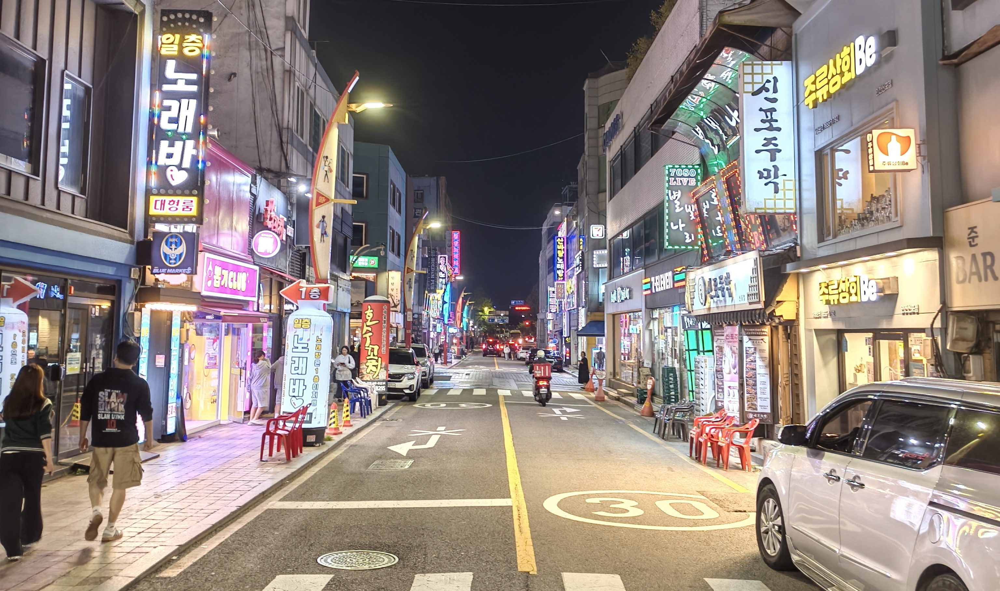

Deveti dan meseca oktobra smo začeli enako kot vsakega do zdaj, vendar z obilnejšim zajtrkom, saj nas danes čaka kar 5 iger. Tako smo se motivirani in siti odpravili proti štandu s klobuki na glavah.
<!-- truncate -->
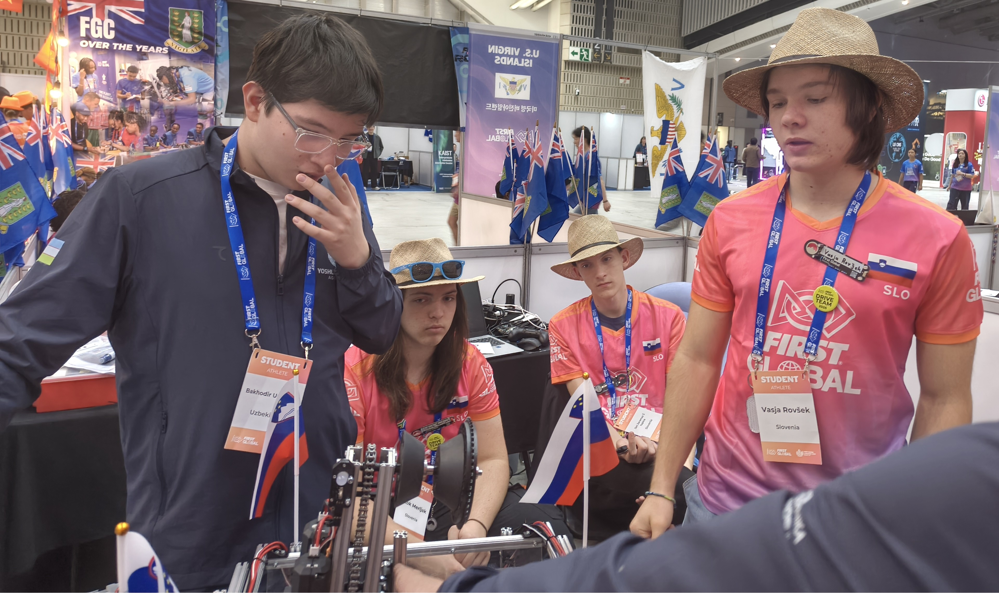

Naše dijake so kmalu obiskali novi sotekmovalci in se dogovorili, da bo naša glavna vloga pobiranje žogic in podajanje le teh v nabiralnik igralca, ki jih bo lastnoročno metal v koš. Z nekaj časa v rezvervi v slamniki oddrveli na slikanje, medtem ko so Slovaški mentorji z nami debatirali o tem, kako bo Holy Priest nastopal novembra v Bratislavi in ob tem odprli debato o elektronski glasbi.

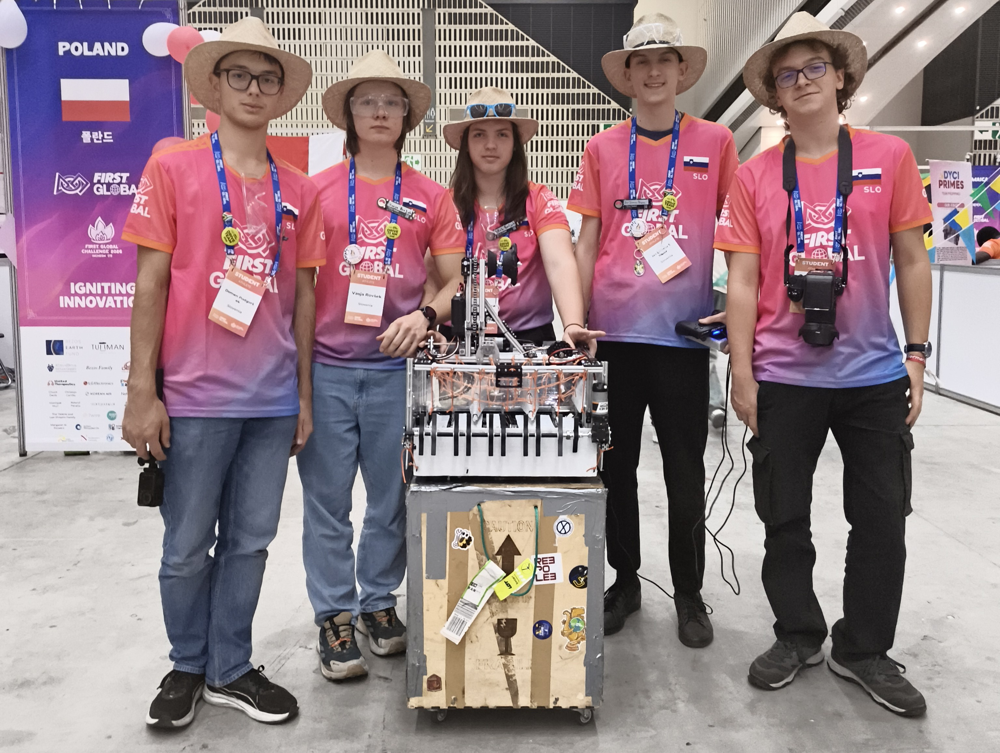

Napočil je čas za tekmo številka 93, v kateri smo ponovni zastopali modro alianso skupaj z reprezentanco Avstalije in Jordanije. Skromna strategije nam je v kombinaciji s plezanjem robotov dobro dela, saj smo tako uspeli tekmo “proti” Belorusiji, Azerbejdžanu in Komorom zaključiti z izzidom 56 : 39 v našo prid.

Kmalu smo se morali ponovno zbrati države, ki smo blizu po abecedi. V igri z zaporedno številko 132 smo na strani rdeče alianse stale ekipe Slovenije, Somalije in Sierra Leone. Z vsakim pritiskom na igralnem ploščku je na števcu kazala nižja številka, ko je pa ta odbila konec, smo segli v roke kolegom na nasprotni strani iz Tanzanije, Mozambika in Črne gore in jim čestitali za zasluženo zmago.

Med odmorom smo obiskali stojnice korejskih in ameriških fakultet ter letošnjega sponzorja LG, ki so s seboj imeli Lego maketo in mobilnega robota. Nekaj slik in izmenjanih besed pa smo že hodili nazaj do štanda. Kmalu je po nas prišel prostovoljec in nas povabil v čakalno vrsto skupaj s Turkmenistanom in Mongolijo, ki prav tako predstavljajo modro alianso. Na drugi strani mize smo pozdravili predstavnike Tajske, Britanskih Deviških otokov in Eswatinija. Začetek igre z zaporedno številko 162 je kmalu napočil in po 150-ih sekundah smo vsi zaploskali, čeprav je bil izzid igre 195 : 81 za modro stran.

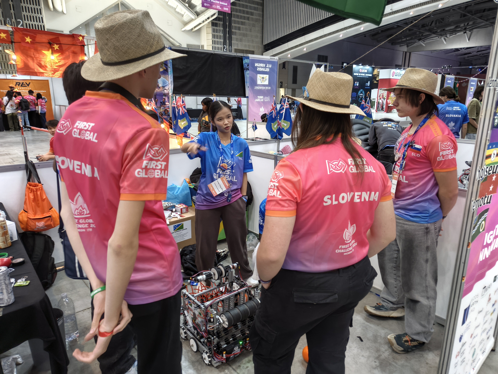

Dijaki so veseli pritekli v štand, odložili robota, parkrat obrnili ključ za M3 vijake in matice ter se odpravili na odmor za kosilo in prigrizke pri ostalih državah. Oddihu je sledila debata s kolegi iz Solomonskih otokov in Danske, da so lahko razčistili zmožnosti posameznega robota in skovali zmagovalno strategijo. Kot vsakič do sedaj je prostovoljec naše pocukal za rokave tudi tokrat, da so šli v čakalno vrsto in do polja za tekmo številka 201. Komentatorka je najavila našo modro stran in seveda še rdečo stran, na kateri smo lahko videli zastave Demokratične Republike Kongo, Tunizije in Zimbabve. Požar v obliki oranžnih žogic smo uspešno gasili, pri čemer je naša stran dosegla 171 točk in tako uspešno zaključila igro.

Za zadnjo igro dneva smo glave stisnili s kolegi iz Gvineje in Senegala. Čeprav so naše možnosti za zmago bile šibke, smo se vseeno podali v sodelovalno igro proti Finski, Mikroneziji in Ameriški Samo-i. Dneva nismo zaključili na visoki noti, saj smo v roke segli z izzidom 189 : 36 za nasprotno ekipo.

Podelitev vtisov dneva ob večerji s slavnim gostujočim kuharjem šefom Irvine-om je bila prijetna izkušnja ob ameriški kuhinji. Hitro smo pojedli, odložili stvari v hotelu in se napotili na avtobus številka 16 proti ChinaTown predelu mesta.

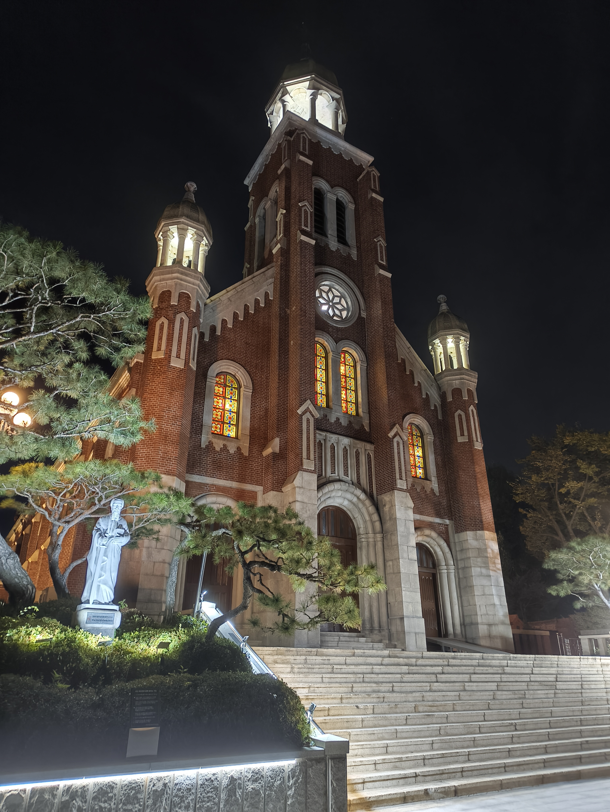
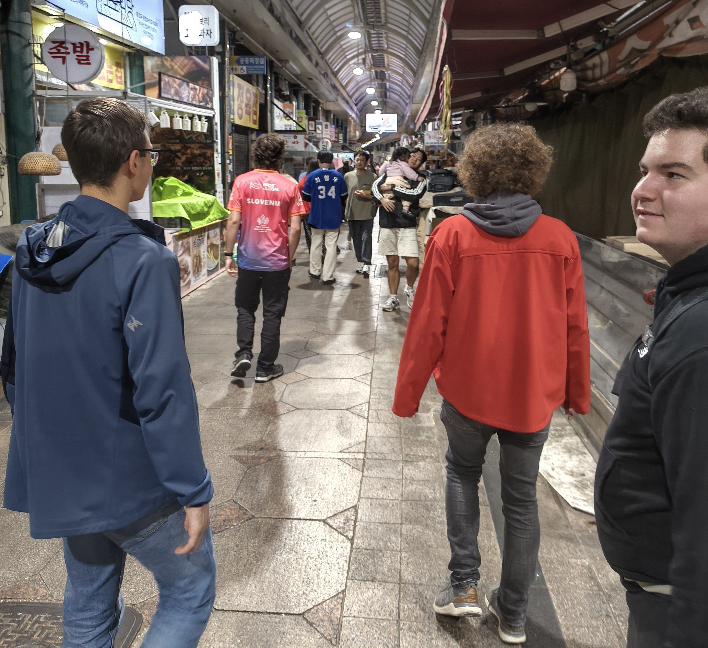
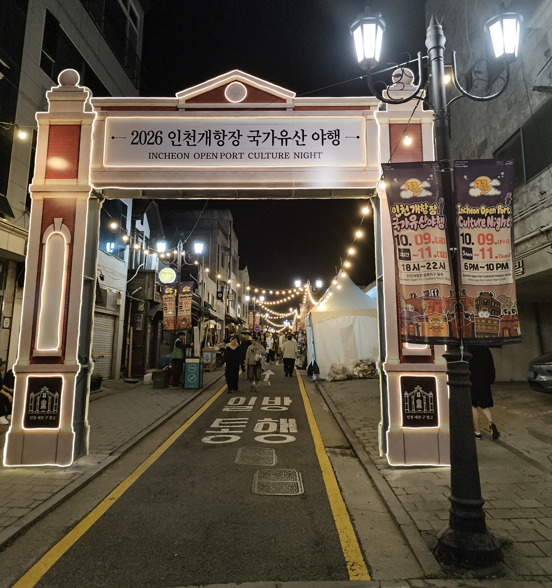

Na poti smo se peljali mimo vojnega spomenika, ki smo ga obiskali nekega dne, a z avtobusa smo stopili dol pri avtobusni postaji Singpo market. Na hitro smo si ogledali zunanjost cerkve, ki je bila le nekaj stopnic stran od glavne cesta. Z višine smo lepo videli vhod v kitajsko odprto kuhno, kjer smo lahko med sprehodom našli sadje naprodaj in sveže dumplinge, saj je ostalo žal bilo že zaprto. Na koncu tržnice so se odprle osvetljene ulice v ChinaTown četrt. Mi smo iskali festival, zato smo iskali čim večji nabor ljudi. Ko smo se sprehodili mimo neštetih kavarn in korejskih BBQ restavracij smo prispeli do napisa “Incheon Open Port Culture Night”.

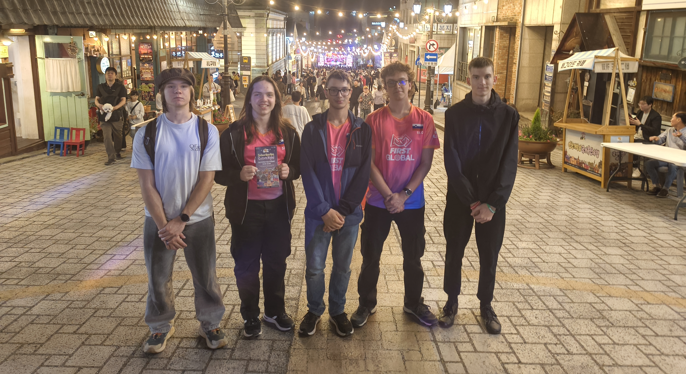
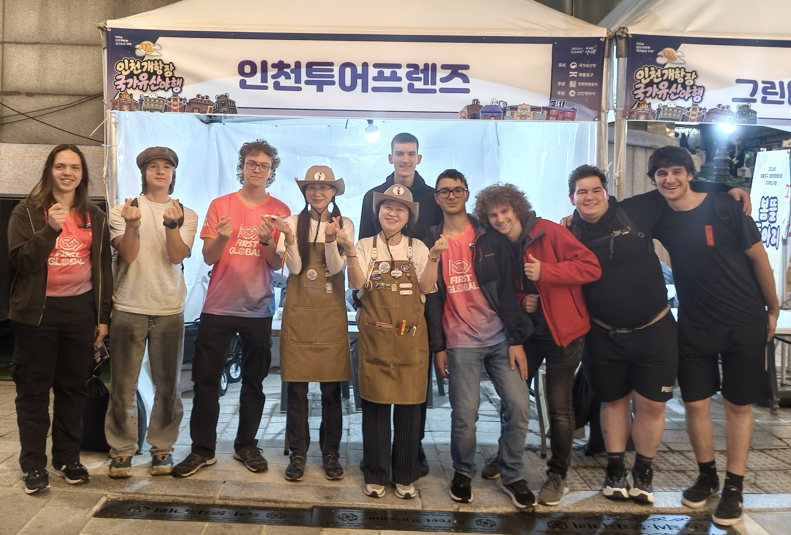
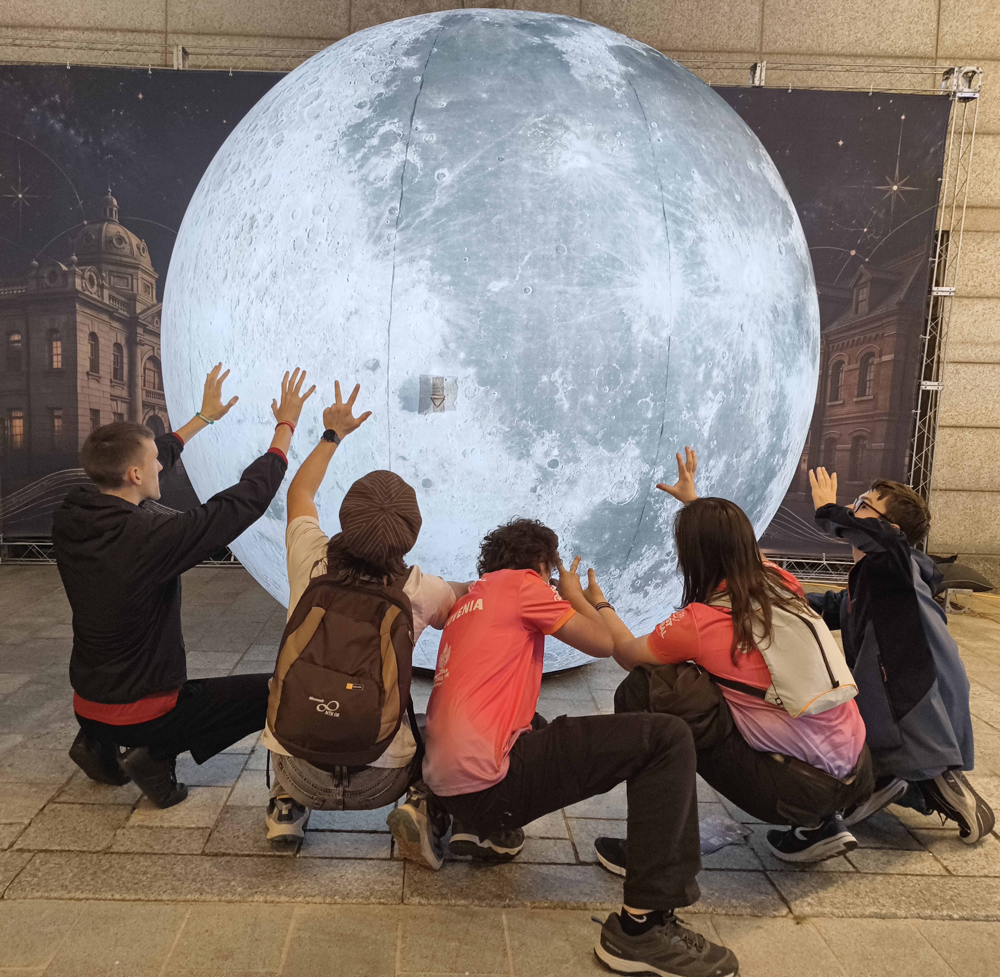

Od tu naprej smo bili del festivala s stojnicami polnimi drobnarij, golaža in Pokemon kart. Sprehod mimo popolnih neznancev nas je pripeljal do pevskih nastopov, solo nastopov s pihali, violinami in na velikem odru petje v spremstvu saksofona ob skladbi “It’s raining men”. Aplavzi na vseh koncih so nas spodbudili, da raziščemo še ostale ulice, kjer smo srečali gospe iz turistične stojnice našega dogodka robotike, ki so nam podarile nekaj lokalnih bonbonov, karte za podvodni vlak in ovekovečili trenutek s fotografijo. Za tem smo še odkotalili luno za sliko in se odpravili proti izhodu kulturne večeri. Pred izhodom smo kupili še par pahljač in kitajskih kovancev ter se napotili naprej proti pravljični vasici.

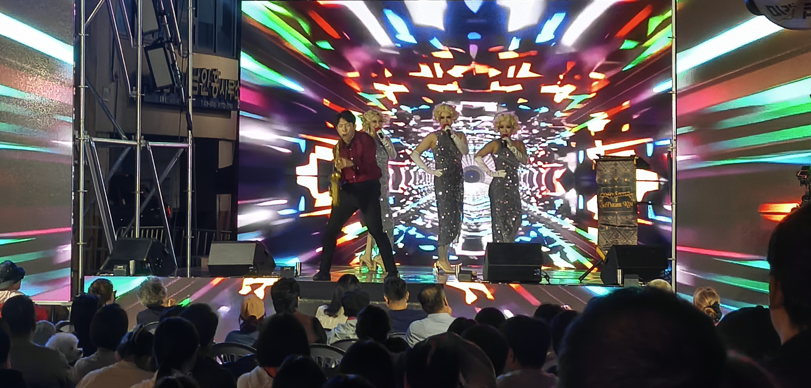
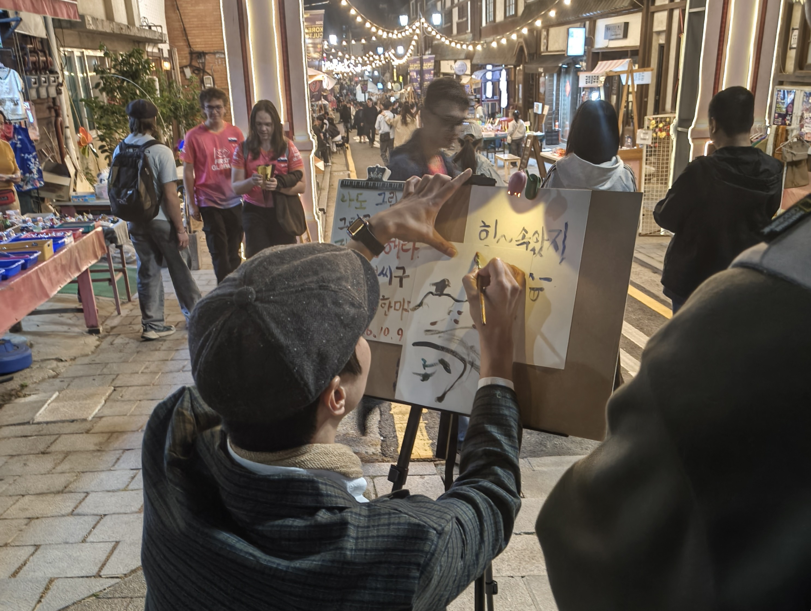
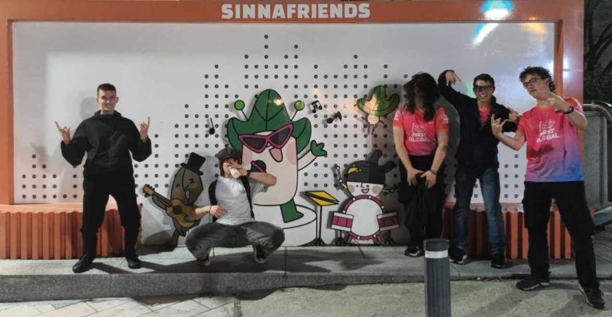
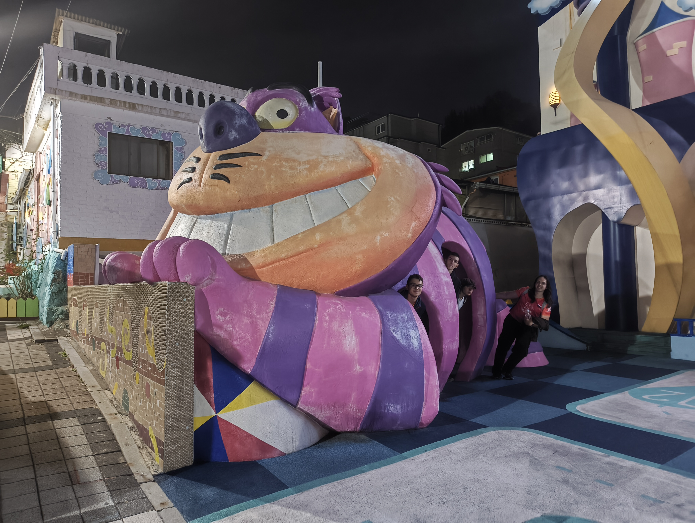

Na poti do “FairyTale Village” smo naleteli na manjšo trgovino s prigrizki in pijačami, kjer smo bili prijetno presenečeni ob najdbi prvih magnetov v mestu, kar smo si morali zagotoviti. Okrepčani smo se napotili naprej skozi vasico, kjer smo našli pisma v avtomatu, skulpture Čarovnika iz Oza in Ostržka ter drugih risanih likov. Na koncu smo ulice smo našli stopnice, ki so nas pripeljale do osvetljene gozdne steze s skulpturami živali. Na vrhu vzpona smo našli nebeško opazovalnico, od koder smo se hitro napotili naprej po hribu dol, mimo rakunov in parka s projekcijo vode. V upanju da bomo ujeli zadnji avtobus smo študirali vozne rede na postaje, vendar smo morali priznati poraz tudi tokrat in poklicati Uber voznika.

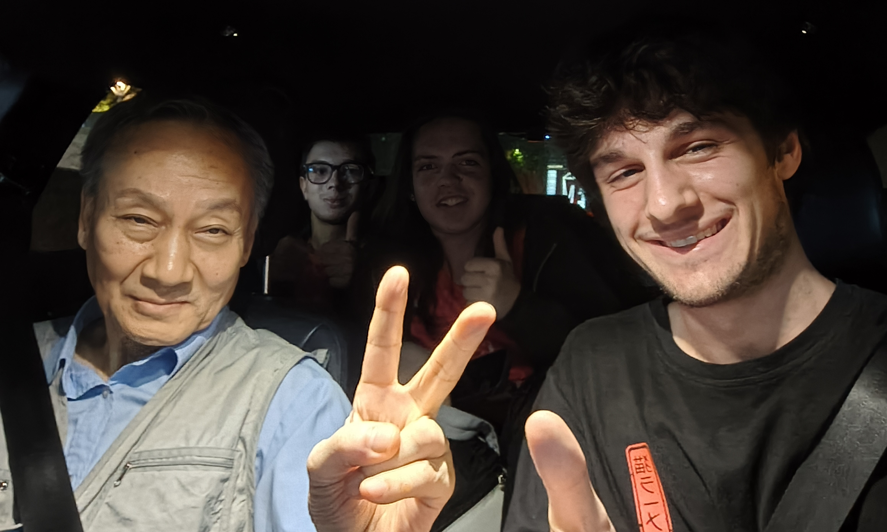

Do naslednjič,

gutnaet 