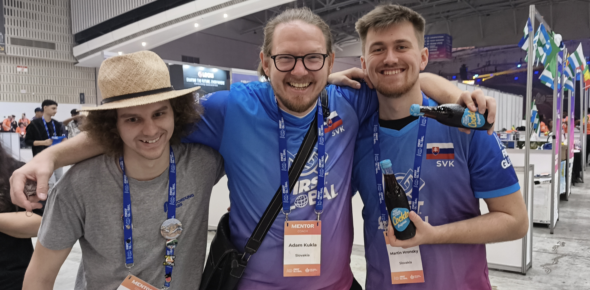

At breakfast, we wished each other ‘Gud monin’, as our friends from the Solomon Islands would say, and chatted whilst clearing our plates. Then we quickened our pace to get ready as soon as possible for the last three matches of our firefighting attempt at this year’s robotics Olympics, the FIRST Global Challenge.
<!-- truncate -->

Before the first match, our peers from Uruguay and the Gambia called by so that we could agree on how to work together, as a co-operative showdown awaited us against the red alliance, namely Greece, Papua New Guinea and the host country, South Korea. The queue was pleasant, the match short and the result good, but not good enough. We scored 129 points, whilst our opponents scored 278, and thus match 253 came to an end.

<iframe width="560" height="315" src="https://www.youtube.com/embed/tkQpTnlTcu8?start=26079" title="YouTube video player" frameborder="0" allow="accelerometer; autoplay; clipboard-write; encrypted-media; gyroscope; picture-in-picture; web-share" referrerpolicy="strict-origin-when-cross-origin" allowfullscreen></iframe>

Today was the last day of the event, so we encouraged the students to start looking for shirt swap candidates. Whilst searching, they offered tastings of Herba sweets and Cockta, which delighted the volunteers, the other competitors and absolutely everyone else. We managed to arrange swaps with our friends from Slovakia and South Africa, and some even organised a swap with the team from Chile across the bushes.

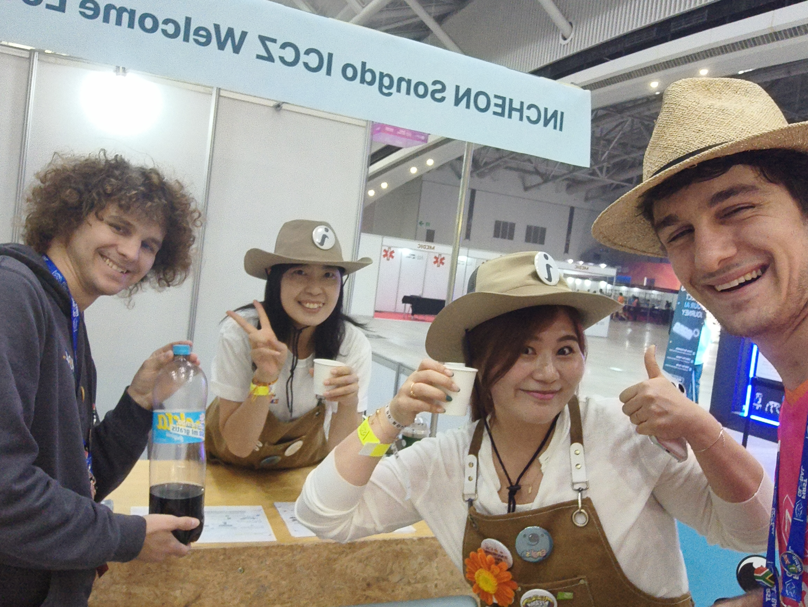

A couple of sweets later, we were called back to the queue, this time for match number 279. The competition was somewhat more modest on both sides: we represented the red side together with Lesotho and Iran, whilst the blue side was represented by Palestine, Eritrea and Cape Verde. Fighting the fire took two minutes and thirty seconds and ended 71 : 50 in our favour. To recharge, we treated ourselves to one last lunch break with snacks.

<iframe width="560" height="315" src="https://www.youtube.com/embed/3H32iaSLciE?start=2666" title="YouTube video player" frameborder="0" allow="accelerometer; autoplay; clipboard-write; encrypted-media; gyroscope; picture-in-picture; web-share" referrerpolicy="strict-origin-when-cross-origin" allowfullscreen></iframe>

All the hard work brought us to our last match before the end of the qualification rounds. We confidently shook hands with our old friends from Venezuela and left the students to agree with the team from Luxembourg on how to play the final match. They stepped up to the stage, with their peers from Myanmar, Yemen and Haiti on the other side. Clear communication, plenty of balls and climbing robots were unfortunately not enough. We applauded everyone, despite the 240 : 178 result to our opponents.

<iframe width="560" height="315" src="https://www.youtube.com/embed/P4tHKmWGoS0?start=7422" title="YouTube video player" frameborder="0" allow="accelerometer; autoplay; clipboard-write; encrypted-media; gyroscope; picture-in-picture; web-share" referrerpolicy="strict-origin-when-cross-origin" allowfullscreen></iframe>

Whilst waiting for the announcement of the top 24 countries and the eight randomly drawn wildcard countries, each of us passed the time chatting with someone from some corner of the world, which is precisely the charm of this competition. Unfortunately, we were not picked, so we could pack up early and take our things back to the hotel. Upon our return, we cheered on our friends from Bosnia and Herzegovina, who had made it into the top 24. Montenegro was drawn as a wildcard, but they had already packed away everything they could before the announcement, so Kazakhstan’s urgent strategy session caught them entirely off guard.

We spent the remaining minutes with friends who would be leaving Korea before midnight, and in the stands, cheering at the top of our lungs for the Slovak team in the New Technology Experience side competition. Their idea of detecting fires by sound was an interesting one and earned them third place on the podium, and with it Slovakia’s first medal. We also warmed up our hands applauding the announcement of the best mentors, with the mentors of Bosnia and Herzegovina and of Slovakia amongst the nominees.

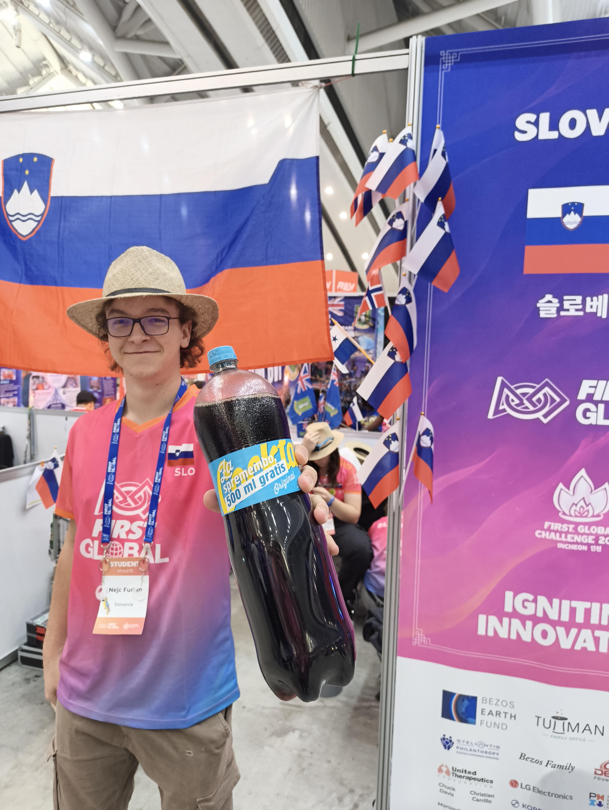
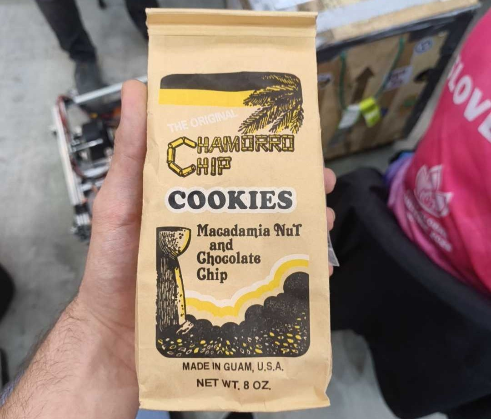
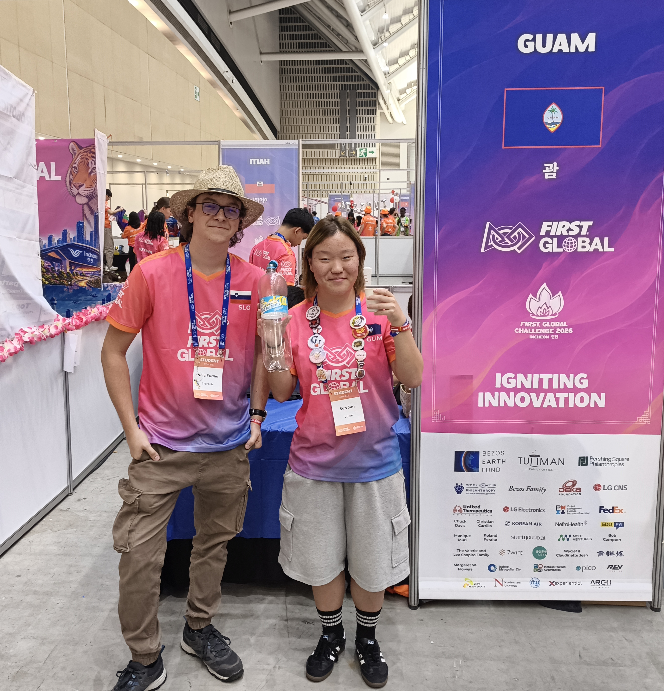

We handed out the last few keyrings and drops of Cockta to those who had made the Slovenian pit their safe space. Then we made our way to the stands for the closing ceremony. We were treated to the final matches, karate-style K-pop performances and the announcement of the 2027 venue. And next year we shall be breaking wheels, blowing fuses and sharing smiles with friends from all over the world nowhere else but in Madrid, Spain.

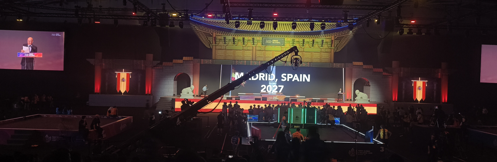

We grabbed the last snacks and bade farewell to all the wonderful volunteers, organisers and participants. Then we set off towards the Hyundai Outlet Centre, some by Uber and others along the running track. What awaited us at the end of the kilometre-long park was a shopping centre that sorts its shops by floor: children’s, men’s, women’s, and general in the basement. And along the open-air walkways, sculptures, yachts, stalls and cafés.

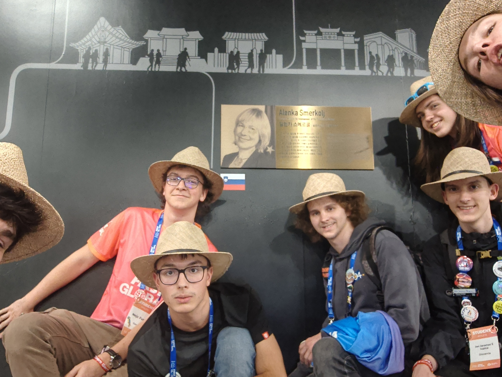
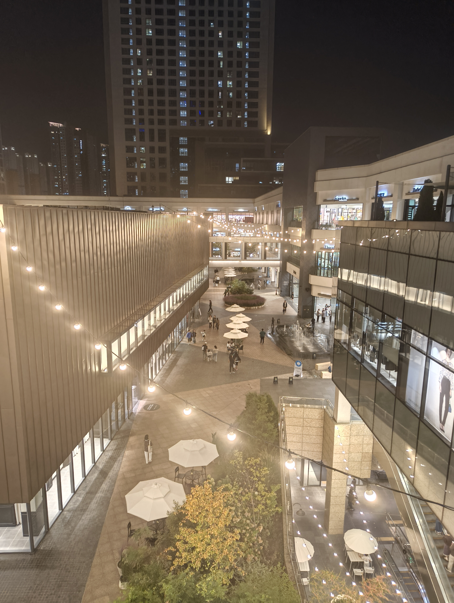
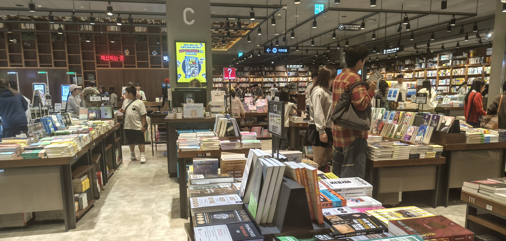
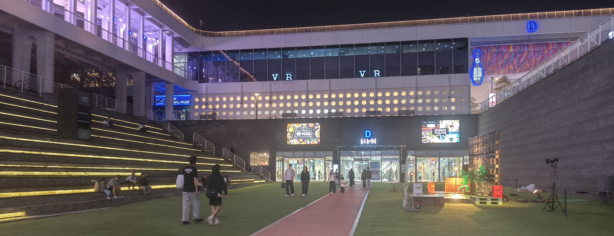
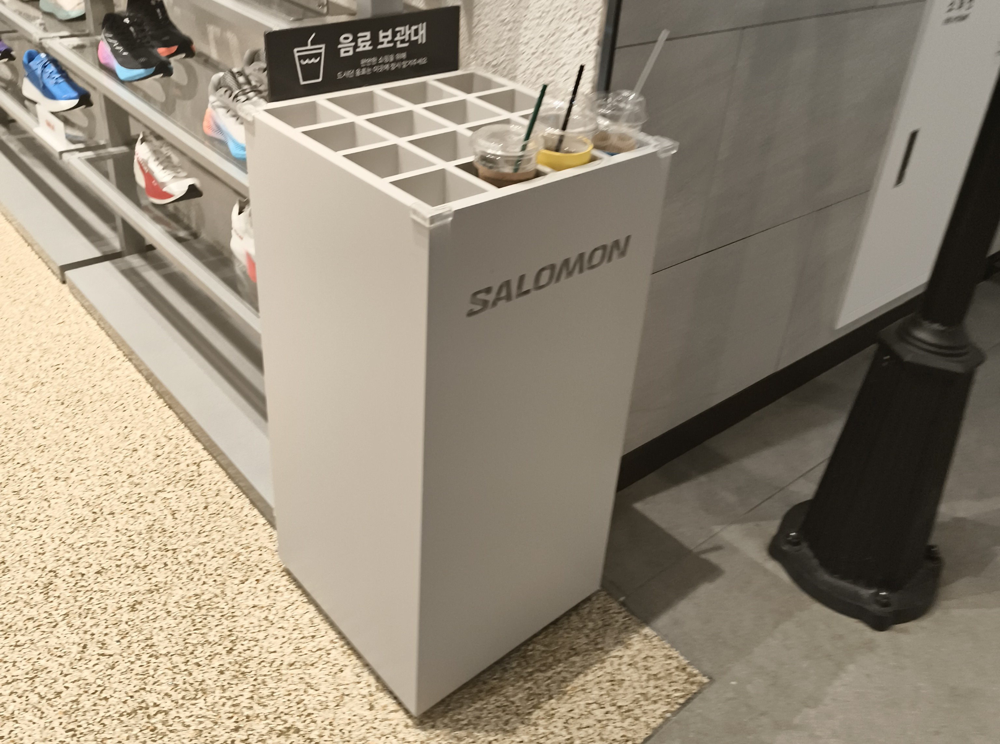

The general section was the most interesting to us, as the basement hid everything from a Nintendo shop, IKEA and a bookshop with a pile of mechanical keyboards to premium clothing and footwear shops that liked to greet customers with stands for their drinks. Curious shoppers also discovered a tempting corridor that revealed ever more restaurants the further one walked. And if one headed to the upper levels of the corridor, one found oneself in another shopping centre called Triple Street, where the buildings are labelled A to D, with small parks and places to rest in between. So we strolled past cafés and restaurants serving Korean barbecue or fast food, and at the end of the walkway, we came out onto the main road.

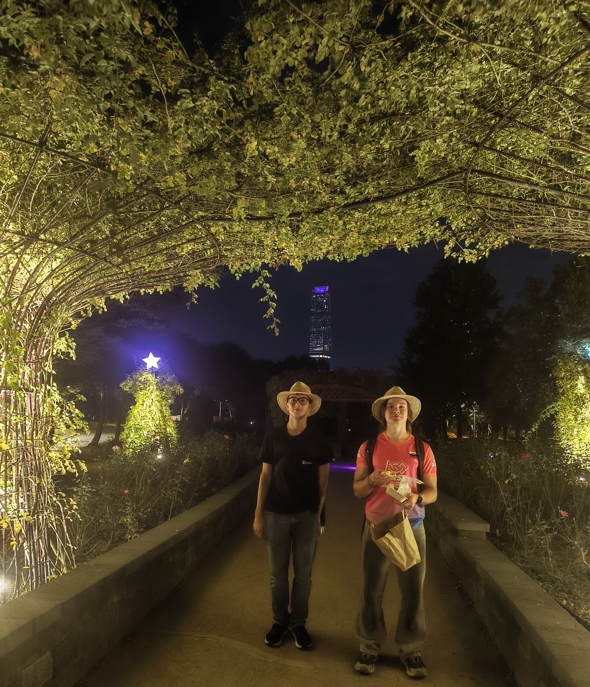
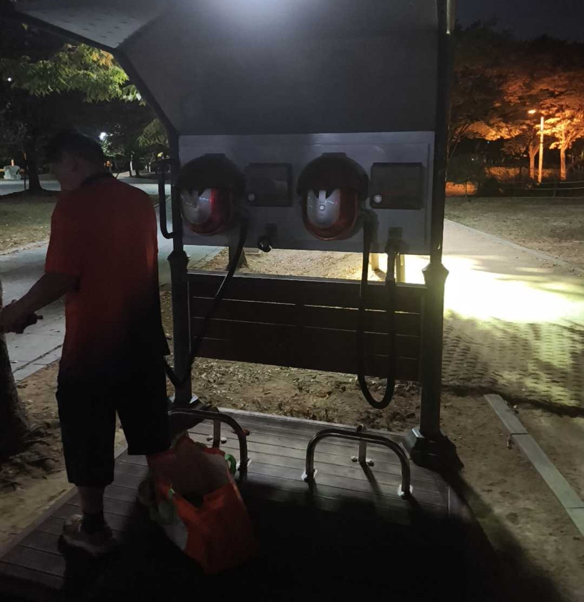

The late hour beckoned us back home through YingYang Park, where besides large open spaces we also found a soothing barefoot walking path, which one finishes by cleaning the soles of one’s feet with an air blower.

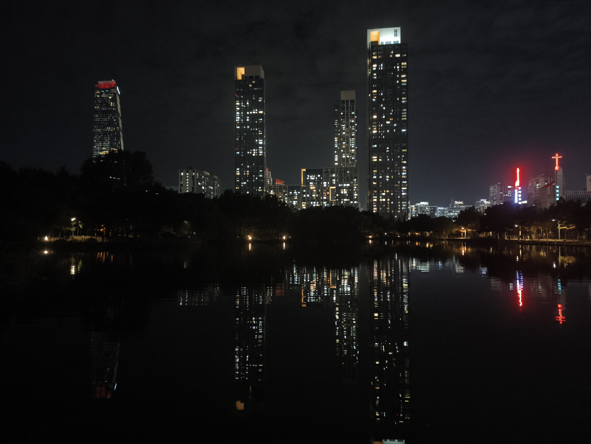
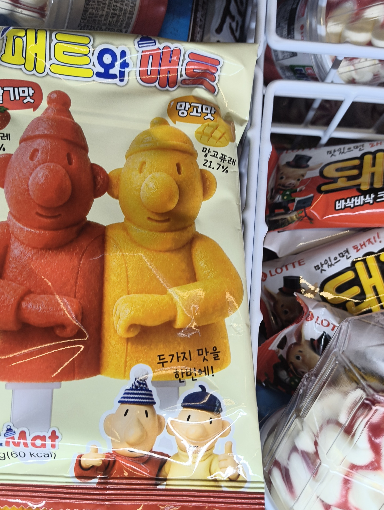

It would not do to come home without spices, so before bed we popped into the by now familiar Lotte Mart, bought souvenirs, sauces and snacks, and retired to our hotel rooms. We had a visit from Trym, a Norwegian student who came to swap shirts with our students and stayed longer than expected. Before getting some rest, there was still the packing and weighing of suitcases to be done, and the shifting of luggage into the spaces where we had previously packed 12 litres of Cockta.

Until next time

goeie nag
