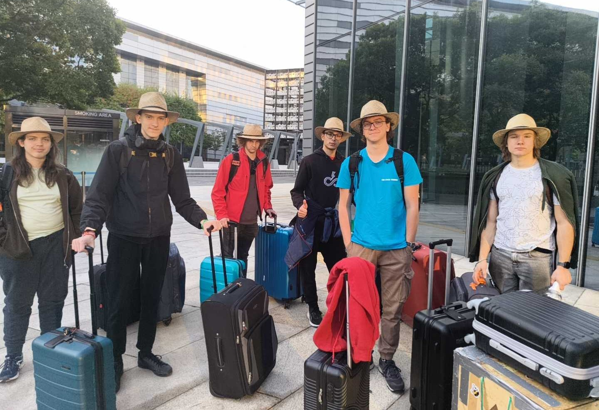
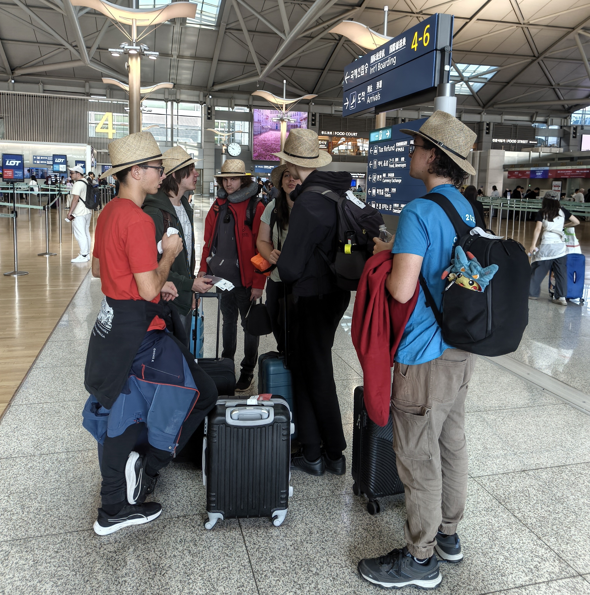
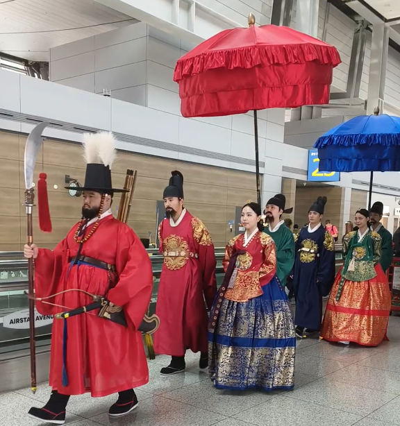
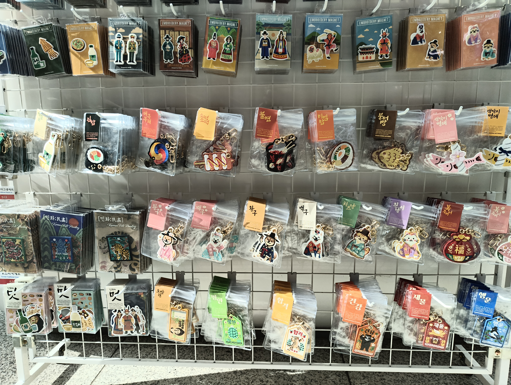
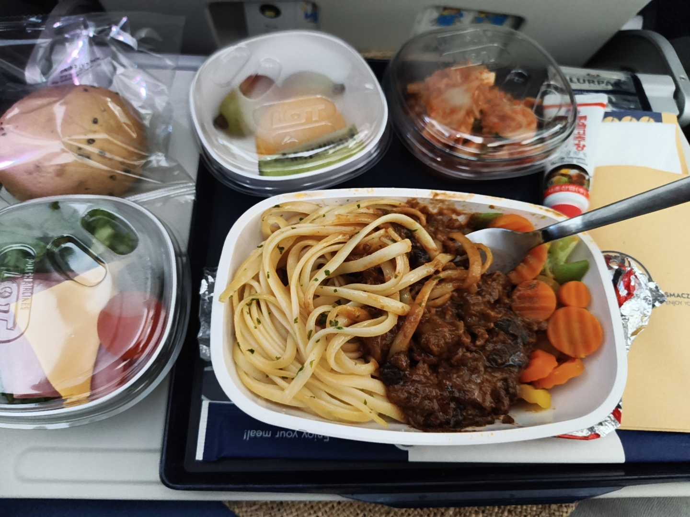

For the last time this year, the alarms on our telephones rang out on Korean soil, announcing that it was time to rise. With our luggage ready, we headed to the earliest possible breakfast sitting and, with sleepy eyes, took one last look at the skyscrapers and parks from the Oakwood Premier hotel.
<!-- truncate -->

Before we could even say thank you in Korean, we had already handed our key cards to the lady at reception and descended 36 floors to await our coach to Incheon Airport. A calm ride, a city waking up, the Incheon sign on a hill in the distance and a view of the airport say it all. At the airport, we used the last pieces of cling film to wrap our suitcases, drank the last drops of our drinks and joined the check-in queue to the sound of the machines that push luggage trolleys and play Beethoven’s Für Elise as they go. Before dropping off our bags, we had to take a few things out of our rucksacks, as this time we were warned that a rucksack and a small suitcase together may not weigh more than 10 kg. Once everything was out and weighed, we could pack it all back in. We waited another ten minutes in case we were called back over anything unsuitable in our checked-in luggage (such as a robot).

Soon we made our way through security, past the shops and the tax refund stations for foreign shoppers, all the way to our boarding gate. We then allowed ourselves some rest and strolled about the shops, past a re-enactment of a royal procession and purveyors of doughnuts, souvenirs and magnets. We bade farewell to Jaka, the Slovenian FIRST volunteer, and boarded an aeroplane that was less spacious and luxurious than the one that had carried us to Korea. Dripping air conditioning and heat transfer are not the most commendable features of an aeroplane with Rolls-Royce written on it.

So, with films, sleep, dinner and breakfast, we once again crossed numerous time zones and soon began our five-hour stopover in Warsaw, with automated border control followed by a hunt for a seat, a nap or a stroll in search of food. We slept through the flight to Zagreb, and at the airport we collected our suitcases, counted our hats and set off for our ride home in an extended fire brigade van.

Until next time

hayrli tun
