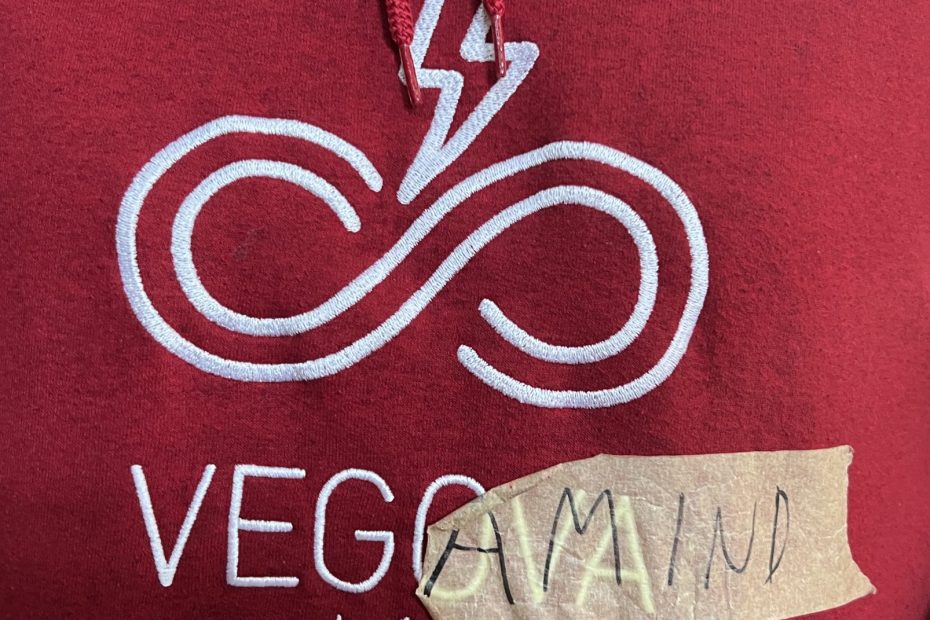
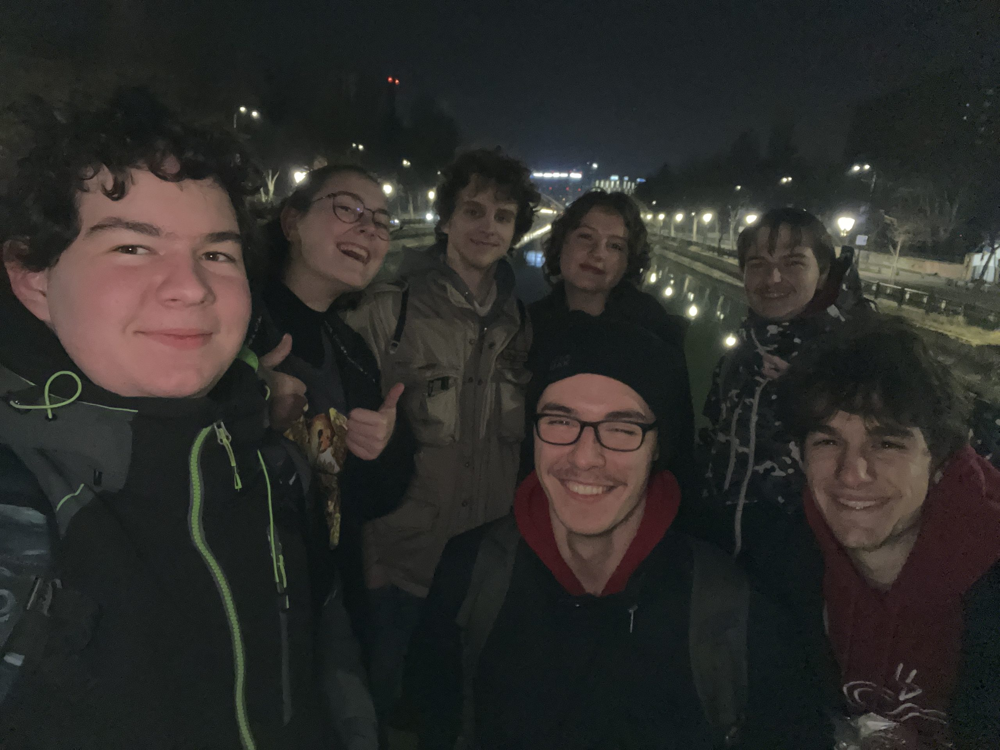
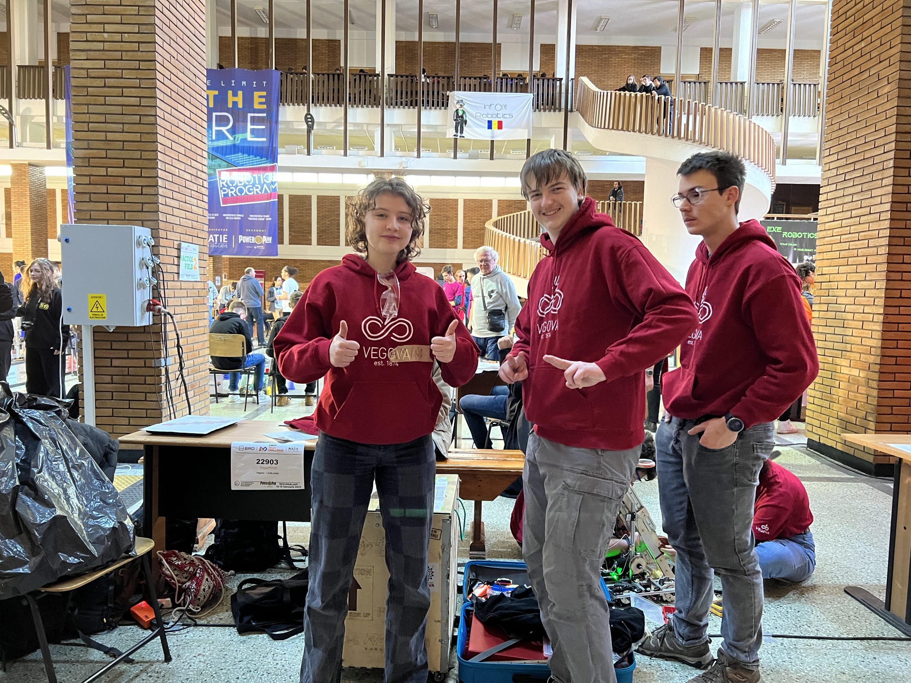
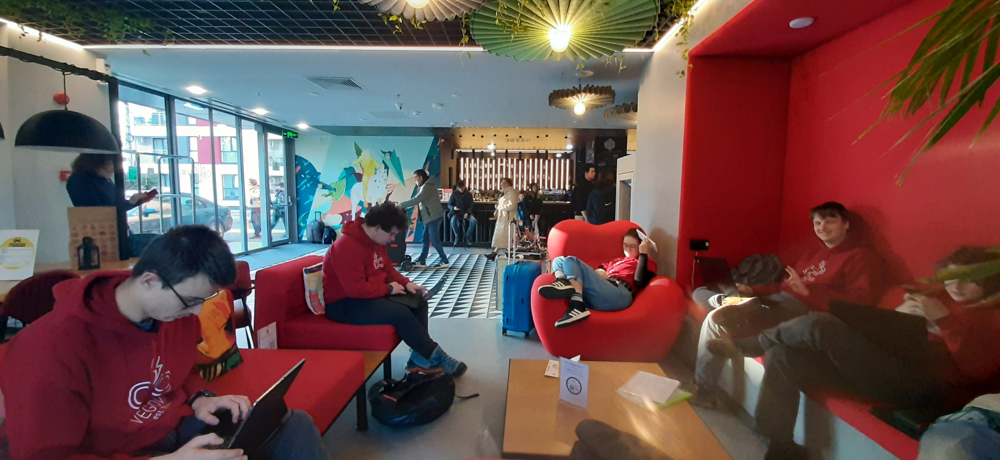
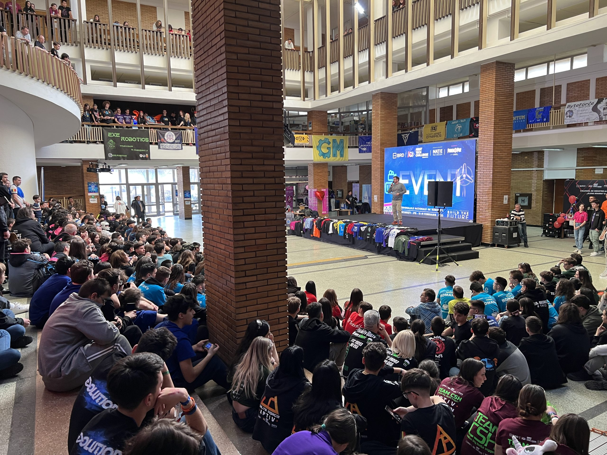
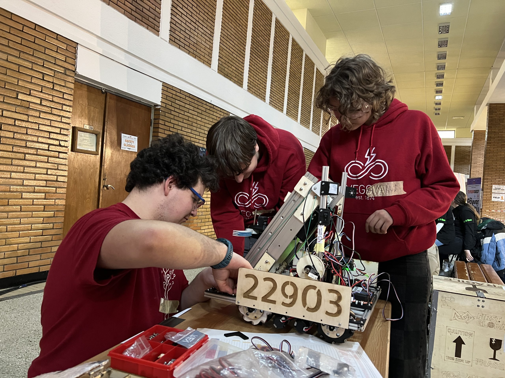
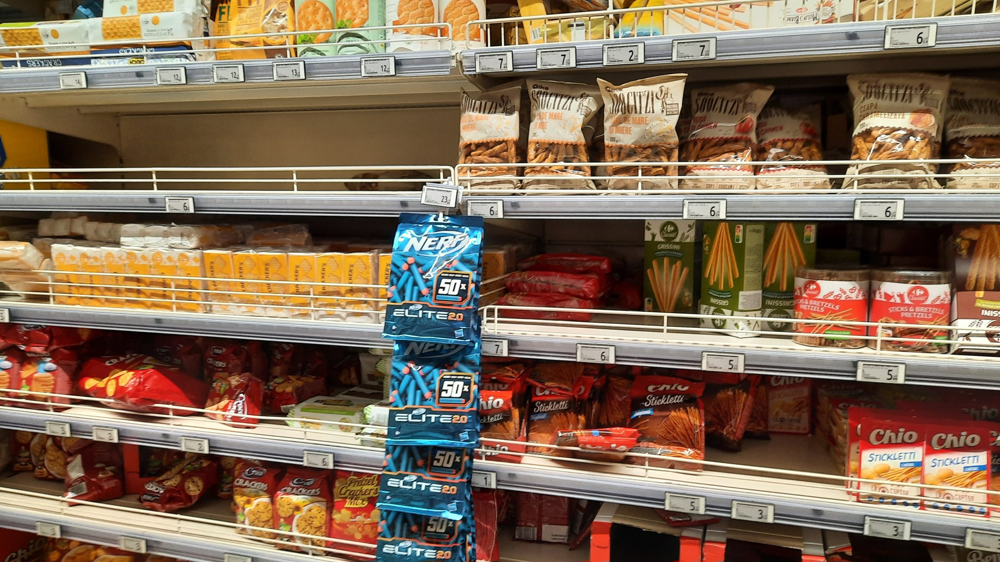

Soon after returning home, the team took the decision to jump in at the deep end – we wished to take part in the FIRST Tech Challenge competition (FTC for short). We European teams are somewhat limited in qualifying tournaments, so our path led us to Bucharest, the capital of Romania. <!-- truncate --> After plenty of sleepless nights and days spent debugging, we boarded an aeroplane that took us, with a stopover in Belgrade, to Bucharest. The city greeted us with taxi chaos, which was resolved by Uber and an air-conditioning repairman, Sin Valentin. A ride without seat belts, and a tour of half the city’s sights along the way, were followed by checking in at the Ibis hotel, a chain we had already made ourselves at home with during our visit to Geneva! In the lobby we already met a few of our fellow competitors. Owing to our rather late arrival and the untrustworthy look of the surroundings, we decided to spend our first night in Romania visiting the nearest shop and walking to the venue where the FTC competition would take place over the coming days.

The advantage of our lodgings’ location is that we wake up a 10-minute walk from the building of the Politehnica University of Bucharest, which stands on a student campus together with plenty of other engineering faculties. A 𝐹𝐼𝑅𝑆𝑇-coloured corridor and a crowd of lively fellow competitors hinted that we were in the right place. After a walk to the practice fields, which are located near the main competition fields and the stage, we also found, close by, the table – or rather the pit – of our team, VegaMind #22903. The look round was followed by changing the lettering on our Vegova clothes to VegaMind, which sticky tape made possible.

On our return to the largest of our three rooms, a heap of work awaited us in writing documentation, namely the written submissions, the ‘Engineering Notebook’ and the ‘Team Portfolio’. The practice of staying up into the small hours proved useful after all when playing a game of Exploding Kittens.

After a hearty breakfast, we finished our written work and, with a polite request, had it printed at the hotel reception. The morning had a working flavour, as access to the practice field let us refine our programming solutions. Besides these duties, we also set about repairs to the robot itself, on which we had discovered a few shortcomings. Test drives showed us the robot’s real capabilities, namely that we could aim only for the ground junctions and the lowest poles. We also attended the opening ceremony, which was in Romanian, admittedly, but we managed to contribute too, by donating a ‘shirt’ for the group photograph.

Besides engineering activities, the first day also brought social ones, as we made friends with some teams and looked at our fellow competitors’ robots, the sight of which brought sweat to our brows.

We rewarded our work into the small hours with a visit to the nearby Carrefour Orhideea shopping centre, where we treated ourselves to drinks we had never seen before and explored the world of Romanian snacks. The walk back to the hotel was followed by planning the new day and a pinch more work.

Until next time,  
takle mamo
