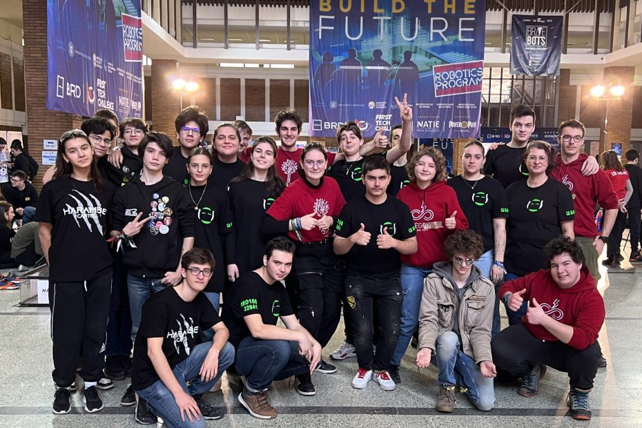
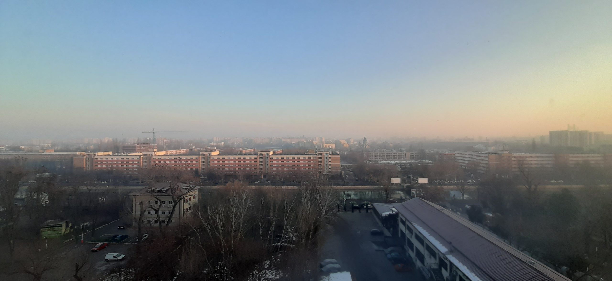
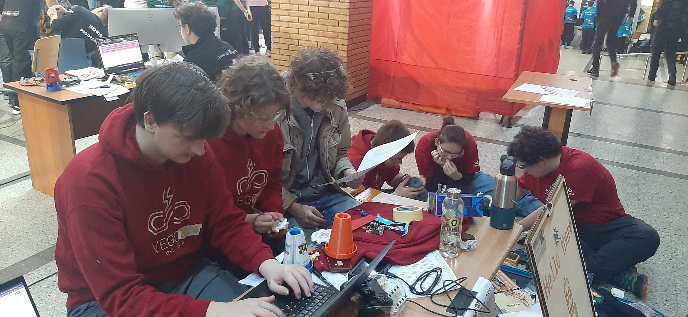
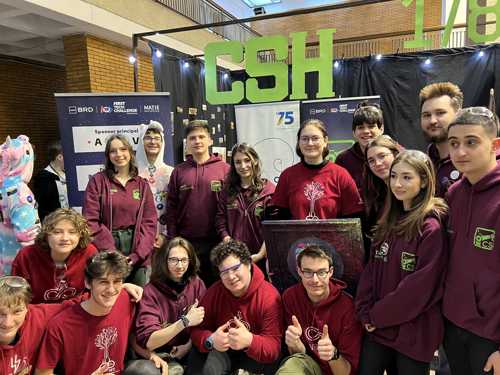
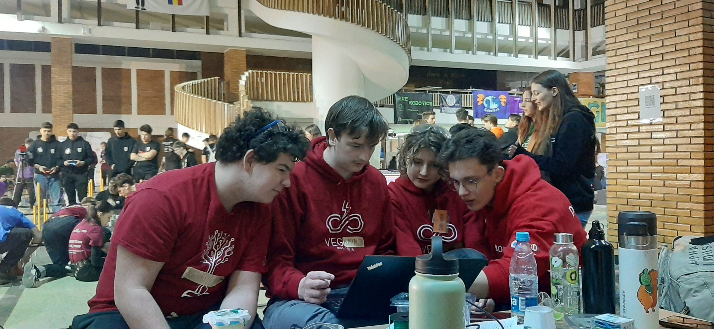
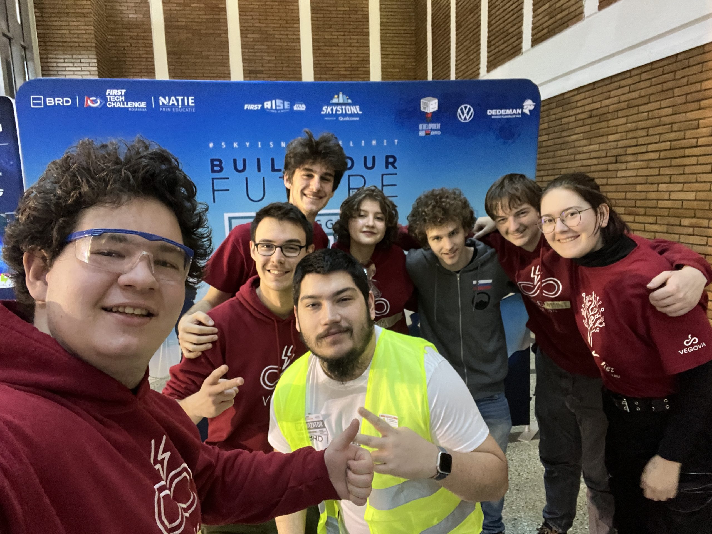
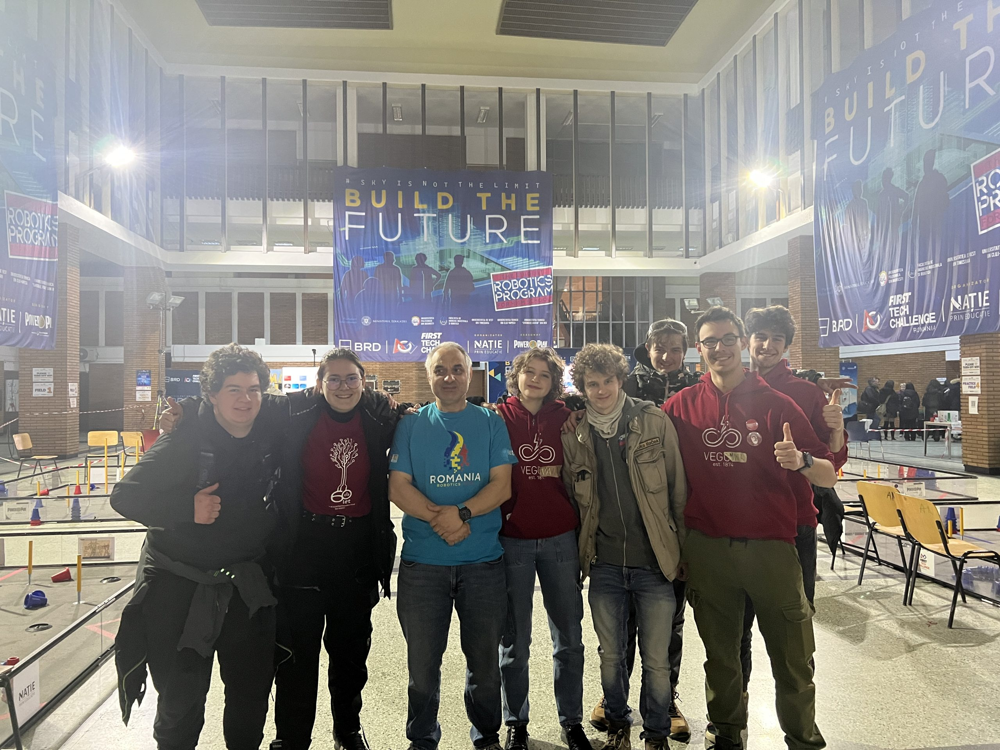
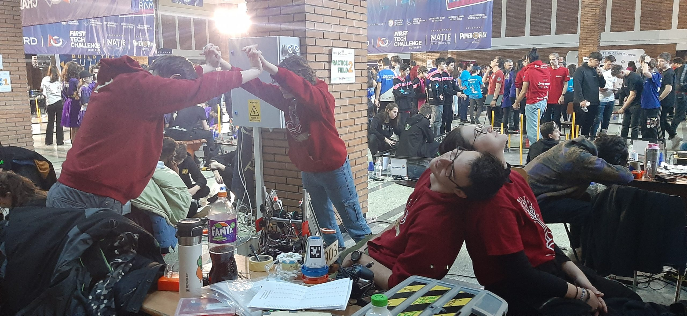
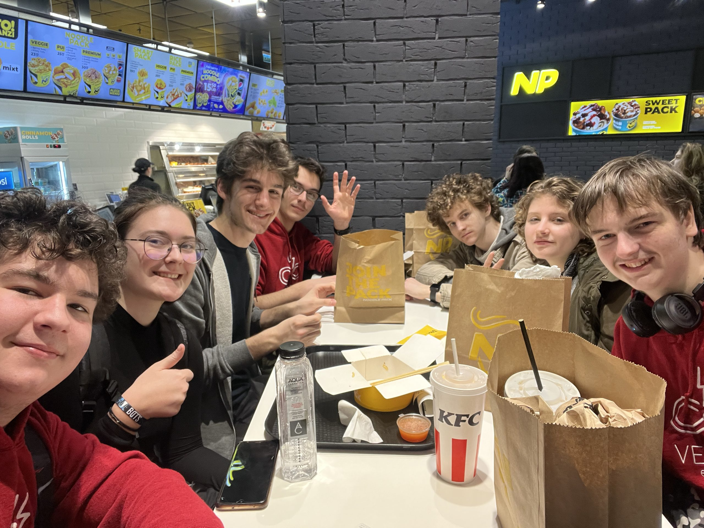
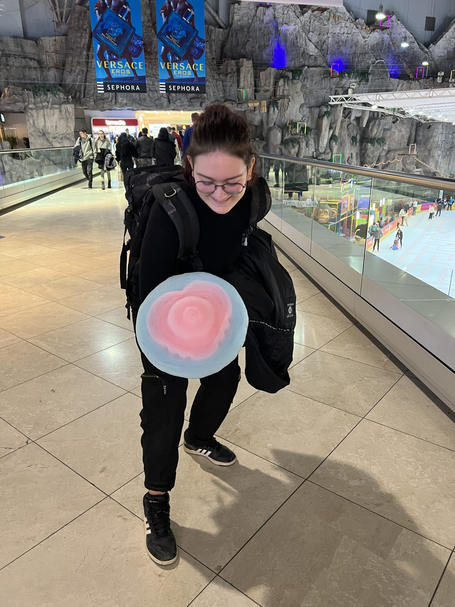

With a view of the rising sun, the nearby blocks of flats and a church, we began the second morning of our visit to Bucharest. A hearty breakfast was followed by a walk to the hall that was the main purpose of our journey. Instead of stretching exercises, we set about repairs to the robot and cracked our knuckles by hammering at keyboards. <!-- truncate --> Adapting the gamepad’s button settings to the driver’s wishes and building the robot’s autonomous routine kept the programming part of the team busy until inspections and qualification matches began. The robot inspection was followed by the defence of yesterday’s written work, seasoned with the surname of one of Slovenia’s biathletes and the partial disintegration of the robot itself. After that we also had the robot’s performance tested on the playing field, where the autonomous part let us down. With minor repairs we passed the test and turned our attention to the next challenges, despite the ban on modifying the robot. Luck was on our side and moved our first match to the second day, which allowed us to make repairs. The robot’s operation was stabilised and the lifting mechanism improved to meet our requirements. Our drive team – David T. (driver), Ana (co-driver) and David Z. (coach) – attended a meeting on the first day intended to clear up any uncertainties and go over the rules again. The team captain, David T., also went over to our partners on the blue side in good time to discuss the game strategy that our pair of robots would try to carry out.

Our first qualification match (number 16 on the list) was played in partnership with team CYB3RG0DS (#22998) and ended in victory for our alliance, 107 to 89. With a far better feel for the game itself (and for handling the robot), we returned to the rest of the team and immediately set about the necessary repairs, and soon afterwards about forging strategies anew.

In between there were rests and strolls, during which we members of team VegaMind met new people and struck up friendships. Our best friends were at first our very neighbours, team BrutForce (#22941). Whilst getting acquainted, we were surprised at the number of members in some teams, which reached as many as 17, not counting mentors. Colour, logos, gifts and little chats adorned the corridor leading from the building’s entrance to the centre of the action. Amongst the teams we met (and got to know) the world champions of the 2021/2022 FTC season – Delta Force. Their robot certainly stood out, working by means of a crane-like mechanism. We also became good friends with some members of team CSH, above all with their spokesperson, Cristie, the only one who would readily come over for a chat.

The hours passed ever faster, just as the robots on the fields moved ever faster. The second match of our FTC career had arrived (number 38), in which we again appeared on the blue side, but this time with team Bots’ Brain (#19081). Somewhat poorer coordination and bad luck brought us a mere 41 points, which was not enough for a win. Tired, we returned to our place and quietly hoped for the arrival of food, which, despite its dreadful taste, managed to fill us up for a while.

Whilst testing the robot, we got to know some members of team Decebal Tech. Their programmer, Matej, showed our coding crew some resources worth their weight in gold, namely Road Runner and an artificial intelligence program. The former is meant to make life easier for programmers who want the robot to follow a more demanding curve. The latter makes image recognition simpler, which is a central part of the game’s autonomous phase, as parking in the correct part of the field (depending on the image on the cone) earns us extra points. Along with the resources, we also learnt that most programmers at the event do not ‘reinvent the wheel’, as the competition in Romania is so well developed that the great majority of programming solutions are readily available online. After this programming enlightenment, we also met some colleagues of that team, namely team DarkEnergy (#19106), made up of students from the same school, but from lower years.

Free time passes quickest of all, and so before long a volunteer, Liviu, who later became our friend, came up to us and reminded us that we needed to queue for the next match (number 53). Still with the blue circle pinned to the side of our robot, we went into a new duel alongside our colleagues from team November Eleven (#21073). This time we suffered a worse slip-up: we could not control the robot. Because a sensor failed to trigger, the driver was denied access to the robot. All it needed was a tap on the head, but touching the robot during a match is strictly forbidden. Two agonising minutes dragged on, and sadly we could do nothing to help our colleagues. With a mere 42 points, we shook hands with our fellow blues and the reds alike and, with the motto ‘gracious professionalism’ in mind, marched back to those waiting for us. To say that the two programmers had their work cut out would be an understatement. Fortunately the problem was soon put right, which we also tested carefully on the field.

During the hectic day we received a visit from the Romanian version of the team’s favourite teacher – Christian! Full of positive energy and in somewhat simplified English, Christian greeted us and thanked us for coming. Sadly, as one of the chief organisers and judges, Christian was very busy and could not stay long, but we were glad of the visit. Now, back to work!

The last match of the second day of the FTC competition was drawing ever nearer. The match, recorded as number 70, was the last challenge before a well-earned rest. Exchanging the blue circle for a red square, we took our place beside the members of team HYPERCUBE (#20925). With a solid strategy and a calm approach, we listened to the loud (very loud) blasts of the sirens and the clamour of the crowd. The autonomous part of the program ran correctly. After 30 seconds the drivers seized their gamepads and set their sights on victory. The intended manoeuvres and a modest number of stacked cones turned the start of the match into a work of art. Whilst placing the fifth cone on a distant pole that blocked our view, we made a fatal error – the cone fell into the robot. As the game forbids carrying more than one cone at a time, we were forced to remove the cone from inside the robot, and our partners were unable to help us in time. For the rest of the match we tried to shake off our mistakes, but in vain, as the final whistle overtook us. The referee’s smile and respect were a sign to us that we should hold our heads high. The end of the exhausting day had come, but this time we decided to head back to the hotel before ten o’clock in the evening.

After a brief visit to our little rooms, we set off for the long-awaited shopping centre – AFI Cotroceni. We got there by a path through a park and by crossing the Romanian answer to Ljubljana’s Celovška cesta. A blue sphere and a growing number of people told us that we were not far from our destination. Famished, we first threw ourselves into the hunt for food – well, restaurants, to be precise. Just after discovering an ice rink, a zip line and a large number of restaurants all in one place, we found a machine that uses a robotic arm to make heart-shaped candyfloss on a stick. After lengthy deliberation over where to have a more serious meal, we chose NoodlePack, apart from the chicken lovers, who ended up in the queue for KFC.

Dinner was followed by a stroll through the building and a longer visit to a bookshop with board games and records. We rounded off our tour with a visit to a shop, where each of us treated ourselves to a few goodies in exchange for a few lions (that is, Romanian lei). The way back was filled with laughter, stumbling and the interpretation of modern art. Soon we were back at the hotel, but still far from the land of dreams.

Until next time,  
ajaje
