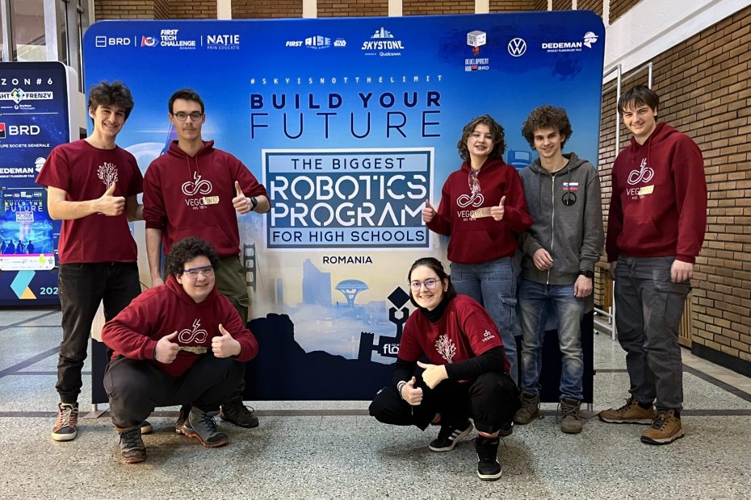

The last day of the first regional competition in Bucharest had dawned. A long awakening, a hearty breakfast and watching Romanian electricians at work were followed by the journey to the venue of our last matches of this season. Laughter at travellers’ jokes was followed by a warm-up in the form of minor repairs to the robot and to the program itself. <!-- truncate --> Fairly soon a volunteer called at our table to remind us to queue for our match. This time we approached the playing field alongside team Evolution (#19131), on the side of the red alliance. With a strategy forged the day before, we went into match number 96 at the sound of the horn. This time we felt extra tension, as we were up against our friends from team CSH (#17861). Despite our strategy and coordinated cooperation, we were simply a little slower than the opposing colour, and at the final whistle we were a few points short.

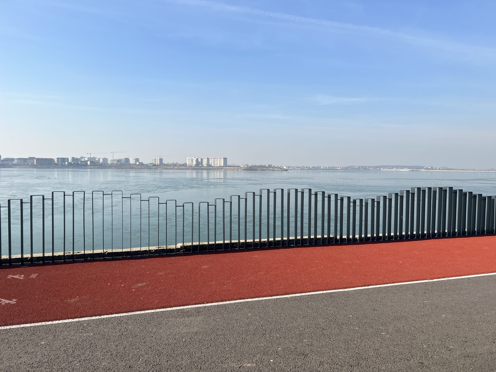

The members of the drive team returned to the table content and motivated. There was quite some time left until the next match, so we decided to visit colleagues and make new acquaintances. We made friends with team RoSofija. A discussion about the robot and the program grew into a fine friendship. They also gave us the Romanian version of Jaffa Cakes, which made a pleasant snack. Later in the event they called at our table again and talked with us about the present state of their country and its history. We became closest to two of their members, Frumo and Sebi.

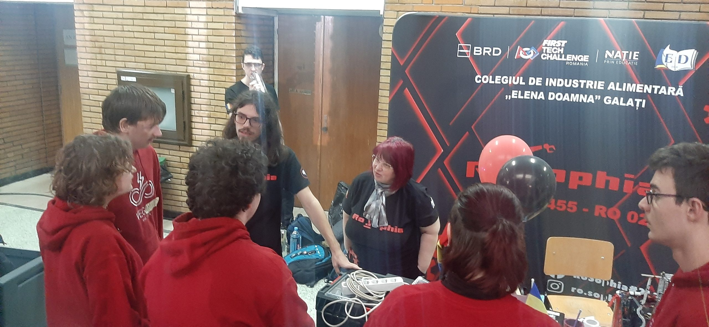

Soon lunch was over too, and with it the time until our last qualification match, number 115. Still with the red square fixed to the side of the robot, we worked out a strategy in good time with team Gentlemen (#17857). For the last time, we pinned our Driver and Coach badges to our shirts and made our way to the playing field. The starting siren soon sounded, followed by a successful autonomous phase for both red teams. Whilst the spectators chanted ‘Haj rošu’ (‘Come on, red’), we manoeuvred about the field as efficiently as we possibly could and stuck to the agreed ‘circuit’ strategy. With a successfully completed circuit and a satisfying number of points, we managed to end our appearance at the FIRST Tech Challenge competition in a good light.

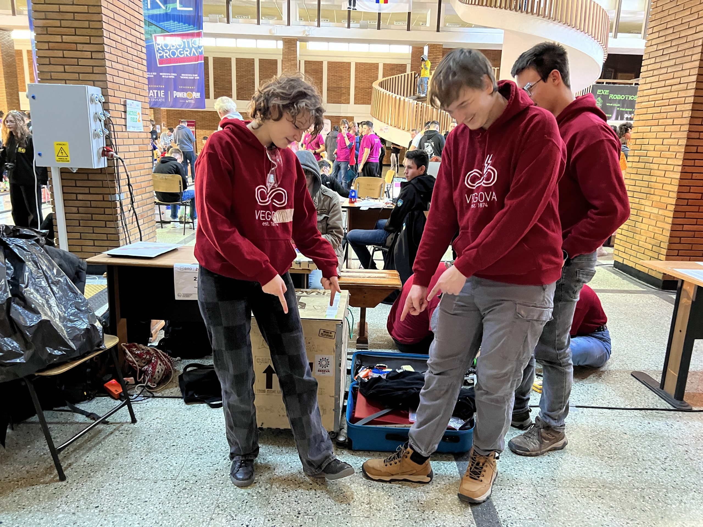

Soon after our last match, the alliance selection for the competition’s semi-finals began. More and more people gathered round the playing fields, on the balconies and on the stairs, so as to follow the semi-finals and finals live, even if by looking at the big screen. The tension and noise only mounted, adding to the atmosphere of the matches themselves, which were played on the principle of ‘the first team to win two matches wins’ (best of three).

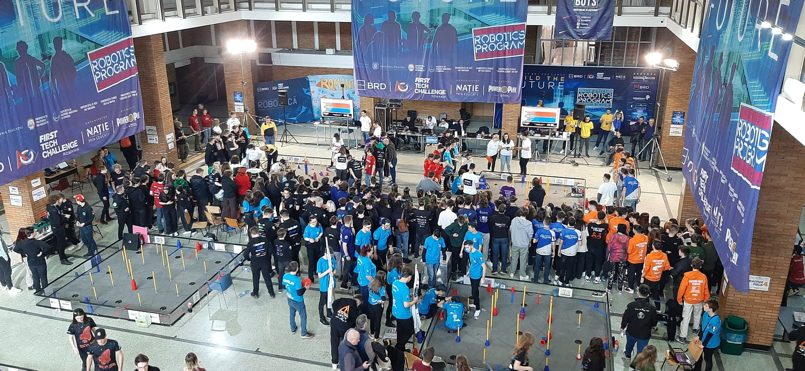

When the noise of the audience and the horns had died away, we moved to the neighbouring pavilion, where the awards ceremony took place. The event involved a language foreign to us (without subtitles), applause, and cheering for our friends whenever they won an award. After the pleasant event, we met our friend Christian one last time at this event and managed to exchange a few more words.

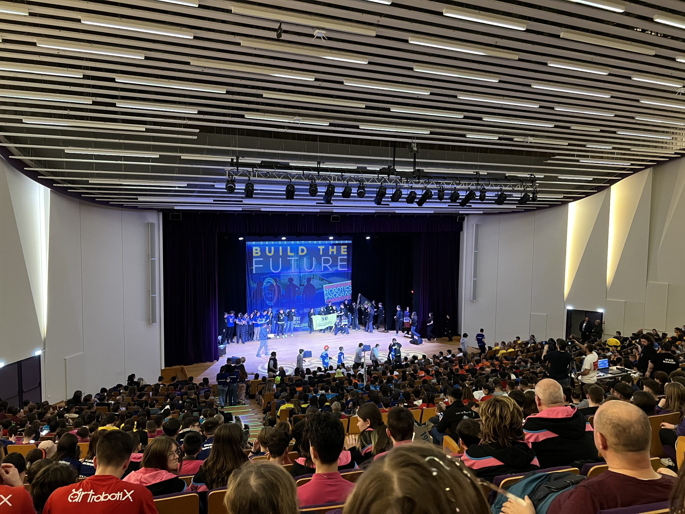

We quickly worked out what came next on the programme for hungry and tired competitors – what else but dinner! After a short visit to our hotel rooms, we set off for the Carrefour Express shopping centre we already knew. Whilst we were choosing between fast-food outlets, our friends from teams DarkEnergy and DecebalTech came up to us. The conversation turned to less competitive topics, chiefly food and the city centre. A long conversation was followed by an even longer farewell, which nevertheless ended with plenty of smiles. In the end the great majority of us decided on the ChopStix restaurant, apart from a few who opted for Popeye’s. With full stomachs and goodies for the road, we made for the nearest underground station.

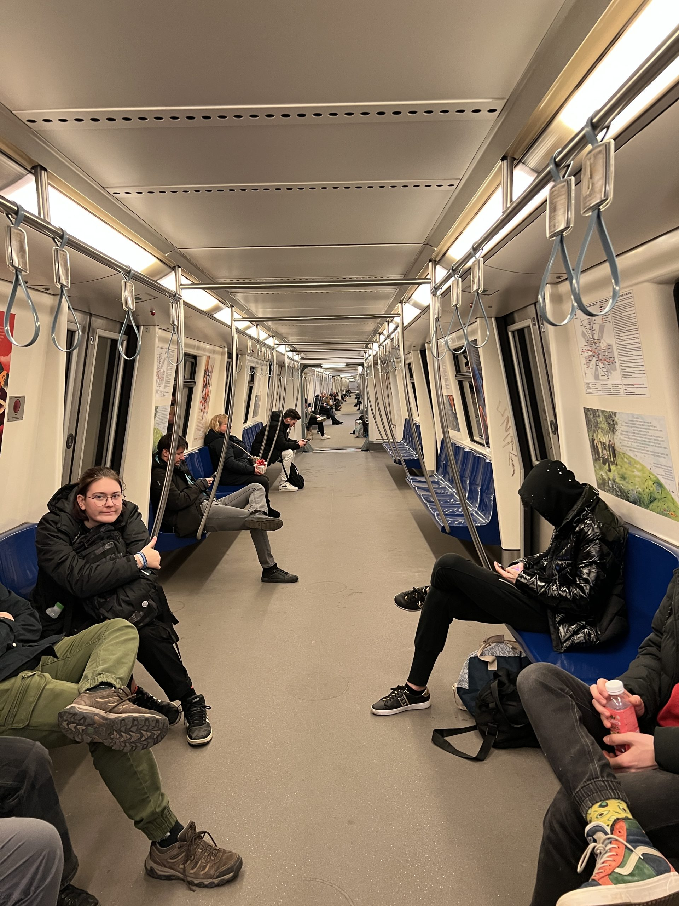

Thanks to a simple system and timetable, we were soon able to sit down on a train, which, in just a few minutes and in exchange for a good half a euro, took us to the city centre, close to the sight at the top of our list – the Parliament. On the way up to the surface we also encountered a simulation of the Karst – or rather of its famous bora wind. A few minutes’ walk brought us to the second-largest parliament building in the world, which we could view from a car park at a suitable distance from the front of the building.

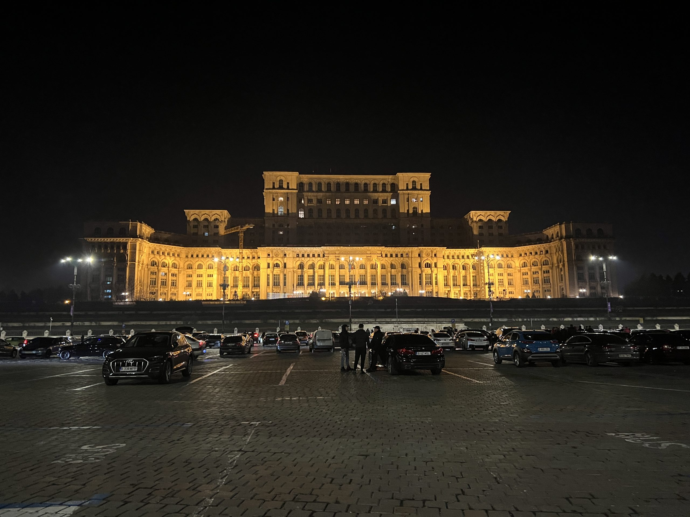

We continued our tour of the city towards the old town centre, adorned with tall buildings, suspiciously dark underpasses and well-nigh unsolvable Kirchhoff loops. Fortunately the narrow streets had many small maps to help with orientation, so we could see sights such as the National Museum without difficulty. Owing to transport constraints we had to hurry, and on the way we could catch only a few closed shops, a church, the National Museum of Art, University Square and the statue of a seated man (Iuliu Maniu). Quick feet brought us to the station by the river in time, and then the train took us back to the neighbourhood of the Carrefour shopping centre.

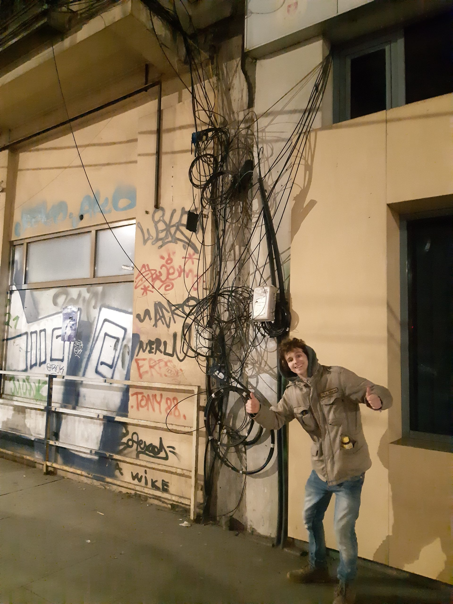

The warmth of our hotel rooms put us in a state of comfort and encouraged one last evening get-together in Romania, which, alas, was partly taken up with packing tools and local energy drinks. Soon it was time for sleep, though for some sooner than for others. The new morning brought new adventures with it. As our flight was in the afternoon, we decided that after meeting two volunteers and swapping shirts, we would visit a sight close by – the lake Lacul Morii. After breakfast and handing in our key cards and luggage, we set off to see it. Our route led through a park which, together with its surroundings, had been worn by time and put us in mind of the Soviet style. The playground equipment and the goings-on were, despite the very pleasant sunny weather, rather uninspiring, if one does not count the military equipment on display in the park. The lake itself, however, is considerably larger than the park, and is surrounded by a running track and arches in a modern-art style, which served as a speed test with the help of pigeons. At the far end one could make out a small peninsula bearing the remains of ancient columns.

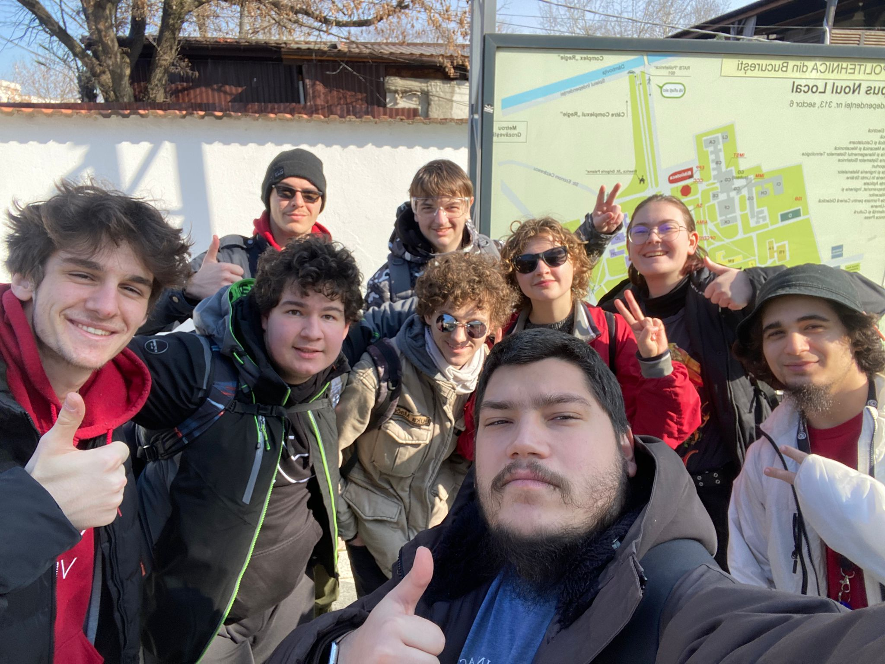

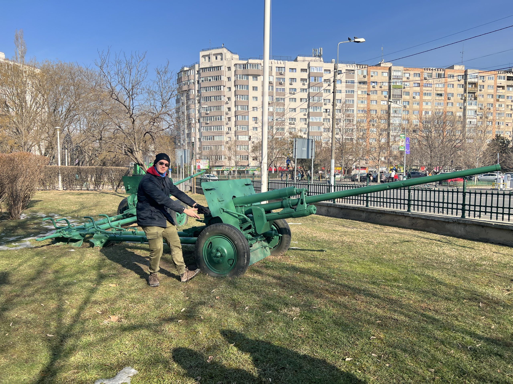

Soon we returned to the hotel, where all that remained was to wait for the Uber we had ordered and for a call from Sin Valentin. The ride to the airport offered us another taste of Romanian driving skills, as well as a look at sights such as the Triumphal Arch (Arcul de Triumf) and the Village Museum. Meeting up at the airport was followed by waiting, check-in and an explanation that the robot’s box did not, after all, contain bottles of wine. During the journey we also published a thank-you video for our supporters on this occasion, Zavarovalnica Triglav.

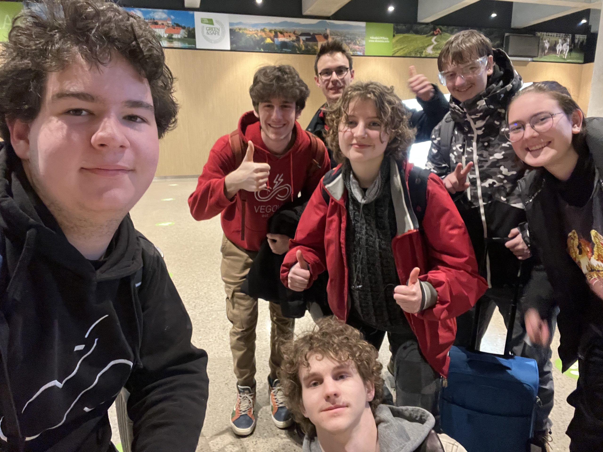

Until next time,  
salut
